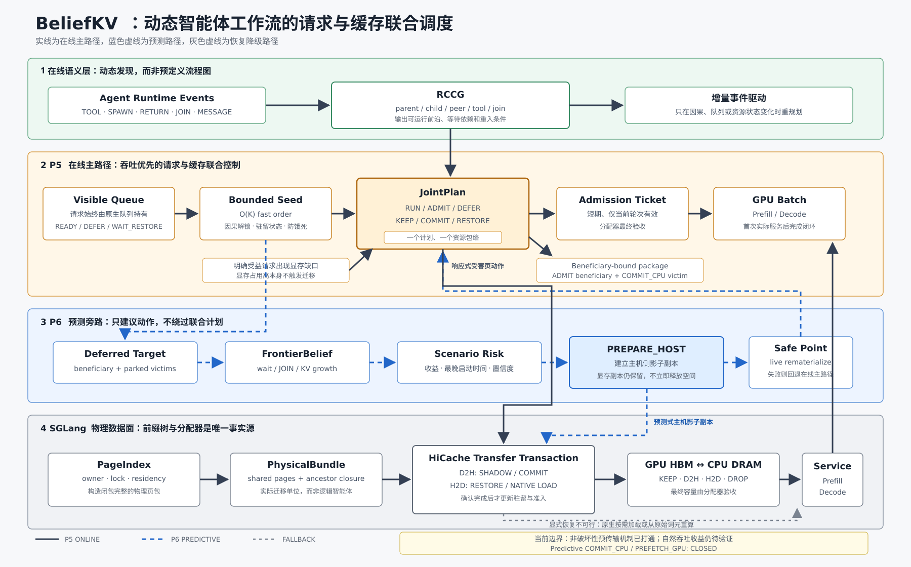

# BeliefKV 当前系统设计

更新日期：2026-10-16（Asia/Shanghai）

当前GPU验证为V70_terminal_root，冻结06f031b、相同dedbe1a0引擎；
2026-10-15 21:10:19 PDT在18474冷启动，V1043/V1045登记与启动，
V1046核验真实GPU服务、源码、配置及相同池容量，V1047记录NUMA
preferred。状态ops/v70_terminal_root_20261015.state.json。
V1044在GPU启动前替换未启动V69，保留旧源码、登记及失败记录；
V68已完整结束并退出0，两次资源空闲观测后才启动V70。
V70包含acae8a1驻留消费配额、e284084同次PREPARE最优闭包复用、
364fa23结束workflow root回收；V1040/V1041各1109项检查通过，
V1042绑定冻结源码。显式ROOT RETURN加WORKFLOW_END才允许原生
私有后缀回收，保留共享前缀、session/generation、锁和在途依赖，
只重试原生延期锚点。root回收与child容量交接、预测H2D分别计数。
实际allocator释放和PREPARE复用不等于端到端收益。
V1048前三窗请求步数236154/246021、371594/386707、
366491/381775，仍落后4.01%/3.91%/4.00%；控制独占墙钟
15.321/30.649/27.014秒。新增提前驻留配额尚无触发记录，
不能把旧resident_aged_priority统计当成新策略有效。

V1049首批密封前缀中提前FULL复用为JOIN53/tool34事件、
1.074/2.485GB，最后ACK到服务P90为15.927/96.278秒。
V1050工具完成前区间P90为84.757秒，原生到达后服务等待P90仍
11.960秒，须分别改进过早恢复及准入消费，不能相加边际分位数。
PDT 21:59为82 completed/1 incomplete；django11087末轮length、
重复正文且无语义完成，无超时/guard干预，保留现有输出预算。

V1037曾混入epoch变化，V1038已更正为显式root RETURN及workflow
结束后的观测；117项至少10秒后累计device FULL/Mamba约19.07/19.90GB、
Host FULL/Mamba约5.70/6.37GB，跨时间且可能共享祖先，不能当作
同时或已证明可回收的容量。实际回收必须由原生allocator判定。
V68完整156项为153 completed/3 incomplete，无error；三个root
length且无语义完成，child/JOIN已结束、无guard干预。
V1048的151个双方completed配对平均JCT为2156.276/2302.910秒，
但P95为5603.914/4999.253秒。143个双方明确合格配对平均
1946.816/2199.727秒、低11.50%，76更快/67更慢；另外8对均有
guard_intervened_completion，5对另缺语义完成，须保留全部结果。
版本、实际需求与native工具长尾差异及质量待验，仍不支持因果收益
或稳定达标。完整官方质量评测在单CPU/8GiB/无GPU下运行，
V1035已导出、V1036绑定环境；资源重叠须记录，完整评分尚未收齐。

V1051在上述同一143对中发现LLM请求/工具调用分别少21.57%/21.81%，
平均JCT低11.50%尚不能归因于调度或预测迁移。调用量各在±10%内、
spawn轮次相同的14对平均1535.346/1483.330秒，5快/9慢；
这是事后粗筛，未匹配token、工具时长及质量，不证明因果减速。
优先完成可以改善平均JCT，但长尾增加并非必然代价。减少暴露恢复等待、
有效KV回收及实际工作量变化须单独核算，不凭复用字节证明JCT收益。

历史V68_partial_restore/e4aa180由V997/V999于18:51:42 PDT启动，
V1000/V1001核验服务与池容量，V996绑定
1832个不重复通过/2跳过，新冻结检查708项通过；收益仍须GPU测量。
本轮同时验证多成员JOIN的中间正文控制合并和部分恢复请求的有界
消费优先级。后者依据已提交请求的现场FULL+必要Mamba缺失字节、
下一chunk输入量和因果优先级，不能授权不完整KV执行。
仅在降低普通准入配额确能改变排序时额外检查老化队首；
保留普通请求轮次及原生前缀、容量和传输依赖。CPU夹具至多多一次
原生检查，真实遍历成本、首次消费和端到端收益仍未确认。
V991说明长ACK到服务间隔至少混合预测过早、摘要及原生准入等待，
不能统一解释为客户端空等，也不能简单整体平移RETURN预测。
V67五个固定窗口及135个completed结果保留，21个未终态项明确
记为有意中断删失；V1002记录资源释放，不补造完整JCT。
原未启动V68_join_body/6815795由V998明确替换，旧源码和登记保留。
工作负载、工具180秒、Host80:20及HBM比率.9沿用，不新增guard。

排队中的驻留消费也是独立优化对象。V1006在V68四个大额工具轮次
的末次完成前快照中未见FULL缺页，下一请求却有0.65–0.81GB原生
FULL Host命中和13.31–14.63秒服务等待。不能把后验命中都当成
完成前预取机会，也不能由稀疏快照断言精确驱逐原因；应检验在已有
完整FULL驻留时提前消费，避免它在服务队列中变成新的恢复需求。
历史未启动冻结c27ca37只用已有新鲜提示发现这种候选，再现场核验双方
真实输入前缀、剩余FULL+必要Mamba恢复成本和下一chunk输入。
更便宜、输入不更多、因果级别不弱才按原生下一批槽位获得有界轮次；
至少保留一次普通准入，独立计数以继续积累恢复/收尾优先额度。
原生准入与执行依赖不变，不为排序新增传输、锁或完整就绪证明。
V1008无命中仍新增扫描的初版已弃用。V1010最终CPU负对照不新增
原生扫描，但全冷提示仍多42–51us，有效提前轮次多69–78us及两次
现场校验；真实长上下文成本与GPU收益待验。V1013绑定1850个不重复
通过/2跳过，冻结726项通过；V1019登记随后被V1044在启动前替换，
其改动已进入V70，V68未热改。
V68首三固定窗只有第三窗请求步数高于历史native；V1023首批全部
108项的1800秒截断完成时间仍为1623.358/1612.092秒，不能宣称
平均JCT或吞吐已胜出。V1018保留错误等待入口的失败，正确V69等待器
曾按PID/argv核验但未GPU启动；检查通过不等于目标完成。

V1024更新密封前缀审计：完成前正FULL计划JOIN107/tool153事件，
提交76/42，提前且下一请求确认复用57/34事件、1.367/3.185GB FULL。
事件最后ACK到服务P90仍16.156/20.919秒，工具最长184.704秒。
每文件独立密封不是原子快照，未知边界不计失败，需求恢复仍单列。
V1025用真实原生RadixKey/reentry方法补测完整CPU规划：
32k/8层与98k/24层合格提前轮次多0.133–0.404ms，两次现场校验；
32k/1024层多3.472ms，输入不匹配仍有队首检查成本。
合成树与CPU索引不证明线上频率或GPU收益，须保留这项风险。
PDT 19:51已有87 completed及1 incomplete；后者root输出重复并两次
触及length，无语义完成、无guard干预，保留预算及原始失败证据。
PDT 19:55为90 completed、2 incomplete；新增pytest6197同样
以length及重复正文结束，无guard干预，全部child/JOIN已结束。

V68第四窗3600–3900秒请求步数仍为372397/388781，控制独占墙钟
17.930秒；短prefill选择线程CPU均值7.539/4.027ms，不能宣称胜出。
开发e284084只复用同一同步PREPARE扫描的最优闭包，收到控制事件
或已有一次原生尝试时重读，保留原生最终验证及逐extent账本。
V1031真实引擎CPU检查730项通过。V1030的12组完整规划中，选择与
回收发布一致；仍有控制交付小幅额外成本及64层夹具37.840ms异常样本。
该改动未热改V68；随后与结束root回收共同通过V1042并进入V70。

V68五窗已收齐，第五窗378536/330775请求步数，控制独占墙钟10.500秒。
V1033首批全108项的3600秒截断完成时间2264.675/2328.684秒，
约低2.75%，90/89项自然完成；48对更快、52对更慢、8对截断/相同。
这不是完整JCT或稳定收益，保留前面落后窗口及质量未验限制。
V1032的提前FULL复用为JOIN62/tool34事件、1.614/3.185GB。
V1034中该结果子集的原生到达到服务P90为454.923/273.754ms；
另8个工具无提前复用事件到达后等待中位数13.907秒。不能用结果
分组证明因果或Mamba就绪，须分别解决过早搬运、再次恢复和消费等待。
完整156项CPU官方质量评测由3204505/start_ticks629116499管理，
完整summary已导出V1035并绑定V1036环境，worker3450470/
start_ticks629378270运行中；单核/8GiB/无GPU，完整评分尚未收齐。
与GPU开发的资源重叠须保留，不当作匹配资源正式实验。

未来冷诊断可在同一采样prefill记录相邻forward±1的前驱结果
处理、后继选择及launch观察点，保留每个阶段绝对线程CPU
端点和同一调度线程的时钟域。阶段顺序/身份与native行匹配后，
才逐段解释已测阶段和间隙；缺项、重复或交叠不做CPU比例分摊。
不新增CUDA同步，不持有原生请求或tensor。215项及12个
subtest已验证回调与计时契约；v751新增CPU约0.03–1.92us/
迭代，尚未计JSON/GPU成本。该开发诊断不回填历史trace，
未进入已登记V61/9e8a574，完整GPU周转与JCT目标仍待验证。

候选选择可在完整身份复核的同一遍历中保留未标记原生请求和
已授权重排位置，最后只回填这些位置，无须再次读取整个原生
队列的metadata/rid。该开发优化不改变安全身份或授权结果，
v746的254项检查通过。v747相同完整CPU周期均值仅少
0.7–19.3us，低幅值视为近持平，不足以解释毫秒级残余。
开发改动尚未进入V61/9e8a574；不要将CPU夹具收益当GPU、
吞吐或JCT证明，先保持19:51冷观察的源码和workload可追溯。

短prefill周转须按同一forward的墙钟区间核算：屏障、物理规划
与交付间隙取交集/并集，不能累加重叠阶段或相减边际分位数。
v743在V59/V58四窗固定47→1→48队列后，前一批遥测入口到
下一run_batch入口、排除已测区间的残余均值为2.614–3.310/
1.201–1.579ms。它混合遥测收尾、采样、接收、维护/选择和等待，
不等同线程CPU、GPU idle或JCT节省。阶段线程CPU仅用于完整
包含的观测，不对截断区间比例分摊。新离线分析不改变已登记
V61/9e8a574或19:51预约；真实周转、FULL消费及端到端目标待验。

完成JOIN后的恢复可以跨越客户端提交，但须将checkpoint来源
与新目标请求分开。开发2d78ab1保留旧请求退休行为，保存原
native session/generation及已知安全输入，只为显式连续前缀、
JOIN已满足且未被压缩的新普通parent请求创建消费绑定。
目标epoch与当前图一致；native尚未登记时可读取旧checkpoint
并恢复缺失页，容量、代际、前缀及必要Mamba仍由原生现场检查。
native登记、上下文变化、取消或过期使接续失效。恢复结束后
消费绑定暂留供驻留验证，不占住其他JOIN的规划入口。

候选9e8a574经v736绑定89份源码和1691项/2个subtest，原
1662身份全覆盖。v737–v739已将尚未启动的V61改登此候选，
保留今天北京时间19:51下限和独占检查，旧登记/代码保持可查。
该阶段是JOIN完成后的恢复，实际HTTP/原生到达可能早于内部
登记，必须用真实submit和同一下一请求的FULL首次复用归因。
不能将其当RETURN前预测或JCT节省。v721批次合并仍未纳入，
模型、负载、引擎和原prefill配置保持，真实收益仍未验收。

内部上下文摘要是独立前台模型工作，不能归为parent纯排队或
客户端空等。v718–v720对完整V59/V58 native各156份轨迹确认
786/749次摘要请求和71/77次空正文length响应；请求区间包含
排队、生成及传输。旧checkpoint的预取保护已有summary开始
失效路径，压缩后的下一请求须重新核对安全输入，不能为提高
预取覆盖而绕过该边界。工具间隔中的显式JOIN等待也须单列。

开发v721在一次交付中按序发布CONTEXT_COMPACT及LLM_SUBMIT，
保留compaction的同步ACK屏障、本地session轮换及错误降级。
108项及2个subtest通过，审计另17项。减少一个逻辑控制批次
尚不证明实际加速；LLM_SUBMIT现在于ACK前采时，验收以HTTP/
原生到达、完整周转、FULL消费和最终JCT为准。已冻结73518e2/
V61与19:51预约保持，摘要模型、预算和thinking策略未改。

JOIN恢复新增已确认的执行依据：最后必需child返回后，parent
下一请求送达前即可恢复安全checkpoint，无须继续猜child时间。
开发48838cd使其在正常final-stage模式可用，保留原有在途burst
和ACK，并保存并发JOIN的独立任务；不能因一项无副本/容量就
阻塞另一项。parent提交或身份/生命周期变化仍使旧任务失效，
最终缺失页、输入预留和原生依赖仍现场检查。语义/EOS较早触发
尚未关闭，后续须分别量化驻留与消费，不能宣称策略已取代。

v701的193次JOIN完成至原生到达P50/P90为130.51/341.47ms，
有后续原生FULL恢复的105次为122.21/262.55ms。这是端点窗口，
要扣除通知/规划成本，禁止人为延后parent来扩大。实际submit
位于RETURN前、完成至客户端提交、客户端提交至原生到达、
到达至观测服务的恢复分别归因；只给同一下一请求确认复用的
FULL字节记消费。73518e2经v706绑定89份源码、1662项及2个
subtest。v707/v708已将后续冷观察登记为V61，停止尚未启动
实验的旧V60等待进程，原冻结证据保留。使用独立V709执行目录，
避免Main新文档提交与原快进约束冲突；Main内容保持。用户将
启动下限改为北京时间2026-10-15 19:51，v713–v715已登记。预约结束
及独占资源确认后才启动，平均JCT/吞吐目标未验收。

v695绑定独立候选43b6310：两处容量修复仅涉及两个runtime
方法和一个physical函数，88份源码及同一引擎保持，35模块
1645项及2个subtest通过，覆盖继承的1620个测试身份。
后续观察须按该候选版本绑定；冷资格不代表部署或GPU/JCT收益，
原V60/9c79eee和预约保持。v693进一步区分恢复后的等待：
成功提前FULL复用子集的JOIN/tool在原生到达后至服务P90
约292/338ms，但JOIN完成前驻留P50仍约2287ms。
不能把这个按复用结果筛选的子集推广到所有机会；继续优化
过早恢复、恢复完整性和首次消费，也继续消除共用控制成本。

Host新备份的容量限制不能抹掉已有冷副本的回收资格。开发
c7bd6ee在原PREPARE预算检查中保留安全输入范围内已备份的
原生FULL叶页/已备份Mamba状态；内部FULL前缀不因此大量
进入维护集合。仅登记身份，不授权驱逐；发布和原生事务继续
检验锁、共享引用、传输及因果等待。2e37ed2的一页零预算
探测同样必须在回收后获得新预算，显式静态零预算不放行。
v688有881项通过；v689无可用叶页控制每轮多0.0195ms，
保留此额外成本，不当性能收益。v685在V59中未见零字节预算，
而FULL回收目标未满足的10099条快照中10096条无发布等待
候选；仍缺同一时刻全量冷页可用性证明。v690保留证据绑定，
两修复现已纳入独立43b6310，9c79eee/V60保持，端到端收益
和完整目标未验收。

v678独立冷候选9c79eee继承d925278，只追加身份相等快路径、
同次准入图状态复用及wire压缩，原harness/模型/预算和引擎
不变。87份源码及35模块1620项/2个subtest已绑定通过，唯一
初次Docker跳过用现有缓存镜像补验。候选上身份CPU快路径少
8.5%–10.9%，强制重建控制保留0.22%退化；其余CPU证据按
精确源码复用，不能把各项百分比相加。原V60登记不改，冷观察
资格不等于真实FULL消费、GPU/JCT或完整目标已达标。

f29ccb4仅压缩控制event传输中的顶层None字段；权威to_dict日志
和from_dict解码含义保持，嵌套null与零值不删除。v671在四份
V59封存前缀中确认图/计数/ACK/计时次数一致，CPU合计少约
3.9%–4.3%；v672完整字段控制合计多2.2%–2.7%的成本保留。
这不是原始批次/socket或GPU/JCT对照。v669的无动作PREPARE
夹具仍以完整闭包观测为主要成本，不能用跳过物理验证或盲目
延长backoff换取表面提速。扩展现已纳入v678冷候选，尚未部署。

24054ca只合并同次分类中重复的图状态判断，并在没有收尾候选
时跳过队列索引。invocation的READY/RUNNING、context身份/
epoch以及workflow结束条件共同决定分类；最终授权仍重新读
终态，不将一次读取升级为跨轮次的可执行证明。v667在相同
父计时范围下的完整CPU事件/维护/规划/选择少约7.6%–10.4%，
稳定队列少3.1%–5.7%，收尾控制近持平。231项运行时检查和
12项计时契约通过；v665/v666计时不对称结果隔离。该开发
扩展已纳入v678冷候选，仍须验证实际周转、FULL消费与JCT。

v662以相邻forward入口继续定位短prefill交接。四个开发窗口的
返回至下一run_batch入口P50为predictive约4.9–6.0ms、
native约2.3–2.6ms，下一入口至结果处理约1.3–1.6ms。
应继续测清并减少下一入口之前的增量工作；不能将整个worker
区间归为GPU计算，也不能把遥测完成观测当全部结果处理的结束。
该区间覆盖遥测尾部、采样、延后规划、接收及维护/选择，尚未
隔离单函数责任；相邻batch匹配仍未固定前缀/压力/实际轨迹。
分析器24项CPU检查通过，不改变冻结V60或冷候选d925278。
同一引擎树核对也仅发现scheduler顺序及测试差异，不能因此
忽略不同恢复路径的实际成本。证据见v662汇总。

7386610为已绑定的不可变请求身份提供同对象相等快路径；
_request_key及最终native选择仍验证全部当前字段。异对象保留
完整字段/严格类型比较和原字段hash，新增契约按dataclass字段
逐一检验身份变化与字典/set隔离。v658的完整CPU夹具少
7.5%–8.5%，异类比较多6.9%–9.5%仍保留；1118项集成通过、
1项固定编码器产物缺失跳过。该改动现已纳入v678冷候选，不以
0.07–0.11ms夹具节省声称已解决完整服务周转或JCT。

此前隔离的调度候选为d925278，v651绑定80份源码、同一冻结
引擎和967项/2个subtest通过；相对V60仅四个生产文件变化。
重复工具反馈5bc57d0及离线时钟修复bc3820e分别提交，避免将
harness轨迹变化混为调度改进。现有冻结V60登记保持。
v652已验证V59/V58完整clock_v2产物及native参考缓存，原始
JCT/需求/迁移字节不变，旧时钟产物保留但不再用于完整分段。
native95.376%的H2D字节位于前1800s；workload迁移阶段不均匀，
须按实际机会与繁忙阶段验证，不能用工具长尾后的全程平均获益
替代关键路径/JCT和服务量证据。

V59完整审计显示迁移量大而提前消费覆盖低：完成前有正FULL计划
的JOIN为162个、提前复用69个；tool为2529/216，提前复用FULL
合计11.398GB。设计须区分预测端点、可恢复缺失页、物理容量、
实际准入和首次消费；先减少控制成本与链路损失，再判断空间。
增加嵌套委派属于研究假设，不能替代当前性能验收。当前child
没有task工具，需明确编译一层可委派child和最终leaf；图/adapter
的层次身份支持不等于harness已经可用。预测保持当前直接parent
的JOIN语义：grandchild返回后child仍须服务/汇总，不能据此恢复
所有祖先。按层更新收尾信号、等待集合、终态引用与容量交接；
估计剩余工作与判断迁移收益仍分别属于模型和runtime。比较时
native使用相同任务分解与质量要求，不用额外无用工作制造收益。
冻结V60/workload不改，细节及CPU补充验证见当前架构状态。

当前CPU优化以最新V59高频路径为依据，v643–v647对照冻结V60：
局部因果分类缓存只失效受影响invocation；在途动作计数按注册/
退役维护；空控制通道先探测就绪，最近有消息则直接接收。
保留事件顺序、ACK、物理信用和完整父计时，GC保持启用。
线程CPU收益分别为20.9%–24.3%、23.4%–69.1%、空轮询18.6%/
稀疏6.4%；连续消息成本多0.4%–0.5%，消息失效负对照多
2.0%–3.0%。CPU场景不替代GPU/JCT、质量或真实频率验证。
752项检查及2个subtest通过、1项Docker跳过；冻结V60未改。

v636将事务类型计数从decode循环内扫描改为事务注册/退役时
维护；读取只做字典查询，完整/部分ACK与失败信用规则保留。
工具预取先处理在途ticket，再检查既有重试时刻，避免尚未到时
仍查询事务。没有改变预测窗口、lease或准入预算；重叠的延后
原因计数顺序有变化，不能把计数变化当动作覆盖变化。最新V59
共2856427次检查、2743143次原延后，具备真实热点依据，但
已按用户新授权完成CPU性能和状态对照，候选不进入冻结V60。

v635要求离线性能分析绑定采集时区与绝对anchor，并用原生
wall/monotonic和client monitor相互核对。禁止把naive本地
Unix起点用于历史墙钟，或复用缺少时钟证据的旧native缓存。
V58 native/V59旧完整时间线的阶段时长与分段统计已隔离，原始
JCT/累计字节和v614独立窗口不因此失效。开发代码支持新路径
重导出，CPU回归已通过、完整重算未执行，不改冻结V60；调度
收益仍须以正确窗口、FULL消费和完整JCT/吞吐共同验证。
独立参考timeline/cache需在初始化时绑定路径和哈希，续跑验证
不变；开发启动链仅在参考run相同时继承文件。切换参考或新
native对照要显式清空环境值，避免进程继承陈旧路径。CPU用例已通过。

v634的执行反馈独立于调度策略：对同一会话、输入和已知文件编辑
epoch内相同的execute观察，持久化次数/墙钟耗时及诊断建议到本次
工具消息，后续KV前缀保持稳定。原输出指纹与长度单列，提示自身
不增加进展证据；相同输出不证明文件或外部状态未变。调查child只
对自己的交付负责，不能把parent完整修复要求误作无限复现任务。
V58该循环没有压缩事件；压缩prompt强化保留仅作后续防遗漏。
当前开发修复已通过CPU消息链检查，未进入V60；新harness须同样给
native使用，实际循环终止、任务质量和性能仍待验证。
真实agent图用例同时覆盖观察预算、反馈保留和早期消息不变；
不得将固定假模型按脚本返回视为真实模型已退出循环。

当前一次性预约期间不进行GPU实验：北京时间
2026-10-15 15:00前（PDT2026-10-15 00:00）。v630暂停
原v60等待器，v632仅在该时刻后重新检查资源/冻结源码并
尝试恢复；用户最新指令允许CPU优化及验证。不恢复每日停实验
规则，v59已完成采集并退出GPU。

下一冷观察V60采用v615已验证的观察事件分类缓存复用，
只冷部署，不改当前V59；v620/v621记录冻结和实际登记。
继续使用不变原生引擎、predictive单侧及V58 native开发参考，
等待前轮完整后处理与资源容量。目标仍是消除周转增量并改善
平均JCT/完成吞吐，不能把72份源码/932项检查或CPU场景收益
当作真实频率、GPU性能及质量验收。

v619把V58最终native尾部从旧运行中快照补齐：最后单workflow
6351.045s中工具覆盖99.551%，GPU均值0.332%、队列始终为0；
76次相同命令成功，最后一次被既有workflow截止取消。
固定两波到达后的需求消退与重复工具执行分别解释这段空闲；
不能据此修改预算、增加guard或推算预测迁移收益。
v618归档V56六份客户端日志的独立内容，保留canonical和此前
失败证据；只在完整压缩比较和关闭/身份重验后释放raw空间。

最新v614的补充负载3600–3900s短周转P50为52.818/43.778ms，
predictive多20.65%，decode服务量少6.37%；前三个窗口的接近
不能替代全部阶段或完整/重复验收。选择及返回交接仍多约
2.9ms，中位数不能相加归因；原V59保持d1c3f14/5262707a。

开发提交3c14655把纯观察事件的图版本推进与准入分类失效
区分开：记录/校验继续，只有状态未变且session稳定时保留
分类缓存；实际驻留、时效、老化与恢复优先级继续重查。v615
绑定72份源码和932项检查，CPU场景成本少52%–55%，只是
局部CPU资格；原生引擎、物理授权及运行V59没有改变。

模型改进不能只看中位数：v611/v612/v616的因果形态/失败调用
历史虽改善中心误差，却新增142–171s级高估，两候选均留在线下。
v609/v610仍区分JOIN入队长尾与tool过早恢复；继续要求足够
提前、真实FULL首次消费以及独立质量/JCT证据，不扩大租约
或用该开发前缀调阈值后直接称校准通过。

此前v606的1800–2100s短周转P50低1.65%、decode服务量高
0.74%；前三窗保持接近开发阶段范围。选择/交接仍有额外成本，
GPU迁移的首次消费及完整JCT尚未验证；第二波以v614为准，继续完整目标，
不将三个不同需求窗口替代同版本重复与质量验收。

当前V59实际服务及65份源码已由v600核验。v604两个完整开发
窗口的短周转差距为9.35%/7.58%、decode服务差距-3.39%/
-3.65%；参考仍是不同版本/实际需求的V58 native，不作因果
或最终收益结论。返回后到结果处理仍有约2.8–3.3ms的中位差，
继续检查下一批启动前的维护与准入及恢复消费。
v602单独核验观察时钟：V59 GPU日志PDT，V58参考Shanghai，
两侧起点与native时钟差约17ms。分析按arm解释墙钟字符串，
不改变原始事件、GPU服务或模型标签；22项离线检查通过。

当前overlap候选把等待上下文物理规划放在前批结果处理和当前
sampling发射之后。forward发射、WAR屏障、前批结果、当前
采样的原生依赖顺序继续保留；planner仍使用当前引用、容量、
checkpoint与原生load fence核验。这样避免物理规划先阻塞
结果交付及采样，但不减少planner自身工作，也不直接证明
GPU空档或JCT下降。normal与不支持overlap的路径保持原位。
v594绑定65份源码、引擎tree5262707a，725项CPU检查和12个
子场景通过；v592相同埋点循环CPU差异在约0.3%内。V59冷观察
需验证真实GPU周转、迁移时机、FULL首次复用和恢复等待。

V58最终审计v596保留154个共同completed任务的平均JCT
2912.078/2310.910s，predictive仍高26.01%。native最后
pylint的deadline error及pytest的输出截断incomplete、两侧
既有硬预算干预都保留；任务质量尚未评分。全程工具长尾差异
不能替代运行服务效率和重复对照。冻结工作负载与预算，
模型继续只预测完成/剩余工作，runtime判断迁移及准入。
以下阶段历史作为依据保留，当前候选状态以v594/v596为准。

v585/v587将短prefill交接按同一采样的相邻forward边界拆开，
239/252样本对账，600–900s平均差7.147ms，主要增量位于
forward后规划区域与下一批启动前，区段不是单函数或纯GPU时间。
v586的root观测收窄在全child完整回调中反而慢24.1%，实际root
服务量只占0.3%–23.1%；已撤回并恢复64份合格源码。继续保留
完整语义监控，优先检查overlap结果交付/采样/规划顺序和维护，
不以微基准或失败候选声称吞吐收益。运行V58及固定预算保持。

最新开发候选bff29cb将闭包验证与缺失FULL/Mamba计数合并，
减少内部节点的session leaf临时对象，仍保留身份、类型、
在途传输和原生提交前校验。v581的3456组捕获、14580组规划/
错误及6种完整扫描一致；有效扫描CPU少3.0%–4.7%，只具CPU
意义。v582绑定27模块/64份源码，1402通过、1项显式Docker
测试跳过；v583绑定提交和不变引擎，未部署当前V58。
开发代码补齐natural-return干预统计及root自然终态标注，
V58原始结果不重写，重算保留24个workflow/26次干预。继续
以在线周转、实际FULL消费、任务质量及重复JCT/吞吐作为验收。

V58尾部新证据：最后单workflow的183.842s中GPU均值46.8%，
queue恒为0；root请求/工具/其他占87.724/90.326/5.793s。
相同绘图检查208次没有workspace变化，去除对象地址后结果
相同；6000–8100s则仍有约95%–96%的GPU采样利用率但batch
逐渐缩小。将模型重复执行、负载消退与恢复/控制成本分别归因。
24个workflow的26次natural-return事件带既有guard干预，
汇总却漏计为0；156 completed不能称全部自然完成或质量达标。
依据`v58_tail_diagnosis_20261014.json`及
`v58_tail_repetition_and_terminal_20261014.json`保留原始证据；
当前冻结native不热改，终态口径与系统性能分别审计。

最新v579绑定全部四窗，同版本周转差距+9.06%/+16.11%/
+7.07%/+6.19%，decode服务差距-9.49%/-5.54%/+2.30%/
-1.04%。窗口差异及任务需求变化保留，全程和重复对照待验。

v577的1800–2100s同版本短周转多7.07%，decode服务量多
2.30%；仍不能从发射墙钟或前两个窗口推出全程收益。v576的
native incomplete来自root两次8192-token输出截断，deadline/
child取消/guard未触发；保留固定预算、未完成及全任务质量口径。

V58 predictive客户端记录156/156个completed；当前native已由同一冻结引擎
启动。同版本120–300/600–900s的周转P50仍多9.06%/16.11%，
decode服务量少9.49%/5.54%，阶段与最终收益均未验收。

v567/v568记录早传且复用FULL为JOIN81事件/1.599GB、工具
210/11.244GB。99个早传JOIN中52个到达native时有保护记录；
保护解除与实际驱逐区分，保留9个未知完成。v570的54个启动
未提交事件中53个有同次回收后零FULL预算，不能据此推断全局
无冷KV。继续协调容量、准入及首次消费。

v571以选中的84个阶段分解工作/速率，主要是剩余工作低估。
v572只用此前已完成child并排除同项目标签的全局token修正，
500ms命中不增且偏晚显著增加，保持离线。v573中H2D估计/
启动窗口/区间余量P50为71.891/1900.228/1732.596ms；该
启动窗口不是物理传输时间。需逐帧检验时机和条件剩余工作，
不将首阶段回放当作真实迁移或净收益证据。

v561/v562核验28个V58 JOIN启动未提交事件：27个同次回收后空闲
FULL仍落在输入/decode预留内，未发布等待候选；有界扫描不是
全局可迁移KV清单。启动到完成P50约473ms，队列到服务P50约
12.79s，继续将传输容量、原生准入与首次消费分开优化。
11个早传JOIN的长ACK尾部中10个以原生到达后为主，确认复用为0；
这不证明所有未确认传输都浪费，也不能删除真实依赖或输入预留。

单叶物理规划沿本次已验证链一次选择最深安全输入checkpoint，
保留完整后缀长度验证、多叶规则及提交时物理核验。v565绑定
1241项和30600组规划/错误对照，只具后续冷观察资格；不将CPU
fixture的约2.8%–6.1%有效扫描减少当作在线GPU/JCT收益。

最新3600–3900s短周转P50为46.489/58.199ms，返回后空档
6.710/4.419ms，仍仅作历史native开发参考；完整同版本结果待验。
v559在窗口后无损归档旧服务端快照11.997GB→287.790MB，当前
工作空间、旧incomplete证据及客户端事件保留。

v556保留1800–2100s及v555封存前缀。短周转P50为
55.449/58.001ms，仍对历史native；工具预取/驻留检查成本较高。
JOIN/tool确认提前FULL复用为32/181事件、0.690/10.186GB。
28个JOIN启动窗口未转为完成前提交，其中27个有FULL拒绝记录、
25个有更早可放入快照；需要按触发时容量和实时准入核验，
不能靠旧快照授权恢复。ACK到服务P90为20.575/13.838s，未知
完成边界及不同需求继续保留，平均JCT/吞吐未验收。

V58于2026-10-14 22:02:57冷部署9a54233/ebdbc183/91daa419，
22:06:10核验58份源码及实际服务；running48、108+48两波及
原预算保持，先predictive后同引擎native。临时21:30恢复的
pidfd_open兼容性失败由v544保留并修复，未在预约期派发。
v551登记完整窗口观察，既有PrefillAdder保留，新增凑批仍关闭。

开发候选只在单FULL叶时复用已经遍历并验证的祖先链顺序，
不缓存跨调用物理状态。多叶来源/深度排序及所有提交检查保持。
v543留存暂停前448项检查；v541的14580组规划/错误结果相等，
单叶CPU约少10.5%–23.2%，完整正扫描约少2.2%–4.8%；多叶
小幅变慢与驻留负对照保留。v547绑定1237项/58份源码，限后续
冷观察，不热改V58。逻辑减负不证明CUDA或端到端收益。

最新120–300s的v549/v550仍有选择与返回后维护差距；历史native
对照的短prefill周转P50为43.793/52.239ms，但版本与实际需求
不同。control_drain和admission是本窗口前两项已埋点成本；
下一步按最新trace定位，完整同版本JCT/吞吐及有用FULL消费待验。

600–900s更新为周转51.504/50.291ms、返回后空档9.362/4.273ms，
tool_prefetch重新成为最大已埋点成本；不能固定采用早期成本排序。
v553主线程active采样597/1744位于stream同步，但含实际数据依赖，
不量化可删CPU；194个读取错误及1个损坏文本排除完整保留。

当前仍以短prefill周转和控制成本、有效FULL迁移与及时消费改善
平均JCT和完成吞吐。V57已于2026-10-14 18:47:37 CST完成全部
后处理，156 completed/零incomplete，冻结0fd9d13/
3c13ad50/572109fe。v535相对历史native平均配对JCT约-5.78%、
完成吞吐约+7.26%，伴随输出工作少11.73%、token速率低5.93%，
不构成独立策略收益。JOIN/tool确认提前FULL复用为1.587/
10.690GB，JOIN最后ACK到首次服务P90仍为19.201s。

GDN新候选继续减少已知prefill元数据回读：使用本批次不可变CPU
mask生成整数行号，当前GPU翻译后的tracking slot按行读取；
FlashInfer checkpoint沿用同一CPU mask/长度/前缀输入。
形状失配、缺失或非普通EXTEND保留原回退，不缓存物理slot值、
不改状态内容、allocator、引用或逐层数据依赖。v533/v534绑定
437原生测试+53子检查、68启动检查，patch ebdbc183/
树91daa419；CPU准备中位增加约20–37us保留，GPU收益待验证。
V58的v536/v537已登记冻结9a54233及58份合格源码，2026-10-14
19:02登记时资源等待器1528612等待其他用户GPU任务释放容量，
尚未派发workflow。
资源可用后重新核验并冷启动predictive和同版本native；新增
延迟凑批、mixed chunk、最小槽延迟和间隔调整仍关闭。
后续控制减负继续针对v523定位的物理闭包和恢复计划构造；
逻辑候选、物理状态、传输就绪和首次服务分别处理，不能将旧的
物理快照当作恢复授权。原平均JCT与完成吞吐目标保持未验收。
实际状态见`experiments/reports/v58_resource_wait_gdn_prefill_20261014.json`。

最新V57的600–900s开发窗口见v516/v517：短prefill完整发射到
结果P50为56.896ms，V56 native参考为50.291ms；返回后间隔
9.757/4.273ms。工具预取self-wall仍为7.327s/300s，逻辑缓存
回放的改善尚未转化为已证实的线上收益。公共引擎和实际需求
不同，独立中位数不可当作逐请求因果开销。

最新第二波v530/v531的短prefill发射到结果P50为60.271/
58.199ms，run返回后间隔7.613/4.419ms；decode服务量约少
10%，不能用近似相等的批次数宣称服务一致。v522在mask查询处
得到206个包含样本/205个栈顶样本，不换算成可节省时间。
预测、逻辑维护、物理提交和实际消费继续分别验证。

等待成员状态按已接收的GraphDelta增量维护；未受影响的JOIN/
tool候选复用不可变身份与顺序快照。原生会话变更只失效相应组，
外部版本变化、批量结束和镜像错误保留完整重建；复用工具计数
已得到的受影响集合。该缓存不存页驻留、容量、传输或GPU就绪。
v507的769010次查询与旧代码及完整扫描逐项等价，包含45223次
代理绑定；完整回放CPU约少30.2%，不代表线上频率或JCT收益。
841项检查和58份源码由v509/v510绑定；v508的强制重建变慢
及v502缺字段导致空绑定的初次无效回放均保留。已部署V57
含设备槽、缩小payload时机和方向级服务缓存；真实预取消费和
端到端验收仍待观察。

以下为此前设计演进与历史证据，旧运行状态以顶部当前状态为准。

服务成本状态按实际证据变化增量维护。原生ACK新增某方向样本时，
只失效该方向的统计缓存；共享FIFO若同时淘汰另一方向的样本，
也必须失效另一方向，包含原先“不支持”的缓存。历史、估计公式、
FULL补充证据过期、最新预测和物理计划核验均不变，禁止将统计
缓存当作页驻留或容量缓存。v491的7395个封存V56查询逐项等价，
重算4656→4372；局部回放CPU改善不构成端到端收益。
v493通过803项检查，v494绑定冷候选；v495/v496已登记派发前
替换为冻结d58e982/launcher2985446，继续包含已验证的设备槽
与缩小payload时机修复。旧等待与docs-sync已终止，记录保留，
V56不变，V57未派发。
本次不是完整状态机化。下一重点仍是发射后规划及迭代维护；
全面零拷贝与通用算子框架暂不作为新路线，也不扩大实验配置。

最新v497–v499是V56同版本第二波3600–3900s参考：短prefill
完整发射到结果P50为55.051/58.199ms，run返回到结果开始仍为
6.017/4.419ms，selection为4.646/2.334ms。decode服务量约
低4.77%，实际prefill需求不同；57/65个样本及12个几何交集不
证明可归因收益，也不是新候选结果。开销依负载阶段变化，必须
逐相位和真实需求诊断，不能固定扣除首波中位间隔。
下文较早V57等待安排以v495/v496为准。

2026-10-14用户撤销每日00:00–06:00停实验约定；23:59自动释放
与旧06:00自动恢复已停用。新冷启动器也不再等待指定时段，
实验依实际资源可用性继续；历史中断与行政删失仍是有效凭证。

当前V56冻结661ed45/b8e7942c/c916d585，predictive已自然结束，
155 completed/1 incomplete，native已于13:18:38完成启动核验；
尚未证明短prefill或JCT/吞吐改善。v455短单请求完整
run_batch墙钟P50为42.163ms，V55 predictive为40.815ms，
小组样本稀疏；旧V29 worker间隔不能替代同版本完整forward。
只读native观测已登记，配置/运行源码保持，新增延迟凑批仍关闭。

最新v469/v470补齐第二波3600–3900s；完整短单请求run_batch
P50为46.018ms，V55 predictive为46.756ms，稀疏匹配不足以证明
改善。v471/v472按独立JOIN/tool等待统计完成前正计划、可放入
空闲列表、实际提前FULL、下一请求确认复用，漏斗分别为
161/161/78/69及1993/277/191/171，确认提前FULL为1.502GB/
10.881GB。容量快照不是预留，后续native Host命中不是早期可迁移
容量的证明。9 JOIN/8工具长尾主要发生在native到达后，3 JOIN/
8工具主要发生在完成前，4工具主要发生在客户端提交前；模型
剩余工作、入队准入及客户端收尾必须分别处理，不统一平移ETA。
v473的服务进度拒绝未见旧端点已耗尽，不自动放宽服务新鲜度。
v474的root输出截断与更早child图预算收尾分开计入质量统计。

容量回收可能将已支持的FULL+Mamba计划缩成较小FULL-only前缀。
开发候选对同key/checkpoint且逐池严格缩小的payload，优先查询
直接耗时；缺少支持时重新查询原较大计划当前耗时作为时机预算。
不缩放ACK固定开销，不扩大物理计划，也不省略最新预测或原生
前缀/容量/代际/事务检查。较大payload成本不是排队/DMA保证。
v480的781项检查通过；v479/v484的708个原直接估计保持，617个
成本查询补上支持，涉及16 JOIN/5工具等待。由于trace缺leaf
代际，这不是完整动作回放。v481普通路径CPU中位多0.162us，
新回退多7.306us；冷GPU与JCT收益未知。v482最终确认提前FULL
复用仍为JOIN69事件/1.502GB、工具171事件/10.881GB。

同版本v488将短prefill问题进一步定位到周转：run_batch中位
42.163/42.150ms接近，但发射到结果处理结束55.989/50.291ms。
run返回后的间隔仍多约5.18ms，含发射后规划、下一迭代维护和
正常依赖，必须在对应调用内分解，不能从独立中位数推可删成本。
既有PrefillAdder保持，不启用新延迟凑批。v486/v487已登记新的
d7980a4冷候选，V56 native和冻结checkout继续保持，最终收益待验。

公共prefill准备路径继续减少CPU/GPU元数据往返。已部署v448为
普通EXTEND保留独立、不可变的CPU mask/seqlen快照，用已有CPU
长度算行号；物理Mamba槽值仍从本次GPU翻译结果选择，禁止将
CPU逻辑槽号当物理槽号。行号显式异步H2D；快照失配、其他模式
走原回退，decode/filter/merge使快照失效。decode完成mask不改。
176组完整元数据等价和383+29项native检查支持冷观测；CPU中位
多5.6–9.2us，并不证明GPU节省。这些小型元数据复制不是FULL/
Mamba KV迁移，不能计入预测迁移覆盖或已隐藏的传输开销。
两侧共用这项准备优化及相位探针，再独立验证调度/预取净收益。
新隔离v463只把prefill本次虚拟Mamba槽留在设备上stack，避免
先.item回CPU再H2D；mask和长度由已有CPU值显式异步上传。
不引入长期CPU物理槽缓存，不改变原生物理翻译/槽位生命周期/
checkpoint或stream barrier。400测试+29子检查与CPU等价支持
冷观测资格；v466/v467绑定3c13ad50/572109fe，未部署。48请求
lazy均值退化也保留，不宣称GPU收益。
这一已验证候选安排在V56完整两侧收尾后冷观察，不能热改或提前
替换native参考。后续以V56 native作开发参考时仍须标明公共
引擎差异，正式JCT/吞吐验收继续使用同引擎对照。
v459的307个同步采样中275个为decode结果依赖，不能因为命中多
就删除等待。active-stack比例与self-wall均不可直接当作可扣JCT。

以下为历史证据，不覆盖以上当前运行状态。

预取覆盖必须区分完成前正计划、当时可放入空闲列表、实际提前
传输和下一请求确认复用。v430/v431的JOIN漏斗为146/146/83/73，
工具为1729/229/147/124；快照可放入不证明时机、驻留或收益。
服务支持缺失也须区分未测形态与历史淘汰。v433/v434的61,229笔
时序评估否定全面替换混合历史：整体支持和误差均恶化。开发候选
保留原估计，仅在FULL-only H2D缺少支持时查询最多32条、300s
以内的独立同类历史，保持原minimum=3和4倍大小范围；补充证据
过期时缓存同步失效。它不补冷启动未测形态，不借用D2H/Mamba
时延，也不改变已有支持的结果。300s是候选参数，不是最优结论。
真实runtime回放保留60,778个原有估计，新增支持涉及18个工具
等待的22条记录，尚未证明这些机会会提交、消费或产生GPU收益。
模型继续只估计时机/服务，动作收益仍由runtime判断；controller
submit→ACK精度与child RETURN、DMA和暴露等待精度分开报告。
v449在实验创建前保留替换旧V56等待器；这些补充历史与prefill
准备优化现已随661ed45冷部署，V55已完整结束，仍未证明JCT改善。

终态统计不能只依赖natural_child_return_count：v438/v439两例各
4个已返回child中，均有一个经历过图硬预算收尾。RETURN时机
训练/评估须结合sandbox审计区分guard促成与自然收尾；root的length截断则
保留为incomplete，不计为成功workflow，也不能归因于KV恢复。

短prefill优化先减少实际共享路径开销，同时保持native对照相同。
当前候选把单request row的Mamba及ping-pong映射改为保形切片，
不改槽位生命周期、代际、状态或流依赖；多行/其他索引继续走
原生高级索引。v423仅证明CPU分配及输出一致、局部少约3–7us，
不能将active-stack命中当作已测GPU同步等待。v426的363项
native检查及29项子检查通过；V55维持旧引擎，V56冷候选同时
纳入JOIN端点修复，先predictive后同版本native补齐完整相位参考。
仍不启用新延迟凑批，不用旧native截断worker区间替代forward。

JOIN预取的工作端点是可更新的估计，不能因计划已选中而冻结。
选择、预测余量与物理入队须使用同一个最新因果request/epoch
预测；终点被进度越过不代表已结束，仅可使用仍有效的upper
回退或等待新预测。入队时仍核验通知、实际服务、工具/EOS及
完整物理身份/容量/依赖，时机失效立即撤销票据。v409在55条
JOIN拒绝中的49条发现已送达的新鲜预测，支持这一实现修复，
不证明动作必有净收益。v412的950项检查与2项子检查通过，
CPU模拟保留约44us额外成本；修复留给V55收尾后的冷候选。
运行中的V55不热改，新prefill延迟/凑批仍关闭，最终收益未证明。

最新V55的完整600–900s相位和历史参考见v407：满批decode已
接近参考，但短prefill截断worker口径仍高35%–50%。新64个
phase样本把选择、发射、结果和GPU stream跨度分开，不能从
旧worker区间虚构native forward。+0.89% request steps伴随更少
prefill工作及拓扑/版本差异，最终平均JCT与完成吞吐尚未验证。
v406确认10个JOIN/67个工具独立事件提前且下一请求复用FULL，
同时保留未知完成和JOIN40次启动窗口仅17次提前提交的缺口。
近期仍优先周转/控制成本及有效提交与消费，不扩大统计口径。

d65ed0f保证原生worker继承外部NUMA策略：启动器管理Host时关闭
SGLANG_AUTO_NUMA_BIND，避免上游默认V2将preferred覆盖为bind。
v393真实CPU spawn验证1→2覆盖及关闭后1→1继承，CPU亲和性保持；
v394保留06:58池初始化OOM、PID1965823和包装脚本，无任务派发。
v396延续41份源码绑定和126项检查。07:11:24 V55恢复服务，v398
已核验源码/引擎、HTTP200与200.050GB实际Host；v392观察FULL
148.310GB在NUMA1、11.690GB在NUMA0，Mamba40.050GB在NUMA0。
实际回退生效，正式对照须匹配策略并报告落点；性能仍待完整验证。
V55保持冻结，新delayer/mixed chunk/间隔调整关闭。v401无损
归档217个旧workspace恢复约24GB空间，不改模型、trace或终态。

当前Host启动策略由9dff40b改为CPU绑定NUMA1、内存优先NUMA1
并允许回退，启动余量恢复8GiB；实际200GB/80:20及HBM、负载、
预测和调度规则保持。新plan冻结策略，旧冻结arm仍按原bind恢复。
v390绑定41份源码、126项启动检查通过，原27份核心哈希不变。
启动前估算不能替代实际NUMA页分布、pool census及服务验证。
最终native对照须匹配拓扑策略；跨旧V29比较仅供开发诊断。

第三次06:28启动已分配200.050GB Host并尝试health prefill，
无完成响应/客户端派发，内核以NUMA1 memory-policy OOM杀死
scheduler1947843，此时另一节点仍有空闲内存。v387完整保留；
不能算作workflow错误/删失，也不能声称未尝试服务。临时6/5GiB
前检余量未解决实际节点压力，已被取代；v379/v382保留前两次
前检失败。新prefill延迟/凑批保持关闭，真实GPU/JCT目标未完成。

V55首个06:00启动止于Host前检：预算200GB加8GiB余量要求
194.26GiB，NUMA1估算192.36GiB。无服务/任务派发，失败现场
由v379独立保留。2e5f58d将启动额外余量收窄至6GiB，不改变
实际Host200GB、80:20或NUMA1；v380绑定此第28份源码并保持
原27份核心资格，实际pinned分配待冷启动验证。时段管理依据
真实PID身份与失败回执收尾，spawn前复用既有Host前检；等待
资源时不创建新采集，不把预检通过写成性能或实际分配收益。

v377关联全部31个保护提前释放工具等待的因果输入：13个root/
18个child，首次H2D提交时均仅1个活跃调用且没有相同输入历史。
22个测试命令，15个child有项目类别支持、18个有规模邻居支持，
但同类短调用中位数不能代表当前长调用。20个事后callback error
仅用于诊断标签，不能作为提交前输入；1个等待有2次调用，
保持单callback/完整工具轮次区别，真实执行起点仍未知。
不据此放开root历史过滤或统一移动ETA；后续检验更细命令形态、
历史支持失效与长尾，冻结V55执行/预算与runtime动作判断分工保持。

JOIN parent身份投影按RCCG/context-session版本复用（6bd0dd3），
不复用物理驻留、输入就绪或容量许可。返回/结束/epoch/重绑/abort
会改变版本，因果错误显式丢弃投影。v374验证六组CPU树的选择、
所有压力发布/动作/记录及native查询数一致；重复投影改善约84%，
完整PREPARE改善3.27%–4.78%，重建时两个完整backed用例退化
1.68%/2.02%。保留重建成本及真实命中率未知，不能声称整体收益。
804项检查及2项子检查通过，v375绑定27份源码；V55允许时段冷测，
延迟凑批/负载/预算及预测模型负责时机、runtime负责传输的分工保持。

v369按全部273个提前FULL独立等待检验保护：JOIN84个中36个
完成前全部保护释放，但25个仍复用0.678/0.934GB；工具189个
中31个对应事件仅复用0.0478/3.437GB，其最后ACK到完成P50
为89.245s。未观测到完成前释放的组分别确认0.916/0.916GB、
11.094/11.149GB。已传输且结果已知的分组不是全体机会，也
不证明延长全局租约的收益；3个工具共享锁关联保留未知。
优先改进工具长尾的有效恢复时机，并联合完整输入恢复/驻留/
准入消费检验；保留JOIN到期后仍复用的反例，不把解锁当驱逐。
冻结V55策略、资格标志与负载保持，最终吞吐/JCT验收未完成。

v364显示7 JOIN/11工具的排队主导长尾中，140个提前FULL命令
均在完成边界前释放3s保护，到达时未观测到锁，且无对应恢复
优先准入回执。15个有采样的等待仍出现Host-backed FULL缺页；
3个无采样保持未知。解锁不是驱逐，稀疏且不验证input的快照
不能证明完整执行就绪或所有预取浪费。因此先校正过早恢复的
时机，随后联合检验输入恢复/驻留/准入消费；单纯延长入队后
保护不覆盖这批完成前已释放的情况。V55候选及租约/优先配额
保持，不用这18个选定样本直接增加全局驻留时间或统一平移ETA。

3a47942按因果图变更集合增量维护全局WAIT_TOOL/family统计，
覆盖上下文成员与终态child的返回目标；版本不连续全量重建，
失败清空counter和成员索引。模型输入值/时机公式/资格保持，
不在这次性能修改中修正训练局部并行数口径。decode文本已在
入口过滤，不会使RCCG版本增长，这一怀疑已排除。
v361最新V54的156个封存client前缀、390742事件、12211个批次
与全量统计一致且无应用错误，最多1235个历史invocation。32个
事件加一次查询的线程CPU均值240.62→206.22us，少14.30%，其中
事件维护成本增加。回放分批/查询不代表在线频率，native/cache/
model/GPU未回放，行政删失仍保留。781项检查及2项子检查通过，
v362绑定21份源码及原引擎；纳入下一V55冷候选，06:00后资源
可用才部署，线上周转/服务/质量与JCT收益仍须验证。
初始v355缺原生叶子/LRU索引导致publication归因偏大，v356
补齐后改为优先观察祖先遍历和等待核验；合成剖析不是线上证明。

6186577仅在多FULL叶子时保留共享祖先状态表，单叶子仍执行完整
路径/身份/环路/命名空间/pending/驻留核验。v351的48组同输入
CPU树输出一致，单叶子线程CPU中位改善13.13%，多叶子中位退化
1.89%、最差9.87%。保留不利数据；线上比例与整体效果待测。
驻留提示仍不验证input内容，不授权迁移。769项检查和2项子检查
通过，v353绑定19份源码及原引擎，同时保留978bdc9证据；V55
下一冷启动纳入两项修复，06:00后GPU空闲才部署，目标未达标。

978bdc9只在新请求首次服务时创建语义进度deque，避免decode每步
求值setdefault默认值产生临时队列；已有空历史也保留。v347的
1200轮同输入48请求回调CPU墙钟均值111.822→91.067us，少18.56%，
顺序/运行状态一致；v348另核验20批分配960→48，已有历史为0。
这些是局部CPU证据，不是GPU、短prefill全程或JCT改善。534项
检查、2项子检查通过，v349绑定14份源码及原引擎。下一V55冷候选
包含此修复；06:00后资源可用才部署，仍须真实相位和消费验证，
不改token观测、工具/终态判断、预取策略或已冻结负载/预算。

v344确认工具时机头训练/在线的active_tool_count口径不一致：
前者为单invocation并行调用数，后者为全局WAIT_TOOL invocation数。
18条长尾曲线全部可逐点复现，有效计数1–6；仅修正为真实局部
计数1使16条更早，P50从1.022秒变0.665秒，实际为152.462秒。
通用时机头目前没有命令细类、shape或历史输入。50ms–5s拟合
horizon不能证明131.072s曲线已校准，但这18条预测在5s内，
也不能简单将长尾归因于horizon外推或已修复的批量中间态。
后续工具输入须分别定义局部并行和全局压力，因果取得命令结构/
历史；模型预测返回，runtime仍依据容量、准入和传输成本做动作。

v345对V54封存工具等待做全量诊断：22099个有最后1秒预测的
轮次，独立轮次绝对误差P50/P90为73.55/586.58ms。少数长尾
不能代表全体，但上述条件中位数也不能当初始预测或未见项目验收。
7397个同样本对照中残余分位数误差中位数更低，却有134个首次
500ms窗口提前超过10s，通用曲线为22个；过期分位数保持无支持，
不直接替换。漏判窗口的569个正FULL轮次仅7个快照有空闲容量。
保持V55冷候选和既有负载，先测控制周转、容量交接、准入及实际
FULL消费；不能仅靠全局ETA平移或扩大预取字节解决这些问题。

v339按独立等待重算预取长尾，分别保留完成前预测过早、原生入队后
等待和客户端后处理。工具长尾中18个完成前占主导，2.330GB未
确认下一请求复用；11个排队占主导，0.870GB中确认0.0478GB。
v341修正v340缺context/epoch与单调时钟的关联问题，精确定位
18个单工具：17个通用曲线、1个项目先验，无相同输入历史。
这说明仍有严重工具时机低估，不能仅改ETA偏移或归因于调度。
工具回调耗时包含后端等待，不能当作实际执行耗时或改动180秒预算。

0481982仅修复批量输入一致性：元数据整批更新后按context发起
一次预测，避免unknown输入被同revision去重固定；单事件路径
保持。534项检查、2项子检查通过，v342绑定14份源码。未改预测
公式/物理许可；实际频率、成本及端到端效果须V55在06:00后验证。

v334/v335完成最新V54全程前缀及行政截止核验。185个已知JOIN与
23994个已知工具等待均有截止前服务，各1个完成边界未知；提前且
下一请求复用FULL为73/1.771GB与160/11.142GB。161/346个独立
等待采样曾有可放入FULL计划，仍有88/186个未成为提前复用，
不能将采样容量当触发时的保证。客户端提交P50约19/15ms，
原生入队到服务P90仍约13.45/12.85秒；准入和容量仍须联合优化。
v336零工作start的后续拒绝主要为FULL/Mamba预算，并非已证明的
终点验证错误。8fec5be保留既有条件，只记录静默拒绝的已有计划
及drain前JOIN身份；267项检查、2项子检查通过并由v337绑定。
无新物理查询/分配/调度策略，实际观测成本和GPU/JCT效果仍待V55。

V54在2026-10-13 23:59:09按预约停止，155 completed与1个
行政删失保留于v326。共同完成子集JCT少11.42%，不代表完整
到达集或同版本因果收益；django-11211仍有重复长工具调用，
不能删掉该任务改善指标。服务器已释放，V55仅在06:00后GPU
空闲时恢复，阶段目标未完成。

v328已将V54的156个完整workspace（含未跟踪文件及删失任务）
逐文件验证归档，2026-10-14 00:53:26后39.014GB源占用变为
4.227GB归档，raw副本清空；trace/结果/计划/删失保持。
归档库存与恢复命令更新既有archive README。可用容量当时
52.087GB（48.51GiB），V55启动前需重新确认，不视为固定容量保证。

v331另将V40–V48的72个server/opportunity日志逐文件比较后
21.889→0.684GB归档，保留恢复指针及client/结果/计划/删失，
V49–V54和native参考直接可读。末次可用65.53GiB，恢复启动
容量检查提高为60GiB。v329已注册首个完整600–900秒只读审计，
核验真实启动身份和源码、按阶段封存证据；夜间不执行实验。
v330的36组CPU对照保持证据相同，匹配list/tuple减少32.1%–66.4%，
但早期分歧有退化。v332的2165个V54截止前目标中2139完整匹配，
26较晚分歧/短输入；保持候选，CPU局部减负仍不能当作GPU/JCT收益。

a843e83将首次服务的list/tuple token前缀转换一次后进行精确
C比较，只转换ACK证据涉及的前缀。不可转换数值保留原逻辑，
不改变原生恢复权限或组件复用证明。新增launch_telemetry为
run_batch的嵌套观测；分析器以同clock domain、forward_iter、
完整请求身份和原生工作几何配对，CPU/GPU/子区间不相加，
旧字段和shutdown缺证保持未知。194项检查与2项子检查通过，
v325更新资格；旧probe CPU微基准不覆盖这次新增观测/转换，
真实性能仍须V55冷测与同版本对照，不能据此宣称吞吐改善。

历史服务器时段约定已于2026-10-14撤销：不再因跨午夜停止实验，
也不再等待06:00冷启动。既有原始trace、截止快照和行政删失保留，
不改变模型guard、输出和deadline预算；按实际可用资源运行，
不停止其他用户进程。

下一阶段目标/goal已建立，当前阶段按用户最新指示暂缓新增prefill
凑批策略。保留正在使用的原生PrefillAdder；PrefillDelayer、
最小空闲槽延迟、mixed chunk继续关闭。先定位并减少短prefill
周转中额外的准入/前缀检查、控制事件、候选维护及结果处理，
分别测CPU发射和真实GPU工作。阶段期望周转差距≤10%、忙时
服务量差距≤5%；最终仍以质量受控的平均JCT和完成吞吐改善验收。
如后续解除凑批约束，共用参数变化须用同配置native评估，旧V29
只作开发参考。不能把917/1039个短prefill均使用graph等同于
所有图外GDN成本一致，也不能把共用GDN成本直接解释为本系统差额。

最新v321第二波3600–3900秒有350521/353757个decode服务步数，
少0.91%；上下文约18.1k，工作量仍不同。108/118个细工作/
邻居匹配短请求raw完成60.326/67.333ms，比参考短7.008ms，
worker却8.112/6.997ms。无H2D逐层采样配对，跨度与等待未知。
v319前一窗口服务量少3.78%，粗邻居匹配raw多10.276ms，
细邻居支持不足。保留方向变化，不能把区间差额当固定forward税。
1a9286e为下一冷版本补逐批观测：每16个prefill记录一次准入、
run_batch、WAR/发布、迁移规划及结果处理的墙钟/本线程CPU，
另用非阻塞CUDA事件记录计算流范围，normal用current stream、
overlap用forward stream。该范围含依赖和发射间隙，不是纯kernel。
native/predictive共用，不持有Req/tensor或改变调度/物理规则。
144项检查、2项子检查及同派发CPU对照通过，增量2.2–4.2us/
循环；真实CUDA事件扰动和GPU收益未测。v322绑定a8f4ea97/
f7e0a895，V54继续冻结，V55按新的服务器时段冷测；/goal仍未完成。

最近部署V54，2026-10-13 21:33:35 CST从45f7afb冷启动，包含
v308服务统计复用和v310局部性提示。v312/v314确认相同真实容量、
不变引擎patch6938bd10、实际提示调用及HTTP200。工作负载与
prefill延迟等参数不变。V53已完成155 completed、1 incomplete
及全部收尾；双方完成的155任务平均JCT为2666.636/3024.858秒，
少11.84%，完成吞吐61.969/61.074 workflow/h。但输出量和轨迹
不同，未见同版本重复/独立质量评估，不能据此完成当前目标。

更近的v317完整1800–2100秒服务步数365441/347017，多5.31%，
上下文均约23.8k token，但新增prefill工作仍不同。控制独占墙钟
25.221秒。细工作/邻批次配对仅35/22例，raw完成64.738/
56.239ms，多8.499ms；较粗905/815例也多8.926ms。18个短
采样GPU/CPU/本线程跨度P50为36.965/34.546/34.545ms，恢复
依赖等待0.0868ms。不能凭decode服务量领先宣布短prefill已解决。
开发ea7cff5仅在全局FULL叶子超过候选8倍时选择候选侧求交，
保留原有顺序与完整物理校验。299项检查、12组同输入CPU对照
通过；差距大的几何减负57.9%–85.3%，普通几何仍额外1.5%–6.2%。
首版边际几何61%–115%退化保留于v315。真实频率/服务收益
未知，候选留待未来冷部署，V54继续冻结。

V54完整600–900秒decode服务步数369578/380722，少2.93%；
控制独占墙钟35.162秒。105/110个细工作/邻批次匹配短prefill的
raw完成均值57.845/55.452ms，多2.393ms，截断worker仍为
10.719/7.094ms。59个短请求的GPU/CPU/本线程CPU层跨度P50
为34.598/34.219/34.217ms，依赖等待仅0.0865ms。缺少native
对应跨度，局部接近不能证明完整forward或全程收益已达标。

V54准入时读取cached_tokens_device的分歧计数无效：原生此时
尚未执行prepare_for_extend，0是初始值。v313修复e4c1931在
首次服务后才比较，要求请求实例/key仍匹配、分层已计算且未
retract，未证据保持unknown、取消保持unserved。414项检查
通过，修复留在开发树；不为统计问题热改当前运行源码。
截至21:59:01的独立前缀审计确认提前消费FULL为JOIN5个/
0.0828GB和tool62个/6.967GB；68个JOIN完成边界未知，保持
未知。ACK→首次服务长尾和容量/触发缺口仍是待解问题。

以下V53窗口与资格验证说明是历史证据，当前运行/分析优先V54。

候选v310为同因果组排序使用低成本session驻留提示，读取当前
FULL/Mamba及在途状态，不比较新请求的token内容。提示明确
input_prefix_verified=false，独立于完整reentry观测并沿用50ms
有效期；仅影响候选顺序，未知走完整检查。原生输入前缀匹配、
物理依赖和容量准入仍决定执行；缩短老化队首普通准入配额时仍
必须新鲜确认实际输入checkpoint，不能把正提示用作恢复anchors。
409项检查含输入改变时拒绝恢复就绪证明，36组匹配输入、不同
Host/GPU布局的真实CPU int64索引对照，完整规划下降4.7%–36.5%。
这不是线上准确率或GPU收益；V54分歧旧计数不可用，有用消费
按真实边界和首次服务独立审计，反馈修复待下一次冷部署。
v309最新3600–3900秒服务量仍少6.05%；v311的16-token及邻居
配对仅覆盖94/92个样本，原始launch→完成差2.440ms，而worker
差2.371ms，不能推为完整forward倍数或全部短prefill的成本。
候选已在V54冷测；新增凑批/延迟/mixed chunk继续暂缓。

V53最新完整1800–2100秒窗口的decode服务步数为357336/347017，
阶段多2.97%，但可见上下文与prefill工作不同，不作全程JCT或
因果加速结论。短单请求原始launch→处理完成为60.276/56.797ms；
同分桶短worker仍有1.17–1.51倍差距，控制独占墙钟为29.833秒。
下一轮候选v308仅复用相同大小/池形态的D2H服务统计；任一方向
新样本都使统计失效，避免滚动历史淘汰造成陈旧支持。动态工具
剩余时间、Host容量和原生副本仍重新检查，不缓存动作许可。
147项检查与九组同输出CPU对照通过；静态重复时下降44%–51%，
新样本频繁时几乎不改善，个别无命中组增加约3.3%。这是有界
局部减负，不是已解决短prefill或吞吐。V53继续运行，候选留待
冷部署，PrefillDelayer/最小槽延迟/mixed chunk保持暂缓。

v299将空恢复检查与完整规划分开：实时原生祖先上没有Host有、
GPU缺失的FULL/Mamba副本时，操作候选可跳过closure构造；
任何正目标或未知仍需完整安全checkpoint、容量及传输依赖校验。
不延长跨轮缓存，不删详细机会审计；缺失Host的诊断数量仍为
unknown而非补零。662项检查及同树CPU对照通过，空路径下降
77%–91%，正路径有6–38us额外成本。V53于18:55:48从02c171a
冷启动；v303确认相同容量、83项不变字段及捷径实际调用，尚未
证明服务收益。v305已完成完整忙时窗口：控制独占墙钟36.154秒、
tool_prefetch6.389秒，分别低于V52的41.287/8.692秒；不同live
轨迹不作因果加速量。decode steps仍比固定native少11.48%；
55组短请求的GPU/CPU/本线程CPU跨度P50仍41.748/41.506/41.505ms，
实际短prefill问题未解决，继续分解图外发射和批次周转。
V52以18:51:35截止的
81 completed和75已到达未完成保留，不能做completed-only JCT。
低频逐层观测增加线程CPU跨度，不把墙钟差额直接归为GIL或收益。

状态：本文是当前算法与系统边界的权威说明。历史版本保存在
`docs/archive/snapshots/beliefkv_design_2026-07-14_zh.md`。

## 1. 研究场景与目标

BeliefKV 面向单 GPU、HBM 受限的动态 Agent 工作流：

- 多个 root workflow 并发运行；
- workflow 在运行时产生工具调用、FRESH subagent、RETURN、JOIN 和 peer message；
- 系统不要求应用预先提供完整 DAG；
- GPU KV、CPU KV 和 raw-token recompute 可以共同参与容量管理；
- SGLang RadixCache/HiCache 仍是物理 KV 与 allocator 的唯一事实源。

主要优化目标是**相同到达流下的成功 workflow 吞吐及 JCT 分布**；
任务正确性、无界饥饿和物理容量安全是不允许交换掉的约束。
GPU service utilization、action throughput、action unlock、reentry/admission
stall、D2H/H2D、recompute 与控制面开销是用于解释因果和判断退化的指标，
不能仅凭 GPU 利用率或预取次数宣称性能收益。

Workflow fairness 只作为有界防饿死和最终 tie-break，不以平均分配 GPU 时间为目标。

### 1.1 当前阶段目标：相对 native 的可验证性能提升

**2026-10-13修订的执行目标：**在固定任务、到达流、模型及容量下，
结合低成本控制、动态workflow关键路径准入、工具等待预测驱动的
KV保留/增量卸载、终态child容量回收，以及按近期准入安排的
predictive H2D，降低平均workflow JCT并提高完成吞吐。正式成功
吞吐必须结合独立质量评测；尾部、饥饿、失败、重算和资源成本一并
验收。模型预测阶段/剩余工作/完成时间，runtime判断迁移与准入，
不要求模型从离线trace学习净收益。

开发只跑predictive并复用固定V29 native；正式验收再进行同版本
重复对照及调度/回收/PREPARE/提前预取消融。decode token/s不必
先赢才能承认平均JCT改善。此修订是当前执行合同；现有`/goal`
仍active且未达标，工具不提供目标正文原地修改接口，不能为替换
正文而虚假完成旧目标。V49已完成采集及收尾；按最新用户要求，
V50已于2026-10-13 14:20:50 CST从02fd87c冷启动，包含当前
已提交的Host回收减负与收尾准入修复。运行源码保持冻结。
V50已于16:22:48行政停止，133 completed、23未完成，截止结果
保留。V51于16:40:12 CST从0990b73冷启动验证容量/恢复消费；
v292迁移规划顺序修复通过468项检查，V52已于17:43:50从3892fe1
冷启动。V51于17:35:21截止：63 completed、45已到达未完成、
48尚未到达，全部保留，不能据此构造完整JCT收益。

v295确认真实V52执行、82项不变计划字段和物理容量；实际服务
证明冷部署，不证明已超越native。迁移路径计数包含空闲循环，
不能称为GPU forward数量。完整忙时分解由v297在监控覆盖后生成，
不会以部分覆盖宣布成功。V51截止前JOIN/tool提前消费FULL为
1.040/12.826GB，停止后完成/首次服务排除，未知边界保留。

当前优先解决短prefill与批次周转。原生有效前缀复用和breakable
graph两侧均实际启用，GDN attention仍在图外发射；不能将
约两倍worker差距解释为关闭graph或大块H2D等待。V51同分桶
仍为1.98–2.23倍，54组短请求的GPU逐层依赖等待P50仅0.0863ms；
首末观测层GPU/CPU跨度P50为42.086/41.927ms，不是纯kernel。

新候选让原生forward先发射，再规划不可变等待context的
JOIN/tool恢复及PREPARE，以GPU在途计算覆盖额外CPU工作。
仅单卡原生支持overlap且关闭执行handoff时适用；空闲不漏执行，
其他路径保留原顺序。完整数据依赖和最终原生容量检查继续决定
执行，模型没有迁移收益授权。移动规划会改变overlap截断边界，
也可能损失提前量；必须共同验收实际吞吐、完整JCT、准入等待和
完成前启动且随后被消费的FULL，不能只报告更短worker区间。
V51忙时decode少9.53%仍未达标；独立profiler不作收益证据。

V52最新完整忙时窗口仍少11.99% decode steps，控制独占墙钟
41.287秒。短prefill同分桶worker缩至1.70–1.94倍，但实际
观测层GPU/CPU跨度P50仍约42ms；不能把调用边界重排等同于
完整forward变快或净收益。两侧实际GDN后端也已核验一致。
继续减少控制工作和定位图外发射，V52已行政停止，V53保持冻结；
完整JCT仍待采集。V52截止前JOIN/tool提前消费FULL为1.279/7.800GB，
56个JOIN边界未知及停止后完成/服务保留删失。

分析每次优先最新实验trace：当前忙时诊断优先V54完整600–900秒
窗口；完整轮次仍为V49。V50/V51截止诊断单列范围，不替代完整性能结果。旧native
可复用已核验参考，旧predictive只补充具体历史比较和复现。

v274确认实际`remaining_report_work`排序、handoff=false以及
JOIN/tool、PREPARE、驻留和优先准入启用；V49/V50只有revision
和patch变化，其余82项计划字段和物理容量一致。HTTP200与真实
GPU服务证明部署，尚不证明性能改善。回执同时保留间歇不可观测
预算：30个近期状态中10个真实预算、20个回退；不能将回退或
较早的有效预算当作完整计划证书。FULL Host回收调用尚为0，
因此扫描优化的线上频率及收益仍待后续压力阶段确认。

V49全156任务收集得到155 completed、1 incomplete，完成吞吐
57.748 workflow/h，低于固定native61.074。155个共同完成任务的
平均JCT2962.757/3039.510秒，P95却8097.639/7342.445秒；保留
incomplete，不据completed-only均值宣布达标。提前消费FULL为
JOIN1.237GB/tool12.073GB，原生H2D3.099TB，需求handoff为0。
部署、V49完整结果与后续优化优先级见现有架构状态和执行计划。

V49后本轮6597555修复两个限制：原生分配组开放时拒绝整个空闲
观测，以及完整恢复仍固定间隔四次普通准入。现在只读已扣除
待释放/预留位置的free-list；同次规划复用，变更后重读。
经新鲜观测确认完整驻留且下一批名额有效时，恢复消费使用实际
预算的1–3次普通准入间隔，仍保留至少一次普通准入；部分或未知
依赖保持原规则。CPU资格通过不代表JCT改善，运行V50不热改。

V50最新忙时片段仍有短prefill约2.29–2.61倍的worker区间，
容量/优先级不是所有差距的完整解释。下轮原低频逐层等待采样
记录CPU/GPU首末跨度，不增加CUDA事件或同步；跨度包含发射
间隙，不能称作纯kernel。Host无效建堆修复实测17690次容量
满足时直接返回，频次不是端到端节省量。按已授权快速迭代
准备封存V50并冷测同workload的V51，保留所有未完成和未知；
最新完整对照仍优先V49。

V50的50组短单请求实际等待样本中，逐层GPU等待P50仅0.0889ms，
worker区间P50为15.2809ms；等待证据不能解释全部差距，旧trace
首末层跨度未知。截止前确认提前消费FULL为JOIN1.454GB、
tool14.897GB，未观测JOIN与停止后完成/服务保持未知或删失。
所有156个workspace无损归档后释放旧目录；新候选按既定配置冷测。

当前成本诊断将prefill/批次切换与原生缓存维护列为重点。v265的
V49完整300秒窗口中，已埋点Python独占墙钟39.679秒，较V48下降
28.55%，decode仍低于固定native16.287%；同粗几何满批连续decode
接近native，不能继续只优化需求handoff。v266第二波GIL采样在FULL
Host回收上观察381/2,355个样本（另有520次采样错误）。修复
write-back重复副本已回收到足够容量后仍全量建堆的无效扫描；
未满足时的原生回收规则、锁及FULL/Mamba执行依赖保持。
每秒Host样本增加累计跳过/建堆计数，实测其调用频率。CPU分支
减负不代表整体JCT改善，采样也不能分离所有native相对差距。
该修复已在V49完整采集后的V50冷启动；最终需测同版本native，
不能将共用缓存优化全归因于预测工作流信息。

JCT可作为主收益指标，不要求decode token/s先超过native。V29完整
同版本156任务对照已观察平均/P50/P95 JCT改善12.869%/13.408%/
11.500%，87个配对任务更快、69个更慢；v264重新绑定原始汇总证据，
保留全部任务。全程完成请求输出token/s仍低3.836%，实际输出也少
5.970%；这不抹掉JCT改善，但尚不能分离轨迹、准入与提前迁移贡献。
正式验收需完整相同到达任务、质量、尾部和资源成本及重复结果；
短期开发重启的未完成任务保留删失，不比较completed-only JCT。

V49于11:31:21 CST从69beb35发起冷启动，单独验证原生需求恢复：
`EXECUTION_HANDOFF=0`，已提交
请求由原生prefill恢复完整必要依赖，动态工作流仍驱动JOIN/tool
提前预取、PREPARE和恢复后优先准入。需求handoff应以净服务收益
证明其额外规划、传输及管理成本；不能用需求恢复字节增加作为
预测覆盖提升。v260确认其余80项计划字段保持，runtime/引擎保持。
部分预测恢复仍只提供前缀，完整输入和必要状态就绪由原生决定。
v258的61个短prefill采样逐层等待P50仅0.0838ms，而worker区间P50
为17.301ms；不据此删除依赖，继续查控制和请求切换成本。v259
较晚GIL样本再次见handoff/准入/reentry。v262于11:36:56核验V49
HTTP200、591个真实服务样本、实际handoff=false与保留开关，
80项计划字段、27项配置及池容量保持；已记录遥测无drop/writer
失败。样本预留4,145 FULL token、1个Mamba名额，性能收益待测。

V48于11:18:44.461620行政停止，84 completed、72未完成，全156
已到达；未完成保留行政删失。v261/v263截止前确认提前FULL消费
JOIN41个/1.060GB、tool164个/9.994GB，34个JOIN边界未知；
停止后5个工具完成/7个首次服务不作终态训练。156个workspace
全量比较、审计退出后再次比较并归档，38.691→4.418GB，只清理
72个该轮已停容器；原始证据和冻结计划保持。

当前目标的执行优先顺序如下，具体实现状态与未来方案须分开：

1. **先验证最新组合效果。**V50同时冷测已满足Host回收请求的
   扫描跳过及3b66033收尾绑定/剩余工作准入，不再作为Host修复
   单因素实验；V49完整JCT已采集。共享修复也应进入最终
   native基线。
2. **关键路径准入与短期局部性。**已有最后一个阻塞child的因果
   排序、resident-first、恢复后优先和终态容量交接。v271已实现
   收尾候选按有效语义剩余工作/报告预算选择，并修复同批通知
   与下一请求的阶段漏绑定，V50已部署、实际覆盖仍待测。下一步结合
   必要恢复成本，降低最后child和可推进parent的累计排队；
   持续调查的straggler
   与真正收尾的child不能只按同一类别处理。root身份不代表即将
   完成，未知未来DAG不作输入，老化与普通请求份额继续保留。
3. **统一等待期间的KV生命周期。**短工具等待可能更适合保留
   HBM；有回收需求且等待足够覆盖实测往返时，才增量备份FULL并
   回收安全冷页。释放的容量应接续可执行请求，预取与驻留绑定
   近期准入。继续及时回收无共享/活跃/在途引用的终态child私有页，
   不备份持续变化的Mamba，必要恢复状态仍由原生确认。
4. **补齐有用提前恢复覆盖。**按独立JOIN/tool事件核对完整安全
   checkpoint、缺失页、当时两池容量、提交与下一请求消费；
   减少重复恢复和未消费PREPARE。正FULL计划不是可执行机会的
   充分证明；不足完整H2D P90的提前量也可重叠部分传输，不能以
   固定时间窗拒绝全部收益。部分恢复仍不授权不完整依赖执行。
5. **以工作流结果验收并分离贡献。**所有任务保留，报告完成吞吐、
   mean/P50/P95 JCT及其他workflow代价。正式用同版本重复实验
   分开调度/终态回收、PREPARE和JOIN/tool预取的增量价值，不以
   handoff字节、CPU微基准或工具长尾替代收益。

收尾优先只作用于显式通知、绑定请求且仍为最后阻塞child的阶段。
有效语义预测减去实时可见的生成进度；端点已耗尽而无正预算时
保持未知，不能凭空当作即将结束。候选已在队首不再被旧阶段
替换，未知或相同工作量保持当前顺序。恢复消费优先、普通请求
老化和有界份额继续生效；没有因此放宽物理容量或数据依赖。
v271通过186项检查及六组原实现对照，这只证明CPU行为修复，
未证明JCT收益；V49以冻结源码完成，V50已包含这些修复。
部署revision及原配置一致性由启动回执和v274独立核验绑定。

v272按已观测的JOIN历史进一步拆解V29全94,892请求：唯一child
关键排队每workflow413.311→211.632秒，多child阶段493.145→
500.390秒。predictive无有效收尾通知的唯一child请求贡献
208.456秒，162个已通知报告只贡献3.177秒。工作流感知调度
应覆盖工具返回后的持续调查阶段，不能只靠最后报告排序；客户端
角色仍不证明实际准入rank或老化的因果代价。

native旧trace有301个成功通知工具、没有stage事件，阶段保持
未知；不能写成native未通知。v273修复非queued模式的本地
stage记录，58项检查通过、queued行为保持，提交fe7b54b仅在
开发工作树，V50不热部署。后续同版本native需补齐这一观测，
不新增控制授权、prompt约束或模型调用。

v270完整V29分解显示，平均少391.198秒，其中root JOIN等待少
268.933秒，root模型请求少108.731秒，root工具少18.935秒，
其他和trace外流程反增5.401秒。JOIN最后child的入队至首次
worker服务等待少194.434秒，root同类等待少22.403秒，合计
55.43%的观测差值；它们是非重叠路径区间，不是已经隔离的调度
因果收益。最后child请求数/输出为24184/3.887M→24270/3.945M，
root输出少15.91%，两类机制均不能忽略。
最大10项改善占净差值71.19%，其输出均更少；两波均有正向均值。
运行轨迹、缓存竞争、请求组成与准入策略未被单独控制，因此既不
将全部收益归为少生成，也不宣称194.434秒全部由优先调度造成。

上一轮开发轮V48于2026-10-13 10:14:57 CST从b8616d1冷启动。
canonical patch3698ce2f/actual tree6d6af094及冻结workload保持，
只跑predictive并使用固定V29 native作开发对照。v253于10:20:19
核验HTTP200、613个真实服务样本、预测器/物理动作、源码/引擎、
27项配置和池容量一致；样本预留4,144 FULL token、3个Mamba
名额，随下一批准入变化。近期准入探测及PREPARE实测预算保持，
启动健康不作为性能改善证据。

v257的V48完整600–900秒decode request steps为323,764/380,722，
少14.961%，与V47的323,881基本持平。Python独占墙钟仍55.537秒；
tool/reentry/handoff/admission为8.377/5.696/5.287/5.437秒。
满48连续decode同粗几何接近native，单请求短prefill仍约
2.89–3.70倍。区间含控制/overlap，不能当kernel或可扣除JCT。
继续降低共用控制、重复规划和切换成本，并独立验证提前消费。

v256独立前缀确认提前FULL消费JOIN6个/43.540MB、tool45个/
3.643GB，43.894GB handoff单列需求恢复。完成前正FULL/启动/
提交25/25/11和430/50/49；服务进度、容量与时机原因可能交叠。
82个待完成JOIN未知，不作为漏取或终态训练标签，也不与旧前缀
累加。新修复已实际执行，但尚未证明吞吐或覆盖相对提升。

e7b0d7a/b8616d1只在成功冷回收、完整计划且最新两池容量/预留/
保护字节可容纳时复用同次选择计划；不可观测、partial、probe或
不足沿用刷新，最终入队仍捕获完整目标，不授权部分恢复执行。
v255绑定472项检查，v254的48组CPU动作输出相同，成功分支
减负84.1%–95.5%，回退最多增加9.09us，不能当GPU收益。

0902199把同一工具调用已经超出首次恢复窗口的事实保留为生存
证据：保护到期但工具未完成后，将旧预测按已存活时长条件化，
与最新预测共同决定剩余时间；旧分布无尾部支持时保持未知。
刷新不抹掉偏差，旧hint不授权动作，实际身份/容量检查仍使用
最新状态；真实工具、revision、session或context变化后清除。
不增加驻留期或agent门禁。v248/v249的一次V46调用有8次恢复/
944.251MB未证明消费，7次后续恢复不满足生存条件化的两秒提前量；
单例不证明总体精度、避免字节或吞吐提升。

V47于10:00:46.068105行政停止：80 completed、76未完成，全156
任务已到达，未完成保留行政删失。v251/v252截止前提前且下一请求
确认消费FULL为JOIN34个/468.521MB、tool158个/10.213GB；
145.072GB handoff仍单列需求恢复。截止前完成107/13,287个，
停止后3个工具边界与4个首次服务不作终态训练。采样可容纳计划
99/271个中65/113未证明提前消费，不代表实际触发容量。
最后ACK到服务事件P90仍为11.087/17.620秒，分母不能混用。
156个workspace全量比较后于10:07:05归档38.760→4.346GB，
raw/结果/计划保留。目标仍active且未达标。

v243的V47完整600–900秒decode request steps为323,881/380,722，
比V46多3.75%仍低于固定native14.93%；Python独占墙钟55.197秒。
满48粗几何接近native，切换/短prefill差距仍在，不证明因果收益。
v244保留897个GIL栈和241次错误，closure有51个叶样本，
remaining_quantile仅1个。v246旧前缀已由v251/v252最终截止资格
替代，不累加。最终dispatch正FULL/启动/提交为93/92/52与
1,967/186/180，tool含3个停止后完成边界，训练按v252过滤。
v242中的可容纳快照不保证触发时容量，
重复恢复和完成前保护过期也不能一律归因到未来准入等待。

V48需以真实工具生存偏差、重复恢复、JOIN提交缺口和首次服务复用
验证修复，再按完整繁忙窗口检验吞吐；启动健康不等于目标达标。

V46于08:47:12.309023行政停止，69 completed、1 incomplete，
38已创建未完成、48未到达，后86个单列行政删失。django-11206
末两次root生成finish_reason=length，无guard干预完成；输出
上限按既有要求保持，v240保留证据。108个workspace全量比较后
于08:50:28归档20.961→2.234GB，原始证据保持。v238/v241截止
前提前且下一请求消费FULL为JOIN42个/1.951GB、tool150个/
11.536GB；handoff的130.613GB单列需求。正FULL/启动/提交为
87/83/47和1,342/181/175；停止后6个工具边界与4个首次服务
不作终态标签，计划到提交缺口和繁忙吞吐继续优化。

v231的V46 600–900秒完整窗口decode request steps为312,178/380,722，
少18.004%；Python独占墙钟55.041秒，仍未达标。满48请求同
粗几何decode接近native，短prefill与请求切换继续较慢；这些
区间含控制/overlap，不是kernel计时，不能从JCT直接扣除。

v232独立密封前缀确认提前且下一请求消费FULL为JOIN8个/
181.924MB、tool73个/6.623GB，65.572GB handoff确认复用单列
需求恢复。完成前正FULL/启动/提交为37/36/11和762/81/77，
仍有显著计划到提交缺口。JOIN arrival到服务P90 457.583ms与
12个ACK事件最后ACK到服务P90 8.584秒分母不同。采样可容纳
正FULL为JOIN526.684MB、tool9.052GB，不证明实际触发容量。
623个PREPARE ACK命令中113个关联后续恢复，不能当净收益。

db68f89/v233在隔离Followup验证后随9e017a1冷部署V47，未部署V46：
有完整服务和排队证据时，PREPARE预算为首个extent的D2H/H2D ACK P90、
两向排队P90及100ms观测周期，不把最大预测提前量当固定恢复
耗时。缺失证据保留回退，慢恢复允许更长预算；344项检查通过。
首个extent估计不代表完整checkpoint往返，执行仍依赖完整原生
数据，Mamba不做PREPARE。目标active，实际收益继续检验。

V45于07:43:41.038655行政停止：87 completed、69已创建未完成，
全156任务已到达；保留行政删失，不作自然RETURN。156个workspace
于07:49:31全量比较后38.815→4.057GB归档，保留raw/结果/计划。
v227/v229确认截止前提前且下一请求消费FULL为JOIN48个/1.342GB、
tool139个/8.774GB；handoff确认复用134.226GB单列需求恢复。
已知截止前JOIN/tool完成126/14,846个，停止后2个工具完成与5个
首次服务不作训练标签，提前复用量不变。采样可容纳的正FULL
计划114/210个，其中66/71未证明提前消费，实际触发容量仍需
检验。JOIN arrival到服务P90 328.469ms与最后ACK到服务P90
8.738秒分母不同；336次后续同节点/池D2H均有此前Host驱逐。

v224按实际工作量细分V45短prefill：单请求小于512 token的
970/1,039批次worker区间为21.403/7.059ms，run_batch入口到
结果处理70.494/53.222ms；同16-token工作组、2,048-token前缀、
CUDA标志和相邻阶段的短prefill仍约2.26–3.53倍native，4,096
token组约0.971–1.009倍。相同后端配置不证明相同kernel耗时，
继续检查控制、恢复依赖与请求切换；保留逐批数据供复用。

JOIN的报告阶段与实际恢复窗口分开：7bc7fbe只在该parent存在
有效恢复ticket时暂停FULL PREPARE，不再以报告通知一概阻止
WAIT_JOIN备份。非继续JOIN、reentry、session、原生在途传输、
锁/引用及完整执行依赖检查保持；Mamba不做PREPARE。467项检查
通过，V45未部署；与c8fa8c7的静态closure及已有副本登记一起
在V46冷部署，v225/v228绑定源码资格，实际机会和吞吐待检验。
v226的769个GIL栈/196次
错误跨第二波到达，不用于把栈份额换算成JCT收益。

v219已完成但仍未达标：V45的600–900秒decode request steps为
337,096/380,722，少11.459%；相对V44多7.962%只是观测变化。
Python独占墙钟54.565秒，worker decode区间34.812/32.467ms；
同粗几何单请求prefill仍约为native的2.65–3.32倍。worker区间
含控制/overlap，不能当纯kernel或可移除JCT；复用v199固定native
摘要，本地分析与采集重叠范围在报告中保留。

v222独立密封前缀：JOIN/tool已知完成33/3,924个，未知76/3个；
dispatch口径完成前正FULL/启动/提交28/27/9和611/54/51。
提前启动且下一请求确认消费FULL为JOIN5个/54.354MB、tool47个/
3.572GB，handoff确认FULL复用46.501GB继续算需求恢复。
节点命令和全部ACK复用不能替代提前独立事件计数。7个JOIN与
11个tool命令在完成前保护过期，须与后来准入等待区分。已知
JOIN native arrival到服务P90为327.615ms，9个ACK事件最后ACK
到服务P90为4.021秒，不合并分母或累加重叠前缀。

v220另一容量前缀有1,385个tool、24个JOIN事件预留后FULL预算
为零；19次DMA期间尾部回收检查仅1次释放1,806 FULL token。
部分恢复只能使用真实空闲/已安全回收的容量；完成部分传输不会
自动补足页，也不授权执行。已有Host副本仍需通过冷等待、引用、
共享依赖、在途传输和驻留保护校验，不能把session引用页全当冷页。

V46已冷部署在Followup验证的改动，V45未部署：静态closure直达
现有静态几何校验，所有动态字段每次重读；PREPARE有剩余备份时
仍登记同次观测中安全输入内的已备份节点，不再等待整个备份完成。
702项检查通过，v221的30组观测输出一致，静态四层CPU减负约12%。
v223的9组PREPARE保持传输选择/原生读取，深层部分副本登记额外
约4.2–23.5微秒。提前候选可见性不等于实际可回收容量或吞吐收益；
继续测容量到提交、完整依赖到服务和繁忙吞吐，目标active。

V44于06:24:32停止，34 completed、74已创建
未完成、48未到达，后122个任务行政删失。108个workspace于
06:29:09全量tar比较后20.932→2.249GB归档，只清理74个该轮
已停容器，原始trace/结果/计划保留。v216最终完成前正FULL/
启动/提交为JOIN63/62/18、tool1,652/203/194，未知边界47/3个。
提前且下一请求消费FULL为JOIN10个/120.177MB、tool182个/
10.756GB，handoff的141.648GB确认复用单列需求恢复。
JOIN ACK到服务P90 13.700秒不等于准入等待；native arrival到
服务P90为494.102ms。封存前缀与早期重叠数据不相加，目标active。

V44于2026-10-13 05:44:21 CST从f55e136/
3698ce2f冷启动，actual tree6d6af094，H2D统计复用和实时Tensor
长度减负已提交后部署。v207于05:48:06核验HTTP200、独立尾部
1,851个真实GPU服务样本、预测器/物理动作启用、源码/引擎、
27项冻结配置及各池容量一致。FULL预留4,144 token，Mamba
预留随下一批名额变化，该样本45份。固定V29 native继续用于
开发比较，下述完整繁忙窗口仍未达标，运行源码冻结，目标active。
v209修复开发重启的历史工作树核验，68项检查通过；首次启动
在创建workload前被源码检查阻止，不能计入workflow错误。

v212封存V44完整600–900秒：312,235/380,722 decode request
steps，较固定native少约18%；可见上下文22.716k/23.240k，
worker decode区间37.655/32.467ms。Python独占墙钟58.511秒，
tool/reentry/admission为7.984/6.057/5.647秒，handoff独占/
含嵌套6.030/18.657秒。满48请求同粗几何decode接近native，
请求更替及prefill附近仍较慢；含控制/overlap的区间不能当纯
kernel或可扣除JCT。v211密封前缀已知JOIN/tool完成23/3,846个、
未知88/2个；完成前正FULL/启动/提交20/19/5和517/55/52，
提前且下一请求消费FULL为JOIN0、tool49个/2.461GB。
需求handoff的41.942GB确认复用单列。JOIN ACK到服务P90
12.565秒，native arrival到服务P90仅425ms，继续区分提前
驻留与后来准入。优先检查同迭代重复租约维护，未部署新减负；
不跨迭代缓存物理驻留，部分ACK仍不授权执行。

工具扫描已在隔离代码中将额外全局租约刷新移到有启动候选、
真正规划恢复容量之前；延后/在途/无候选路径不重复维护。
每轮scheduler、事件、batch和abort维护保持，锁释放失败停止动作。
v214/v215的406项检查及12组等输出CPU夹具通过。156上下文/
4–48租约的维护加扫描线程CPU减负1.6%–34.3%，无租约组基本
持平且保留0.35%退化。仅为CPU资格验证，V44未热改，V45冷部署。
v213采样779个GIL栈、214次错误，closure/reentry叶样本56/26个；
完整前缀观测仍需减负，不将采样或夹具变化外推为JCT收益。

V43于05:27:59行政停止，78 completed、30已创建未完成、
48未到达，后78个任务保留行政删失。108个workspace全量tar
比较后于05:32:08完成20.973→2.501GB归档清理，raw/计划保留，
仅删除30个已停容器。v206最终完成前正FULL/启动/提交为
JOIN92/86/43、tool1,483/203/198，保留14/6个未知边界。
提前且下一请求消费FULL为JOIN37个/753.193MB、tool180个/
12.127GB，handoff继续单列，重叠前缀不累加。

v204确认未提前消费的10个JOIN中9个自然RETURN少估剩余工作
57–303 token，触发到EOS约3.2–14.2秒；另1个随后调用工具，
EOS到JOIN177.49秒须作为终态误判单列。已消费37个自然RETURN
的EOS到JOIN P50/P90为88.846/277.805ms。v208只使用实际RETURN
后可见的历史标签并排除同项目donor做残差试验：76个自然终态
末次pre-EOS样本平均token绝对误差80.936→110.818，P50
70.917→105.738，采样2秒自然触发44→15。负面结果未部署，
不证明全部在线更新无效。下一步保持阶段、内容和服务进度
条件，分别解决剩余工作、工具轮次误判与容量/消费缺口。

V43完整600–900秒服务量比固定V29 native少12.918%，331,539/
380,722 decode request steps，worker decode区间35.340/32.467ms；
已埋点Python独占墙钟53.979秒。v199不证明既有减负的因果收益。
v200对V42同封存事件进一步纠正归因：未证明提前FULL消费的27个
tool ACK/服务事件为3个晚传、22个完成前保护过期、2个总结失效；
10个类似JOIN事件均提前过期。不能把完成前过期归因到后来排队，
也不能用缺少submitted记录否认已经存在的物理提前消费证据。
优先按实时剩余工作和完整恢复成本判断时机，避免一律增加偏移量、
延长驻留或提高返回后优先级。模型仍预测完成，runtime负责传输。

已冷部署精确字节/形态的H2D统计复用，每个有效完成
回执失效；closure读取实时Tensor形状而非跨调用驻留缓存。
588项相关检查通过。v202完整输出一致，Tensor closure线程CPU
减负6.8%–10.6%；含冷查询的4/16次重复估计组减负68.3%–74.2%/
90.6%–93.2%。单次估计/range closure最多慢4.12%/3.0%，同样保留。
v201只有2个含H2D估计栈样本，不能称它为已测得的主要系统瓶颈。
V43未热改，V44继续实测；CPU结果不证明GPU或JCT改善，性能目标active。

V43于2026-10-13 04:28:33 CST从50df863/3698ce2f冷部署前缀
检查减负，actual tree 6d6af094，配置和固定V29 native保持。
v197于04:34:14核验HTTP200、独立尾部575个真实GPU服务样本、
预测器/物理动作启用、新源码/引擎匹配、27项配置及各池容量一致。
FULL预留4,145 token，Mamba随下一批名额变化，该样本一份。
V43已停止并完成上述窗口审计，仍未达标，性能目标active。
V42于04:24:59停止：69 completed、39已创建未完成、48未到达，
后87个任务行政删失。108个workspace于04:28:01全量tar比较
后20.957→2.137GB归档清理，审计退出后才删workspace，只删
39个已停容器，raw/计划保留；v196及现有archive README绑定恢复。
V42最终完成前正FULL/启动/提交为JOIN86/83/46、tool
1,451/178/176，28/6个未知边界保留。提前且下一请求消费FULL
JOIN767.529MB/tool10.163GB，需求handoff继续单列。
v198以同事件分解驻留与服务：47个已知JOIN ACK/服务事件中
ACK到完成的P90为10.065秒，native arrival到服务P90为457.752ms；
37个JOIN/153个tool提前FULL消费事件该项P90为436.449/858.707ms。
量化分位数不相加；ACK间隔不是全部准入等待，早驻留仍有容量
代价，不用这些时间差认定native相对加速。

V42完整600–900秒decode request steps为323,732/380,722，
仍比固定V29 native少14.97%，可见上下文23.254k/23.240k，
worker decode区间36.122/32.467ms。Python独占墙钟55.787秒
低于V41的60.585秒，但不同轨迹不能归因全部减负或扣作JCT。
满48同粗几何CUDA graph接近native，46/47后接prefill区间
仍长9%–18%，部分单请求prefill后接decode同粗几何区间约为
native的2.8–3.2倍。这是包含控制/overlap的worker区间，不是
纯kernel或已定位函数成本。见v190；下一步拆分prefill准备、
恢复依赖和结果处理，并继续容量、完整恢复与服务消费优化。
V41原整队skip仅一次，V42冷部署
按当前下一批已老化FIFO前沿判断：后方新请求尚不能进入时，
省略不会产生恢复动作的整队规划。同一调用共享身份读取，
未尝试的恢复就绪/parent交接目标、rearm和绑定变化保持原路；
普通准入及完整数据依赖仍实时判断。347项检查通过，v186绑定
源码。选定CPU fixture在156/512请求下减负约47%–49%，
young浅树队列则增加0.15–0.21ms/次；真实频率和净收益待验证。

v195隔离引擎优化只减少当前前缀检查的重复长度及正常namespace
函数调用，Host FULL读取当前Tensor形状；不缓存跨调用驻留。
257项原生/61个子检查及45项报告检查通过，27种CPU int64索引
fixture输出一致，成功匹配减负4.3%–19.7%，部分不匹配仅约0.2%。
v194/v195绑定新patch 3698ce2f/tree 6d6af094，已供同配置V43冷部署；
V42未热改，CPU结果不作为吞吐收益，完整数据依赖语义保持。

v192的30秒非阻塞GIL采样保留1,033个栈及286次错误；
selection/launch/result为340/404/164个样本。selection中reentry/
长度/前缀比较叶样本为79/38/27，支持继续检查前缀路径成本。
单次共享祖先复用已存在；不以采样份额替代墙钟或GPU归因，
不通过跨调用缓存驻留状态绕过完整依赖检查，运行源码保持冻结。

v182同封存证据的9,562个最后一秒工具预测事件，事件中位
绝对误差P50/P90为72.214/517.558ms。错过记录启动窗口的
257个事件中仅13个同时记录足够空闲容量；61个候选过早，
类别可重叠，不能视作完整机会普查或未见项目精度。模型继续
预测完成，runtime负责容量、时机、完整恢复和实际消费。

上一开发轮V42于2026-10-13 03:27:54 CST从028bb6b/cf0243b6
冷启动，actual tree仍为c7c27e0d。108+48到达、running48、
Host200GB 80:20、HBM Mamba/FULL0.9、工具180秒及固定V29
native保持。v188在03:32:26核验HTTP200、GC初始化、尾部
520个真实GPU服务样本、物理动作启用、源码/引擎匹配以及
27项配置和容量一致。03:34:07早期快照中新skip尚未命中，
v189在03:36:50记录387次老化前沿skip、395次handoff选择；
计数分母不同，不据此计算命中率或GPU收益。
观测老化FIFO前沿skip的实际频率、同步控制成本、提前FULL
消费及完整繁忙窗口。
Mamba预留按下一批名额动态变化，运行执行源码冻结，收益待验证。

v191在03:47:10–03:47:24封存的V42独立前缀确认提前FULL消费
JOIN6个/90.276MB、tool50个/3.117GB。完成前正FULL/启动/提交
为JOIN24/23/11、tool578/54/53，保留84个JOIN与2个tool未知边界。
最后ACK到首次服务P90为11.263/2.653秒，handoff仍单列需求。
不以这段原始数量对比更长V41，也不把未知完成边界当漏报。

V41于03:24:35行政停止，21 completed、87已创建未完成及48
未到达，135个任务保持行政删失。108个workspace于03:27:39
全量tar比较后20.861→2.296GB归档，仅删除87个已停容器；
审计退出后才清理，raw/结果/计划保留，维护先于V42。见v187。
最终完成前正FULL/启动/提交为JOIN47/47/18、tool1,021/151/144，
保留63个JOIN与3个tool未知边界。完成前启动且下一请求消费
FULL为JOIN8个/82.801MB、tool134个/8.932GB；最后ACK到
首次服务P90为6.153/2.698秒。容量、恢复完整性及准入消费仍待
优化；残余原生FULL Host-hit 0.832GB/0.884TB不等于oracle空间。

v180对已停止V40的最终审计确认完成前启动且下一请求消费
FULL：JOIN34个/500.408MB、tool150个/10.422GB。已知边界
正FULL/启动/提交漏斗为JOIN80/79/41、tool1,394/170/165；
31个JOIN与7个tool边界未知。最后ACK到首次服务P90仍为
9.042/15.321秒，需求handoff单列。残余原生FULL Host-hit
1.669GB/1.238TB不证明全是预取机会，不与v176早期前缀相加。
重点仍是正计划到提前提交的缺口、实际完整恢复和服务消费。

V40于02:46:16行政停止，62 completed、46个已创建未完成和
48个未到达，94个任务单列行政删失。108个workspace于02:51:17
再次全量tar核验后清理，20.943→2.117GB；初次检查被只读
审计进程阻止时未删除源数据。仅删除该轮46个已停容器，
raw/结果/计划保留，维护早于V41，v180及archive README记录恢复。

V40完整600–900秒仍比固定V29 native少14.07% decode request
steps；60.013秒Python独占墙钟是控制诊断，不能扣作JCT。
v176独立早期前缀确认提前消费FULL为JOIN63.406MB、
tool560.599MB，保留95个未知JOIN边界。v178的非阻塞GIL
采样保留867个样本和246次错误，使用qualified归并报告。
现有共享祖先复用已实现，不再把它当作缺失功能。

V41冷部署优先移除已耗尽候选的handoff重复整队规划。
当前请求字段与attempt集合决定是否仍有可尝试对象；
新/变化/rearm身份仍经过原路径，普通prefill仍使用原生完整
依赖，不能靠部分ACK执行。265/337两批重叠检查通过。
v179真实inspector的选定CPU fixture中48请求/64层树
线程成本3.017→0.115ms，实际频率和GPU/JCT收益仍待验证；
V40未热改，容量/模型/patch保持，目标active。

等待parent的冷页资格按当前恢复事实保护，不能仅因child
发出收尾通知就保护整个最终报告阶段。V40冷部署保留实际
同parent恢复ticket和节点驻留租约，继续验证原生引用、Host
副本、身份及在途状态；READY/终态parent不参与等待回收。
FULL已有Host副本但Mamba仍活跃无副本时，只回收FULL。
434项相关检查通过，v172绑定最终源码；V39采集期间未热改。

V39完整600–900秒窗口为332,453/380,722 decode request steps，
比固定V29 native少12.68%，Python独占墙钟57.799秒不可扣作
JCT。v170早期前缀确认提前消费FULL为JOIN13.804MB、
tool250.163MB；96个JOIN边界未知，容量拒绝不能当作没有
安全冷页的完整普查。目标仍active，下一冷轮检验实际释放、
完整恢复、下一请求消费和控制成本，而非仅增加候选/ACK数量。

上一开发轮为 V40（9f42c24/cf0243b6，实际 tree c7c27e0d），
于 2026-10-13 01:57:38 CST 冷启动，固定复用 V29 native，
不每轮重跑 baseline。上一轮 V38 的完整 600–900 秒窗口
decode request steps 331,016/380,722，仍少 13.06%；已埋点 Python
独占墙钟 59.102 秒不是可扣除 JCT。v162 同一封存前缀确认完成前
启动且下一请求复用 FULL：JOIN 21.176 MB、tool 2.079 GB。
性能目标仍 active，不能以路径已部署或 ACK 数量判为达标。

V39于01:53:51行政停止：31 completed、77个已创建未完成和
48个未到达，后两类125个任务行政删失。108个workspace于
01:57:11全量核验后20.890→2.492GB归档清理，只删除该轮
77个已停容器，raw/计划保留。维护早于V40，v173及现有
archive README保留恢复路径。V40在02:04:16已核验HTTP200、
GC初始化、尾部565个真实GPU服务样本及物理动作启用，各池
容量和27项冻结配置等于V39；v174绑定源码/引擎及独立输入尾部。
Mamba预留随下一批请求名额变化，不是固定一份的配置字段。
v175早期等待者释放包含需求路径，尚无wait-prefetch实际回收；
不将启动或CPU资格检查代替GPU消费或吞吐/JCT收益。

V39 先降低数值查询与窗口外工具扫描成本。固定单调分布
的条件绝对中位数不会提前，因而可计算最早可能进入预取 lead
的重查时刻；历史支持转回 operational CDF 前须重查，新通知
立即失效旧缓存。未知/不合法分布不使用推导延迟；runtime 仍
决定是否传输并重验实时身份、缺失页、容量和执行依赖。二分
quantile 查询保留原数值语义，不调整预测值或动作收益模型。
472 项检查通过，真实曲线/扫描 CPU fixture 有改善，但尚无
新版本 GPU 吞吐证据。保持部分恢复后继续回收及 ACK 重规划，
部分 ACK 不代表整个 checkpoint 可执行。

v166 同一前缀的固定 JOIN 偏移在后半事件上增大误差，不部署。
首个传输经常早于 RETURN 3–11 秒，而最后滚动预测 P50 仍晚
428 ms，二者须分开优化：触发后重新预测没有撤销已经开始的
传输；完成前耗尽租约也不同于 parent 提交后的排队。
V38 已于 01:15:52 CST 封存行政停止：84 completed、72 行政
删失；156 workspace 全量核验归档后于 01:19:38 冷启动
同配置 V39。运行源码不热改，后续验收仍看真实提前消费与
繁忙窗口成本。v169 于 01:26:33 已核验源码/引擎身份、
27项冻结配置与各池容量、HTTP200、GC初始化、独立日志
尾部556个真实GPU服务样本及physical_disabled=false。
实际FULL/Mamba预留保持4,145 token/一份；启动服务与
CPU fixture均不能代替后续有效消费及吞吐/JCT验证。

以下 V130/V129/V128 为历史决策依据，不代表当前运行版本。

V130 区分正常 EOS 事实与 protocol-only 回退窗口。
已确认正常停止、可见正文且无工具证据的请求，在 child
尚未 RETURN 且请求/session/context 身份仍有效时，按
既有 restore lead 与语义身份寿命保留有界终态证据。
当前 2 s lead 下允许最长 2 s；stage 到期时间锚定
真实 EOS，不因重新规划而续期。普通工作预测继续要求
服务进度，child RETURN 或新工具/身份变化立即失效；
这不延迟 agent RETURN，不保证存在容量或后续复用。

同一封存 V30 输入的 49 个完整自然 ALL JOIN 中，
EOS→RETURN P50/P90 为 98.900/273.410 ms，7 个超过
旧 250 ms。34 个启动未提交事件中，5 个随后在
EOS+250 ms 至 JOIN 完成之间记录进度不可用；容量
不足与此原因可重叠，不能外推为全部损失。318 项相关
检查通过。两项修订现已用于 V31 的 5c1a646/7b4832ef
冷启动，单跑 predictive、固定 V29 native；实际运行
确认 EOS 证据窗口 2,000 ms、physical_disabled=false，
客户端于 12:55:22 CST 启动，尚无完整性能或覆盖结论。

V30 于 12:49:22 CST 行政停止，快照记录 80 completed、
1 incomplete、75 删失。旧 Host 池内存释放滞后导致 V31
第一启动尝试仅在 NUMA 预检退出，容量恢复后复用同一
冻结计划，未更改 pool 配置或跳过预检。原始轨迹继续
保留；156 个已停止 workspace 经逐文件核对后无损归档。
12:56:26–12:59:24 CST 归档维护及自 12:41 CST 的本地
开发须在重叠 V31 性能窗口中说明，不作为因果性能收益。

V129 在独立 followup 将 FULL 容量交接与不必要的状态
备份解耦：只缺 FULL 空间时，符合既有冷页/身份/引用/
传输条件的 Host-backed FULL 可以释放，活跃 Mamba
继续留在原生 device pool、保留引用与 LRU。此路径限定
FULL/Mamba 组件组合；同时缺状态槽位或不支持的树仍
采用原生备份/ACK 路径，不释放唯一有效状态。实际 CPU
allocator 回归证明旧路径为 FULL 回收多发了 Mamba D2H，
新路径释放 FULL 后再次恢复仍可复用同一状态。157 项
原生检查和 182 项运行时/审计检查通过，仅证明组件及容量
契约，尚未量化该依赖对真实覆盖或 GPU 性能的影响。

V30 的独立封存前缀于 12:11:56–12:12:14 CST 读取；
48 个已观测完成 JOIN 中 38 个记录完成前容量截断、
38 个进入窗口、仅 4 个提交。3,794 个完整工具等待中
1,268 个出现容量截断，启动/提交为 12/11。原因可重叠，
69 个未知 JOIN 边界不算失败；提前 FULL 复用为 JOIN
2 个/17.224 MB、工具 7 个/403.825 MB，不将部分采集
总量与完整实验比较。v129_v30_sealed_prefetch 保留
独立输入长度/SHA256，跨文件不承诺原子快照。V30 继续
冻结为 fca7ad3；本次回收修订仅在 followup，目标仍 active。

V129 的完整 300–600 秒 V30/V29 native 开发窗口观测到
345,167/344,185 个 request steps；整体 decode worker
区间均值虽为 35.414/36.991 ms，48-request/上下文匹配
桶中 predictive 区间仍高约 2.1%–2.9%。这些区间不是
孤立 CUDA kernel，需求/粗分桶也不能支持因果加速。
本地分析自 11:52:47 CST 与该窗口重叠；Python 独占
埋点累计约 42.598 秒/300 秒，继续测清控制路径成本。

V128 的完整 V27/V29 对照将当前覆盖问题定位在提交之前：
JOIN/工具提前 FULL 复用事件由 90/479 降为 25/17，
合计 9.581→1.330 GB；V29 已发出的正 FULL 节点命令
均确认复用。两轮模型、lead 和物理/workload 配置相同，
代码/引擎补丁不同，等待事件没有减少。
严格完成前工具启动为 504→17；JOIN 启动为 129→147，
提交却为 92→25。因此继续协调启动时机、容量回收和
最终入队，不以高 ACK 复用率或较少预取自行证明收益。

V117 在 fit/回收中保护下一批原生预留，旧 fit 快照不能
直接当作新版可用容量。V29 有 293 个工具事件在正计划
被窗口挡住后变成无 detail 的零计划，形态与预算裁剪
一致；旧日志缺少精确 no_step_reason，保留未知而不做
单因归结。原约 165–180 ms 物理启动窗口仍需结合预测
区间，真实容量和近期服务消费共同判断。已排队
V121/V126 用真实 GPU 继续验证，不取消原生依赖/容量
保护来追求动作数。证据为 v128_v27_v29_prefetch_drop/
funnel；本地分析从 11:35 CST 开始，重叠窗口标注负载。
V29 native 在分析期间完成 156/156，9195.415 秒；V30
于 11:45:12 CST 从 fca7ad3 启动单臂 predictive，固定
复用 V29 native。本次证据/文档只提交 followup，正在
采集的 V30 源码和补丁保持冻结，性能目标仍 active。

当前目标的开发执行频率按 2026-10-12 新约定调整：
V127 的 cddd60d 默认只运行 predictive，固定引用历史
native；待启动 V30 引用 V29 native，不再追加新的 native
采集。基线写入冻结计划并在后续轮沿用，开发报告保留
版本、补丁、配置差异与任务配对，并复用已有 native 汇总。
61 项相关检查通过，V29 正在采集的 native 继续完成。

最终目标仍是相对 native 的可归因吞吐/JCT 改善。开发
筛选可以复用基线，正式验收保留重复配对；当 native
执行路径、workload、物理容量或 harness/工具配置变化时
刷新基线。以下历史条目的逐轮 native 要求由本段覆盖。
本地 V127 开发从 11:14 CST 开始，重叠窗口继续标注。

V126 的 ce56b8f 让 JOIN 的触发使用当前语义工作区间，而
不只检查中心预测是否进入物理传输窗口。所选工作端点与
已推进后的下界之差，用当前 decode 速率换算为提前余量，
与实测 H2D、入队和观测间隔合成，受提前驻留上限约束。
初选、回收后规划及最终入队采用同一公式，ticket 保留
已选端点；新工具、失去服务或区间变化继续影响提交。
预测头仍不判断预取净收益，未来 RETURN 不作为输入。

V29 最后一次被窗口拦住的正计划中，108 个 JOIN 的真实
剩余 P50 为 553 ms，预测高估 P50/P90 为 778/1,518 ms；
1,239 个工具事件对应 310 ms 和 9/331 ms。下一 V30 将
提前驻留上限由 500 ms 改为 2 s，验证这类近终态机会能否
转化为实际提前 FULL 复用。工具保留 V121 条件 P50-P10，
JOIN 使用自身工作区间，不固定平移所有预测或要求完整
传输必须在边界前完成。365 项检查验证提交行为，实际收益
仍须由冷启动 GPU 对照确认；保留 v126_v29_trigger_gap。

空间是独立限制：真实边界前 500 ms/2 s 内有明确适配
空闲池快照的 JOIN 为 38/61 个，工具为 39/67 个。正计划
不代表持续可用空间；需要同时观察冷页回收、下一批准入、
提前驻留和首次服务消费。当前 V29 冻结，V30 未启动候选
纳入 V120-V126。本地开发从 10:43 CST 开始，重叠窗口
标注开发干扰，最终性能与归因目标仍 active。

V125 的 23ad8a5 修复离线机会判断：计划观测保留相对完整
JOIN/全部工具 END 的有符号时间，严格用完成前的快照判断
当时有无正 FULL 计划。计划时间不是预测误差，结束后的
Host 命中不是提前可恢复量；快照的最大字节也不是累计 DMA
或 oracle 收益。68 项审计用例通过，没有增加运行时观测。

完整 V29 在完成前有正计划的 JOIN/工具事件为 164/1,416，
提前启动且确认下一请求 FULL 复用的事件只有 25/17，合计
1.330 GB。工具正计划最大快照合计 113.891 GB，其中只有
95 个事件出现过明确适配空闲池的快照、合计 2.542 GB；
1,239 个在结束前记过 before_start_window，原因可重叠。
因此优化同时涉及触发时机、容量和近期服务，不能只追求
更多 ACK 或传输字节。16,553 个工具事件在结束前只有零
计划，后续 316.676 GB Host 命中也不能算作可预取分母。
保留 v125_v29_wait_plan_timing 的逐事件证据。

继续同时降低控制成本和利用动态 workflow/tool 信息：
JOIN 进展、终态 sibling 的容量交接、长工具等待的 FULL
备份/卸载以及恢复后的快速准入。只在物理副本和执行机会
真实可用时传输缺失页；模型预测完成/剩余工作，runtime
决定迁移。V30 保持排队的 V120-V124 运行时改动并纳入
V125 离线归因与 V126 时机，当前 V29 冻结。单个忙窗的 decode 改善
不能替代完整成功 workflow 吞吐/JCT 或预取收益归因。

V124 的 bc33cb8 让等待候选按图/session 绑定修订缓存，
只在需要时生成相应类别。缓存是因果成员信息，parent
排序、工具轮转不变；终态、取消和绑定变化使它失效，
实际容量与恢复闭包仍实时读取。407 项相关检查及八组
CPU 对照保持完整动作/轮转/发布；156-workflow 维护与
PREPARE 合计成本约减 4.86%-6.56%，每步图变化时约减
1.96%，但维护子项仍增 3.97 us。原生入队与模型提交为
stub，这不是端到端收益证明，保留首轮及最终 CPU 报告。

V29 的 18,775 个工具等待事件只有零 FULL 计划观测，
下一请求仍有 351.592 GB 原生 FULL Host 命中；有正
计划的 1,494 个事件另有 377.437 GB 残余。零计划不能
直接解释为没有未来需求，也不证明当时已有可预取副本。
继续区分等待时可恢复 checkpoint、观测时机与后来被
驱逐的数据，模型预测完成阶段/剩余工作，runtime 结合
容量和近期服务机会决定迁移。真实提前且复用的 FULL
只有 JOIN 675.144 MB、工具 654.356 MB；107.091 GB
handoff 是需求恢复。控制成本和有效提前覆盖共同决定
能否超过 native，完整吞吐/JCT 与可归因收益目标仍 active。

下一冷启动候选包含 V120-V124，V29 执行不变。V124
开发从 09:53:25 CST 开始，对重叠 native 窗口保留限定。

V123 的 941156c 只优化传输服务估计的样本筛选：同次扫描
分类精确/兼容形态，已知不兼容形态先跳过尺寸计算，仍保留
unknown/旧 tuple 支持及原顺序。408 项相关用例与 120 组
完整输出等价对照通过。四组实际 256 样本历史的等权 thread
CPU 累计约减 17.1%-19.2%，旧 tuple 约减 1.6%；个别
unknown/FULL 查询可增 15.6%/8.6%，不声称所有场景加速。
这是局部 CPU 证据，不是迁移、GPU 服务或 JCT 改善证明。

V29 predictive 已 156/156 completed，运行 8991.395 秒，
同版本 native 尚在采集。首个完整 300-600 秒窗口的 decode
吞吐为 1219.89/1140.88 token/s，predictive 约高 6.93%；
总 H2D 为 565.544/634.388 GB。但 JOIN/tool 标记 FULL
仅 4.321 MB，17.003 GB handoff FULL 是需求恢复，不能用
该窗口证明提前预取带来吞吐收益。匹配实际小 prefill 仍慢
1.476-1.921 倍，已埋点独占 Python 墙钟为 41.441 秒/300
秒，仍需压缩共用服务路径成本并提高提前 FULL 消费覆盖。
保留 v123 两份同版本窗口报告及传输估计 CPU 证据。

下一冷启动候选纳入 V120-V123，冻结 V29 执行不变。V123
本地开发从 09:19:18 CST 开始，晚于 native 首个窗口结束；
后续重叠窗口须标注。完整相对 native 的 workflow 吞吐/JCT
与可归因预取目标继续 active。

V122 的 7749e32 只在同次同步规划内复用请求身份，恢复
锚点仍校验当前语义绑定；身份或图版本变化继续使规划失效。
驻留只在可以改变同一因果组内排序时检查，单候选组不检查，
但选中的 handoff 仍读取自己的安全 checkpoint。组大小
属于纯因果分类，复用已有版本化缓存；年龄扣减只作用于
本次副本，不缓存未来准入或物理驻留。原 50 ms 观测期限、
扫描轮转、实时容量和入队前物理检查保持。

558 项相关用例及 12 组原生只读 CPU 对照通过。48/156
候选的两次规划 thread CPU 约减 0.9%-3.1%，小型混合组
约减 17.45%；512 候选基本持平，存在约 0.15% 增幅。
这只能证明局部成本变化，不能替代实际 GPU 服务和成功
workflow 的 JCT/吞吐证据。V30 候选同时包含 V120/V121/
V122；等待冻结 V29 完整同版本对照后冷部署。此次本地
开发与 V29 重叠的区间在登记回执中保存，分析需标注。

V121 的工具启动窗口包含当前存活条件分布的剩余 P50-P10，
用于容纳工具比中心预测更早结束的可能性；与实测传输、
入队时延及 100 ms 观测间隔相加，仍以现有 500 ms 为上限。
初次选择、回收后的部分前缀和最终提交使用同一规则，余量
独立记录为 prediction_early_ms。JOIN 的阶段/服务判断不加
工具余量，模型不学习迁移净收益。500 ms 不是要求 H2D 在
边界前全部完成；短提前量仍可提交实际能容纳的连续缺失页。
已有冷页回收、目标排除、下一批预留、驻留与首次消费路径
不因放宽时机而跳过。

19a83b1 的 596 项相关检查与 16 组 CPU 对照验证候选到
提交链路；有限容量只恢复连续 FULL，必要 Mamba 仍单独
核算。窗口计算增加约 20 us thread CPU，不声称零开销。
夹具的回收/分配/入队为模拟，尚无真实提前复用或吞吐
证明；V30 包含该修订与 V120 的重复规划减负，等待 V29
完整同版本对照后验证，不能把 V120 的未验证计划计作收益。
完整目标仍是繁忙吞吐、成功 workflow JCT 与可归因的
提前 FULL 复用。维护旧 V16b workspace 的 07:45:42-
07:47:55 CST 区间与 V29 重叠，性能解释保留该影响。

V120 的 JOIN 阶段识别可以直接把同次读取的恢复计划交给
dispatch，避免重复扫描；入队之前仍 drain 因果事件、读取
当前物理闭包/容量/时机，原生逐节点验证和事务不变。空
计划的 no_step_reason 必须与粗粒度 no_restore_plan 一并
进入独立等待归因，区分预算不足与 checkpoint 不可用等
情况，而不增加 agent guard。301 项 runtime/恢复及 110 项
审计/批量恢复检查通过，部分重叠。八组只读 CPU 夹具中
扫描 3→2 次、thread CPU 约减 24%-35%，不代表真实 GPU
收益；该修订保留在 followup，采集中的 V29 继续冻结。

07:20 的新独立前缀审计更新早期零提交状态：95 个 JOIN
曾进入窗口，13 个提交；12 个事件提前复用 376.996 MB
FULL。工具侧 15 个事件、639.918 MB，95.894 GB handoff
仍为需求恢复。独立事件末次 ACK→服务 P90 为 541.163/
1565.680 ms，22 个 JOIN 完成边界未知。721.439 GB 工具
下一请求原生 FULL Host 命中不是提前容量；1,407 个事件
曾有正 FULL 计划，1,228 个记录 before_start_window。
继续核对预测残余与实际启动窗口、容量和准入机会，规划
原因重叠且旧空计划细节缺失，不可推断互斥失败原因。
证据保存在 v120_v29_sealed_prefetch_lifecycle；同版本冷
native 的完整吞吐/JCT 验收仍是最终标准。

V120 对现有 500 ms 提前驻留上限的只读检查中，16 个
before_start_window 工具事件当时直接 fit，计划 537.293 MB
FULL，原启动窗口 P50 167.668 ms；9 个真实提前量在
0-500 ms。冷页回收未验证组有 1,207 个事件、99.433 GB，
51 个记录时完成边界已经过去，两个容量组可重叠而不相加。
扩大时机
覆盖必须连同实时容量、驻留保护和消费验证；候选字节
不能代替可实现的提前 FULL 或吞吐收益。保留
v120_tool_start_window_evidence，V29 的冻结策略不改变。

当前冷启动验证轮已改为 V29：V28 在 2026-10-12
06:27:24 CST 主动截断，保留 112 个 completed 和 44 个
行政截断任务及原始证据。V29 于 06:28:01 部署 92e47d7，
合入控制报文合并、诊断移至批次派发后及等待恢复预留一致性
修复；06:34:36 已确认实际请求/GPU 服务、新 launch 字段、
JOIN/tool/PREPARE 开关与零遥测错误。执行源码/配置冻结，
先 predictive 后同版本冷 native；旧等待登记只是历史记录。
停止轮不可作为完整对照，部署也不表示性能目标完成。
V28 workspace 无损归档维护的 06:29:52-06:33:04 区间
与 V29 加载/早期服务重叠，相关性能窗口须明确标注。

V119 的 V29 完整 300-600 秒窗口与历史 V27 native 比较中，
48 请求 CUDA graph decode 匹配组基本相当；实际 extend
0-511 token 的单请求小 prefill 仍约慢 1.92-2.21 倍。
原始 launch 覆盖完整，但 launch 到结果处理及裁剪差值仍
不是内核时间，不能将 41.441 秒 Python 独占墙钟直接换算
成 JCT 收益。保持同版本冷 native 作为正式性能验收。

06:54 的独立事件审计中，48 个 JOIN 曾进入启动窗口却没有
预测 H2D 提交；工具侧仅 8 个事件提前且复用 436.859 MB
FULL。69.231 GB handoff FULL 复用继续单列需求恢复。
这说明需要追踪候选、实时恢复计划、时机重检和提交链路；
不能把 start_window、ACK 或原生 Host 命中直接当作有效
预取覆盖。63 个 JOIN 完成边界尚未知，保留逐事件证据和
独立日志前缀的长度/SHA256。此诊断不修改冻结 V29 的
策略、模型或配置，完整性能目标继续 active。

JOIN/tool 的直接恢复容量判定与入队重检必须使用同一原生
预留。可回收冷容量用于规划时，直接 fit 仍须扣除下一批
prefill/decode 预留；回收目标是所需恢复量加该预留。
V117 修复此前前规划通过、重检又因预留撤销整批的问题。
原有冷页验证、目标前缀排除和连续 FULL 部分恢复保留。
430 项相关检查及旧提交 CPU 对照证明该路径可恢复提交，
尚无 GPU 吞吐/JCT 收益证明，也不归因全部计划变化拒绝。

V116 的 V28 固定前缀审计中，完成前启动且复用的 FULL
为 JOIN 269.496 MB/8 事件、tool 182.006 MB/8 事件；
96.821 GB handoff FULL 复用仍为需求恢复。工具下一请求
原生 FULL Host 命中约 619.726 GB，不能自动视为提前
可迁移的容量。末次 ACK→服务 P90 为 738.282/808.372 ms，
仍需提高覆盖并核实实际吞吐。输入是独立文件固定前缀，
不宣称跨文件原子快照；原有边界未知事件保留。V117
加入下一轮等待目标，完整相对 native 的性能目标仍 active。

周期诊断采样不参与预测传输策略，可以在原生批次结果处理
阶段执行，使 overlap 路径先提交下一批 forward；空闲选择
仍采样当前队列。事件、预测轮询、传输、租约及准入仍在
原位置执行，记录和频率保留。V115 通过 242 项 runtime/引擎
检查及 105 项遥测、20 项分析检查；24 组 CPU 夹具保持
观测、策略和 pending 状态，但总耗时有小额退步情形。
这项改动只改变诊断执行位置，GPU/JCT 收益待冷启动验证。
V28 的 293 次机会采样累计 1.975 秒不能作为可扣除的 JCT。

服务遥测同时保留原始 launch_monotonic_ms 和经过裁剪的
service_start_monotonic_ms。前者直接复用 scheduler.run_batch
入口已有时钟值，不代表 CUDA 提交或内核开始；后者的 v1
口径不变。离线分析仅在原始字段存在时统计入口至结果处理
区间和裁剪差值，明确部分及缺失覆盖，不从旧记录反推。
保持冻结 V28，下一轮 V29 冷启动合并 V113-V115；
完整相对 native 的吞吐/JCT 与有效提前 FULL 目标未达到。

V114 的现有服务区间仍只能作为流水线诊断：导出的 start 是
原始 launch 与上一批结果处理完成时间的较大值，因此不能把
下一条 service_start 当作下一次原始 launch，也不能由相邻
边界相等推断结果处理成本为零。V28 300-600 秒与旧 V27 native
只有代码版本不同；后接 48 请求 decode 的小 prefill 匹配组
仍慢约 1.47-1.98 倍。分组匹配的是工作量桶，不是相同轨迹
或内核；原有控制计数保留。下一步检查确实执行在启动前的
额外操作，收益仍由完整同版本 GPU 对照与实际复用证明。

异步控制交付合并已入队报文以减少串行 ACK 往返，但不增加
批次收集等待。原始批次边界、事件顺序与时间戳保留，接收端
逐批处理图更新及预测观测；部分失败确认成功前缀并停止后续，
重试不重复应用。沿用通道字节与事件数量限制，逐提交完成及
关闭语义不变。V113 的 11c8258 通过 73 项相关检查和 CPU
夹具比较；模拟 ACK 的积压延迟改善不替代冷启动 GPU/JCT
及真实提前 FULL 复用验证，单批次与 codec 的小额代价保留。

首服预取和后台同会话前缀审计保留独立 token 快照，但长
q-array 的精确匹配不再创建比较用切片；沿用原生 RadixKey
的保留 GIL 内存比较及 token 边界查找。不同数组类型、短
前缀、分歧位置、请求变短和命名空间仍精确处理。V112 的
fa6f6c8 已通过 122 项相关检查及首服/后台 CPU 记录等价
对照。物理 FULL/Mamba 复用仍由原有节点、分配身份和实际
服务前缀证明，不以内容匹配代替。局部减负尚无 GPU/JCT
收益证明，短数组代价与均值退步情形保留，完整目标不变。

首次服务的 Host 命中路径记录只在同一次观测中复用相同整数
锚点的祖先链。下一次请求继续实时读取；路径身份仍不等于
FULL/Mamba 组件复用，也不替代原生页有效性、锁、ACK 或
准入依赖。V111 的 efcda87 实现该共用观测路径减负，104 项
相关检查通过，CPU 对照保持记录与服务状态；尚待冷启动
GPU 对照确认收益。V27 小 prefill 的剩余成本仍须继续归因。

JOIN/tool 的恢复计划允许把缺失 FULL 与必要 checkpoint 状态
分步执行：FULL 连续前缀已具备容量、而 Mamba slot 或组合字节
预算不足时，先传 FULL；Mamba 随后由下一次恢复补齐。纯状态
步骤缺容量时仍等待。每次计划核算实际 FULL/Mamba、预留容量
与字节，提交前复核节点和会话身份；容量增加不自动扩大原定
FULL-only 传输。耗时、ACK、驻留和首次复用各按实际传输池记账，
FULL 就绪不能代替执行所需的 Mamba 依赖。V106 的 793e8ba
实现该规划，511 项相关检查及 45 项原生恢复检查通过，另有
27 项 subtest；尚待后续冷启动 GPU 实验验证。

压力候选维护在每次扫描中实时刷新租约、检查上下文与等待
状态，仅删除失效节点。相邻节点若共享同一个不可变 key，
复用本次扫描已经取得的判定；不同 attempt/epoch 继续区分，
判定不跨扫描缓存，发布顺序保持。V107 的 61f415d 已通过
294 项相关检查。156 workflow、24/64 层已有备份的 CPU
夹具无租约均值为 5.840→4.622、20.769→12.181 ms，
选择、发布及节点读取次数一致。Host-only 采样均值有
9%-13% 退步，保留原报告，不以局部 CPU 改善替代吞吐验收。
V27 已完整结束：predictive 为 155 completed、1 incomplete，
native 为 156 completed；隔离优化由已启动的冻结 V28 验证，
V113 排队等待后续 V29，当前完整目标仍未达到。

同版本对照使用实际 batch 几何分组，区分提交量与服务工作量：
V108 的 300-600、600-900 秒两侧 prefill 几何完整，匹配组为
13、12 个。后一个窗口 predictive 实际 extend 比 native 少，
worker 区间却为 48.00/37.99 秒；小 extend 的单请求匹配组
均值比为 1.90-2.72。48 请求 decode 基本一致，观察到的 decode
均使用 CUDA graph。区间包含 overlap 和结果处理，不把它当
内核时长或可扣除 JCT；继续拆分准入、恢复和同步观测成本。

准入选择在重读当前 request/session 字段后，可直接复用计划
中的未变化身份。V110 的 49fb704 使用既有身份解析器实现这一点，
不缓存实时字段，不改变 stale/invalid/changed 的拒绝口径。
179 项检查通过，156 请求完整选择的 CPU 夹具均值从 0.463
降到 0.304 ms；这仍不足以解释剩余 worker 差距。后续 V28
包含该修订和 V101/V104/V106/V107，性能须由冷启动对照验证。
只优化实际执行路径；V109 的 list 输入转换候选虽在部分夹具
有效，但当前 tokenizer 已使用 array，因此撤回并保留负结果。

V106 的固定前缀审计在 108 个 JOIN、16 个工具事件观察到过
仅 Mamba 容量不足，对应每事件最大 FULL 快照合计 2.005/
0.530 GB。该观测用于检验分步恢复，而非额外可预取量承诺。
独立完成边界前启动并复用的 FULL 为 JOIN 1.553 GB/90 事件、
工具 8.028 GB/479 事件，124.344 GB handoff 复用另记需求
恢复。继续比较提前量、驻留到期、首次服务与同版本 native
实际工作量；规划变更和 CPU 检查不构成吞吐验收。

开发迭代允许在重要优化已提交后主动结束旧采集，并用新目录
冷启动最新 predictive。旧计划与 trace 保留，未结束任务属于
截断观测；只有稳定候选的完整同版本 native 对照用于收益验收。
现有部署脚本的 --development-restart 支持这一流程，旧轮无需
完整 summary/后处理，但部署仍在旧执行进程退出之后进行。

同一调度轮次的 resident-first 检查按一份扫描名单执行：
handoff 与实际准入共享该名单，队列顺序、请求身份、语义
或图版本变化时重新选取，下一轮继续轮转。驻留观察失效、
请求老化、当前容量及恢复优先级仍实时处理；全老化队列
沿用到达排序。V104 的 0b26516 已通过 286 项相关检查，
真实 native inspector 的 CPU 夹具中，156 请求的检查次数
从 2432 降至 1632，32K/8 层与 96K/24 层两次规划均值为
2.358→1.977、4.141→3.153 ms；全老化为 0.839→0.754 ms。
4 请求短队列增加约 3 微秒，初次退化报告保留。混合驻留
的第二次采样范围改变，不能声称全部排序保持旧行为。
该优化尚未部署至冻结 V27，CPU 结果不代表 GPU/JCT 收益。

V103 确认旧 native 的 prefill 工作量无法归一化：
600-1800 秒 V27 的 7303 个 batch 有原生几何，实际
extend 为 7,254,415 token；旧 V23 native 的 7248 个
batch 全部未知，可匹配分组为零。提交的 uncached prompt
与实际 GPU batch 工作分开，不能据 214.60/167.29 秒
worker 区间认定相同工作下服务变慢。同版本 native 继续
负责补齐这项对照。01:38:22 CST 分次观测为 133 completed，
四个运行句柄仍在运行，遥测无写入错误、丢失或失败，
writer 队列深度为零；V27 保持 df3dd3c，完整目标未达到。

V102 的 V27 / 旧 V23 native 完整窗口差值为 -2.79%、
+9.05%、-1.99%，不能取其中正窗口代表全程收益。繁忙
600-1800 秒 prefill worker 为 214.60/167.25 秒，uncached
prompt 提交量为 7.254/6.812 百万 token；下一步区分真实
服务工作量与额外路径成本，同版本 native 仍待采集。

压力回收候选发布只读取仍需补齐的原生池消费前缀。FULL 或
Mamba 已选满后停止扫描该池索引，另一池继续按原候选顺序
和实时锁、驻留、共享及在途传输条件选择。V101 的 68e656c
实现这一减负，118 项相关检查及六组各 100 次 CPU 对照
保留相同输出。4096 个无关 FULL 叶节点、Mamba 稀疏的
夹具均值从 0.423741 降至 0.051102 ms；只是局部成本，
尚未部署至冻结 V27，也不证明端到端收益。

V100 的 V27 完整繁忙窗口仍有控制开销：600-900、
900-1200 秒已埋点 Python 独占墙钟为 42.668、41.613 秒，
reentry 为 5.970、6.370 秒。00:22:42-00:23:03 CST
分别固定前缀审计确认工具/JOIN 提前启动且下一请求复用
FULL 7.608 GB/410.952 MB，事件数 428/35；46 个 JOIN
边界未知。已关联恢复事件末次 ACK 至服务的 P90 为
tool 996.50 ms、JOIN 1555.99 ms，JOIN 仍有 19 个
FULL 命令在完成前驻留到期。预测触发、恢复保护和实际
消费须联合验证，不能以统一 TTL 或秒数偏移替代。
99.690 GB handoff FULL 复用单列为需求恢复，500.795 GB
工具残余原生 FULL Host 命中不是已经可用的提前机会。
完整数据、前缀封存及无损压缩明细保留，V27 继续按原
代码和产物采集同版本对照，完整性能目标尚未达到。

V99 的粗略开发对照使用 V26 predictive 与最近完整 V23 native，
按各自首个 GPU monitor 样本对齐。300-600、600-2400、
4200-4800 秒窗口完整并避开栈采样；predictive decode 吞吐
分别落后 14.58%、2.42%、16.32%，两侧加权 batch 均约 47。
600-2400 秒总 H2D 为 1.723/2.391 TB，但 prefill worker
墙钟为 336.57/271.87 秒。5.661 GB JOIN/tool FULL 来源
标记与 66.866 GB 需求 handoff 必须分开；前者不自动证明
事件完成前的有效复用。容量、到达流及模型产物相同，代码、
patch 及实际轨迹不同；不能据截断 V26 的已完成子集推断
完整 JCT。相对 native 的性能目标尚未达到，V27 继续冻结。

既有 body_progress_v2 候选保持阶段头，在同一 V26 输入
回放中将 46 个自然 pre-EOS 请求末次快照的绝对误差中位数
从 39.04 降到 30.19 token，CPU 批次 P50 相近。但 500 ms
首次触发仍没有 0-500 ms 命中，候选 7 次触发全部提前超过
2 秒。仅保留开发证据，不部署；继续以项目隔离、因果输入、
可消费提前量和实际 FULL 复用评价，不以 token 误差代替收益。

V98 针对后台记录编码增加严格 ujson 5.12.1 路径，提交
8f8ce45；字段值、非有限数拒绝、队列、ACK/use flush 和
身份/HMAC 编码契约保留。236 项相关检查及 259 条真实记录
的解码值对照通过；60 次交替 CPU 样本整组编码均值从
2.916485 降至 1.267997 ms。不是文件 I/O、队列或端到端
收益。已与 553fa7c 一起冷部署 V27 冻结 df3dd3c。
V26 于 2026-10-11 23:43:32 CST 行政停止：106 completed、
50 已启动任务截断，没有未到达任务，native 未运行。旧
执行进程和 GPU 分配退出后，保留原计划、trace 及 50 个
未完成 workspace，清理 106 个已归档 workspace 和 50 个
按 bind mount 确认的容器。

V27 于 23:45:30 CST 冷启动，计划与 V26 仅 code_commit
不同；V7 产物和规范引擎 patch 完全相同。23:48:59 CST
分文件核验有 599 条 GPU 服务样本，health=200，遥测无
写入错误、丢失或失败。当前权威登记为主工作区
v27_launch_after_v26_20261011.json，running_new_pair。
同版本 native 在新 predictive 稳定完成后运行；CPU 基准、
启动成功和截断轮不证明完整性能目标完成。

内容剩余工作头的最近 128 token 候选已快速回放并拒绝部署：
阶段分数完全不变，但 V26 的 46 个自然 pre-EOS 请求末次
快照 token 绝对误差中位数从 39.04 增至 43.19，CPU 批次 P50 从
129.85 增至 191.43 ms。500 ms 回放没有 0-500 ms 命中，
且未重放容量与候选额外时延。原 selector、interval、
evaluation 数据均无 notice-active 快照，与训练数据的
10310 个通知阶段快照不匹配。下一步补通知后阶段的项目
隔离校准，固定阶段头后优化剩余工作；当前继续使用 V7，
不把固定秒数偏移当作预测精度改善。

V26 非阻塞栈采样保留 470 个有效样本与 101 次读取错误，
50 个叶帧为标准 JSON iterencode。主性能比较保守排除
2026-10-11 23:22:25-23:22:54 CST；采样频率不等于
总 CPU/JCT，精确开始时间未单独记录。下方旧条目只说明
历史观测，完整相对 native 的性能目标仍 active。

V97 恢复保护注册先利用同一上下文现有原生锁的祖先覆盖关系，
避免已保护的 ACK 再做完整闭包与字节计算。只有新锁或更深锁
重新捕获闭包并核算实时预算，后代锁先取得再释放祖先锁；
命令生命周期、实际身份与首次消费证据保持。提交 553fa7c，
220 项检查通过；12 组各 60 次交替 CPU 样本记录及锁一致，
64/512 层同节点覆盖均值 0.5520/2.5895 至 0.0674/0.0619 ms。
扩展锁仍有小幅代价，保留原始数据；不解释为 GPU/JCT 收益。
这项修改位于后续版本，当前 V26 的冻结代码不变。

V26 300-600/600-900 秒完整窗口的 decode 吞吐为
1065.18/1077.11 token/s，GPU 77.64%/80.57%，控制独占
墙钟仍为 46.049/44.013 秒；后者与旧 V25 的 43.732 秒
接近，没有证明整体减负。prefill 区间及真实输入工作量单列，
不同版本和实际轨迹的参照不替代同版本 native 对照。
22:43:30 CST 分文件审计确认完成前启动且下一请求复用 FULL：
工具 4.738 GB/307 事件、JOIN 152.248 MB/20 事件。全部
工具/JOIN ACK 至服务 P90 为 736.88/2955.47 ms；65 个
JOIN 完成边界未知，73.119 GB handoff 复用仍属需求恢复。
继续核对 JOIN 长尾和控制开销，完整目标保持 active。

V97 同前缀诊断的 8 次未复用 JOIN FULL 分布于 3 个 JOIN：
真正提前量为 1.578-15.157 秒，均有约 1.5 秒驻留到期；
相应 parent 原生到达后至服务仅 116-427 ms。不能将这些
长尾全部归为 parent 准入等待，需同时改进 child 剩余工作
估计，并减少过早恢复、到期及重复恢复；生命周期关联仍不
证明到期是唯一的复用失败原因，不以任意固定秒数修正预测。

V96 优化同步首次复用证据路径：原生 token 数组直接比较并
定位分歧，列表输入保留原有共享前缀遍历，ACK 时仍形成独立
快照，FULL/Mamba 物理身份证据不变。85 项检查及 48 组 CPU
对照确认记录一致；32K 单 extent 的匹配均值从 1.4742 降至
0.0561 ms。保留列表 8K/16 extent 的 0.7728 至 0.8256 ms
代价和先前列表转换退化证据，不外推 GPU/JCT。
该修改已提交 741d9d4，并于 22:15:26 CST 在 V26 冷启动
冻结 2d25850 中部署。V25 于 22:13:58 CST 主动停止，52
completed、56 已执行任务截断、48 未到达；未运行 native。
旧执行进程和 GPU 分配全部退出后再部署，旧 trace 与未完成
workspace 保留，清理 52 个已归档 workspace 及 56 个容器。
ACK 快照展开仍是后续独立成本。

V26 当前配置与 V25 仅代码修订不同，产物、模型、引擎 patch
与到达流一致，先 predictive 后同版本冷 native。22:18:10 CST
健康检查通过，22:20:36 CST 核对确认真实提交 901 次、prefill
695 批及 930 条 native_batch 工作量样本，writer_error=null、
丢记录/失败记录均为零。主工作区
v26_launch_after_v25_20261011.json 为当前权威登记。
局部 CPU 基准不能代替繁忙吞吐与配对 JCT 验收。

V25 停止前的分文件审计确认完成边界前启动且复用的 FULL 为
工具 6.922 GB/418 事件、JOIN 274.125 MB/26 事件；
ACK 到首次服务 P90 为约 953/2792 ms。59 个 JOIN 边界
未知，需求 handoff 与原生残余 Host 命中分别报告。继续
降低服务控制成本、JOIN 服务长尾并验证更多有效提前复用，
不能从这些局部结果宣布相对 native 的性能目标完成。
V25 live GIL 采样的 21:48:26-21:48:52 CST 从主性能窗口
排除，371 有效样本与 120 读取错误一并保留。
以下 V25 及更早部署条目记录历史事实，当前以 V26 登记为准。

V24 已在开发阶段主动结束：132 completed、24 主动截断，
未运行 native；旧计划、trace 和诊断窗口保留。V25 于
21:28:52 CST 冷启动冻结 a770180，包含状态发布减负、
prefill 工作量修正与开发重启支持，保持原配置，先 predictive
再同版本冷 native。启动遗留的失效 Unix socket 已自动清理，
21:31:26 CST 健康检查通过，21:32:04 CST 起已执行真实请求。
21:34:22 CST 的启动核对确认 1058 个 prefill batch、1412 条
原生工作量样本，writer_error=null；工作量修正已在实际服务中
生效，尚不证明性能改善。主工作区
v25_launch_after_v24_20261011.json 为权威状态，当前
running_new_pair；CPU 效果与实际服务收益分开验收，主性能
目标仍 active。以下历史 V24 观测保留为开发诊断。

控制成本须包括后台状态发布，不能只依赖逐记录 writer 和
scheduler 的既有计时。V24 实际 GIL 栈采样确认 `_write_status`
有重复扫描待归因驱逐记录的成本；后续版本由单一 writer 在
索引增删和替换时维护分池数量及最新单位累计值，发布及结束
汇总不遍历记录，不增加锁、丢弃观测或缩小归因范围。84 项
检查通过；32768 项 CPU 夹具中发布均值降至 0.132 ms，匹配
更新路径约增加 6%，完整 GPU/JCT 净收益仍待同版本实验证明。
旧 V24 全程保持原代码，诊断采样重叠窗口从主性能比较中排除。

V24 完整 600-2400 秒窗口相对旧 V23 native 的 decode 吞吐
高 5.07%，但 prefill worker 区间仍为 335.226 秒，已埋点独占
墙钟仍为 221.872 秒。版本和运行需求不同，不能替代同版本
native 对照；6.788 GB 预测 FULL 传输同样不能替代提前复用
证据。下一轮同时核对实际 prefill 工作量、后台成本和恢复消费。

prefill 成本比较需依据原生实际分块工作量。旧遥测读取已失效的
`req.extend_input_len` 并默认零，不能将其解释为没有计算；
后续隔离版本改读 CPU 批次 `prefix_lens`/`extend_lens`，
备用为请求 `extend_range`，缺失保留未知。分析只有全批各行
均具备原生长度才按工作量和前缀建立分组，不补造历史数据。
99 项相关检查通过，不增加设备同步；冻结 V24 保持原采集。
测量修正不代表性能优化，继续以同版本 GPU 与 JCT 结果验收。

当前工具等待卸载窗口为 1 秒，PREPARE 和等待页回收共用判断，
以实际释放容量和后续恢复消费验证效果。V24 冻结为 56ff3c2，
包含恢复容量扫描修正及主分支月报提交，已于 19:38:08 CST
在完整 V23 对照及后处理结束后部署，先 predictive 后冷 native；以主工作区
v24_launch_after_v23_20261011.json 为权威登记。
用户汇报与运行代码分别核验，采集修订和当前核验修订单独记录；
未跟踪报告无需移动或忽略，不改变模型、运行代码或规范 patch。
时间候选覆盖增加尚不证明相对原生 LRU 的收益，仍须比较实际
卸载、提前 FULL 复用、繁忙窗口吞吐/JCT 和重算。

V24 实际动作前缀已确认工具等待节点释放 59 次、0.732 GB FULL，
涉及 36 个工具，首次释放后仍等至少 1 秒为 32/36。工具 PREPARE
的 9.122 GB FULL 必须单列，它只是 Host 备份；不能将备份字节
等同 HBM 释放，或把节点事件等同完整 agent 卸载。已知结束边界
的独立工具首次备份资格为 116/140，未关闭边界保持未知。
该时长判据的精确率不证明恢复复用、吞吐或相对 LRU 的净收益。

V24 已于 19:38:08 CST 部署该冻结版本，开始真实 predictive
任务，运行期工具 forecast 已确认 1000 ms 卸载窗口；结束后
仍按同版本冷 native 对照。V23 全部结束，共同成功的 154 个
任务中平均 JCT 少 311.133 秒，但有 68 个任务更慢，且执行需求
不同；600-2400 秒繁忙 decode 吞吐仅高 1.23%，prefill worker
区间仍多 59.684 秒。配对 JCT 需同时报告失败差异和实现出的
请求/工具数量，不能将同项目任务当作相同轨迹。完整目标保持，
继续核对 V24 的服务成本、提前 FULL 复用及冷 native 对照。

V24 600-900 秒窗口已观察到 1152.66 decode token/s、88.30%
GPU 利用率、47.351 加权 batch 和 1.428 GB 预测 FULL 传输。
这些字节尚不代表完成边界前启动并由下一请求复用。已埋点
Python 独占墙钟仍为 40.760 秒，prefill worker 区间为 50.639 秒；
控制成本相对 V23 predictive 的 40.985 秒尚无明显下降。新版本
逐批 graph 标记均为 true，46/47 请求的较长 worker 区间仍
不能直接归因于未回放。旧 V23 native 的跨版本吞吐参照高约
8.49%，尚无 V24 同版本 native 结果。保持版本与实现需求差异，
不把候选增多、ACK 或局部 CPU 减负当作完整目标完成。

控制成本分析还可使用现有服务日志的周期 graph 状态，独立于
逐 batch 审计。V23 600-900 秒的两侧 180/197 个日志样本均为
true，仍有相近上下文的 worker 区间差距；未 capture 46/47
请求的专用 bucket 不能作为未回放 graph 的结论。周期样本
已由启动配置确认每 40 步记录一次，不外推到全部批次，也不
回填旧审计的未知字段。V24 共用路径减负已进入实际运行，
仍须由真实 GPU 对照确认，继续保持采集配置。
磁盘维护重叠窗口仅用于诊断；维护后的晚期 batch 占用差异
同样不单独证明预取收益或退化，保留两侧完整结果。

恢复目标自身的节点必须在 FULL 叶和 Mamba LRU 候选扫描的
八节点额度之前排除，避免受保护节点占满额度而遗漏后面的
安全冷副本。保留原生 Host 副本、引用、锁、在途依赖与实际
allocator 空闲量检查；Mamba 单池回收仍保留 FULL。四个真实
hybrid allocator 场景在修复前失败，修复后共 95 项相关检查
通过，没有新增 D2H；它们证明容量选择的修正，不证明 GPU
收益或所有容量不足事件的原因。V23 继续使用冻结版本。

新增同版本 1800-2100 秒窗口 predictive decode 吞吐高约
9.32%，H2D 为 28.065/204.488 GB；紧接着 2100-2400 秒
却低约 1.97%。可见上下文及 batch 相近，仍有不同执行需求，
不能将有利窗口或减少的迁移量直接作为隔离的预测策略收益。
完整 native 对照和主性能目标尚未完成。

驱逐归因的后续排序视图在索引增删时维护，减少每个请求对
同一 namespace 长度集合的过滤和排序；受限 probe 保留原
驱逐最近顺序，完整前缀哈希和归因范围不变。大索引 CPU
夹具的非匹配/部分匹配查询显著减负，但插入与过期增加约
8-9 微秒，实际负载与 GPU 收益待测。同版本 3600-3900 秒
窗口吞吐几乎相同，H2D 两侧均不足 0.15 GB；不能用平均
worker 区间较短替代迁移收益或宣称主目标达标。

工具卸载的后续规则已从 2 秒降到 1 秒：未来 1 秒内结束概率
不超过 10%，无 CDF 时残余 P10 至少为 1 秒。一次工具预取
扫描内复用未发生回收的容量预算；后续 CDF 查询用二分定位
已排序时间结点，保持插值和概率输出。32 条真实预测的查询
夹具中，完整剩余时间查询线程 CPU 降低 14.27%，不是预测
精度或 GPU 性能提升证据。上述修改已进入 V24，V23 全程
保持冻结。V23 同版本 2700-3000 秒曾观察到 predictive 吞吐
低约 4.01%，完整性能目标尚未达到。

V23 同版本 native 已覆盖 600-900 和 900-1200 秒窗口。
predictive decode 吞吐分别低约 8.6%/2.2%，首窗口时间加权
batch 几乎相同，可见上下文也相近；完整 pair 尚未结束。
该不利证据必须保留，不能再用跨版本窗口改善代替同版本收益。
46/47 请求的较长 worker 区间尚未归因；原生允许 padding 到
48 回放 graph，不能仅凭 batch 大小认定 eager。后续共用服务
遥测保存引擎完成结果的 `cuda_graph_replayed`，旧 trace 保持未知；
即使回放，worker 区间也不等于纯 kernel 时间。后续 reentry
优化仅复用一次读取中已失败的共享前缀，并减少重复属性读取；
不跨调用持有输入/驻留状态。27 类 CPU 夹具返回值一致、
共享失败前缀线程 CPU 降低 6.76%-38.27%，不代表 GPU 吞吐
或 JCT 改善。继续以繁忙窗口、实际提前 FULL 复用及恢复等待验收。

V22 完整同版本动态对照仍未达到该目标：两臂均完成 155 个
workflow，predictive 完成吞吐低 17.56%，154 个配对 completed
workflow 的平均 JCT 高 17.82%。该对照的执行轨迹不同，不能
单独识别策略因果效果；此前繁忙窗口的吞吐退化同样保留。
后续 V23 已于 2026-10-11 14:01:40 CST 以 a6dd627 启动，
保持冻结配置；其预取覆盖、控制成本及实际服务改善仍须验证。
600-900 秒完整窗口为 1143.43 decode token/s、86.03% GPU
利用率、47.35 时间加权 batch；V22 predictive/native 对应
1019.20/1219.52 token/s、76.68%/89.81%。跨版本、不同轨迹
只作诊断，不能替代 V23 同版本 native 对照。V23 predictive
已结束，156 个 workflow 中 154 个 completed、2 个 incomplete，
耗时 8984.588 秒；native 服务/客户端已于 16:38:39/16:41:22 CST
启动，完整比较尚不可用。两个 incomplete 没有 deadline 过期或
child 取消，所有 JOIN 满足；最终 root 响应连续 length 截断，
不能将其直接归因于调度或将长分析正文当作完整任务报告。
已核对每次最后调用为 8192 token 的原响应及关闭 thinking 的
恢复响应，恢复正文仍重复并 length 截断；django-12273 的
hard-budget 收尾属于 test-analyst child，不能说成 root 被 guard
终止。终态分类保持 incomplete，生成退化根因仍需调查。
14:41:13 的 V23 审计确认 JOIN/tool 完成前启动并由下一请求
复用 FULL 为 0.515/6.132 GB，需求 handoff 的 93.742 GB
继续单列。独立等待最后 ACK 到服务 P90 为 1772/919 ms，
仍有 9.383/91.976 秒最大值；12 个 JOIN FULL 命令在完成前
过期。此观测不能证明触发长尾已解决或同版本吞吐目标达到。

下一轮 V24 等待登记已于 2026-10-11 17:58:19 CST 更新，
冻结修订为 ddeda0b，包含空提示准入减负、无工作采样调用减负、
按 ledger 扩大 JOIN/tool 批量前缀、下一批恢复额度修正、
1 秒工具卸载窗口、工具扫描内准入预算复用、后台驱逐前缀
范围跳过、本次读取的失败共享前缀复用、graph 回放记录及
工具 CDF 二分查询。运行配置与 V23 相同。这份历史登记随后由
19:05:27 的 56ff3c2 登记取代，V24 已按约在完整 V23 后处理后
启动 predictive；后续仍为同版本冷 native。尚无 V24 成对 GPU
收益证据；登记不代表主性能目标完成。

FULL 的固定前缀可复用有效 Host 副本。PREPARE 只复制缺失
extent，新增前缀增量备份；radix 分裂保留原生 Host 索引映射。
JOIN/tool 预取批量规模由现有 physical ledger 剩余槽限制，
再按字节、分池可用与可回收容量及下一轮 prefill 预留裁剪连续
祖先前缀，不另设独立的 16 节点策略门槛。原生接口在逐节点
reservation 和容量校验后一次提交成功前缀，Mamba 仅在需要的
checkpoint 恢复；整批 H2D 时机仍由服务估计与当前预测决定。
需求 handoff 与只读机会采样保持现有范围。697 项检查和 27 个
原生子测试验证此语义，尚无实际 DMA/吞吐证明，冻结 V23 不变。
若已有副本被 Host 驱逐，后续必须重新备份该段。后续同节点、
同池 D2H 仅为关联证据，不能据此认定覆盖有效副本或精确重复
字节。V10 的 35066 次关联均有中间 FULL Host 驱逐，支持
回收后补传；详细归因见架构状态页与固定审计报告。

投机 PREPARE 不携带 Mamba。运行请求的状态持续更新，固定
前缀的检查点则是版本化快照；真正卸载与恢复时，仍由原生
write-back 和恢复依赖保存、加载必要状态。关闭提前备份不能
删除恢复所需状态，也不能将全部 Mamba 驱逐视作无成本。

预测器负责从已观察的 child 通知、正文及 decode 进度估计阶段
和剩余工作，工具头估计工具返回；runtime 决定传输对象、物理
范围与时机。未来首次服务时刻不进入预测输入，模型不学习
离线 trace 中不可识别的预取净收益。准确率、真实传输提前量、
ACK 后消费与端到端收益分别评价。

最新 V82 运行期读取中，100 个 JOIN 与 390 个工具等待完成前
启动并由下一请求复用 FULL，分别为 1.479/6.257 GB；需求
handoff 的 97.598 GB 保持单列。独立等待最后 ACK 到服务
P90 为 1452/913 ms，最大值仍为 12.496/91.976 秒。工具轮次
关联的 480.284 GB 残余 FULL Host-hit 不是可预取容量上界，
不能将只读计划关联当作实际迁移机会。继续检验等待长尾、
批量恢复覆盖和 V23 同版本 native，当前性能目标尚未达到。

V23 完整 predictive 中，4720 次 handoff no_cold_capacity
拒绝后的原生首次 prefill 距关闭 P50/P90 仅 73.051/116.885 ms，
超过 500 ms 的有 48 个。相关 FULL Host-hit 计数不代表拒绝后
可用容量，也不证明可被提前恢复；暂不增加通用重复尝试。
parent 在关联 child 实际释放设备容量后的专门重试继续保留。
依据实际控制计时优化 reentry、事件交付和采样，不以容量拒绝
次数推导服务被阻塞或恢复收益。

工具卸载的现有实现从实际 WAIT_TOOL 开始，根据残余时间判断
是否备份。后续默认以 1000 ms 为窗口：未来 1 秒内返回概率
不超过 0.1，或无 CDF 时残余 P10 至少 1 秒，便可进入长等待
候选；从原 2000 ms 降低，模型置信度条件不变。备份与等待页
回收共用该判断，实际回收仍由原生分配压力及安全副本决定。
接受预测记录窗口，审计同时报告实际策略口径与固定 2000 ms
参考；缺少窗口字段的历史日志继续按旧规则还原。
不是在工具执行前预测调用并主动卸载。JOIN parent
在进入 WAIT_JOIN 后可备份缺失 FULL，再于真实分配短缺时由
原生 allocator 回收已备份的冷页。当前没有每次 spawn 后
无条件 COMMIT_CPU；PREPARE 只形成 Host shadow，不保证
parent 或工具 agent 已经成为 host-only。已有原生 Host 副本
同样可以供回收使用，Mamba 恢复依赖继续由原生路径维护。

V22 审计记录工具/parent 压力回收为 77/49 条节点事件，
涉及 49 次独立工具等待/42 个 parent，累计释放 FULL
1.188/0.733 GB。该 V22 审计当时要求工具残余 P10 至少 2 秒，
或未来 2 秒内返回概率不超过 0.1；独立工具首次卸载的实测
精确率仅 27/49=55.1%，首次 PREPARE 为 143/499=28.7%。
这是已选择动作的精确率，不是全体预测准确率或机会召回；
累计页回收也不是完整 agent 卸载或吞吐收益。后续改进应同时
核对长等待高估、结束事件交付及实际副本/容量消费，不能用
更多备份 ACK 代替这些证据。逐次数据与来源 SHA256 见
`experiments/reports/v70_v22_wait_offload_20261011.json`。

V23 15:25:09 CST 的审计确认该卸载路径在运行：47 条工具
节点回收涉及 24 次独立等待，首次回收仍剩至少 2 秒的是 22 次；
17 次为 execute、7 次为 glob，样本不足以说明整体预测可靠性。
工具 PREPARE 覆盖 172 次独立等待，首次长等待精确率 135/172。
29 条节点回收有有效 P50，绝对误差 P50/P90 为 224/5161 ms；
重复节点不是独立工具样本，RETURN 时间尾部尚未达标。
JOIN 已备份 128 个 parent context，实际压力回收覆盖 47 个
parent。逐次动作及读取前缀哈希保存在
`experiments/reports/v79_v23_wait_offload_live_20261011.json`；
14:35 的历史审计保留为 v75 回执。继续沿用
实际 WAIT_TOOL/WAIT_JOIN、缺失 FULL 备份和原生容量回收语义；
没有加入工具执行前或每次 spawn 后的无条件卸载。

降低窗口的 V79 固定 trace 回放将独立时间候选从 800 扩至
1447，新增 647 个中 574 个实际仍等待至少 1 秒；原先选中的
快照全部保留。该回放没有重演 allocator 或证明实际 Host 副本、
卸载与复用，不能用候选增加代替性能改善。该规则先于
15:48:41 CST 登记为 1f75f55，16:13:07 更新为包含扫描减负
的 bb64e77，16:46:05 再更新为 dd12454；原生 patch 与 workload
保持，冻结 V23 的 2 秒
动作及标签保持原始口径。
14:15:42 已观察到 0.105/1.188 GB JOIN/tool 提前启动并复用
FULL；需求 handoff 复用单列。它们仍须由完整冻结对照评价，
不能把更多 Host 副本或 ACK 视作性能目标完成。

工具完成历史的误差余量不能作为确定的剩余工作。历史中心值仍
有效时使用已完成调用的先验；中心值已过去、三点先验只剩
误差上界时，切回 operational survival CDF，不再把该上界
归一化成概率为 1 的终点。窗口概率与 P10/P50 采用同一分布，
避免一边投机备份、一边判断即将恢复。若两类分布都没有支持，
预测保持未知，由原生需求路径继续执行；不新增动作门槛。
V22 开发回放的原卸载动作中，新逻辑保留 54/77 条，其中
48 条实际还需至少 2 秒；独立工具为 26/29，对比原 27/49。
这是记录动作的重选子集，收益与全机会覆盖仍须由同版本 GPU
对照证明；不能将 89.7% 写成部署后的全体准确率。

H2D 可以只隐藏一部分恢复依赖，无须预计在 RETURN/TOOL_END 前
完成整批传输。服务估计仍用于选择启动时机，触发 horizon 裁剪到
配置最大提前量；整批服务加交付时间超过此上限不再令计划失效。
例如只剩 100 ms、传输估计需 800 ms 时，可先提交有效缺失页，
完成边界后沿用原生逐层依赖继续恢复。最大提前量限制过早驻留，
不是最小提前量；完整提前 ACK、部分重叠、晚于完成边界启动和
首次消费分别报告，不能将完整覆盖 P90 的子集当作收益上限。
真实收益取决于需求路径暴露等待是否下降，以及额外控制、带宽、
驻留和重算代价；预取 ACK/字节不能替代吞吐与 JCT。

容量也不要求整批 checkpoint 一次全部可容纳。JOIN/tool 在有界
冷页回收后按当前分池空闲容量选择连续祖先前缀；Mamba 只随
可容纳的必要 checkpoint 恢复。首个所需祖先都放不下时仍交给
原生需求恢复，不能跳过祖先加载后面的页。提交前交付因果事件、
重新读取容量，并限定为已选择的节点数，按实际选中负载重算
传输时机与字节归因；不把未提交尾部计为提前恢复。剩余尾部
可在后续预取或需求恢复中继续加载，原生依赖、reserve 与驻留
预算保持有效。此路径复用已有 physical fitting-prefix 规划，
不增设传输门槛、策略开关或观测事件。

恢复预算对应下一批请求，不能持久扣除当前 prefill adder 已选的
请求数。后续 decode overlap 继续使用配置的批量上限，并以实时
request rows、running frontier、分池容量和 prefill/decode 预留
决定实际可恢复范围；不将有空闲字节等同于可执行 slot。V79 的
281 项相关检查及固定 a5b4a83 CPU 夹具验证满当前 prefill 后
下一批仍可恢复，真实 rows=0 时仍不恢复。该修复尚未部署到
冻结 V23，live 预算拒绝仍需区分具体因素，GPU 收益尚未验证。

工具预取扫描中，无分配和回收的候选检查可以复用本轮准入
预算，避免为每个工具重复读取分池容量；在尝试回收前使缓存
失效，下一候选重新读取。预算仅在该扫描内有效，实际前缀
规划和提交继续独立复核容量。323 项检查包含回收后额度下降
的回归验证。V81 固定 455a5ef 的九类 CPU 夹具保持策略计数、
检查与命令一致，扫描 CPU 降低 26.78%-46.48%；这不包含
真实原生分配、DMA 或 GPU 性能，仍须后续同版本对照验证。

V72 的 579 项相关检查及固定 fd4a13c CPU 对照确认原先拒绝的
部分前缀可以提交；该对照的分配、closure 与 enqueue 为夹具，
没有测量实际 GPU、预取提前量或 JCT 收益。V22 中观察到容量
阻塞的工具等待后续关联 187.167 GB FULL Host-hit 需求，
不能由此推成全量可预取机会；最终效果仍按真实提前复用、
残余原生恢复、首次服务等待与同版本繁忙窗口性能评价。

性能实验区分运行所需的控制与纯诊断观测。事件应用、准入/恢复
规划、预测输入和物理依赖仍在正常执行路径；机会快照、终态
缓存追踪、详细直方图可以降频或在独立诊断轮开启。后台 JSON
编码及写盘不使 scheduler 内的同步快照构建变成异步，也可能
争用 CPU/GIL。两臂采用一致的最小公共观测，额外诊断成本单独
报告，保留实际传输、首次消费及必要正确性证据。已埋点函数的
独占墙钟既不是纯计时器开销，也不是可直接扣除的 JCT。

后台驱逐归因可用已有排序前缀长度的二分边界跳过不匹配路由
的整段长度；匹配路由仍逐个生成精确终端摘要，完整证据与
原有候选、溢出和容量过期口径保持。V82 的 148 项检查与
36 类 CPU 对照验证记录、哈希和索引状态一致，不匹配分支
处理 CPU 降低 6.58%-18.28%。这未测量并发 GIL、GPU 服务
或端到端收益，不据此减少归因覆盖或宣称性能目标完成。

隔离后续实现将既有采样条件提前到 scheduler_step 的调用位置，
仅在 writer、诊断条件及 deadline 满足时进入对应计时函数，
semantic worker 不存在时跳过 poll。helper 自身检查保留，
不改变记录或 poll 时序，不将观察条件变成传输门槛。24 组
固定 e317b68 的 CPU 夹具验证等价输出与微秒级空闲维护减负；
未测量真实 allocator、DMA 或 GPU，尚未部署到冻结 V23。
V23 窗口已埋点独占墙钟累计 40.985 秒仍包含 reentry、准入、
备份和恢复的实际工作，不能由该维护夹具推导全路径吞吐改善。

准入没有输出长度提示时，不扫描全队列统计提示覆盖。有提示
时仍校验实时身份、时效与 invocation revision；只有同一
class/depth 组的全部成员有有效提示时，才生成长度排序键。
提示失效后回到既有因果及到达排序，驻留、老化、恢复优先级
继续独立更新。当前 tool_timing_only 实验不产生该长度提示，
该优化用于减少共享控制工作，不替代 child/tool 时间预测。
24 组固定 f9b2f96 的完整 CPU 周期确认等价计划及驻留读取，
未测量真实原生分配、DMA、GPU 或 JCT，尚未部署到 V23。

准入的纯因果 class/depth 可跨无变化的 scheduler 迭代复用。
签名包含 semantic revision、graph version、原生等待队列顺序、
request 对象与完整身份；签名变化重算。缓存不保存完整准入计划
或未来调度时间，不延长驻留/预测有效期。分池容量、当前物理
驻留、老化及优先配额仍实时判断；命中后仍提交已变化的预测输入。
V69 完整 scheduler/准入 CPU 夹具验证等价输出与正常路径减负，
已提交为 b854a91 并登记到仍等待的 V23；实际 GPU 吞吐/JCT
仍需由下一轮同版本实验判定，冻结 V22 及实验配置保持不变。

工具的已完成同输入、失败重复和项目命令历史头输出残余时间
分布。该分布必须跨worker/runtime保留，以预测观察时间为起点
按工具仍在执行条件滚动更新，并扣除IPC年龄。未使用这些历史
特征的通用 operational CDF不能覆盖特定历史头；无特定历史
时才沿用通用路径。支持耗尽表示未知，不能因预测中位数已过
就宣告TOOL_END。在线历史时长与冻结误差余量是输入，未来
工具结束只作评价标签；物理Host副本、分池容量和准入仍由
runtime独立核验，不把同trace时间改善当作真实预取收益。

滚动预测以独立请求的首次可执行触发评价，保留过早触发、工具
轮次误报和无触发；不能只报告末段快照或正确触发的时间中位数。
V16b的4/8/16/32-token窗口CPU候选未取得足够首次触发精度，
不替换当前产物。工作量倒计时与已观察EOS分别检验，常数偏移
只在独立拟合/检验事件中探索，不给所有滚动预测统一加几秒。
请求body发送到原生登记和登记到首次服务各自测量，不能将入口、
tokenizer、IPC和原生准入都当成H2D耗时或RETURN模型误差。

Qwen3.5纯文本请求复用Jinja模板已经编码的输入token，保留模板
缓存，避免多模态模型声明造成的decode/再encode；真实媒体
输入保持原有processor路径。原生与predictive共用此入口优化
和每请求计时；时间随原生IPC携带，报告body发送、API转换、
tokenizer完成、dispatch、scheduler接收、队列登记与首次服务，
不把入口等待并入child剩余工作标签或仅靠扩大驻留锁掩盖。

动作必须有真实迁移需求：PREPARE 的候选需要未来卸载机会，
H2D 需要有效 Host-backed 缺失前缀及必要当前检查点。按池核对
Device/Host 余量，不用总体显存占用代替可行动容量，不为制造
机会主动驱逐有效 Host 副本。已有完成副本、未锁定冷等待 KV
可在真实分配压力下由原生回收；不抢正在执行的热 KV。
预取保护及准入提升有界，并计入新输入、decode 增长和状态
预留、普通请求老化及其他 workflow 尾延迟。

真实 child RETURN 后，结束上下文的无引用私有后缀可直接交还
原生 allocator，无须额外 D2H。已提交且 JOIN 满足的 parent
可在四次普通准入额度后使用下一批恢复 slot：原候选中没有
该类 parent 时，有界检查最多八个关联 parent，选取至多一个
安全 checkpoint、实际恢复 extent 适配当前 free lists 的对象。
数据依赖和首次消费前驻留仍由原生核验，其他可服务请求继续
填充 batch。这个返回后选取与需求恢复不计为预测 H2D；较早
sibling 的真实释放供最终 child 返回前预取使用时，仍按独立
完成边界、实际 submit/ACK 和 FULL 复用证明计算预测覆盖。

容量交接的验收还包含同版本忙碌窗口的服务成本。V22 已观察到
child 私有容量释放与 JOIN 前 FULL 复用，但 600–900 秒窗口
predictive/native 吞吐仍为 1019.20/1219.52 token/s，时间加权
decode batch 接近 47。完整 batch 的相近上下文桶 worker 区间
接近，补入请求阶段的区间则更长；该窗口 predictive Python
独占墙钟计数累计约 46.4 秒。因此应同时核验恢复规划、前缀
检查、控制交付与 prefill 路径，不能只增加回收或预取次数。
worker 墙钟包含调度与 overlap，不等于 kernel 时间；请求轨迹
未固定，也不能将局部计数直接解释为可消除的端到端耗时。
具体证据见 v64_v22_busy_context_600_900_20261011.json 和
v64_v22_busy_window_same_version_20261011.json，性能目标仍有效。

同版本 2400–2700 秒完整窗口出现局部改善：predictive/native
吞吐 1139.97/1082.35 token/s，GPU 利用率 86.29%/79.59%，
可见上下文均值接近，时间加权 batch 仍约 47。然而 native 此时
全部 H2D 仅 1.663 GB，predictive 为 25.225 GB，迁移压力和较早
窗口不同；该窗口不能证明预测迁移或 child 容量交接带来的
因果收益。predictive 的 Python 独占墙钟仍累计 31.495 秒，
其中完整 reentry 观察 7.526 秒。保留 V66 窗口报告与前段退化，
等待完整 pair 和已登记 V23 的同版本对照，不只选有利阶段验收。

补充到达后的完整窗口也必须纳入验收。V22 在 3600–3900 秒的
predictive/native 吞吐为 894.99/1015.65 token/s，4200–4500 秒
为 621.67/881.84 token/s。后者时间加权 decode batch 接近 47，
平均可见上下文为 22665.93/23807.54 token，H2D transfer-stream
累计均约 6.52 秒。相近上下文桶的 batch=48 worker 墙钟接近，
batch=47 及全窗口 prefill 在 predictive 中更长；桶匹配只能用于
定位服务路径，不能消除动态轨迹差异或替代相同需求的因果验证。

该补充负载窗口的 Python 独占墙钟累计 32.381 秒，其中机会
采样、reentry 检查、control drain、JOIN PREPARE、handoff
enqueue 约为 4.259/4.092/4.068/4.021/3.047 秒。减负应分别
处理同步诊断与必要控制/恢复规划，并验证下一轮已登记的正常
前缀、身份、load 结构及预测/归因优化。保留 V68 两份完整窗口
报告和不利阶段，不把此前局部优势当作性能目标已达到。

减负候选须覆盖当前实际的正常输入形态。有效 latest-anchor
快照每池只返回一个叶子；多叶共享树的规划加速不能替代单叶
完整恢复观察的验证。V65 候选虽在多叶规划中加速，单叶完整
路径没有稳定改善，已撤销生产修改并保存可重现的候选补丁。
后续依据实际热路径和同版本 GPU 对照选择部署，不能用未使用
夹具的局部 CPU 加速宣称当前吞吐改善。

若最后child的收尾通知先于sibling RETURN，保留该通知及其
下一请求绑定，在sibling真正RETURN、JOIN只剩一个child时
立即建立恢复阶段，并接续已经观察到的decode进度。检查同一
JOIN与当前context epoch，沿用通知原有效期，不因RETURN
续期；工具调用和后续请求失效的通知不复活。该联动只是提前
规划，H2D仍由真实缺失页、分池容量、近期准入和剩余工作触发，
不释放未结束child的页面，也不替未提交parent独占容量。

终态诊断只跟踪仍存在且creation_time匹配的旧锚点。直接查找
已删除或替换的节点后保留最后一条证据，并停止其后续轮询；
祖先不可观测等未知继续保留。不把旧锚点消失当作独占物理
释放量或触发缓存迁移，容量交接仍以原生allocator回执为准。

已提交请求的 execution handoff 按实际输入规划需求恢复；
child/tool 返回前的预测 H2D 单独计数。前者已有物理 ACK 与
FULL 首次复用证据，不能计作提前预测收益。完整 JointPlan、
主动 COMMIT 与 running retraction 的缺口仍单列为后续工作。

child→parent 容量交接由权威 RETURN 与原生物理引用共同驱动。
通知阶段复用现有 parent 安全 checkpoint/缺失页规划；RETURN
后，在 scheduler 内释放已结束上下文的 child session 引用，并直接
回收无共享引用、无设备/Host 锁、无在途 DMA 的私有终态叶及
经逐节点验证的私有祖先，不为无用后缀新增 D2H。闭合 generation
来源处理 close/RETURN 顺序，session 重开失效旧来源。FULL、
Mamba 和 parent 新输入/decode 增长分别核算，不能按 child
完整上下文推算释放量，也不要求 parent 使用相同物理页号。
Deep Agents 的 persistent 标记用于任务内部多轮执行；完成回调
自动声明 context_retired，复用现有 RETURN 后关闭 session 的
生命周期，不要求模型输出新增字段。同一 context 有其他活跃
invocation 时保留；原始客户端事件时间与 scheduler 交付观察
墙钟分别记录，容量交接时延用同一墙钟计算。

终态 close 与 RETURN 的来源必须覆盖该 session 全部已索引有效叶，
不能因历史分支超过动作快照额度而退回仅最新锚点。完整来源只在
终态关闭/退休读取，后续仍按每次原生回收节点额度分批推进；
generation、节点创建身份、共享引用、锁与在途 DMA 继续逐节点
核验。这样不会丢失历史私有分支的重试来源，也不为终态后缀
新增 D2H 或同步等待全部回收，不扩大预测恢复到整个历史上下文。

终态回收对象按明确的调用身份区分：动态spawn subagent、内部
上下文总结调用及缺失身份的unknown分别记录分池释放量。
runtime_internal总结请求仍可正常释放无用缓存，但不将其回收
算作JOIN child到parent的交接。日志保留invocation_scope；
历史审计优先读取invocation_create元数据，不通过ID命名推断。
所有终态上下文的累计释放、真实child释放和parent服务关联
分别报告，不能把累计字节当成独占容量、预取复用或时延收益。

预测改善与物理机会的交叉评价只使用在机会快照前已交付的
预测，同一workflow/invocation/context/epoch及准确活跃工具
身份关联，保持原hint失效时间。当时的缺失FULL页、free-list
容量及已记录整批latest-start窗口用于诊断；工具未来返回
时间只作为评估标签，缺失窗口不补猜。瞬时容量与规划字节
不等于准入承诺或实际预取收益，仍需传输回执与下一请求消费。

实际释放容量进入原生 allocator，可供既有预取与需求恢复使用。
JOIN 解锁 parent 的缺失 checkpoint 恢复只在近期可准入候选内
有界优先；JOIN 满足、下一请求已提交且必要数据驻留后，再与
恢复页租约和普通请求老化共同决定优先准入。不存在未提交
parent 长期独占容量或模型预测许可释放运行中 child 的路径。
较早 sibling 释放可支持真正边界前 H2D；最后 child 释放后才
启动的恢复属于需求 handoff。终态分池释放与 parent 首次观测
完成 batch 独立记录，不能把容量关联当成预测复用或 JCT 改善。

机会性恢复规划不为补齐活跃 Mamba 的 Host 副本同步等待全部
write ACK。异步备份使用原生读锁保护设备源，ACK 前不回收该
FULL 叶或 Mamba 槽，也不把预分配的 Host 索引视为已完成副本；
ACK 后由后续真实恢复需求再检查容量。无法立即腾出容量时，
已有原生准入继续执行，不额外等待这个候选。真正驱逐所需的
原生同步依赖保留。该处理只是减少规划自身的等待，不增加预测
模型权限、不改变终态 child 回收条件或提前预取的归因边界。

恢复容量回收按FULL/Mamba各池的实际短缺执行。Mamba短缺时，
可从原生未加锁LRU有界选取已有Host副本的无引用状态，只释放
设备Mamba，不连带驱逐仍有用途的FULL前缀；内部节点也可作为
状态候选。仍被等待agent引用的冷状态使用既有因果验证。恢复
闭包内所有节点，包括已驻留祖先，均排除出回收候选；释放后
重新读取原生free-list决定实际可提交的缺失页和必要状态。
容量审计仅将准确、可观测、非空规划的快照分为FULL短缺、
Mamba短缺、双池短缺及均充足；同一事件的不同快照可以跨类。
这些条件不能替代实际传输、下一请求消费或拒绝原因证据。

同一完成 batch 内复用已绑定的请求身份以减少控制查询，lease、
收尾阶段及下一请求的物理可读性仍按实时元数据核验；本次
查询结果不跨迭代作为未来准入或回收授权。终态容量交接与
恢复选择的 CPU 成本单独测量，不能将 CPU 夹具改善换算为
GPU 吞吐。

忙时比较按相同到达流的固定时间窗口进行。decode 工作按完成
batch 的 token delta 归属，LLM 最终长度按请求完成另列。
FULL/Mamba 迁移按真实 submit 归属已完成物理回执；混合
batch 的字节可按来源分拆，但时间只计一次。已采样 GPU 层
依赖与 scheduler/worker 墙钟区间分别报告，不把后者当成
kernel 时间，不用 transfer-stream 累计或 submit→ACK 推算
可直接扣除的 JCT。只有事件边界和下一请求实际复用共同确认，
才将 JOIN/tool 来源的传输列为真正提前消费的 FULL。

V15 历史比较配置为 156 个任务，108 个在 t=0 到达、48 个在
3600 秒后到达，running=48、NUMA1 Host200GB/FULL:Mamba80:20、
HBM Mamba/FULL=0.9、context131072、completion8192、
graph2048/reserve32、workflow14400s，seed21/temperature0。
首轮约束为 2--4 child，后续轮次仍由 prompt 与模型执行决定。
native 关闭 BeliefKV 控制与优先策略，保留双方一致的协议兼容、
客户端优化及遥测；它不是未修改的上游 wheel。

V15 从冻结提交 `feb5ee01a9f1340a694dcba442c439d08e4bd274`
运行，其最终比较与高负载退化见架构状态页。当前推进 V20
终态容量交接与已解锁 parent 的恢复选取：运行中的主目录、
引擎与预测产物保持冻结，
新修订先在隔离分支提交；当前V20两臂完成后再部署新版并按
predictive-first、同版本冷启动native进行验证。仍需完成稳定对照，
目标尚未达成。completed 是运行终态，任务正确性另行评价。
正式实验多轮取平均，固定需求 GPU 回放不是主线前置条件。
实际实现、最终数据与未完成项以架构状态页和执行计划为准。

安全 checkpoint 检查继续逐段核验实际请求 token 前缀，不以
context 身份代替内容匹配。后续控制减负仅为长 int64 段增加
不复制数组的精确比较，保持 namespace、salt、有效长度、
bigram 边界和页对齐语义，并在比较时保留 GIL；短段及其它
容器继续原路径。CPU 基准与真实 allocator/引用检查单独报告，
只有部署后的同配置 GPU 对照才可证明吞吐与 JCT 收益。

只读恢复就绪检查区分D2H备份和H2D恢复：FULL连续前缀及必要
Mamba状态都已驻留时，正在复制到Host不会使GPU源数据不可读。
Host-only组件和在途H2D仍须满足原生数据依赖。此区分只修正
检查结果及由其驱动的候选顺序，不解除原生锁、提前发布Host
副本或授予回收权限。no_restore_plan既可能表示缺乏可用恢复
计划，也可能表示已驻留；不能单凭该原因推断checkpoint缺失。

一次准入规划内复用已经绑定的不可变请求key，避免在编译
顺序时再次解析同一身份；正式选择请求仍核验实时session、
generation、context epoch及attempt，不跨规划调用缓存身份授权。

GPU batch完成回调先按context筛选容量交接和恢复租约的可能
消费者。parent匹配使用本次可见请求已经绑定的context，随后
仍核验完整实时身份；租约匹配使用当前租约context集合，再
核验实际请求的session/generation/epoch。无关child decode
继续正常记录服务和语义进度，相关消费者仍通过原生锁回执
释放驻留保护，不跨batch缓存一次身份核验作为后续授权。

等待parent/长工具请求的压力候选发布保留原序fallback及FULL、
Mamba各池前八个。先扫描十六条；只有仍需寻找稀疏池候选时，
才利用原生设备叶集合和Mamba驻留LRU过滤后续节点查询。
每次发布重新读取索引，并继续核验实际身份、副本、引用、锁及
在途传输；缺少索引时沿用逐节点扫描。索引只减少无用查询，
不改变child终态回收、parent容量交接或原生驱逐的授权与顺序。
CPU发布基准和部署后繁忙窗口吞吐分别评价，短路径微小开销
也计入结果；不以CPU夹具代替GPU/JCT收益。

原生与predictive采用相同服务初始化：health成功后、workflow
提交前，显式执行原生GC冻结。跳过模型warmup时，启动线程
可能在HTTP监听前发出同一操作；不能仅由服务进程就绪推断
初始化成功。运行中补做的时点作为实验条件保留，受影响的
全程JCT与完整冷启动对照区分，不修改模型或调度参数掩盖差异。

闭包不可观测时保留原始具体原因，区分深度、锚点身份及在途
传输，不把所有失败解释成checkpoint缺失。同一scheduler
安全点的H2D闭包失败可直接用于PREPARE只读机会采样，避免
再次扫描；下一次采样重新读取物理状态。日志详情及去重只
服务归因，不增加动作门槛或以旧失败替代当前恢复授权。

JOIN评估以workflow/context/JOIN ID定义独立事件，不随parent
恢复后的context epoch重复计数。完整JOIN后的首次服务只关联
parent实际提交的第一条请求，即使计划观测晚于该提交；缺少
完整JOIN边界时不推测关联。后续工具请求及不同spawn轮的JOIN
分别评价，GPU服务开始观察与完成batch观察也保持各自口径。

主指标为完成吞吐、JCT 和 completion curve；同时报告实际
工作量、任务正确性、GPU 服务、缓存命中、重算、按来源分池
传输、驻留字节时间与公平性。CPU wall 区间、传输累计时间或
更多 ACK 不自动构成端到端节省。若计算、Host thrash 或工具
长尾主导，需报告收益边界，并降低缺乏后续消费的动作成本。

### 1.2 可证伪的研究假设与对照

- **HBM 有可行动余量**：工具等待或 JOIN 提供足够 lead，且未来
  卸载会消费提前备份、未来服务会消费提前恢复的 KV 时，
  `PREPARE_HOST`/predictive H2D 相比同到达流 native 可缩短同步
  D2H/H2D 停顿；计入无效备份、提前驻留字节时间及 PCIe 干扰。
- **有冷 KV 可置换**：当 free-list 不足但可安全收回更冷页时，
  在有界 lease 下预取关键路径 parent 或下一 agent；将 victim
  后续 miss、其它 workflow JCT 和尾延迟纳入成本。缺乏冷页时
  放弃替换。联动执行顺序/回收的 handoff 另作消融，不用它掩盖
  PREPARE/H2D 自身是否有净效益。
- **过载、计算或 Host 容量主导**：若增加 H2D/驻留无法转化为
  真实消费或节省阻塞，应回退到响应式路径，并报告机会缺失；
  不将此压力档的 speculative H2D 数量视作成功。

各压力档必须由训练工作负载中的**物理状态**划分：runnable backlog、
可回收/锁定的 FULL 与 Mamba 字节、Host 有效副本和驱逐后 miss、
GPU 服务饱和度、传输队列及重叠余量。根数只用于重复配置，不用作
压力标签；同一模型、Host/NUMA、HBM/graph、runtime 和到达流
下比较 P5、PREPARE、H2D、闲置容量使用、冷页替换与可选联合 handoff。
分档门槛与动作预算只在训练项目冻结，项目隔离测试不回调参数。

与已有 Agent-aware offload/predictive upload（TokenCake,
arXiv:2510.18586）及 next-step KV prefetch（KVFlow,
arXiv:2507.07400）相比，不能把「提前迁移」本身作为新颖性主张。
待验证的区别是**在线因果 frontier 和 FULL/Mamba 物理余量共同
决定哪笔 KV 值得提前备份/恢复、是否替换冷页、何时准入执行**，
在缺乏可靠精确时钟或有用物理机会时有界地放弃动作。联合
handoff 是可选增强，不能作为尚未验证的当前收益。

## 2. 当前核心设计



本节及第3-4节描述目标联合架构的合同，不是新版全部已上线的
能力清单。当前执行通过native causal admission和有界物理动作
接入SGLang；完整JointPlan、COMMIT与running retraction的迁移
缺口见第7节。图中的旧P5/P6路径同样不能代替新版实现证据。

BeliefKV 使用两个相互正交的状态视图：

- RCCG 描述 Agent 的因果和执行关系；
- PageIndex/Radix 描述 KV 页的物理共享、驻留、锁和 generation。

目标架构在 JointPlan 中结合二者：

```text
runtime events -> RCCG causal frontier
                          \
                           -> JointPlan -> admission tickets -> GPU batch
                          /
Radix/PageIndex -> physical bundles
```

JointPlan 同时决定：

- 哪些 runnable request 优先获得 GPU service；
- 哪些 waiting request 获得当前 batch epoch 的 admission ticket；
- 哪些 KV 保留、迁移、恢复或丢弃；
- admission 是否依赖某笔 reclaim/restore ACK；
- 是否需要 selective running retraction。

## 3. P5：Observed-State JointPlan 目标合同

### 3.1 请求调度

P5 只调度已经由 RCCG 证明 runnable 的 invocation。正常排序综合：

1. starvation floor；
2. JOIN straggler 和下游 action unlock；
3. causal MaxWeight utility；
4. resident-ready bytes 与 startup cost；
5. workflow fairness tie-break。

系统不限制每轮每个 workflow 只能选择一个请求。同一 workflow 的多个 child 可以在资源
允许时共同进入 batch。

请求始终保留在 SGLang visible waiting queue。BeliefKV 生成短期、单 epoch 有效的
AdmissionTicket；没有 ticket 或等待 restore 的请求在本轮被跳过，但不能阻塞后续可运行请求。

同步路径使用 O(K) bounded seed，复杂语义规划在异步 worker 中运行。计划必须在 scheduler
safe point 重新验证，SGLang PrefillAdder 和 allocator 保留最终否决权。

### 3.2 Residency 分类

| 类别 | 含义 | 默认处理 |
| --- | --- | --- |
| `PINNED` | running、engine lock、active reader 或事务占用 | 不迁移 |
| `IMMINENT` | 已 ready 或即将 reentry | 保留或优先恢复 |
| `PARKED` | WAIT_TOOL/CHILD/JOIN/MESSAGE | 可作为 victim |
| `DEAD_UNOWNED` | 无未来 owner | 直接释放 |

共享页使用所有 owner 中最强的保护等级。逻辑 context 不能直接作为迁移单位；系统必须先解析
为包含共享页和 ancestor closure 的 PhysicalBundle。

### 3.3 响应式 HBM 释放合同

真正释放 HBM 的 `COMMIT_CPU` 由已经可观测的 beneficiary HBM deficit 触发：

```text
deferred beneficiary
  -> startup + restore + growth deficit
  -> select PARKED/DEAD physical victims
  -> COMMIT_CPU(victim) or DROP(victim)
  -> completed reclaim ACK
  -> ADMIT(beneficiary)
  -> first real GPU service
```

高 HBM 使用率本身不是迁移理由。系统要求存在明确 beneficiary，并且估计的 saved admission
stall 大于 D2H、未来 restore/recompute 和干扰成本。

### 3.4 Restore 与活性

Running retraction 使用 durable RestoreTransaction：

```text
WAIT_FEASIBILITY -> WAIT_FUNDING -> READY_TO_COMMIT
 -> H2D_QUEUED/ADOPTED -> H2D_ACKED
 -> ADMISSION_RESERVED -> ADMITTED
 -> SERVICE_GRACE -> SATISFIED
```

普通 waiting prefix 不得升级为全局 restore barrier。显式 H2D 不可行时回退到 SGLang
native demand-load；Host copy 不可用时允许从 raw tokens 重算。Restore 只有在请求重新获得
至少一个真实 GPU service quantum 后才完成。

## 4. 物理 KV 数据面

- SGLang/Radix/HiCache：真实 KV、allocator、DMA 和 lock 的 owner。
- PageIndex：按 `(page_id, allocation_generation)` 维护物理镜像。
- PhysicalBundle：共享页和 closure 完整的迁移单位。
- Transfer transaction：D2H/H2D/DROP 的提交、ACK 和终态。
- JointPlan：只表达语义动作和依赖，不直接修改 tensor。
每个物理动作都必须在 safe point 检查：

- context/request epoch；
- Radix ownership、ancestor closure 和 allocation generation；
- engine lock、semantic pin、active reader；
- HBM/Host 实际容量；
- transfer capability 和 in-flight conflict；
- beneficiary、deadline 和动作证书。

## 5. 新版事件与内容驱动的预测旁路

v8c reactive原生迁移数据已完整采集，但D2H在途split ACK的
旧节点集合校验错误禁用了PREPARE通道，不能证明完整策略baseline。
修复按native拓扑/代次与原Host目标索引验证发布节点扩展，不放松
字节、pool、session/epoch和重放约束。后续v8d是修复版本的108-root
predictive开发诊断，沿用冻结预测头；不将跨版本轨迹当作公平对照，
模型仍只预测事件/工作量，runtime决定动作。

2026-10-07当前v8c诊断使用108-root单波及每轮2–4 native task
调用，保持running48与池配置。这是新压力/fanout组合，不自动
外推v7校准。JOIN恢复要求完整ALL成员集只剩一个未完成child，
不能用首个child通知提前唤醒parent。工具CPU并发、GPU无服务
间隔及任务大小变化须按新trace分别评价。
新的旧输入前缀未命中代理排除新输入，Host块归因完整探测原有
有界索引；终态leaf ancestry/锁/refs及close ACK时间独立记录。
关闭引用不等于释放缓存，祖先可能仍共享，不盲目D2H无用child
或DROP共享活页。H2D计时预算不是包括调度/重算的完整oracle上限。
首次v8因auto首轮绕过委派已停止。v8b后置专用委派prompt，
首轮命名task且显式并行；仅在BeliefKV ingress对task子集使用
可重复required约束，避免本机命名工具语法硬性限制为一个调用。
完整工具prefix不变，但v8b仍108个首轮全部单调用，已停止。
v8c首轮通过RepeatFormat在生成时限定2–4，模型选择数和内容；
后续轮次保持prompt驱动并记录实际次数。不在输出后拒绝回复，
不补造child，也不把首轮约束当成所有后续轮次均2–4的证据。

预测旁路不建立第二个调度器，也不控制agent是否可以RETURN。
当前配置使用冻结MiniLM encoder及phase/work头、独立工具事件
时间模型和实测传输服务估计；运行中不切换权重或重新校准。
旧Qwen3 FrontierBelief schema-v5的数值、动作资格与完整
RECLAIM_AND_PREFETCH机制属于历史参照，原文保存在
`c219604:docs/beliefkv_design.md`，不能作为新版能力证明。

### 5.1 模型输入输出与运行边界

child模型输入为已经送达的有界正文语义、正文字符数、已生成
token数、历史工具/模型轮次、完成通知及其报告长度提示。
native工具标记另用于使当前轮的终态信号失效。语义推理在
独立CPU process中运行，scheduler消费有身份与时间证明的结果。

输出分为 `continue_work`、`completion_notice`、`final_report`
阶段分数，以及条件剩余生成token的下界、中心和上界。
校准区间不自动等于正确的P10/P50/P90，状态单独保存。
模型本身不直接授权物理动作，也不把未来GPU准入时刻作为输入。
runtime依据实际decode进度和已观测服务估计滚动换算近端时机，
前EOS使用已有工作上界；无工具EOS仅保留短协议窗口。

工具模型输入包括当前等待elapsed、角色、工具/backend/command
类别与上下文历史，输出残余时间及事件CDF。当前准入使用配置的
残余P50窗口，H2D准入中CDF保留诊断；长等待回收仍使用条件CDF。
v5证实两个口径可同时将同一目标判为冷victim和预取beneficiary，
导致ACK后再次回收。新代码以同一生存条件CDF逆算残余P50，
并在ACK后建立短期策略租约，排除自身冷回收直到服务/失效。
不是容量预留或全局pin，原生压力驱逐仍允许且须明确归因。
v6的7个JOIN H2D已保留并首次复用，无自身再次回收；
工具H2D为0，不能据此完成工具链路GPU验收。
端到端净收益仍未证明。并行工具依赖未满足时不提前唤醒。
传输模型使用实际FULL/Mamba形态及相近大小的样本，分别估计
enqueue-to-submit和submit-to-ACK，不线性放大固定ACK开销。

runtime才决定是否PREPARE或H2D：检查下一输入可复用的安全
checkpoint、有效Host副本、FULL/Mamba物理容量、当前因果状态、
传输时间及驻留机会成本。源副本可以来自native D2H或PREPARE。
阶段模型、旧模型的eligibility字段与物理动作授权相互独立；
不通过改写false标志开放旧全套迁移路径。

当前实现将语义对象与物理范围进一步解耦：动态workflow的工具和
JOIN事件决定“谁即将恢复”，原生有效输入前缀及缺失page/extent
决定“传多少”。FULL祖先只搬缺失FULL，当前安全检查点才携带
必要Mamba状态；本context历史状态引用可释放，其他共享/锁定状态
仍由原生缓存管理。ACK后的有界原生驻留保护、真实就绪到提交
宽限及恢复优先准入共同连接预取和首次服务，普通请求以共享
提升预算和老化限制保护。原生v9结束并导出HTML后已合入，
尚无新GPU净收益证据；模型不负责选择物理范围或判断净收益。

进一步将短期执行顺序与KV恢复联合：scheduler在batch选择之前
确定已提交、可执行的下一候选，并用真实输入读取安全检查点。
优先服务同因果层级中KV已在HBM的请求，给候选的缺失FULL前缀
与必要当前状态提供提前换入窗口；JOIN解锁parent的既有有界提升
与普通请求老化仍保留。真实容量不足时，只停放已有完成Host副本、
未锁定的冷等待agent或无引用缓存，不撤下正在执行的热KV。
备份与恢复可在不同节点同时在途，HBM目的空间必须在实际分配
时已可用，不能根据尚未完成的D2H预测释放容量。
此execution handoff不依赖模型学习净收益；它补充边界前预测，
不替代或伪装为准确预测RETURN。按来源独立计数，要求FULL实际
复用、原生需求恢复减少及端到端效果形成证据。
后续Host FULL:Mamba默认80:20，Device Mamba/FULL字节比例0.9
不变；该配置须经新的物理容量census核对，不宣称已证明最优。

v6已有7个JOIN H2D ACK与FULL首次复用，全部发生在EOS后；
工具H2D为0。单轮吞吐高4.62%但实际工作量更少。端到端吞吐净收益
仍未证明，不能据此证明普遍准确的RETURN预测或完整JointPlan已迁移。

工作头先修正区间语义：旧产物先非负截断再加绝对token margin，
会在末段保留固定正数下限；新候选先在signed residual上扩张
再截断，并重新按workflow校准，旧产物不默默换语义。
随后利用真实100 ms正文/进度观测比较log-work分位数头。
phase/encoder/phase threshold冻结，未来RETURN和服务只用于标签，
不作为在线输入。Runtime显式选择center/upper时机，旧默认upper；
不是用整段保守区间否决全部近端动作，也不把中心为零当作EOS。
首次触发过早、工具轮次误报、区间覆盖与真实预取提前量须分账，
不能只按整体MAE选模型。
正常native stop、已观察到非空正文且无工具标记时，协议窗口
使用独立观测证据，不强制等到NN forecast或TPS可估计。
该阶段只用于H2D，不改变agent终态或收尾准入优先级；仍验证
完整ALL JOIN关键child、Host安全副本、身份与容量。
空白/reasoning-only、length/abort和internal不能作为此证据。
观测窗口与前EOS模型触发分开统计，协议加载不是预测精度证明。

### 5.2 模型预测与 runtime 决策的分离验收

**事件与剩余工作头**仍单独评估工具 release 与完整 JOIN 的预测：使用项目隔离的
自然事件，按触发阶段、压力桶报告覆盖、误报、条件 P50/P90 误差和删失，
不只在事后成功的长窗口子集计算精度。JOIN 不等同于单个 child RETURN；
有多个未完成 child 时需按实时 blocker 集合组合；只剩最后一个 child 时
可把结构化终态提示作为近端信号，但不能把其发出视为已确认 RETURN。
继续追求有用的亚秒级时间精度，但不能把该阈值当成每次预取获益的必要条件，
也不能用只覆盖少数近终态 JOIN 的条件误差替代整体表现。

**runtime动作决策**判断当前可见状态下某笔迁移是否值得执行，
不是让模型学习离线trace不可识别的反事实净收益。令 `R` 为
JOIN真正满足、parent可提交的时刻，
`C` 为同一物理 KV/epoch 的有效 H2D ACK：完全隐藏传输要求 `C <= R`，
且 `R-C` 不超过受 HBM 机会成本约束的驻留预算；部分完成只计实测可节省的
等待。即便 `C <= R`，若没有被首次服务实际消费或挤掉更高价值 KV，也
不得算 useful。受益必须由 request 级 ACK/extent、实际首次服务及同配置
reactive 对照验证；不能拿 reactive 的长排队窗口当作预测式 H2D 的节省。

以下冷页抢占与handoff为目标合同，不是当前已上线策略：
parent 的关键路径价值以剩余 blocker、下游解锁、当前工作流进度和真实
可回收物理 KV 表示，而不是“所有 parent 永远高优先级”。同一 JointPlan
比较空闲空间、可安全置换的冷页以及其它 runnable 工作；只在可用 Host
副本、closure/owner/epoch 与容量证书成立、预计解锁收益覆盖搬运/置换/
未来 restore 或 recompute 成本时，给 parent 短期驻留租约。租约有
字节/时间预算、到期或状态变化撤销、防饿死界限；ACK 未到不得按已恢复
KV 准入。JOIN 之外的 admission handoff 也按相同规则，在选出下一
beneficiary 后先预留空间、协调 D2H/H2D，再给执行 ticket。

child RETURN 时间拆解为可观测的执行阶段/剩余 GPU 工作、未来 GPU
服务份额、排队和工具执行，不把未来排队时长作为在线特征。训练时可以
用有身份关联的 request 服务事件重建**实际发生的**服务时间和排队时间，
检验“剩余工作/服务需求”头是否跨压力更稳健；工具等待对真实 RETURN
仍有贡献，不能一律从标签中删除。预测调度会改变服务分配，需在
reactive 与 predictive 下分别校准/按压力分层，之后只用历史已确认事件
滚动校正；在线更新必须经过因果时序、漂移及安全回退门禁。
当前条件工作头已使用剩余token标签；跨调度的未来服务份额、
排队分头及在线更新仍未验证，不能声称已消除RETURN墙钟波动。

不将 JOIN/工具墙钟点预测达到亚秒级设为物理实验的先决条件。
利用确定性frontier、已观察的临近事件和保守时机进行当前单pair
开发A/B；不以canary或固定需求GPU回放作为前置步骤，正式实验
再采用多轮配对取平均。运行中的源码、prompt、权重和参数冻结。
时间模型单独按全体与条件覆盖验收，未获项目隔离验证的头不得作为
无回退的物理门禁。
不基于正在运行的密封留出集调整压力阈值、ETA、模型或准入门禁。

## 6. 未来可选方案：Predictive Eviction

### 6.1 动机和当前缺口

当前主线实现有界native predictive transfer/shadowing，不是
完整predictive eviction或新版完整COMMIT/JointPlan：

```text
PREPARE_HOST: GPU_ONLY -> GPU_AND_CPU_SHADOW
COMMIT_CPU:   GPU_AND_CPU_SHADOW -> CPU_ONLY
```

前者提前消除未来D2H成本，但不释放HBM；上述COMMIT转换是算法合同。
新版当前的等待态回收由真实allocator短缺触发，要求备份已ACK、
独占且未锁定，不等于完整旧COMMIT事务已经迁移。如果竞争工作
中的收益来自预测式提前释放HBM，当前不能声称已覆盖该来源。

### 6.2 可选的两阶段算法

未来可以在不改变现有安全边界的前提下增加 `PREDICTIVE_COMMIT_CPU`：

1. PCIe 有余量且预测等待窗口足够长时执行 `PREPARE_HOST`；
2. CPU shadow 完整后持续观察 projected HBM timeline；
3. 在 `latest_safe_commit_time` 到达时重新评估；
4. 满足风险和收益门槛才解除 GPU residency；
5. 预测失败时使用已有 H2D、native demand-load 或 recompute 恢复。

提交条件至少包括：

```text
shadow_complete
AND victim is still PARKED and unpinned
AND P(wait remains open beyond commit/restore horizon) >= p_min
AND projected_hbm_deficit > 0
AND concrete/projected beneficiary exists
AND expected_saved_stall
    > expected_restore_or_recompute_debt + transfer_interference + risk_margin
AND live causal/physical certificate is fresh
```

### 6.3 与现有 P6 的关系

该方案复用现有 FrontierBelief、beneficiary-bound package、latest-start、PhysicalBundle 和
safe-point transaction，不新增独立 eviction scheduler。建议把它保留为未来可选实验分支，
而不是当前论文主张，直到满足以下门槛：

- 现有 `PREPARE_HOST` 在自然 workload 中出现可归因的 useful shadow；
- trace 中存在“响应式 COMMIT 已经太晚”的 admission stall；
-离线/影子重放显示 predictive commit 相比 reactive commit 有稳定正收益；
- 有界配对机制验证没有显著增加反向 H2D、recompute 或 HBM-time 浪费。

必须报告 useful/wasted commit bytes、提前释放的 HBM-time、beneficiary saved stall、
restore/recompute debt、方向反转率以及最终 workflows/hour。

## 7. 实现边界（旧 P6 路径及新版缺口）

下表以当前Qwen3.5/SGLang 0.5.20的有界native路径为准。
旧Qwen3的完整P5/P6能力属于历史参照，不代表新版已经迁移。
模型输出不是物理授权，也不需要学习离线不可识别的预取净收益。

| 能力 | 当前状态 |
| --- | --- |
| 动态 RCCG 与 FRESH subagent/JOIN | 新版已接入，summary与并行工具归属已修复 |
| Native causal admission | 新版已接入；allocator最终决定准入 |
| FULL/Mamba物理闭包、身份与ACK | 有界单node原生事务与首次消费证明已接入 |
| 预测器 | 冻结语义phase/work + 独立工具残余时间/CDF；runtime独立选动作 |
| Predictive `PREPARE_HOST` | WAIT_JOIN/WAIT_TOOL 后 FULL 备份与真实压力回收；V22 工具/parent 回收77/49条节点事件，首次工具卸载长等待精确率55.1%；无无条件 spawn 后 COMMIT，净收益未证明 |
| JOIN `PREFETCH_GPU` | v15有99次ACK，FULL传输/确认首次复用0.893/0.743GB；净收益待完整对照 |
| 工具 `PREFETCH_GPU` | v15有77次ACK，FULL传输/确认首次复用0.338/0.293GB；仍有未保护驻留丢失 |
| 原生D2H副本恢复 | 同样可用，不强制依赖先前PREPARE |
| 新版 execution handoff | v15需求恢复15132次ACK，FULL传输/首次复用67.205/67.047GB；不属于提前预测 |
| 完整COMMIT/JointPlan | 尚未完成新版执行/ownership与收益验收 |
| Running selective retraction | 新版完整适配仍缺失，不开放旧全套物理开关 |
| 新版有界恢复驻留与准入提升 | 已接入；锁保护、准入长尾及其他workflow代价继续审计 |
| 新版 child 工作/服务/排队分解与在线更新 | 待训练侧可识别性验证，尚未上线 |
| Peer multi-agent 专项优化 | 非当前关键路径 |
| Oracle action-space 优化 | 已暂停，仅保留诊断资产 |
| Morphology 独立策略 | 已降级；shape 仅作 transfer cost/OOD 输入 |

v4的吞吐负结果不能一句归于模型路径差异。已确认最后一个
workflow的两次600秒全量测试造成长段无GPU请求；管道上游错误
可能被tail的成功退出掩盖。CPU inspection和有请求阶段的GPU
利用率差距仍需profile，不能把scheduler墙钟interval当kernel
时间，或把所有uncached input都当重算。
v5的利用率不再低于reactive，但整轮吞吐仍低8.95%；
真实工具预取被相反的pressure策略抵消。模型只预测时间/工作，
runtime必须使预取目标、回收候选与短驻留生命周期保持一致。

## 8. 不变量

- 不要求预定义 DAG，但要求最小运行时因果事件。
- 不根据 prompt 文本猜测 parent/child 身份。
- SGLang allocator 和 Radix 始终具有最终权威。
- 计划字节不能代替 completed ACK 的实际释放字节。
- 预测动作不能绕过 P5 correctness 和 liveness。
- 不把旧策略的 wall-clock RETURN 误当调度不变的纯服务需求；未来服务/
  排队分头必须使用因果可观测的历史输入，并显式报告压力与策略分布差异。
- 正式性能比较必须使用相同 workload、模型、runtime profile 和 instrumentation。

## 9. 当前实验环境

H200 NVL单卡、Qwen3.5-35B-A3B BF16、SGLang 0.5.20，
同一 `beliefkv-next` 环境运行serving与agent实验。
Device为FULL约36.843 GB/Mamba约33.096 GB，
Host为NUMA node 1的约200 GB，FULL:Mamba按80:20分配；
Host和Device不采用相同比例，容量以实际启动census为准。
running=48、context=131072、completion=8192、workflow=14400秒，
graph=2048/预留32步、宽松native-reactive profile、自然语言终态。
当前比较为V15 native/predictive、156任务两波到达(108+48/
3600s)。两侧冷启动服务和缓存，模型、脚本、共用协议与容量冻结；
详情及启动SHA见架构状态页和当前执行计划。

旧Qwen3/0.5.2rc1的冻结基线仍保存在
`configs/p6/h200_bf16_v7/frozen_runtime_profile.json`，不是当前默认。

## 10. 代码入口

- RCCG：`beliefkv/control/causal_graph.py`
- 新版接入/准入：`beliefkv/runtime/sglang_v0520_runtime.py`、
  `beliefkv/runtime/sglang_v0520_admission.py`
- 原生session/物理动作：`beliefkv/runtime/sglang_v0520_sessions.py`、
  `beliefkv/runtime/sglang_v0520_physical.py`
- JOIN与预测：`beliefkv/runtime/sglang_v0520_join_projection.py`、
  `beliefkv/runtime/sglang_v0520_prediction.py`
- 语义phase/work：`beliefkv/predictor/child_semantic_work.py`、
  `beliefkv/runtime/semantic_report_worker.py`
- 工具与传输服务：`beliefkv/runtime/tool_wait_shadow.py`、
  `beliefkv/runtime/native_transfer_service.py`
- 原生遥测：`beliefkv/runtime/v0520_native_telemetry.py`
- 旧算法参照：`beliefkv/policy/joint_scheduler.py`、
  `beliefkv/runtime/sglang_v052rc1.py`、
  `beliefkv/runtime/restore_obligation.py`，不等于新版迁移完成。

## 11. 文档权威顺序

1. `docs/README_zh.md`：统一导航和生命周期。
2. 本文：当前算法与系统设计。
3. `docs/architecture_status_zh.md`：当前代码与实验状态。
4. `docs/implementation_plan.md`：当前执行顺序。
5. `docs/experiments/`：不可变实验依据，不直接代表当前设计。
6. `docs/archive/`：历史计划和旧权威文档快照。
