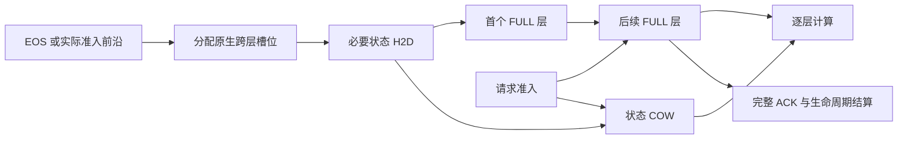

# 选择性备份、依赖恢复与 Workflow 完成时间

日期：2026-10-22，北京时间。状态：代码和 CPU 验证，GPU 性能未验收。

## 本次决定

沿用有效的简单 JOIN parent 排序，分别控制内存机制和较大的调度候选：

| 决策 | 下一轮 Full | 独立对照 |
|---|---|---|
| 周期备份 | 未锁冷页、所有直接 owner 均已阻塞的页 | 原来的所有 dirty 页覆盖 |
| 工具恢复 | 请求到实际准入前沿后恢复 | 旧的完成前预测预取 |
| 恢复范围 | EOS 使用 eager，执行前沿使用 pipeline | 原来的完整逐层提交 |
| 排序 | 与 JOIN-only 相同的完整简单分支 | workflow_completion |
| ACK 后额外保护 | 关闭 | 原来的保护消融 |

不添加在线全局容量缺口优化器，不每 decode 步评分全部 agent。
不调整任务、prompt、到达、上下文或生成上限来制造收益。
主对照维持 batch8、seed21、36root、256K/95%、Host 200GB/80:20，
以及工具 180s。北京时间 2026-10-22 06:00 前不使用 GPU。

## 选择性增量备份

原来的机制已经避免重传现有 FULL Host 副本，但逐渐覆盖全部 dirty 页。
这次改变覆盖策略，不仅更换“全量备份”的表述：

1. 保留 spawn 触发的已发布不可变 FULL 增量备份。
2. 周期仍为 200ms，复用 native dirty index，每轮最多检查 32 个节点。
3. 有执行锁、Host 锁或在途传输的节点不进入后台候选。
4. 无 session owner 的未锁冷页可以备份。
5. 有 owner 时，只用完整的直接 owner 集合：每个 session generation、
   workflow、context epoch 都匹配，且处于 WAIT_JOIN、WAIT_CHILD 或 WAIT_TOOL。
6. 不为后台筛选解析共享祖先的整个子树；覆盖未知时跳过。已知 spawn
   路径及真实容量压力下的原生 donor 证明继续存在。

owner 查询共用 session 索引，仅在绑定版本变化时重建；筛选不查询工具
时长模型、不捕获长 token 前缀、不建全局堆。已阻塞工具即使没有时长
预测也能备份不可变 FULL。Mamba 可变状态不走周期增量备份。
CPU 分发仍在 post-forward 安全点，实际 D2H 异步执行；没有另起线程
并发修改 native 树或每轮扫描全 HBM。

备份不授予驱逐权限：活跃、共享、锁和 DMA 约束继续由 native 判断。
实际恢复仍先回收已备份且可安全释放的页；确实不足才走小批紧急 D2H，
ACK 后释放容量并继续 H2D。D2H 提交不等于已经释放。
`hot_or_unknown_owner_nodes` 保留筛选拒绝。后续同时检查每批字节、
真实释放/恢复关联、Host 占用和 unbacked donor，不能只验收 D2H 下降。

## 真正的恢复档位

过去的 `layer_prefetch_policy.py` 是 CPU 策略原型。本轮接入实际复制和续传，
不将节点数或字节上限称为层数上限：

- **complete**：原生提交和依赖路径，作为正确性后备及对照。
- **pipeline**：先传必要状态，再传第一个实际包含 FULL 数据的层。
  混合模型的 FULL 层可能稀疏，不能将它误认为全局层 0。
  请求准入时续传后续层；没有消费者时 200ms 后收尾。
- **eager**：先传必要状态，再继续全部缺失 FULL，用于确定性较强的 JOIN/EOS。

工具执行前沿用 pipeline，确定 JOIN/EOS 用 eager。这是低成本初始档位，
不是已经接近 GPU oracle；是否需要中间档位，应按真实暴露等待判断。
不重新添加“无法估计耗时就拒绝 EOS 正机会”的门槛。

同时修复真实依赖耦合：旧 pre-forward Mamba COW 等待最后 Mamba 层的
通用事件，而该事件也排在同批 FULL 后面。现在状态有独立就绪事件，
COW 等待状态事件；FULL 计算仍逐层等待原生 fence。

分层复制仍分配完整跨层 token 槽位，不能同比例降低 HBM 容量需求。
部分复制不产生完整 ACK，也不增加完整恢复/复用统计。新的 native load
先续传旧 tail，再推进 layer event ring。stream 时间累加各段，排除中间
CPU 暂停；submit-to-ACK 仍包含这段真实时间，二者分别报告。
原有 1/16 低频等待采样继续覆盖独立状态 fence，使用 `layer=-1` 和
`pre_forward_state` 单列，同时保留总等待；不会因改换 fence 漏掉 COW 等待。

量化 Mamba checkpoint 的独立 COW 未接入新 fence，故不启用新档位，
继续旧路径。当前实验使用支持的 bf16 路径。CPU 顺序、引用和事件测试
不代替 GPU 并发验证。

## 工具预取是否有效

V109 有约 4.198GB 工具 FULL 确认复用，但复用不等于净 JCT/吞吐增益。
独立工具审计还发现很多工具很短，而返回后的准入排队很长。
不同工具人口、上下文和排序之间的差异不能直接解释为预取因果收益。

普通工具因此采用执行前恢复：

- 时长模型保留用于有压力时的等待卸载。
- 同一个排序选择最多两个准入前沿候选，只恢复当前 free lists 能容纳的
  checkpoint。没有原生准入机会时不替它提前占用 HBM。
- JOIN/EOS 和关键 parent 容量事务优先，enqueue 前再次检查。
- 没有已发布 session anchor 的新 context 不重复搜索长输入。
  已确认 resident 的本次请求不持续重查。
- 普通前沿不额外同步搜索 donor，不保留等 ACK 的 handoff ticket，
  不添加插队或驻留租约；不能推进时立即退回 native。

这些提交后恢复仍标记 `execution_handoff`，不计入工具完成前预取。
最终用 speculative/execution 消融比较 JCT、忙时吞吐、恢复等待、
控制成本、重复迁移及实际输出工作量。现在不能断言工具预取总是无效，
也不能因其确认复用而保留全部控制成本。

## 请求目标与 Workflow 目标的区别

对到达 A_w、完成 C_w 的 workflow：

    sum_w(C_w - A_w) = integral(active_workflow_count(t), dt)

请求队列延迟统计的是等待请求数。一个展开很多请求的 workflow 在请求
指标里获得多份权重，在平均 workflow JCT 里只有一份。

相同工作量的说明例：单服务器上，A 有 8 个已展开并行请求，每个服务
1 单位；B 有一个请求，服务 4 单位，全部同时就绪。

| 排序 | 平均请求 TTFT | 平均 workflow JCT | 总服务 |
|---|---:|---:|---:|
| 每次先做最短请求 | 4.00 | 10.00 | 12 |
| 先完成 B 的前沿 | 6.67 | 8.00 | 12 |

表中用服务启动时刻代表理想化 TTFT；加入相同首 token 固定开销不改变比较。
该例未减少任何请求或工作；它解释请求计数加权的偏差，不是 native trace
重放，也不能声称 SGLang 总按最短输出排序，或 TTFT/TBT 优化必然损害 JCT。
反例保留：A 有两个 1 单位请求，B 只有一个 100 单位请求；先选窄 B
的平均 JCT 为 101，先做两个短请求为 52。分支数不是剩余工作量。
结果保存在 `experiments/reports/v2646_completion_tradeoff_cpu_20261022.json`。

## 较大的候选：有界 Workflow 完成前沿

新增 `workflow_completion`，保持 JOIN-only 的 parent 优先及独立配额：

1. 根据已展开前景分支、已服务输出量、FIFO 选择 workflow；分支缓存只按
   受影响 workflow 的事件失效，不每步全图扫描。
2. 同 workflow 内优先实际 JOIN 的最后未完成 child。
3. 最多给予 4 个不同请求连续优先准入，之后让普通 aged FIFO 请求获得
   一次机会；chunked prefill 不重复收费，JOIN 单独插队不消耗普通 FIFO 轮次。
4. 选中 workflow 没有就绪请求时换选，其他候选始终交给 native 填 batch。
5. 恢复候选复用相同排序，避免恢复 A、准入却持续服务 B；不额外锁 KV，
   不取消原生容量检查，也不承诺 TTL 内一定获得服务。
6. 图观测尚未到齐时保留原生顺序，不把未知 workflow 当作小任务。

它将完成进度、恢复和准入跨请求协调，而非让每个工具请求固定最高优先。
未知未来仍有反例，所以先作为独立消融，不替换基本三组的简单 JOIN 骨架。

## 研究边界与验收

重新核查原始来源：

- Agentix，NSDI 2026，§4.2.1：
  `https://www.usenix.org/system/files/nsdi26-luo.pdf` 已有 PLAS/ATLAS、
  动态多线程、program attained service 与关键路径。JCT/动态性不是空白。
- TokenCake v5，§3–5：`https://arxiv.org/html/2510.18586v5` 已有工具
  offload/upload、重要度、压力快照、upload debt 和时间/空间/准入协调。
- Sarathi-Serve，OSDI 2024：
  `https://www.usenix.org/system/files/osdi24-agrawal.pdf` 研究 chunked
  prefill、stall-free batching 的吞吐/请求延迟权衡。这不证明它在本负载中
  的 JCT 一定更差。

待验证的问题是：未知未来 fork/join 下，能否用低成本阻塞事件准备可释放
容量，再让分层依赖和 workflow 完成前沿配合，减少 JCT 且保持有用吞吐？
必须在同信息的强程序调度之上证明 KV 机制的增量。若简单 JOIN 或
Agentix 风格调度解释全部收益，应收缩 KV 贡献，不能弱化 baseline。

最终应用 V2671：3739 通过，保留 V2668 的 3737 项并补充两个边界检查，
无跳过、2 个 subtest。此前一直排除的 Docker 沙箱测试仍明确排除，不计通过。
V2672 绑定最终源码。原生 V2663：467 通过，保留此前 405 项及后续新增项，
无跳过，46 个 subtest；V2664 绑定补丁及引擎 tree。

最终 V2674/V2675 使用正常 GC、101 个交替 CPU 样本。48 队列完成候选
约 220.3us、简单 Full 205.9us、JOIN-only 204.6us；128 队列约
540.4/515.0/511.9us。主分支对 pinned 旧 planner 的 8 请求结果为
-0.06% 至 +0.71%，48 请求 -0.48% 至 +0.38%，128 请求 -1.32% 至 +0.17%。
不能将小幅波动宣称为净优化。初版 V2647/V2648 的 0.8%–3.6% 小队列
退化及全部原始样本也保留；不同源码和测量不能只挑更好的数字。

最终 V2676 完整前沿分发、捕获、重验、登记、提交归因的 4/16/64 节点
正例约 351/836/2677us；新 context 约 17us、resident 26us、
容量拒绝约 150–578us，带 200ms 退避。使用标量 native 替身，
不含真实长输入匹配、分配、GPU/DMA 或 JCT。

旧 V116 已取消且未使用 GPU。替代登记绑定最终合格 main 与新引擎，
按 Full、JOIN-only、工程对齐 native 顺序执行；各机制和纯调度有显式
条件消融。工作目标继续 active。CPU 通过和任务完成都不接受 GPU 性能。
最终资格及 V117 登记位置由
`experiments/reports/v2673_completion_recovery_qualification_20261022.json` 记录。
