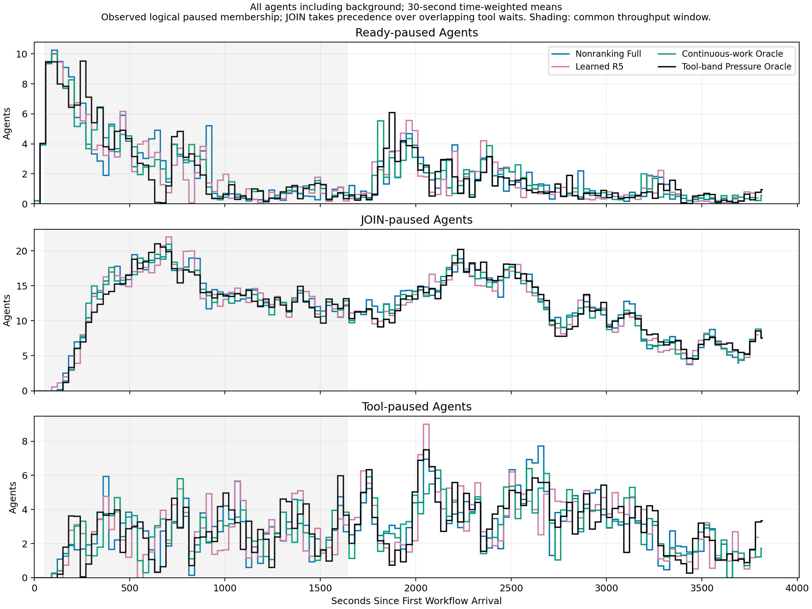

# Paused 队列、加密到达与闲时工具预取

## 最新完整结果与曲线

最新工具保留档压力 Oracle 已完成固定 18 个测量成员。平均 JCT 为
1048.204522 秒，相对非排序 Full 改善 0.428347%，相对连续工作量 Oracle
回退 0.596268%。完整测量、原始工作、自然长尾、新鲜 drain 和实际退出的
证明齐全。保留监督器原 `stopped_for_investigation` 状态；固定测量完成后
取消背景使旧监督器记录 driver failure，不能覆写成完整 83 个全部完成。

等待曲线：



PDF 与同名 PNG 位于 `experiments/figures/paused_agent_timeline_20261109/`。
完整原采样 CSV、JSONL 前缀指纹、30 秒加权数据及方法入口位于同一比较组：

```text
background83_mean70/gpu_campaign_20261106_r2/
  paused_queue_and_idle_tool_prefetch_20261109_r1/
    queue_figures_r1/
    phase_summaries_r1.json
    pressure_wait_lifecycle_r1.json.gz
    idle_tool_restore_opportunities_r1.json
    arrival_mean60/preparation_r2/
```

三类均要求原生逻辑资格为 paused。ready-paused 还要求已有实际模型请求，
且已观察到的工具和 JOIN 均不再阻塞。JOIN-paused 按实际 JOIN 事件识别；
tool-paused 为有实际工具阻塞且不同时等待 JOIN 的对象。两者重叠时归 JOIN，
剩余 paused 单列 other。结束 workflow 中尚未清理的原生记录单列诊断，
不记作等待。逻辑 paused 不等于已证明整个 KV 都在 Host。

使用相邻原生快照保持状态；超过 1.5 秒的缺口不外推。图中为 30 秒时间加权
均值，灰区是共同吞吐窗口 [55.692771, 1638.954850] 秒。各方法该窗口的采样
覆盖为 96.85%–97.35%，缺口保留为未知。颜色沿用既有 Okabe-Ito 方法颜色。

| 方法 | 平均 ready-paused | 平均 JOIN-paused | 平均 tool-paused |
| --- | ---: | ---: | ---: |
| 非排序 Full | 2.8843 | 13.1502 | 2.5137 |
| 学习 R5 | 2.7328 | 13.0576 | 2.5179 |
| 连续工作量 Oracle | 2.8372 | 13.0145 | 2.5499 |
| 工具保留档压力 Oracle | 2.8546 | 12.7805 | 2.5962 |

压力 Oracle 前 900 秒 ready-paused 均值 4.4730，900 秒后为 1.1139，
2700 秒后仅 0.6300。对应 R5 为 4.2338、1.1722、0.5615。后半程供给偏弱
是明确现象；共同窗口仍有约 53.58% 时间存在至少两个 ready-paused workflow，
所以不能把收益小完全归因为“没有候选”。各自能执行却不能全部放下的容量
竞争、选集变化及后续真实服务仍需独立检查。

## 下一组到达率

下一组固定 83 个项目、400GB Host、20 个初始 workflow，平均间隔从 70 秒
缩到 60 秒，顺序为非排序 Full、连续工作量 Oracle、原保留学习 R5。
不推广本轮负收益压力选择扩展；三组都保留原工具卸载、JOIN/EOS、
prepare_host、agent 连续性、sibling 及控制频率，继续关闭工具预取和逐层
handoff。本项比较既有方案的负载敏感性，不是新增逐点 GPU 消融。

到达准备器通过原有生成函数递归重建背景替换及前缀扩展，保留同一 seed、
permutation、成员顺序及全部指数随机样本。没有另抽更有利的种子、改任务、
复制项目或缩短工具。固定 18 个测量成员身份不变，更新到达相关的私人 cohort
合同和共同吞吐窗口；cohort 不送给调度器。仍在测量成员全部自然完成后停止
非测量背景。

原始总输出为 1599388 token，平均每 workflow 19269.735 token。用旧共同窗口
约 345.7 token/s 粗估，仅输出工作的到达负载从约 79.6% 增到 92.9%。
这个估计未计入 prefill、迁移、batch 变化及等待，不能当作稳定性证明。

原 83 个到达表最后到达为 4598.502355 秒，新表为 3941.573447 秒。固定旧 JCT
的静态尾部检查中，Full、Oracle、R5 分别仍有 305.745、185.094、202.882 秒
背景覆盖余量。新服务压力可能延长 JCT，因此 Full 完成后仍要求真实 workload
检查通过，才顺序启动 Oracle 和 R5。若覆盖或实际执行有问题，保留失败，
不截尾、不继续把它当作稳定服务比较。

`preparation_r1` 为初始准备；`preparation_r2` 绑定了可先等待外部 GPU 进程
退出的正式协调器。二者没有 GPU 尝试，正式执行只使用 r2。协调器在等待时
持续检查当前 hold，在每一组开始前重验资源、输入及原生来源。三组均须独立
通过完整测量、工作守恒、fresh drain 和实际退出；不复用 70 秒的性能结果
充当 60 秒的对照。

## 闲时工具预取的机会与边界

用户提出的是新条件模式：用暂时不用的物理容量为 tool-paused 提前恢复，
而非重新启用旧的强制工具预取或下一批请求预备。当前仍未启用新模式。

最新完整执行观察到：

- 9594 个纯工具后继；338 个请求有原生 Host 命中记录，3 个后继的原生身份
  无法唯一确认，保留未知。
- 其中 305 个 Host 命中后继在工具运行期间观察到 paused。
- 严格要求没有 ready-paused 竞争者、实际 free pages 足够，并额外保留
  2048 token 时，38 个对象存在窗口，36 个的窗口并集至少 100ms。
- 这些对象的原生 Host 命中 token 合计 164100；这不是已证明的物理 DMA
  字节，也不保证完整原生 checkpoint、队列或传输时序可行。
- 全程原生 H2D 完成记录 1743 条、实际字节合计约 5.704TB，记录的传输流
  elapsed 求和约 275.496 秒。包含预取及需求恢复，elapsed 求和不是暴露的
  GPU 停顿或可消除的 JCT。

本次筛查使用历史真实返回及后继大小，仅用于 CPU 机会诊断，不能作为线上
输入。时间窗口是并集，不保证连续；没有假设可以回收任意 evictable KV。
它表明严格 free-only 模式有机会，但目前证据不支持把大部分原生 H2D 都
归为可由此消除。并发加压后这些闲时机会也可能更少，应分别评价负载区间。

JOIN 同样有剩余需求恢复：246 个观察到的 JOIN 等待中，242 个有完成前正
计划、99 个有完成前提交日志；101 个有完成前开始且实际复用的独立证据。
不同入口和日志口径不相加。计划受容量预算等约束，精准触发不意味着都能
提前完成。其下一请求剩余原生 Host 命中仍约 7.173GB；不是全部物理 DMA，
更不是工具预取的独占收益。

建议的后续实现合同：

1. 保持逻辑 paused，单独记录物理 warming/resident；实际工具返回、依赖
   满足且请求提交后进入 ready-paused，由既有 R5/原规则决定准入。
2. JOIN/EOS、真实需求恢复和 ready-paused 优先。只有这些路径没有需求、
   传输队列空闲、完整 checkpoint 加增长及输入保留量可容纳时才预取。
3. 首个版本仅用真实 free pages。若后续扩展到回收冷副本，只能使用已有
   settled Host 备份且不属于 active/ready/JOIN 保护的对象，逐次原生复核；
   `evictable_units` 总数不能证明这样的节点存在。
4. 同时至多一个可选原生 burst，复用现有分块、锁和 ACK；由空闲/容量释放/
   工具预测资格变化事件触发，避免全 agent 周期扫描和逐页同步控制。
5. 需求出现时停止追加可选传输，让已加载且尚未使用的工具状态优先可回收。
   不创建让推测性工具压住真实 ready 工作的资格或长期 pin。
6. 根据因果工具特征和已等待时间估计近期返回/复用概率，不使用历史真实
   返回时间。验收看返回后恢复等待、首次复用、浪费字节、需求 H2D 排队、
   decode 与控制 CPU；先估计净收益，再决定是否做 GPU 验证。

队列分析、到达重建、协调器拒绝错误身份/尾部覆盖/失败 CPU 输入，以及工具
并行/分轮/准入条件的 65 项定向 CPU 检查通过。正式执行仍需完整源码绑定、
干净冻结和新鲜资源检查；此处不声称新到达率或闲时预取已有性能收益。
