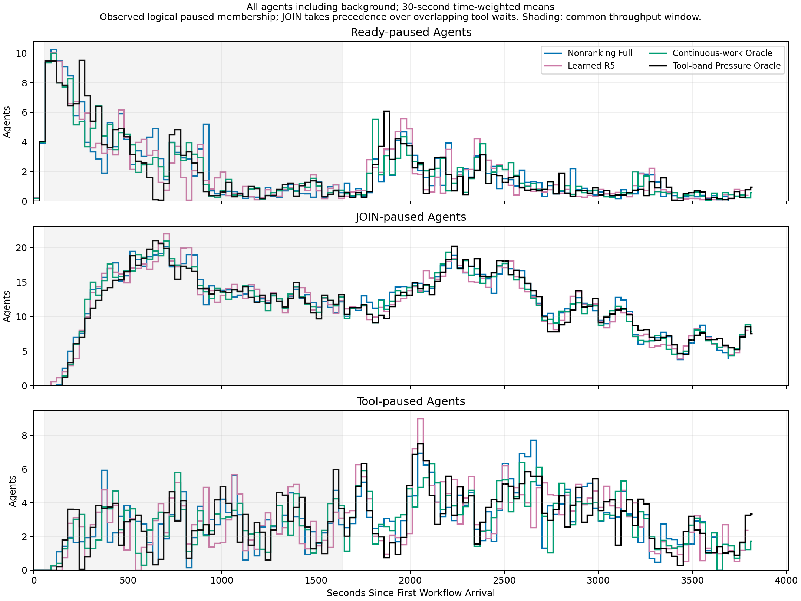

# Paused 队列、加密到达与闲时工具预取

## 最新完整结果

133个不同原项目、Host400GB、initial20及mean60的benefit Oracle已完成
固定18条自然JCT。平均1269.545739秒，相对匹配非排序Full的1274.833468秒
改善0.414778%；共同全输出336.222920对342.209295token/s，下降1.749331%。
完整2991个原请求、362157个原输出、fresh drain及实际退出均独立核验通过。
本轮未达到1%JCT门槛，没有运行后续R5、ThunderAgent或native阶段；
整体目标仍未达成。完整分析、最后大KV成员的等待及来源边界见末节。

## 历史83项目结果与曲线

最新工具保留档压力 Oracle 已完成固定 18 个测量成员。平均 JCT 为
1048.204522 秒，相对非排序 Full 改善 0.428347%，相对连续工作量 Oracle
回退 0.596268%。完整测量、原始工作、自然长尾、新鲜 drain 和实际退出的
证明齐全。保留监督器原 `stopped_for_investigation` 状态；固定测量完成后
取消背景使旧监督器记录 driver failure，不能覆写成完整 83 个全部完成。

等待曲线：



PDF 与同名 PNG 位于 `experiments/figures/paused_agent_timeline_20261109/`。
完整原采样 CSV、JSONL 前缀指纹、30 秒加权数据及方法入口位于同一比较组：

```text
background83_mean70/gpu_campaign_20261106_r2/
  paused_queue_and_idle_tool_prefetch_20261109_r1/
    queue_figures_r1/
    phase_summaries_r1.json
    pressure_wait_lifecycle_r1.json.gz
    idle_tool_restore_opportunities_r1.json
    arrival_mean60/preparation_r2/
```

三类均要求原生逻辑资格为 paused。ready-paused 还要求已有实际模型请求，
且已观察到的工具和 JOIN 均不再阻塞。JOIN-paused 按实际 JOIN 事件识别；
tool-paused 为有实际工具阻塞且不同时等待 JOIN 的对象。两者重叠时归 JOIN，
剩余 paused 单列 other。结束 workflow 中尚未清理的原生记录单列诊断，
不记作等待。逻辑 paused 不等于已证明整个 KV 都在 Host。

使用相邻原生快照保持状态；超过 1.5 秒的缺口不外推。图中为 30 秒时间加权
均值，灰区是共同吞吐窗口 [55.692771, 1638.954850] 秒。各方法该窗口的采样
覆盖为 96.85%–97.35%，缺口保留为未知。颜色沿用既有 Okabe-Ito 方法颜色。

| 方法 | 平均 ready-paused | 平均 JOIN-paused | 平均 tool-paused |
| --- | ---: | ---: | ---: |
| 非排序 Full | 2.8843 | 13.1502 | 2.5137 |
| 学习 R5 | 2.7328 | 13.0576 | 2.5179 |
| 连续工作量 Oracle | 2.8372 | 13.0145 | 2.5499 |
| 工具保留档压力 Oracle | 2.8546 | 12.7805 | 2.5962 |

压力 Oracle 前 900 秒 ready-paused 均值 4.4730，900 秒后为 1.1139，
2700 秒后仅 0.6300。对应 R5 为 4.2338、1.1722、0.5615。后半程供给偏弱
是明确现象；共同窗口仍有约 53.58% 时间存在至少两个 ready-paused workflow，
所以不能把收益小完全归因为“没有候选”。各自能执行却不能全部放下的容量
竞争、选集变化及后续真实服务仍需独立检查。

## 下一组到达率

下一组固定 83 个项目、400GB Host、20 个初始 workflow，平均间隔从 70 秒
缩到 60 秒，顺序为非排序 Full、连续工作量 Oracle、原保留学习 R5。
不推广本轮负收益压力选择扩展；三组都保留原工具卸载、JOIN/EOS、
prepare_host、agent 连续性、sibling 及控制频率，继续关闭工具预取和逐层
handoff。本项比较既有方案的负载敏感性，不是新增逐点 GPU 消融。

到达准备器通过原有生成函数递归重建背景替换及前缀扩展，保留同一 seed、
permutation、成员顺序及全部指数随机样本。没有另抽更有利的种子、改任务、
复制项目或缩短工具。固定 18 个测量成员身份不变，更新到达相关的私人 cohort
合同和共同吞吐窗口；cohort 不送给调度器。仍在测量成员全部自然完成后停止
非测量背景。

原始总输出为 1599388 token，平均每 workflow 19269.735 token。用旧共同窗口
约 345.7 token/s 粗估，仅输出工作的到达负载从约 79.6% 增到 92.9%。
这个估计未计入 prefill、迁移、batch 变化及等待，不能当作稳定性证明。

原 83 个到达表最后到达为 4598.502355 秒，新表为 3941.573447 秒。固定旧 JCT
的静态尾部检查中，Full、Oracle、R5 分别仍有 305.745、185.094、202.882 秒
背景覆盖余量。新服务压力可能延长 JCT，因此 Full 完成后仍要求真实 workload
检查通过，才顺序启动 Oracle 和 R5。若覆盖或实际执行有问题，保留失败，
不截尾、不继续把它当作稳定服务比较。

`preparation_r1` 为初始准备；`preparation_r2` 绑定了可先等待外部 GPU 进程
退出的正式协调器。二者没有 GPU 尝试，正式执行只使用 r2。协调器在等待时
持续检查当前 hold，在每一组开始前重验资源、输入及原生来源。三组均须独立
通过完整测量、工作守恒、fresh drain 和实际退出；不复用 70 秒的性能结果
充当 60 秒的对照。

## 闲时工具预取的机会与边界

用户提出的是新条件模式：用暂时不用的物理容量为 tool-paused 提前恢复，
而非重新启用旧的强制工具预取或下一批请求预备。当前仍未启用新模式。

最新完整执行观察到：

- 9594 个纯工具后继；338 个请求有原生 Host 命中记录，3 个后继的原生身份
  无法唯一确认，保留未知。
- 其中 305 个 Host 命中后继在工具运行期间观察到 paused。
- 严格要求没有 ready-paused 竞争者、实际 free pages 足够，并额外保留
  2048 token 时，38 个后继请求存在窗口，涉及 32 个不同 invocation、
  18 个不同 workflow；36 个后继的窗口并集至少 100ms。这不是已执行的
  预取次数，也不是 38 个完整 agent 的 KV 恢复。
- 这些对象的原生 Host 命中 token 合计 164100；这不是已证明的物理 DMA
  字节，也不保证完整原生 checkpoint、队列或传输时序可行。按同一份
  `idle_tool_restore_opportunities_r1.json` 复核，30 个后继的 Host 命中量
  不超过 512 token，仅 8 个超过 2048 token；不能从请求数推断大规模迁移收益。
- 全程原生 H2D 完成记录 1743 条、实际字节合计约 5.704TB，记录的传输流
  elapsed 求和约 275.496 秒。包含预取及需求恢复，elapsed 求和不是暴露的
  GPU 停顿或可消除的 JCT。

本次筛查使用历史真实返回及后继大小，仅用于 CPU 机会诊断，不能作为线上
输入。时间窗口是并集，不保证连续；没有假设可以回收任意 evictable KV。
它表明严格 free-only 模式有机会，但目前证据不支持把大部分原生 H2D 都
归为可由此消除。并发加压后这些闲时机会也可能更少，应分别评价负载区间。

JOIN 同样有剩余需求恢复：246 个观察到的 JOIN 等待中，242 个有完成前正
计划、99 个有完成前提交日志；101 个有完成前开始且实际复用的独立证据。
不同入口和日志口径不相加。计划受容量预算等约束，精准触发不意味着都能
提前完成。其下一请求剩余原生 Host 命中仍约 7.173GB；不是全部物理 DMA，
更不是工具预取的独占收益。后文完整物理对账进一步确认，这只是上述
已观察等待对象的最终 Host 命中口径，遗漏提前经过需求流水线搬入的状态，
不能代表全部 JOIN 需求 H2D。

### 完整需求 H2D 来源复核

用户明确要求工具预取暂不实现。本次新增的只有 CPU 分析器
`scripts/audit_h2d_agent_origins.py` 和相关测试，不修改运行时或排队比较。
使用同一份已完成固定 18 测量成员的 mean70 压力 Oracle 日志，包含预热与
背景；不声称所有 83 个 workflow 都完成，也不当作 mean60 的运行结果。
证据为本比较组的 `h2d_agent_origins_r2.json`；r1 初步分析保留，r2 增补
独立请求数量，字节来源、窗口分组和原始文件指纹不变。

1743 条完成 H2D 的精确对账为：

```text
5703990214656 total H2D bytes
= 697082019840 controlled JOIN/EOS bytes
+ 5006908194816 untagged native demand bytes

5006908194816 untagged native demand bytes
= 4528629153792 staged native demand bytes
+  478279041024 direct native request Host-hit accounting bytes
```

暂存的 1183 个批次均以提交时间、完整节点列表、实际字节和 session/request
身份匹配未标记的原生 ACK；有 1990 个成员关联、1896 个不同请求。
没有逐请求分摊混合批次。直接请求 Host 命中量乘实际 FULL 几何
98304 bytes/token，恰好与未被暂存批次解释的原生 H2D 余量一致。
两类相加没有未解释字节；该对账仍不构造单个直接请求对应的 DMA 命令。

| 需求来源 | 暂存回执＋对账后的直接恢复 / GB | 占原生需求 H2D |
| --- | ---: | ---: |
| 纯工具后继批次及直接恢复 | 2267.926462 | 45.296% |
| 纯 JOIN 后继批次及直接恢复 | 1454.092419 | 29.042% |
| child 首次请求的纯批次及直接恢复 | 43.290132 | 0.865% |
| 不同后继类型的混合暂存批次，保持联合归因 | 1241.599181 | 24.798% |
| 合计 | 5006.908195 | 100% |

此处 GB 使用十进制。按角色查看暂存批次，root-only 为 2246.732415GB，
child-only 为 733.741941GB，root/child 混合为 1548.154798GB。
单成员回执还观察到一个大 root 在 21 次暂存中累计恢复 387.835625GB；
这证明同一 invocation 多次有实际恢复，不证明每次复制了完全相同的物理页。

因此，原生 H2D 的主要对象是工具/JOIN 阻塞之后已有实际后继、正在恢复服务
的 agent。最终请求 Host 命中量不覆盖已经提前暂存的部分：仅暂存记录就涉及
1379 个不同纯工具后继和 270 个不同 JOIN 后继。它们可能与直接命中对象
重叠，不能简单加成新的独立请求数。前文 338/305/38 的严格窗口筛查只覆盖
最终仍有 Host 命中的子集，不能据此推断全系统只有 38 次预取机会，或只有
7.173GB 的 JOIN 需求恢复。

仍有潜在优化空间，但不是把需求传输量直接换算成收益：

- 90.4476% 的原生需求字节已经走现有 DemandPrefillPipeline。实际冻结与当前
  源码一致，其 `stage()` 要求已有可执行 decode，并允许驻留 decode 在复制
  期间继续推进；这不是工具提前预取，也不证明每个字节都完全隐藏。
- 暂存需求、直接原生需求、控制传输的传输流 elapsed 分别累计
  226.136008、18.199511、31.160049 秒。它们是流内计时求和，不是串行
  GPU 停顿；不能声称原生需求带来 244.335519 秒可消除等待。
- 当前仅有 10 个 GPU 层依赖采样批次，采样间隔为 16，等待合计
  91.477121ms；它不覆盖所有复制或选批前等待，不扩展成全程停顿估计。
- 优先继续用 CPU 追踪 JOIN/EOS 信号到容量协调、提交和实际服务的覆盖缺口，
  以及大 parent 多轮恢复中是否存在可避免的过早卸载。保持正在执行 agent
  连续性，先区分必要工作集切换和可避免抖动。工具预取仍只讨论，不启用；
  后续机会分析须覆盖暂存需求，并检查传输未完成时是否仍有 decode 推进。

### JOIN 恢复为什么仍有需求 H2D

同一份 `pressure_wait_lifecycle_r1.json.gz` 中 246 个有预取规划观测的 JOIN，
有 242 个在 JOIN 满足前形成正恢复计划。逐事件计算
`JOIN 满足时间 - 首次正计划时间`，中位提前量只有 25.203247ms；这些事件
的完成前最大计划量中位数为 6.182486016GB。当前使用 `observed_eos`，
通常在最后 child 的原生无工具 EOS 已经出现后才触发；这提高了恢复目标与
返回事件的确定性，并不提前提供 child 结束前数百毫秒的时间。

作为量级参考，全部原生 H2D 字节除以传输流 elapsed 求和约为 20.70GB/s；
6.18GB 对应约 0.30 秒。它不是逐 JOIN 的实际带宽、暴露等待或收益估计，
但说明仅几十毫秒的提前量不足以据此保证整个大前缀在 JOIN 满足前恢复。
25ms 也不是准入控制周期或 ticket 有效期；延长 2 秒配置不能让 EOS 更早出现。

不过，“没有在 JOIN 满足前恢复完”与“没有隐藏传输”必须分开。对上述
242 个相同事件逐项计算，首次正计划到客户端后继提交、原生到达、首次服务
的间隔中位数分别为 91.879272、217.552979、696.433105ms。部分传输可以
在 JOIN 满足之后、parent 真正使用 KV 之前继续推进；这些时间还包含客户端、
准入和排队，不能当作固定免费窗口，也不能把几个独立中位数直接相加。

预取观测还显示：

- 101 个 JOIN 有至少部分在满足前启动、随后验证复用的 FULL 传输；其中
  8 个有至少部分在满足前 ACK 并验证复用。8 不表示只有 8 个完成了整个
  checkpoint，也不能据其余记录推断全部 KV 未准备好。
- 83 个 JOIN 在满足前有 `prefetch_capacity_budget` 观测。源码中的门槛
  包含 free/evictable 页、输入与增长预留、剩余预取字节预算，实际提交还受
  原生锁、Host 副本和物理回收检查限制。这个记录不能直接等同“物理 HBM 已满”。
- 143 个有完成前 `start_window`、却没有完成前 submitted 规划日志的事件，
  独立原生命令关联发现 2 个实际上提前提交、86 个在满足后提交、55 个未
  观察到关联提交；其中 72 个有完成前容量预算观测。这些分类可以与其他
  约束重叠，不能把 143 个全部当作漏预取，也不能独占归因到时间或容量。

另外有逻辑恢复资格这一道控制门槛。`dispatch_join_prefetch()` 会先调用
`claim_restore()`，成功后才继续物理容量回收与提交。完整日志最后的计数
`agent_restore_deferred_before_reclaim=793` 是重复检查次数，并非 793 个 JOIN；
它确认逻辑资格确实会阻止部分当前动作，不能直接分摊成遗漏字节或可省 JCT。

一条可复核的具体链路是 JOIN `deepagents-join:a9622a19ad4074e6`：
在满足前 57.560791ms 已形成 4.2713088GB 计划，但当时只有 2037 个真实
free token，低于增长/输入预留 2072；计划虽观察到 373590 个 evictable
token，仍需真实回收、逻辑恢复与锁检查。child RETURN 后回收 8154 个
device token，随后创建并绑定 confirmed ticket；parent 原生到达时 ticket
以 `safe_point_invalidated` 关闭，issued_nodes 仍为零。到达后的准入记录
显示 parent 需要 44926 个逻辑 token，普通未用额度为 43930，不能据已有
start_window 就断言可以实际加载。ticket 关闭本身是原生交接边界，不是
丢失 KV 的证明；未完成的恢复随后由原生需求路径接管。

因此当前证据支持三个共同因素：确定性信号较晚、恢复容量/逻辑额度协调，
以及预取在原生到达时转为需求恢复。不能仅靠放宽时间参数解决，也不能
把需求 H2D 的 1.454TB 全部称为实现错误。后续应先核对可以安全协调的容量
是否及时释放、已选 parent 的恢复是否连续承接，再决定是否值得尝试在
child 最终回答 decode 阶段更早预测；后者需要新预测与净收益证据。
本次只补充 CPU 日志与源码解释，没有启用工具预取或修改运行时。

### 关键路径等待与交接检查

本次按原始因果图和精确原生完成回执，重建固定 18 个测量 workflow 的
最后完成依赖路径。2991 个测量请求、362157 个输出 token 和平均 JCT
1048.204522 秒均与既有完整 cohort 对齐。背景仍真实执行并影响服务，
但不并入路径指标的分母。原先 2267.93/1454.09GB 的传输统计覆盖包含背景的
全日志，不能直接除以这里的测量 JCT。

证据在同一比较组内：

- `pressure_JCT_paths_r1.json`：完整测量路径、逐请求首次原生服务、原始图证明。
- `recovery_critical_path_waits_r1.json`：恢复关联、逻辑资格采样和阶段分解。
- `JOIN_recovery_authority_cpu_r1.json`：当前资格/交接边界的独立 CPU 定位。

| 实际关键路径上的对象 | 请求数 | 提交到首次原生服务的等待 / 秒每 workflow |
| --- | ---: | ---: |
| 所有请求 | 2550 | 147.546417 |
| 工具后继全部 | 2339 | 114.580425 |
| 工具后继，首次服务前经过暂存恢复 | 347 | 77.813297 |
| 工具后继，仅观察到直接 Host 命中恢复 | 84 | 20.741035 |
| 工具后继，无初次需求恢复证据 | 1908 | 16.026093 |
| JOIN 后继全部 | 78 | 3.591602 |

最后三组工具关联不重复，347 中有 1 个还存在直接 Host 命中。这里的等待
包含传输、工作集资格、选批和其他本地排队，不能全称作 H2D 阻塞。

347 个暂存工具后继的平均阶段为：提交到首次暂存 72.308372 秒，首次暂存
到首次原生服务 5.504925 秒。已观察暂存到 ACK-ready 的区间并集为
5.017300 秒，最后暂存 ACK-ready 到服务为 0.432575 秒；多段暂存之间的
其他间隔单列在总区间内，不强行把后二者相加当完整分解。347 个均有精确
暂存 ACK 对账和服务前 ready 观测。ACK-ready 是运行时对已完成复制的
观测，含轮询/调度间隔，既不是 DMA 独占耗时，也不证明其间 GPU 没有推进
别的 decode。

对工具后继的全部 114.580425 秒等待，以原生独立快照保留至多 1500ms：
85.939058 秒处于 inactive 采样，28.335126 秒 active，0.306241 秒未知。
这些是观察到的逻辑资格关联；短暂未采样切换不能排除，inactive 不能直接
解释为实现故障或可消除 JCT。让这些请求更早执行可能推迟其他 agent。
工具卸载条件与全局工作集选择的取舍仍需一起评价。

若严格保持其余准入/服务顺序和时长不变，只把上述 347 个请求从开始暂存
到服务的整个区间消除，平均也仅为约 5.50 秒、当前 JCT 的 0.53% 量级；
这不是可实现收益，也不覆盖 84 个直接恢复请求或服务开始后的层等待。
不能把此前 72.31 秒工作集等待当作提前 H2D 自动消除的部分。

JOIN 的 78 个路径后继中，74 个服务前有暂存恢复：提交到首次暂存平均
1.315328 秒，首次暂存到服务 1.528955 秒；暂存到 ACK-ready 区间并集
1.458402 秒，最后 ACK-ready 到服务 0.037169 秒。全部 JOIN 首次服务前
等待为 3.591602 秒。它不覆盖服务开始后的所有层依赖，也不是传输优化的
全系统严格上界，但说明累计 1.454TB 并未在测量路径上形成同量级的串行停顿。
“完全隐藏”还需要提前量、可共存容量和可重叠计算同时成立，当前不具备保证。

修复前的源码和 CPU 定位确认以下缺口；当时尚未修改生产路径。
后续修复及其证据见下节，原定位结果保留：

1. 已合法绑定客户端后继、但尚未原生可见时，ticket 的 request/epoch 已推进，
   admission.latest 仍是原来的 key，context session 暂时分离。
   `_restore_owner()` 能识别同一 owner/session，但 paused owner 的
   `claim_restore()` 免费授予及 `_handoff_join()` 仍要求与 latest 严格相等。
   CPU 定位中合法绑定有效、session generation 相同、逻辑预算 stand-in
   足够，paused 申请仍失败；只把 owner 改成已经 active，同一申请就成功。
   这是现有资格衔接未覆盖的阶段，不应通过跳过 session/epoch 复核解决。
2. `JoinPhysicalRecovery._consumer_live()` 的未原生提交分支还要求
   `_join_ticket_has_native_eos()`。已满足的 confirmed JOIN 与合法客户端
   绑定，未必保留 provisional EOS 的 stage/key 证据，因而在 owner 已有
   资格时仍可能不能推进这条物理计划。CPU 定位复现了有效 confirmed
   ticket、JOIN 已满足、active owner，但返回 false 的情况。
3. 物理计划的 200ms next-attempt 时间保留到同 session 的下一 epoch。
   CPU 定位在新 epoch 的 50ms 检查不读取新 headroom，210ms 才进入检查。
   若出现新的容量/ACK/原生可见证据，应考虑有界重置；不能简单取消退避，
   否则可能恢复先前过高的同步控制开销。共享逻辑交接的退避也需要一起审计。

完整日志有 44 次 `observed_eos_restore/consumer_not_live`、65 次
`safe_point_invalidated` 且 issued_nodes 为零的 ticket 关闭。这些是重复
控制记录，不能都归因为上述缺口，也不能换算成 44/65 个可修复 JOIN。
44 次尚缺原状态的逐项原因，CPU 定位不构造对应 GPU 收益。

正常交接已有实现：客户端绑定引起的两次 enqueue 身份变化均观察到后继
重规划及原生提交；关闭 ticket 的代码不会直接取消已发出的 H2D，物理账本、
原生 ACK 和需求恢复继续负责后续工作。恢复计划也在实际服务后才清理。
这不等于所有中间阶段都已无等待，而是尚未发现仅因 ticket 关闭就丢弃已
提交 DMA 的路径。应优先补齐上述资格与时机缺口，再评估更早的报告预测。

恢复路径新分析相关 55 项 CPU 测试通过；JOIN/原生需求恢复相关 177 项
在 `SGLANG_SOURCE_CHECKOUT=sglang-bg25r1-capture-434c35dd6621` 下全部通过。
首次未指定原生源码时为 126 通过、51 跳过，该次不作为完整原生检查证明。
定位脚本使用明确声明的 CPU 预算和传输 stand-in，不声称实际 DMA、物理
容量或新调度效果。本次没有 GPU 动作，没有修改工具预取或冻结比较版本。

### JOIN 恢复修复

按用户要求补齐上述三个缺口，工具预取继续仅讨论，不增加新的 GPU 实验。

1. 新增严格的 confirmed JOIN 恢复资格校验。已满足 JOIN 的 parent，
   以及已合法绑定下一请求但尚未原生可见的 parent，可以申请完整未折扣
   逻辑预算。客户端绑定必须指回 admission.latest 的精确 checkpoint，
   保持 workflow、invocation、context、session、generation、attempt
   身份一致，只允许已验证的 request/epoch 推进；继续调用原有 ticket
   存活校验，拒绝过期、取消、额外工具/child 阻塞和不完整绑定。
   免费准入保留原 WAIT_JOIN 分支的条件，阻塞 donor 交接也使用同一
   confirmed 资格。没有提前改写 latest、创建原生请求或提供物理容量。
   授予日志使用实际受益请求的 key。
2. 物理计划对 confirmed JOIN 使用同一份已满足且存活的资格，保留 owner
   已获逻辑额度的条件；provisional 分支仍要求真实原生 EOS。
   已有额度但尚未 native-visible 的 confirmed parent 也能建立物理恢复
   计划。新的 `confirmed_join_restore` 日志阶段与 `observed_eos_restore`
   分开，避免把 confirmed 恢复误报成 EOS 预测。原生 FULL 分配器、
   Host 副本、session 引用、锁、DMA 和动作前复核全部保留。
3. 经验证的新请求 key/epoch，以及正式原生注册，允许对应计划重新检查，
   不沿用旧请求的 200ms 退避。同一请求在没有新证据时仍为 200ms。
   相关 consumer/donor 的容量失效和已验证物理 ACK 可以提前唤醒；
   原生请求完成也允许容量重试。事件重试最早在上次尝试后 50ms，多个
   ACK 合并为同一次唤醒；未改变 deadline 的事件不再比较 donor。
   每次通知仅访问最多 24 个已有计划及各自最多 8 个 donor 身份，不读取
   物理前缀，不在 decode token、普通 hint 刷新或语义版本变化时重置。
   真正的容量读取与 donor 检查仍在后续有界 advance 中完成。

CPU 诊断保存为 `JOIN_recovery_authority_cpu_r3.json`，原
`JOIN_recovery_authority_cpu_r1.json` 故障定位及中间 r2 结果都保留。
同一合法客户端绑定的 paused 申请和 confirmed 物理资格由 false 变 true；
新 epoch 在 50ms 时进入容量检查，在 210ms 时累计仍为一次，260ms 时
累计两次，说明只解除旧身份的退避，没有取消新身份自身的退避。

新增回归使用真实 ReferenceThunderAdmission 与 ThunderActingDecayWorkingSet，
覆盖完整预算、blocked donor、准确受益 key、错误身份/阻塞拒绝、
confirmed 原生 burst 与 ACK、首次原生可见及有界容量唤醒。传输与预算池
使用 CPU stand-in；共享套件同时覆盖实际原生树和分配器的 CPU 生命周期。
首次共享检查为 1200 通过、4 项缺本地 tokenizer 跳过，保留在
`JOIN_recovery_repair_cpu_r1.xml`。补充本地 tokenizer 的最终检查记录在
`JOIN_recovery_repair_cpu_r2.xml`，1204 项全部通过，无失败或跳过。
这不是新的 GPU 数值或性能验收，
不能据此声称旧日志中的 44/65 条记录都已修复或推算 JCT 收益。
排队比较仍冻结在 `7fa14a35`，不包含本次修复，没有热改冻结源码。

### 工具预取与 workflow 关键路径

工具后继的可复用 KV 若在 Host，模型消费对应层之前必须等这些页就绪。
需求 H2D 与其他 agent 的 decode 重叠可以减少设备空闲，但不自动消除
这个 workflow 自身的返回后等待。需求流水线覆盖 90.45% 的未标记 H2D
字节，并不证明这部分传输已从所有 workflow 的关键路径消失。

如果工具后继本来还要等待准入、选批，或者其并行 sibling 更晚结束，
部分 H2D 等待也可能不会额外推迟最终完成。提前传输只有在能赶在实际
服务之前完成、随后及时复用，而且不挤占其他有效工作时，才会产生净收益。
之前 347 个暂存关键路径请求的 5.504925 秒只覆盖暂存后至首次服务的区间，
不包括 84 个直接恢复及首次服务后的层等待，不能当作工具预取的全局上界；
114.580425 秒也包含大量准入/选批等待，不能全当成可隐藏的 DMA。

当前证据支持继续评估受限闲时工具预取，而非仅因存在 H2D 就默认启用。
305 个对象中严格窗口至少 100ms 的只有 36 个，且窗口为并集，并非完整
checkpoint 的实际传输证明。后续若验证新模式，应同时看返回后的暴露
恢复等待、首次复用、再次驱逐/重复 H2D、真实需求干扰和控制 CPU，
并让新鲜驻留状态参与后续准入；不能用工具等待对象之间的交换充当收益。

### 准入后提前恢复与闲时工具预取复核（2026-11-10）

用户指出，工具已返回且请求已提交后的提前恢复应是所有请求共享的需求
恢复机制，与此前选定执行集合后提前准备 KV 的探索重合，不应单独归为
工具预取。未获得逻辑资格的普通 ready 请求不能仅因存在物理空间，就
默认提前恢复；逻辑 active 本身也不等于下一批已确定会服务。

新增只读分析器 `scripts/audit_admitted_restore_windows.py`。使用同一份
已完成 mean70 压力 Oracle 的完整前缀，不是排队 mean60 的结果。输出为
`admission_h2d_and_idle_join_windows_r2.json`；初步 r1 结果保留。
首先将先前 347 个暂存工具后继的提交到首次暂存区间按新鲜资格观测拆开：

| 资格观测 | 关键路径累计后平均到 18 个 workflow |
| --- | ---: |
| inactive | 70.527578 秒 |
| active | 1.741043 秒 |
| 未知 | 0.039751 秒 |
| 合计 | 72.308372 秒 |

快照只保留至多 1500ms，active/inactive 不是物理容量或独占原因。
不能把 72.31 秒全部理解为已经准入后、等待发起 H2D 的空白。

按 request、workflow、invocation、context、epoch、attempt、session、
generation 精确匹配准入记录，并排除之后观察到暂停的情况，347 个对象
中 312 个找到同请求的授予记录，另外 35 个没有同请求记录，不能计作
零等待。后者可能已连续保有 owner 资格，并不证明遗漏准入。

| 已记录准入到首次暂存的间隔 | 单请求统计 |
| --- | ---: |
| 中位数 | 27.983081ms |
| P90 | 297.499505ms |
| P99 | 771.586895ms |
| 至少 500ms | 14 个 |
| 至少 2 秒 | 1 个 |
| 最大值 | 7817.901395ms |

这 312 份间隔累计 37.618130 秒，不能当作可消除 JCT；同一请求的最近
授予也不证明此前没有其他资格，记录之外的转换仍有不确定性。这里使用
稍晚的 `native_demand_restore_staged` 日志为终点，H2D 此时已经提交，
所以该统计对真正的“授予到提交 H2D”窗口仍是宽松筛查。

进一步用新鲜物理池快照筛查该间隔：要求容纳原生实际暂存整批的 FULL
传输 token，加上当时的输入/增长 reserve，reserve 至少保留 2048。
312 个工具后继中仅 25 个观察到正空闲窗口，只有 1 个窗口至少 100ms。
按请求累计窗口 389.623535ms；同一批的窗口可以重叠，因此不是独立设备
时间，也不是节省的 JCT。没有扣除传输队列忙、原生槽位和完整输入校验，
不构成物理可执行或净收益证明。

唯一 7.82 秒长间隔的窗口也只有 36.581087ms；其余时间没有观察到满足
这一容量门槛的 free pages。这里没有证据支持为它强行提前驱逐 active
请求。此筛查不包含回收 JOIN 冷 KV 后制造窗口的反事实。

同一分析对其他暂存关键路径类别也没有发现很宽的免费窗口：8 个
context-summary 的同请求授予中 1 个有正窗口；58 个 other 中 3 个；
74 个 JOIN 后继中 23 个有同请求授予记录，正窗口为零，另 51 个未归零。
这不否定已有 JOIN/EOS 预取；这些是尚发生原生需求恢复的特定后继，
也不是所有请求或所有可能容量交接的穷举。

对于用户限定的工具未返回预取条件，沿用原来 305 个 paused Host-hit
后继及原门槛，以独立事件重建“没有 ready-paused”的时间片：

| 观察到的情况 | 后继数 | 证据范围 |
| --- | ---: | --- |
| 已有足够 free pages 且无 ready-paused | 38 | 其中 36 个窗口并集至少 100ms；仍未证明完整 checkpoint 和传输可行 |
| 无上述 free 窗口，但曾在无 ready-paused 时与 JOIN 等待者同时存在 | 158 | 仅为额外结构候选，不是已确认 JOIN donor |
| 其余 | 109 | 在当前观测与门槛下没有前两类窗口 |

158 个额外对象全部观察到 JOIN 等待者，但不能据此认为能驱逐其 KV。
现有物理遥测只有池级 free、evictable、non-evictable 总量，没有该时刻
按 JOIN owner 区分的驻留、settled Host 备份、共享页、锁和恢复保护摘要。
JOIN-paused 也可能早已 Host-only，通用 evictable 数不能替代这些条件。
因此 `safe_join_donor_opportunities` 明确保留 null，不能将 38+158=196
写成有效预取次数，也不能把 158 个全部说成没有机会。

“没有 ready-paused”是这个保守探索范围的必要筛查，还需保护已经 active
的真实需求恢复、JOIN/EOS、增长空间及传输队列。没有准入的 tool-wait
对象即使预取成功，返回后仍存在不能立即服务和再次驱逐的风险。
目前不重启普通队列预取，也不实现或默认开启工具预取。

新分析相关 18 项 CPU 检查全部通过，覆盖授予/标记/暂停区分、会话身份、
授予前提交时间、窗口并集、JOIN 终态、未知容量以及整批与增长预留。
本轮没有修改运行时、冻结来源或 GPU 队列，没有新的 GPU 性能结论。

### 305 个对象的窗口排除原因

对原有 305 个纯工具 Host 命中后继复核原始快照，并保持原窗口计算完全一致：

| 互斥分类 | 后继请求数 |
| --- | ---: |
| 严格空闲页窗口并集至少 100ms | 36 |
| 存在严格窗口，但并集不足 100ms | 2 |
| 观察到足够空闲页，但这些时间片存在 ready-paused 竞争者 | 53 |
| 在有新鲜容量观测的 paused 时间片中，未观察到足够空闲页 | 214 |
| 合计 | 305 |

窗口为并集，不能当作连续传输时间。214 只说明当前采样与
`后继 Host 命中 token + 2048` 门槛下未见足够 free pages，不证明每个未采样
时刻都不足，更不证明必须等 running agent 完成。安全卸载冷状态、原生回收
或进行中的容量释放也可能腾空间。53 个则是保护真实 ready 工作的策略排除，
不是物理放不下。再次强调这 305 个后继不是全部需求恢复对象。

### 对象状态与有效利用

上述 38 个后继在符合筛查的时间片内，其 owner 逻辑上 paused，至少一个
真实工具仍在运行，并且该工具后继未包含观察到的 JOIN。后继提交时有正
Host 命中，说明部分可复用状态届时需要从 Host 恢复；不证明窗口中整个
agent KV 在 Host、Host 副本已 settled，或所有缺失页当时都可以预取。

| 对象 | 工具/依赖与请求状态 | 迁移的作用 |
| --- | --- | --- |
| ready-paused | 已提交实际模型请求，工具和 JOIN 均已满足，尚未准入 | 恢复与准入配合后可以立即提供模型服务 |
| JOIN-paused | parent 正在等待已观察到的 JOIN | 由已有 JOIN/EOS 路径在恢复前提成立时提前准备 |
| tool-paused 预取候选 | 工具尚未返回，尚无可执行后继 | 只能提前准备将来服务，不能立刻增加计算宽度 |
| HBM 中的工具等待 owner | 工具仍在运行，物理上持有可安全释放的 KV | 只有存在真实可执行消费者时，卸载才可能带来及时计算收益 |

本次 free-only 筛查没有选取任何 donor，也没有假设用另一个 tool-wait
对象来腾空间。“没有 ready-paused”也不等于所有需求路径都无工作，仍需
核对 active 后继、JOIN 计划、已选请求、增长及完整输入预留。

若 A、B 都在等工具，且近期返回与可获得服务的机会没有可验证差异，
卸载 A 再加载 B 只是状态搬运，不能视作有效 HBM 利用率提高。若未来考虑
这种交换，必须单独证明 B 更接近实际服务、A 在保护期内仍冷，且收益覆盖
必要的传输、再恢复和干扰；当前没有这样的证明，首个方案仍只考虑真实空闲页。
提高物理占用率本身不作为成功标准。

### 驻留状态必须参与后续决策

此前“保持 paused，再由既有 R5/原规则决定准入”的描述不完整。若新模式
允许 paused 工具 owner 提前恢复，就不能只添加 H2D，而让后续选择与回收
对这次准备没有反馈。保持逻辑 paused 表示尚未取得执行资格，不表示其
物理状态必须是 Host-only；工具仍阻塞时，H2D 完成也不使它变为 ready。

当前 R5 的 `_prefix()` 会读取原生 checkpoint 与 `missing_full_tokens`，
组合容量检查也会使用缺失页，因此它并非完全不感知驻留位置。但本轮保留的
v7 `selection_objective=benefit` 不用 H2D 成本决定主评分，且没有面向新闲时
预取的服务承接机制。旧工具预取的 `holds_restore(..., source="tool_wait")`
还要求 owner 已 active；新模式目前未实现，不能仅打开旧开关来覆盖这里的
tool-paused 候选。

预取 A 与新到短 workflow B 的竞争确实可能出现：预取时的空闲状态不保证
工具返回时还有逻辑额度、执行槽位和输入/增长容量。若 A、B 联合通过全部
容量与原生检查，应共同准入；只有不能全部容纳才需要选择。工具返回且
后继已提交后，A 的驻留状态可降低未来恢复成本，但已付出的 H2D 不能成为
绝对优先权。剩余工作差异明显时，应比较 B 提前完成与推迟 A/必要再次恢复的
增量代价；收益接近时可倾向已驻留 A。若 A 已经开始实际执行，仍保留其
连续性。上述仅为待验证规则，没有写入当前调度器。

建议的后续实现合同：

1. 分别记录逻辑资格、真实阻塞状态与物理 Host/warming/resident 状态。
   预取前确认近期返回后存在合理的逻辑容量与服务机会，不能只检查物理页。
   实际工具返回、依赖满足且请求提交后，使用新鲜驻留摘要参与同一个准入
   控制器；相近调度收益下可优先已经就绪且驻留的对象，避免无意义再恢复。
   这只是待验证选择规则，不能让已发生的传输成为无条件优先权。
2. JOIN/EOS、真实需求恢复和 ready-paused 优先。只有这些路径没有需求、
   传输队列空闲、完整 checkpoint 加增长及输入保留量可容纳时才预取。
3. 首个版本仅用真实 free pages。若后续扩展到回收冷副本，只能使用已有
   settled Host 备份且不属于 active/ready/JOIN 保护的对象，逐次原生复核；
   `evictable_units` 总数不能证明这样的节点存在。
4. 同时至多一个可选原生 burst，复用现有分块、锁和 ACK；由空闲/容量释放/
   工具预测资格变化事件触发，避免全 agent 周期扫描和逐页同步控制。
5. 准入、预取与回收使用一致的选择结果。owner 仍阻塞时，需求出现即停止
   追加可选传输，允许回收其有 settled Host 副本且通过原生检查的闲时页；
   owner 已 ready 且被实际选中时，按普通选中请求保护其恢复，不能继续仅因
   页的历史来源是工具预取就优先回收。不创建压住真实 ready 工作的长期 pin。
   已就绪却未被选中的对象也不因曾预取获得永久资格；记录未复用回收及重复
   H2D，净收益不足时停止这类预取。
6. 根据因果工具特征和已等待时间估计近期返回/复用概率，不使用历史真实
   返回时间。验收看返回后恢复等待、首次复用、浪费字节、需求 H2D 排队、
   decode 与控制 CPU；先估计净收益，再决定是否做 GPU 验证。

队列分析、到达重建、协调器拒绝错误身份/尾部覆盖/失败 CPU 输入，以及工具
并行/分轮/准入条件的 65 项定向 CPU 检查通过。正式执行仍需完整源码绑定、
干净冻结和新鲜资源检查；此处不声称新到达率或闲时预取已有性能收益。
新增 H2D 来源归因、混合批次保留、重复请求计数及窗口排除的相关 CPU 检查
共 44 项通过。分析输入使用完整已封存前缀，并与先前窗口证据逐文件匹配。

## 完整绑定与等待资源

实现与曲线已提交 `7fa14a35`。其独立冻结的 `arrival_mean60/bound_cpu_r1`
完整通过 8411 项及 23 个子测试，无失败、错误或跳过；保留此前 8390 个
字面身份和全部原源码路径。绑定 2665 个源码路径及 199 个外部输入，
源码、原生引擎及输入在执行期间未变。复用原生 434c35dd 和原有 400GB
物理分配、传输证明，没有引入 NUMA 均匀分布门槛或新 GPU 组件测试。

另对 338 个纯工具 Host 命中后继核对实际回执，全部已有精确 token 的完成
记录，其中 38 个严格窗口候选也全部实际完成。证据为
`idle_tool_successor_completion_r1.json`。仍不证明其 Host 副本在早期窗口
已经 settled，或能完成原生 checkpoint 恢复。

正式队列为 `arrival_mean60/execution_r1/execution_plan.json`，协调器
816161 实际存活，冻结目录为 `beliefkv-mean60-work-ranking-7fa14a35`。
2026-11-09 17:01 Asia/Shanghai 观察状态为 `waiting_resources_full`，
`GPU_registered_stages=[]`，没有错误。GPU 当时由另一个进程 788921 占用约
103616MiB、利用率 100%；本队列未创建模型或回放进程。

资源释放后先执行 Full，只有其完整测量及实际 workload 检查通过才继续
Oracle、R5；每组都重新核对 hold、输入、原生来源、资源和前轮实际退出。
原生 /generate token 包、工具时长、400GB Host、running24、chunk2048、
mixed off、seed21 均保留。本队列尚无 60 秒到达的性能结果。

## mean60 队列修复与重新启动（2026-11-10）

用户明确授权开始缩短到达间隔、制造更多 ready-paused 积压的 GPU 实验。
旧 `execution_r1` 在资源释放后尝试注册 Full，但启动模板仍携带 mean70
到达表，而新配置声明 mean60，注册器拒绝
`external workflow arrivals differ from the declared experiment`。
该次没有创建正式注册、模型服务或回放，原失败状态和
`full_registration_result.json` 保留，不能说成已经执行过 mean60 GPU 对比。

提交 `6cf3e88d` 修复三组启动命令，明确传入本轮 preparation 的到达表，
并允许指定新的运行后缀以保留旧记录。新增检查同时覆盖 Full、Oracle、
R5，80 项相关定向 CPU 检查通过。新配置为 `preparation_r3`，到达表与
先前准备的 60 秒表哈希完全相同，不改随机样本、workflow 顺序或测量成员。

本轮共同源码包含 `40dbb0d0` 的 JOIN 绑定、confirmed 恢复和有界重试
修复；三组统一使用干净源码
`beliefkv-mean60-joinfix-6cf3e88d`，未热改旧冻结来源。Full 保留原
非工作量排序配置；连续工作量 Oracle 和学习 R5 使用各自原有排序。
三组实际运行时构造检查通过，证据为 `preparation_r3/constructor_proof.json`。

`bound_cpu_r2` 在新冻结源码运行 8615 项及 23 个子测试，全部通过，无
失败、错误或跳过；保留此前 8411 个字面用例身份及全部源码路径，绑定
2673 个源码路径，源码、原生引擎和外部输入在执行期间未变化。
原生引擎仍为已验证的 434c35dd，未添加新的 GPU 组件或独立小改动实验。

新执行入口为 `arrival_mean60/execution_r2/execution_plan.json`。
协调器 PID 1184672、start ticks 34353881，实际存活，nice0，CUDA 对协调器
隐藏。正式运行名为
`workflow_original83_host400_mean60_{full,oracle,learned}_20261110_r1`，
依次使用 19035、19036、19037 端口。

配置保持 83 个原项目、20 个初始 workflow、平均 60 秒的持续泊松到达、
400GB Host、running24、chunk2048、mixed off、原工具时长和 seed。
工具预取及逐层 handoff 继续关闭。固定 18 个测量成员完整自然结束后停止
非测量背景，核对实际工作、两次新鲜 idle drain 和真实进程退出。
先运行非排序 Full；其真实 workload 检查通过后才自动继续 Oracle、R5，
并输出 JCT 对比及 ready/JOIN/tool-paused 时间曲线。

2026-11-10 18:18 Asia/Shanghai 的独立观察为 `waiting_resources_full`，
`GPU_registered_stages=[]`，证据是 `execution_r2/launch_observation_r1.json`。
另一用户的 GPU 进程 1181557 当时占用 62276MiB，GPU 利用率约 71%；
本队列没有模型服务或回放。协调器持续复核资源和 hold，待整卡空闲后
自动注册 Full，不与其他用户进程并行测量。这里只证明队列已启动，
没有声称已进入 GPU 回放、达到更多 ready-paused 或取得新的性能收益。

## GPU 等待机制与监控交接修复（2026-11-11）

用户询问为何前一用户结束后由另一用户接续使用 GPU。原“排队”只是本地
轮询整卡空闲，不是服务器统一的先来先服务队列，没有跨用户预约或互斥
协议。较早启动等待程序不保证较早取得 GPU；缩短轮询间隔也不能建立
这种顺序保证。不能据此认定另一用户违反了预约。

本次可核对的实际时间均为 Asia/Shanghai：

- 另一用户的服务进程 `1491673` 在 17:01:34 启动。
- 本轮 Full 在 17:02:01 注册，原生监督器 `1492141` 在 17:02:05 启动。
  它观察到 GPU 已占用，持续处于 `waiting_idle_gpu`，没有模型或回放进程；
  正式 run root 当时尚未创建。
- 外层协调器 `1184672` 在 17:22:07 记录
  `serving supervisor exited or startup timed out` 后退出。错误文本混合了
  监督器退出与启动超时；独立进程核对确认监督器仍存活，实际触发的是
  注册后的 1200 秒总期限，而非 GPU 模型启动失败。

提交 `baae274d` 将实际启动与资源等待分开：同一监督器存活并明确报告
等待资源时不消耗启动期限，真正进入启动阶段后仍保留有界超时。新增
`--continue-plan` 仅允许接管已经退出的该类外层监控、同一未启动 Full
监督器，并检查 PID/start ticks/argv、注册配置、源码、没有后续注册、
模型目录或 cohort observer。原失败记录不覆盖，原 Full 不重新注册，
不修改已冻结的服务代码。局部协调器锁防止重复接管，不提供跨用户 GPU
预约。

24 项定向 CPU 检查全部通过，证据为
`arrival_mean60/monitor_recovery_20261111_r1/targeted_cpu_r2.xml`；包含长时间
等卡、实际启动超时、死亡/替换监督器及无重复注册的交接检查。复用原
8615 项服务资格与相同的 6cf3e88d 服务源码，没有新增 GPU 校验或性能臂。

新外层协调器使用干净冻结目录 `beliefkv-mean60-monitor-recovery-baae274d`，
实际 PID `1502284`、start ticks `42756187`，nice0；继续使用现有 Full
监督器 `1492141`、start ticks `42551297`。入口为
`arrival_mean60/execution_r2/continuation_20261111_r1/execution_plan.json`。
17:36:45 的新心跳为 `waiting_resources_full`、
`serving_status=waiting_idle_gpu`、`GPU_registered_stages=["full"]`；两个
进程均独立核对存活。固定 18 测量停止和后续 Oracle/R5 检查由新协调器
继续接续。原 `execution_r2/state.json` 保持原超时失败，不能作为新协调器
的当前状态。

本修复保证正常继续等待和后续监控，不保证先于其他用户取得 GPU；
该保证需要所有使用者共同遵守的预约或统一资源调度。当前尚无本轮
mean60 GPU 回放或性能结果。

## 用户授权停止占卡实验后实际启动（2026-11-12）

用户已与当前占用 GPU 的用户确认，明确授权结束其实验并进行本轮实验。
13:02 Asia/Shanghai 核对 GPU 进程为同一用户的 DeepSeek 服务
`1645841`，父实验队列为 `1645836`，自动接续协调器为 `1488377`。
读取并确认其 SIGTERM 清理入口后先终止协调器，再向已核对的服务与评测
进程组发送 SIGTERM；对未响应的残留服务与评测进程发送 SIGKILL。
13:05:13 独立检查列出的协调器、队列、服务和评测进程全部退出，GPU
无计算进程、利用率 0%、空闲 143145MiB。授权、进程身份、信号与资源记录
保存在本轮 continuation 的 `user_authorized_gpu_release_20261112.json`。

现有 Full 监督器直接取得空卡，未重复注册本轮实验。13:09:50 已进入
`running_full`，原生 prefill 与 decode 均实际推进。独立观察
`full_live_start_20261112_r1.json` 核对：

- 原 Full 监督器 `1492141`、外层协调器 `1502284`、server `1679975`、
  唯一 GPU scheduler `1680051`、replay driver `1681240` 实际存活且 nice0。
- 固定 18 测量观察器 `1681241` 实际存活、nice19，状态为
  `waiting_fixed_measured_cohort`；13:10:42 已观察 21 个到达、0 个测量完成。
- 实际 device pool 为 805198 tokens，Host pool 为 4069011 tokens、
  400000057344 bytes；running24、chunk2048、mixed off、seed21。
- 实际 Full 工作量排序和组合选择均关闭，未来工作量不用于决定或恢复；
  普通控制及合并窗口均为 2000ms。原 83 项目、20 初始、平均 60 秒到达
  和固定 18 测量成员保持原注册。
- 启动观察的原生遥测 dropped/failed 均为 0，writer_error 为空，
  writer queue 为 0。观察来自独立采样，不能当作原子快照。

400GB Host 初始化属于服务启动阶段，本轮测量仍按原 workflow_start 到
workflow_end 的完整 JCT 统计。当前只证明实际运行与监控已接续，尚无
完整 JCT、平均竞争规模或性能收益。Full 完成全部固定测量、工作守恒、
fresh drain、实际退出与 workload 检查后，由现有协调器继续 Oracle、
R5，保留原检查门槛、自然长尾和停止背景的协议。

## 重设当前 Goal 与首段验证（2026-11-12）

用户清除旧 goal 后明确要求重新设定并执行。新 goal 已通过目标工具创建，
状态为 active；工作配置采用当前已经运行的 **83 项目、400GB Host、
20 初始 workflow、平均 60 秒到达、固定 18 测量成员**，不退回旧 73 项目
或 70 秒配置。

目标依次是完成非排序 Full 的实际 workload 检查、同配置 Oracle/R5 对比，
获得可重复的约 1% 或以上完整平均 JCT 改善、共同墙钟窗口吞吐无明显下降，
并将选择变化关联到实际准入和后续服务。若竞争或收益不足，依据候选供给、
资源组合、选批、预测、控制成本及迁移/重算证据修复或调整到达强度，再做
合并的匹配验证；不以局部排序变化代替 JCT。Oracle 收益明确后完善 R5，
补相同最终 workload 的 ThunderAgent acting-decay 与 native 比较，严格
匹配时复用已有结果。保留原任务、token、依赖和工具时长以及完整自然
长尾；JOIN/EOS、预测卸载、prepare_host、连续性和 sibling 保留，
工具预取及逐层 handoff 关闭，NUMA 仅诊断。

本次直接接续原 Full，没有新建或热改 GPU 实验。源码冻结目录中的既有
只读分析程序在 CPU0、nice19、CUDA 隐藏、数值线程 1 下执行，证据位于
`arrival_mean60/goal_reset_20261112_r1/full_live_r1/`：

| 证据 | 首段实测及边界 |
| --- | --- |
| `periodic_decisions.json` | 全封存前缀 315 次周期控制、242 次恢复授予，全部保留并关联精确请求的后续服务；213 次在下一控制或已记录的同 agent 干预前获得新服务和有效批次完成，1 次观察窗口尚未关闭 |
| 首个测量到达到第 635.342 秒的控制记录 | 284 次控制，47 次跨 workflow 的逻辑集合容量竞争；平均 ready-paused 为 5.7782，平均各自放得下的候选为 1.2324，发生竞争时平均 5 个候选、4.766 个 workflow；该阶段 233 次授予均保留到压力检查之后 |
| 固定测量成员参与 | 上述 47 次竞争中 23 次包含测量组候选，11 次至少包含两个测量组候选；涉及测量成员时平均共有 5.3913 个候选，其中 1.5652 个来自测量组 |
| `supply.json` | 独立封存到约 680.827 秒，27 个到达、2 个自然结束，固定测量组尚无结束；共同窗口已观察部分的 591 个状态采样均有 ready-paused，不是全窗口时间加权结论 |
| `demand.json` | 独立最新事件约 645.626 秒，25 个 live workflow、46 个 live context；下一请求可复用旧前缀并集约占实际 HBM+Host FULL token ceiling 的 57.2641%，不是物理页占用或分配可行性 |
| `free_service.json` | 50 次免费补位全部核对原生输入、实际首次服务及完成回执；已有 2490 个完成请求与相同原始工作的历史 position 回执匹配，未证明整个 83 项目或全部固定测量完成 |

免费补位分析首次调用遗漏 `--expected-receipts`，在参数解析时退出，没有
输出结果或 GPU 动作；补充同原始请求的历史回执路径后成功。该回执只校验
原始输入、输出和停止方式，不将旧 mean70 的 JCT 或吞吐用作 mean60 对照。

`supply.json` 另记录同 session 旧前缀损失代理为 0，Host-block 口径额外
重算为 6143 tokens；两者口径不同，不能相加或称零重算。原生 Host 池
high-water 约 273.816GB，当时没有 Host 容量驱逐记录。各程序独立封存，
采样时点不同，不合并成原子快照。

首段有候选并不证明缩短间隔已经增加竞争：旧 mean70 非排序 Full 在首个
测量到达到同一约 635 秒的参考区间有 280 次控制、54 次逻辑竞争，平均
ready-paused 为 5.9；两者都受初始 20 个 workflow 影响，且新源码含 JOIN
修复，不是纯到达率消融。仍需等完整共同窗口、测量后半程及所有自然长尾，
再判断持续压力、实际容量组合和 Oracle/R5 的 JCT 收益。

本段证据没有性能接受结论。既有协调器及固定测量观察器实际存活，继续
收集完整测量，并按原工作守恒、fresh drain、真实进程退出和 workload
检查决定后续 Oracle/R5；新 goal 保持 active。

## 完整共同窗口的竞争与测量成员参与（2026-11-12）

本次继续运行同一 Full。只读 CPU 分析已覆盖固定共同吞吐窗口
`[47.736661, 1404.818443)` 秒，证据位于
`arrival_mean60/goal_reset_20261112_r1/full_common_window_r1/`。
其中周期控制、采样供给与状态需求分别封存，不视作同一原子快照。

新增 `scripts/summarize_measured_admission_competition.py`，根据实际控制
边界及精确候选身份汇总各阶段，区分全部控制的平均候选数、发生竞争时的
平均数，以及两个测量 agent 和两个不同测量 workflow。共同窗口与固定
cohort 必须匹配；候选或控制身份缺失、重复及不一致会拒绝分析；尚未观察
的阶段保留未知值。该程序与相关周期分析共 56 项 CPU 测试通过，报告为
`goal_reset_20261112_r1/competition_summary_cpu_r1.xml`，实现提交
`da5fd2eb`。未修改运行中的服务源码。

| 共同窗口内的实际周期决策 | 结果 |
| --- | --- |
| 全部控制 | 658 次 |
| 有 ready-paused 的控制 | 583 次，占 88.60% |
| 每次控制平均 ready-paused | 3.804 个 |
| 每次控制平均各自逻辑放得下的候选 | 1.196 个 |
| 跨 workflow 逻辑集合容量竞争 | 83 次，占全部控制 12.61% |
| 竞争时平均候选及 workflow | 4.518 个 agent、4.349 个 workflow |
| 竞争中包含固定测量成员 | 53 次 |
| 竞争中至少两个测量 agent / 不同测量 workflow | 31 / 30 次 |
| 测量成员参与竞争时平均总候选 / 测量候选 | 4.755 / 1.830 个 |
| 该窗口的周期恢复授予 / 压力检查后保留 | 612 / 612 次 |

这些是实际决策加权的均值，不能当作时间加权人口。83 次竞争也不是
83 个不同请求或独立的可优化选择。共同窗口以外的测量自然长尾继续观察，
不把未观察部分补为零，也不将重叠阶段的次数相加。

`supply.json` 的共同窗口状态采样有 1272 个，其中 1052 个有
ready-paused、80 个满足该分析器的集合竞争条件；这与周期决策的 658 /
83 使用不同采样与预算口径，不能替换分母。其独立最新封存约为到达后
1591.218 秒，当时 43 个 workflow 到达、19 个自然结束、8/18 测量结束，
不代表所有 83 项目完成。原生计数的 Host high-water 约 368.602GB，
没有实际 Host 池容量驱逐；same-session 旧前缀损失代理为 0，
Host-block 归因重算为 11995 tokens。两个重算口径保持分开。

`demand.json` 独立封存到约 1542.707 秒，当时 21 个 live workflow、
37 个 live context，下一请求可复用旧前缀并集占实际 HBM+Host token
ceiling 约 45.8701%。该需求代理不等于物理页占用、可准入证明或性能上界。

当前已有容量竞争，但尚未据此认定到达间隔调整的因果收益，也没有
Oracle/R5 的完整平均 JCT 结果。后续沿用同一协调器等待全部 18 个固定
测量成员自然完成，核对工作守恒、fresh drain、实际退出和 workload 门槛，
再继续已准备的同配置 Oracle/R5。新 goal 保持 active。

### 局部回放的目标边界与一条长等待核对

同目录 `local_oracle.json` 用冻结源码对非排序 Full 的实际候选、额度、
JOIN 保护和 sibling 规则进行局部回放。共同窗口 658 次控制中，记录到
362 次候选顺序变化、53 次选中集合变化；83 次竞争中 72 次的候选剩余
关键路径比至少为 2。封存前缀共 929 次控制，92 次集合变化。

这里必须保留目标差异：非排序 Full 的记账 artifact 为
`paired_oracle_prepare_r2/full_work.json`，kind 是
`workflow_model_tool_critical_path_oracle_v1`。该局部程序直接使用日志里的
`remaining_path_s`，不是本轮待跑的
`workflow_continuous_model_work_combination_oracle_v1`。因此 53 / 92 只能
说明旧分数下局部选择可改变，不能视作连续模型工作量 Oracle 的生效次数、
预测误差、收益上界或 JCT 预估。当前 GPU Full 仍关闭排序；后续 Oracle
与 R5 按原准备的相同模型工作量目标和组合选择器运行。

独立的 `local_service_order.json` 封存 928 次控制，在 109 次同集合、
跨 workflow 的选中顺序变化中，97 次观察到所有 workflow 在下一控制
或已记录干预前的新服务；其中 76 次已经同批首次服务，84 次最短者
已经在首批服务，13 次最短者稍晚。12 次未完整观察不填为延迟。该记录
同样属于旧分数的局部分析，不能外推本轮连续组合选择器的收益。

另核对固定测量成员
`python_desktop_development_expert_021` 的 root：
请求 `beliefkv:01a18e75-aff4-7bc0-9131-6793c62ec300` 在
`499756375.546643ms` 提交。控制边界 `500124.919812459s` 的原始记录中，
该 agent 为 `active_before=false`、`pending_before=true`、
`application_ready=true`、`resume_window_eligible=true`、
`marked_before=false`；完整预算 248334 tokens，而恢复额度仅 87888。
此时未找到该请求的原生服务记录。这一具体长等待有正确的 ready-paused
身份，但当前额度不足；它不能当作一个各自放得下的排序候选，也不能据此
推广所有长等待的原因。继续保留它的完整自然 JCT。

## 测量后半程供给与预测分析口径修正（2026-11-12）

继续使用同一冻结 Full、监督器和协调器。独立只读 CPU 证据位于
`arrival_mean60/goal_reset_20261112_r1/full_tail_live_r1/`，未重新注册或修改
运行中的服务。周期决策封存到约 2883.692 秒，测量组尚未全部完成：

| 实际周期决策 | 共同吞吐窗口 | 共同窗口之后已观察部分 | 首个测量到达到已观察末端 |
| --- | ---: | ---: | ---: |
| 控制次数 | 658 | 726 | 1384 |
| 跨 workflow 逻辑容量竞争 | 83 | 173 | 256 |
| 竞争占控制比例 | 12.61% | 23.83% | 18.50% |
| 每次控制平均 ready-paused | 3.804 | 4.397 | 4.115 |
| 竞争时平均候选 agent | 4.518 | 4.572 | 4.555 |
| 竞争包含测量成员 | 53 | 96 | 149 |
| 至少两个不同测量 workflow 竞争 | 30 | 30 | 60 |

后两列仍是未完成的测量前缀，不能替代完整测量跨度的最终结果；最后一列
包含前两列，不能将三列相加。该前缀支持“后半程仍有实际逻辑竞争”，
尚不证明新到达方式的因果收益、原生物理可行性或 Oracle 的性能改善。

周期分析的完整封存前缀含预热，共 1555 次恢复授予，全部保留并关联到
精确请求的后续服务；1416 次在下一控制或已记录干预前获得新有效服务，
1401 次在该边界前观察到新有效完成。剩余对象不能直接认定为控制失效或
可消除的等待。独立供给分析封存到约 2957.443 秒，当时 65 个到达、
46 个自然完成、15/18 个测量完成。

Host high-water 已达 400000057344 bytes，实际 Host 容量驱逐记录 10628 次，
累计约 1.903TB；same-session 旧前缀损失代理仍为 0，Host-block 归因重算
为 24095 tokens。Host 驱逐次数不能直接解释为有用前缀丢失，也不能将
不同重算口径相加。状态需求分析另封存到约 2895.455 秒，18 个 live
workflow、30 个 live context，下一请求可复用旧前缀并集约占实际
HBM+Host token ceiling 的 46.1709%；继续只作为需求代理。

另发现后续预测误选分析中的目标口径差异：`audit_live_work_prediction.audit`
原先在首次观察输出时扣除该请求的必要输入工作量，而当前连续模型工作量
Oracle 在请求完成时才扣除。若同 workflow 还有执行中的其他成员，前者会
少计这部分剩余输入工作量。这个差异有可能改变排序，但尚未量化本轮的
实际影响，不能归因为当前 GPU JCT。

现为共享分析函数加入显式 `input_progress`，保留原默认 `first_output`
和所有在线可见预测特征；`completion_only` 只改变离线真值，仍扣除已观察
的部分输出。组合预测审计默认采用 `completion_only`，并在报告中记录
口径；可用 `--truth-input-progress first_output` 复现旧分析。历史报告和
冻结的服务、预测器、候选选择器均未改动。

`input_progress_cpu_r1.xml` 中 52 项相关 CPU 检查通过，无失败或跳过。
覆盖两种口径可能反转排序、完成后收敛、并行分支只扣除完成成员的输入、
预测特征和结果不受标签口径影响，以及已有真值/组合与实际服务身份检查。
这是分析正确性修正，未宣称调度或 JCT 收益；本轮 Full 继续完成剩余自然长尾。

为量化实际影响，`full_tail_live_r1/input_progress_labels.json` 复用同一
周期报告中三个原始 JSONL 的完整前缀长度及 SHA256，拒绝候选边界数不一致，
重新构造原生可见输出与已发布事件。总模型工作量来自同一 token 绑定的
source artifact，不使用其工具关键路径分数；两种口径使用完全相同的
候选身份及预测特征，排除受保护 JOIN，并按 workflow 去重比较。

该封存前缀的 256 个竞争边界共有 1105 个普通候选观测，其中 23 个标签
改变，最大差异为 48.73 个工作单位；2395 次普通 workflow 两两比较没有
排序翻转或新增平局。因此该前缀未显示这项差异造成主要排序错误。
本分析没有运行预测模型或测量实际 R5 误选，也未评价微小权重变化是否
影响组合目标，不能据此断言整轮调度或 JCT 完全不变。保留口径修正，
后续在相同完成时刻真值下解释实际 R5/Oracle 选择。

## Mean60 Full 完成与背景覆盖失败（2026-11-12）

固定 18 个测量成员已全部自然完成。原始完成证书
`workflow_original83_host400_mean60_full_20261110_r1/cohort_termination/completion.json`
与 continuation 的 `full_execution_proof.json` 核对 2991 个模型请求、
362157 个输出 token、精确原始输入输出及停止方式。两次新鲜 idle drain、
取消背景与实际 owned-process 退出均通过，独立 `ps` 检查旧服务、GPU
scheduler、driver、观察器、监督器及协调器均已退出。

| 固定 18 个完整 workflow | 秒 |
| --- | ---: |
| 平均 JCT | 1241.764499 |
| P50 | 814.120057 |
| P90 | 2691.800341 |
| P95 | 3312.222603 |
| 最大 JCT | 4555.762184 |
| 最后测量完成距首个到达 | 4909.714605 |
| 最后计划背景到达 | 3941.573447 |
| 无新增到达的测量尾部 | 968.141157 |

83 个 workflow 均已到达，81 个自然结束，两个非测量成员按协议取消。
不能标为整个 83 项目全部完成；原监督器因取消 driver 保留
`stopped_for_investigation`，固定测量完成协议由独立证书证明，不覆写原状态。

`execution_r2/full_review/workload_decision.json` 只有
`background_arrivals_cover_measured_tails` 未通过；工作守恒、完整测量、
实际退出、工作量异构、反复竞争、ready-paused 供给、旧前缀损失及状态需求
检查均通过。实际全人口模型工作量 P80/P20 为 2.961973，采用的原门槛
保持不变。现有协调器正常终止于 `control_workload_requires_review`，
Oracle/R5 未登记；不把这轮当作已接受的持续到达对比，也没有新的排序收益。

完整等待曲线与原始采样已保存至
`goal_reset_20261112_r1/full_complete_r1/paused_agents/`。
共同窗口时间加权 ready/JOIN/tool-paused 分别为 3.432167 /
14.120986 / 2.423530，采样覆盖 97.768%；该口径与周期决策均值分开。

首次以冻结脚本运行周期审计 `--complete --cohort` 时，旧入口仍调用
全人口 `complete_work`，因原监督器的预期取消状态拒绝，未生成周期报告。
现仅修正分析入口：有 cohort 时验证固定测量的原始工作、完成证书、新鲜
drain 和真实退出；无 cohort 的完整审计继续保留全人口检查。报告分开
声明“固定测量完成”和“全人口完成”，不以取消背景证明全人口完成。
60 项相关 CPU 检查通过，无失败或跳过，覆盖三种入口与无效证书拒绝。
此修改不改变服务源码或已完成数据。

一次剩余外部时间下界观察 `final_workflow_tool_path_lower_bound_r1.json`
封存时，最后成员已经结束、1919 个图节点均完成，故其当前时刻的 elapsed
字段不再是进行中任务的 JCT 下界，不用于剩余耗时、排序或性能证据。
原观察保留，实际 JCT 与完成时刻采用上面的完成证书。

已从原有合格 inventory 找到 17 个尚未使用的不同项目，包括 10 个 node19、
5 个 background25，以及两个原 Python 采集项目。下一步先在 CPU 上核对
源文件与项目独立性，计算追加背景后的时域覆盖和工作量分布；保持原 83
个任务、固定 18 个测量成员、原前缀到达与工具时长，避免通过删除最后成员
或截断 JCT 解决覆盖问题。此处尚不是可执行新负载或 GPU 注册，goal 保持 active。

### 最终决策、尾部供给与追加背景筛查

修正后的周期审计实际通过固定测量证书，输出
`full_complete_r1/periodic_decisions.json`；明确记录固定测量完成为 true、
全人口完成为 false，附完成证书哈希和 2991 个精确工作条目。汇总为
`competition_summary.json`：

| 完整阶段 | 共同吞吐窗口 | 首个测量到达到最后测量完成 |
| --- | ---: | ---: |
| 周期控制 | 658 | 2376 |
| 跨 workflow 逻辑容量竞争 | 83 | 336 |
| 每次控制平均 ready-paused | 3.804 | 3.303 |
| 竞争时平均候选 agent / workflow | 4.518 / 4.349 | 4.411 / 4.190 |
| 竞争包含测量成员 | 53 | 172 |
| 至少两个不同测量 workflow 竞争 | 30 | 61 |

包含预热及非测量请求的完整封存日志共有 2355 次周期恢复授予，均保留并
关联到精确请求的后续原生服务；2131 次在下一控制或已记录干预前观察到
新有效服务，2109 次在该边界前观察到新有效批次完成。前者授予到新服务
P50/P90 约 285.703 / 1254.459ms。它不是物理容量释放到服务的时延，
也不是可消除 JCT；物理释放事件的完整因果关联仍待后续核对。

`phase_supply.json` 根据已保存原始 CSV 重建时间加权阶段。最后背景到达
后的 968.141 秒采样覆盖 96.89%，平均 ready/JOIN/tool-paused 为
1.274689 / 5.632061 / 1.356379，逻辑 active-ready 为 6.655531，
在途 workflow 为 9.606766。约 59.50% 的已覆盖时间有免费逻辑额度但
没有 ready-paused，两个及以上 ready-paused workflow 只占 30.87%。
这说明尾部供给确实下降，覆盖失败并非仅是一个没有实际影响的形式门槛。
逻辑 active-ready 包含排队与服务中的请求，不等于实际 GPU batch 宽度。

末段的一次实际控制中，剩余 root 的 `pending_before` 和
`application_ready` 均为 false，child 已 active、ready 并持续获得模型
服务；该快照不能解释成一个 ready parent 被错误拒绝。此前 root 的
大预算等待与这个晚期依赖等待应分别分析。

追加现有全部 17 个未使用项目的 CPU 筛查保存在
`background_extension_screen_r1/`。全人口将为 100 个不同项目，模型
工作量 P80/P20 为 2.645229，低于原准备器保留的 2.934261 门槛，因此
该准备明确拒绝，没有生成可执行 source 或登记 GPU。原 18 个测量成员
的模型工作量 P80/P20 为 3.402964、P90/P10 为 5.287308，成员保持不变。

纯时间投影将既有扩展包装规范化后追加 17 条，同一原始 83 条到达前缀
完全不变，最后到达为 4658.624885 秒。即使固定本轮旧 JCT 不变，仍比
4909.714605 秒的测量完成短 251.089720 秒。它只是一项未接受人口的
时间投影，不证明下一轮 JCT、ready 供给或足够的安全余量。

首次直接向已有 `prefix_extended_poisson` 再追加被原函数拒绝；规范化
仅用于上述只读时间投影，未修改原到达函数或运行数据。一次已结束成员
的下界观察另有 `final_workflow_tool_path_observation_review.json` 明确
标为不接受的进行中下界。所有失败、未通过筛查和原始观测继续保留。

当前尚无可执行的下一轮配置；需要同时解决持续背景覆盖与人口分布合同，
保持原固定 18 个成员及完整 JCT。不能将 100 项目、mean60 的拒绝方案
当作已准备好，更不能只删掉最后一个长任务来通过检查。整体 goal 保持 active。

### 追加全部原项目背景并重定时至 mean70

此前准备采用 100 个不同原项目、20 个初始 workflow、
平均 70 秒的持续泊松到达、400GB Host。该间隔是执行时偏离目标的错误，
不是用户将目标改为 70 秒；2026-11-13 的纠正及后继见本节末尾。
原 83 个项目全部保留，追加库存中
17 个未使用的完整原任务，不重新采集，不修改原任务要求、token 或内部
依赖。原 18 个测量成员及完整自然 JCT、测量完成后停止背景的协议保留。
到达 seed35 及旧人口的身份顺序保留；共同吞吐窗口随同一批测量到达重定时，
为 55.692771--1638.954850 秒，所有方法使用同一声明。

这是新的背景人口和到达合同，不能复用旧 83/mean60 的性能作为其对照。
全人口 P80/P20 为 2.645229，明确把本次全人口筛查下限预声明为 2.6，
不是声称达到原 2.934261 或 3 的门槛。原 83 个项目仍为 2.961973，
固定 18 个测量成员仍为 3.402964。追加全部现有未使用原项目用于延长
背景，而非按某方法的输赢删除任务。此前 100/mean60 的拒绝筛查保留。

`background100_mean70/preparation_r1/preparation.json` 的静态投影使用已完成
Full 的完整 JCT，得到候选测量结束 4968.706675 秒、最后到达
5435.062365 秒，余量 466.355691 秒。它不是新 JCT 或稳态供给预测；
Full 仍须实测背景覆盖、ready 供给、容量竞争和 Host 状态损失。

`background100_mean70/composite_source/` 由七个原始采集源独立编译：
100 workflow、15599 请求、1907541 输出 token。校验
`materialized_verified.json` 比较全部原 83 项目的 12743 个请求、
65157 个因果节点及原始 token 绑定；内部依赖和工作完全一致。九个
独立 WORKFLOW_START 的存储源时钟偏移因合并起点变化而改变，外部到达
覆盖它们；未允许内部工具、模型事件或依赖变化。原有 2453 个合成工具
样本及公开预测先验逐项一致，新增 336 个工具样本，未裁剪自然工具尾部。

准备器现在显式支持继续扩展已经扩展过的泊松表、预声明新的背景人口
异构门槛，以及校验保持固定测量成员的重定时。默认异构门槛仍继承旧
已接受人口，不自动放宽。新的 Full/连续模型工作量 Oracle/R5 绑定复用
原预测参数、Oracle 训练参照尺度及非排序控制，新增标签只覆盖追加背景。
不把此改动声明为新的预测准确度或调度性能收益。

GPU 执行将沿用原生 position 检查、固定测量停止观察器和匹配比较协调器。
新源需完成 CPU 绑定及 24 请求的实际 token/session/stop 检查；不增加独立
400GB 组件微实验。此处仅记录准备，实际排队身份在登记后另记。

### 新负载已实际登记等待 GPU（2026-11-12 16:01 Asia/Shanghai）

准备和队列代码已提交 `2c3bea97`。冻结操作目录为
`beliefkv-background100-2c3bea97`，服务策略、预测参数和工具时长不另作更改。
首次完整 CPU 绑定 `bound_cpu_r1` 保留 8646 通过、4 失败及 23 通过子测试；
四项失败均为冻结目录缺少继承测试的本地只读引用。补齐已存在的原生
源码和三个历史准备目录后，四项独立复查通过；`CPU_fixture_bindings.json`
记录引用及所用文件哈希。完整 `bound_cpu_r2` 随后通过 8650 项和 23 项
子测试，无失败或跳过，保留此前全部 8615 个测试身份，2678 个源码绑定，
执行前后源码和外部输入不变。

首次合成源登记因旧 background25 分析复核仍绑定旧 CPU 源码集而拒绝，
未创建新源登记或 GPU 进程。现使用本次完整 CPU 证据重新复核同一份已
完成的 25 项目原始采集，保留原失败和 publication-clock 修正；原始
3249 请求、token、工具时长、正常完成与真实退出不变。新的
`source_requalification_r1.json` 仅更新分析证据绑定，随后源登记成功。
不是重新采集或新的 GPU 组件实验。

实际源登记为
`ops/workflow_original100_background_tail_source_20261112_r1.registration.json`。
执行计划及证据位于 `background100_mean70/execution_r1/`：

- `execution_plan.json` 绑定同一负载、三种配置、原生引擎和完整 CPU 证据。
- position 登记
  `workflow_original100_host400_mean70_position_20261112_r1.registration.json`
  的实际等待进程为 PID1746978/start50820024，状态
  `waiting_gpu_calibration`，nice0，无已启动模型服务或 driver。
- 匹配比较协调器 PID1746979/start50820029 实际存活，nice0，
  状态 `waiting_position_qualification`；两者实际 argv 和心跳均核对。
- `queue_verified.json` 在 16:01:32 再次验证所有准备输入哈希和两个实际
  进程。GPU 当时由其他用户的 PID1712120 占用 106104MiB、利用率100%，
  当前程序等待资源，没有停止该进程。尚未产生本轮 JCT 或调度收益。

顺序为新源 token/session/stop 检查及 sampling 校准、Full；固定 18 个
成员完整完成、fresh drain 和实际退出，并通过持续负载验收后，才进入
连续模型工作量 Oracle 和 R5。当前实际登记的 GPU 阶段仅 position，
其余为协调器中的有条件后继，不声称它们已经启动。整个研究 goal 保持 active。

### 等待 GPU 时补齐明确消费绑定的释放到服务审计

新分析 `scripts/audit_bound_capacity_release_service.py` 仅重读已完成的
83/mean60 Full，未修改任何排队、服务、预测或原生引擎源码。输出位于
`arrival_mean60/goal_reset_20261112_r1/bound_release_service_r2.json`，
原始配对复核为 `bound_release_service_review_r1.json`。

审计要求 `predicted_tool_kv_evicted` 具有正的原生 FULL 释放计数，消费者
request/context 与实际替换相同，donor 的 workflow、invocation、context、
epoch、session/generation 全部匹配，随后存在原审核器已经验证的
免费授予及相邻替换标记。采用最后一次匹配释放记录，不重复把同一释放
配给多次授予；消费者 attempt/session 有歧义时不接受。新原生服务还需
精确请求身份、实际新 launch、正 token 进度，并早于下一周期控制或该
agent 的另一次已记录干预。运行时的锁、真实页或容量资格不由分析补造。

完整记录包含 197 次免费授予，其中 177 次可关联到实际工具 A→B 替换，
全部具有匹配的正 FULL 释放记录：

| 观察范围 | 匹配替换 | 控制边界前的新服务 | 最后释放记录→授予 P50/P90 | 授予→新服务 P50/P90 |
| --- | ---: | ---: | ---: | ---: |
| 首个测量到达到最后测量完成 | 177 | 169 | 0.469/0.966 ms | 52.546/143.393 ms |
| 共同吞吐窗口 | 59 | 54 | 0.553/0.934 ms | 47.879/139.421 ms |
| 完整测量跨度内、消费者属于测量组 | 47 | 44 | 0.451/0.877 ms | 56.507/132.241 ms |

169 次有边界内新服务的最后释放记录→服务 P50/P90 为
53.027/144.417ms，最大 363.872ms；177 次释放记录→授予最大
1.487ms。因此在这些实际配对中，物理释放后的逻辑交接已经是即时路径，
没有等到下一个普通 2 秒窗口才授予。它不评价预测资格产生到真正驱逐的
等待，也不能解释或覆盖所有普通容量回收。

另八次均在下一控制之后观察到新服务，授予后约
183.565--3047.107ms；其原始请求和后续服务保留，但不算作前次授予
边界内的消费成功。上述延迟是记录与 worker 服务边界的观测，不是 CUDA
kernel 起点、可消除 JCT、全部请求的关键路径或方法收益。

全记录还包含 7793 个 parent-pressure demotion、912 个预测工具节点
释放、599 个终态 child 回收和184个终态 root 回收事件。这些是记录家族，
可能重叠，不把其 FULL token 累计相加当成唯一释放量。普通回收缺少唯一
消费者或完整交接证据时保持未归因；全系统的容量释放→服务覆盖仍未完成，
不能用本次明确配对的结果替代它。

初次分析混合两类时间对，5ms 时钟门槛拒绝，未发布性能结果；拒绝保留为
`bound_release_service_r1.rejected.json`。源码核对表明周期决策的
`monotonic_s` 是控制开始，而 `ts_ms` 是控制后写出。2410 个周期记录的
两种时间差范围为 58.230ms，不能当成同一时刻的时钟漂移。即时免费授予
在写出时读取双时钟，197 对的范围仅 0.002197ms；正式配对使用该时间对，
保留原 5ms 门槛。周期开始到记录写出的观测跨度另报
P50/P90/max 1.709/5.757/58.276ms，不能直接视为线程 CPU 或可消除开销。

77 项相关 CPU 检查通过。首次三个新用例未通过是 fixture 使用了错误的
输入进度字段；改成原生日志的 `token_delta` 后通过，缺失或零进度仍不
算服务成功。原始复核重新读取 531 个释放、授予、替换记录，核对身份、
顺序、时间与分布；授予容量由原审核器校验。三个完整封存日志与之前一致，新增免费授予后
原 2355 个周期授予的全部 episode 字段逐项相同。分析不消耗 GPU，
不需要重跑或重绑已排队的服务实验。

### 同负载系统对照的 CPU 准备

新增 `scripts/prepare_matched_background_baselines.py`，从已经排队的
100/20/mean70 Full 执行计划生成 ThunderAgent acting-decay 和 native
SGLang 的同流量配置，结果位于
`background100_mean70/baselines_preparation_r1/`。准备前后复核执行计划、
source、到达表、固定 18 个测量成员以及原有输入绑定，没有改变当前队列。
这两份配置尚未登记为 GPU 后继，不声称已经启动或取得性能数据。

两种对照保留同一 400GB Host、实际 HBM 容量、BF16/FA3、prefill 分块、
CUDA graph、MoE 配置及 NUMA diagnostic 合同。ThunderAgent 继续使用
每个 invocation 一个 program 的 acting-decay 版本，控制周期 5000ms、
衰减半衰期 1s；native 显式声明相同 token replay 和固定测量完成后的
背景停止协议，不以旧 source capture 代替本次对照。Full 的预测、JOIN
与 Host 备份策略及工作量排序不会泄漏到这两种对照中。

101 项相关 CPU 检查通过，包括流量、测量成员、容量、NUMA、未来信息、
策略隔离、控制周期和未登记状态的破坏性配置用例。实际 ThunderAgent
CPU 构造检查通过，native 明确不启用自定义准入运行时。准备时 CUDA
隐藏、nice19、单线程并绑定 CPU0，不消耗 GPU 或另做 400GB 组件实验。

2026-11-12 16:42 Asia/Shanghai 再次核对：position 等待进程
PID1746978/start50820024 与匹配协调器 PID1746979/start50820029
实际存活，心跳继续推进，分别处于 `waiting_gpu_calibration` 和
`waiting_position_qualification`，position 的 `owned` 为空。GPU 由
其他用户 PID1712120 占用约 106GB、利用率 100%，没有结束该进程或
重复登记等待者。新负载仍须通过完整测量、持续背景覆盖及候选供给验收；
准备好的系统对照等待同负载比较与实际退出条件满足后再登记。

### 2026-11-12 启动失败与资源冲突重试修复

前述 position 等待者实际接到了 GPU，校验服务于 20:43:49
Asia/Shanghai 启动。20:44:13，原生 SGLang 将请求的 805198 个 HBM
KV token 限制为 profile 得到的 619352 个，少 23.080783%；400GB
Host 池的全部容量字段符合合同。20:47:20 健康检查通过后，实际容量
检查拒绝继续；20:48:17 清理完成，position 监督器及匹配协调器均退出。
没有生成通过的 token/sample 证明，也没有登记或执行 Full。

原始失败日志、实际 census、清理记录及终态保留在原 r1 目录。现有
原生 accounting 未启用，缺少当时逐进程快照，不将显存变化归责于某个
具体用户。原“排队”只有空闲轮询和单登记锁，不能保证跨用户先来先服务；
这次不仅暴露启动期间的资源变化，也暴露失败后直接结束整条链路的问题。

新增 `beliefkv/experiments/gpu_startup.py`，同时接入 position 与正式
Full/Oracle/R5/系统对照的启动阶段。启动前复用两次相隔 10 秒的空闲检查，
每次尝试重新核对输入，启动期间每 2 秒记录 GPU 显存及进程快照，并在
接受服务前强制再采样。发现非本次进程树的 GPU context 时，保留独立
`startup_attempts/NNNN/`，仅清理本次实际拥有的进程，核对没有存活者后
重新等待。成功尝试通过链接提供原有规范路径，不复制或合并失败的 telemetry。
正式回放仅在该启动流程返回后提交，失败尝试不会产生测量 workflow。

实际容量仍须完全一致。仅 HBM FULL 池缩小、所有 Host/其他容量字段保持
一致时，允许有界重试；未观察到外部 context 的容量不足累计失败三次后
停止调查，避免配置或内存模型问题导致无休止重复加载。模型、源码、输入、
Host 容量、其他布局或 token 验证错误不按资源冲突重试。每个正式启动
使用独立短 UNIX socket，避免失败尝试的旧 socket 干扰下一次启动。

333 项相关 CPU 检查通过，包含真实监督器的模拟启动冲突、清理后再启动、
成功后才提交回放、PID 重用、进程树归属、清理仍有存活者时拒绝重试、
三次无归因容量失败停止，以及输入改变时禁止下一次启动。首次局部检查的
16 项失败来自旧 fixture 假定固定服务路径及环境检查前的读取顺序，已修正
fixture 并恢复原环境检查边界；不以这些 CPU 检查声明实际 GPU 恢复或
性能收益。修复不修改模型服务算法、任务、到达表、工具时长、资源或测量成员。

启动修复提交为 `5957fab8`。首次完整源绑定复核保留 8686 通过、1 失败、
23 通过子测试；失败来自原有工具刷新测试，不是 startup 用例。独立复查
确认该测试将同一浮点毫秒数除以 1000 再乘回后，可能略小于 hint 的
`issued_monotonic_ms`，导致新 hint 被判为尚未发出，仍保留旧短预测；
另有精确浮点相等断言，以及 fixture 构造控制器早于设置参数化间隔的问题。
修正仅涉及测试：时钟不倒退，发行时间比处理时间早 1ms，明确验证新 hint
被接受，时间比较使用 1ns 量级绝对容差，并在设置环境后重新构造控制器、
验证实际 300/400/500ms 间隔。运行时策略不变。357 项相关检查通过，
首次失败及复查报告保留在 `startup_recovery_20261112_r1/`。

修正测试后的完整绑定位于该目录的 `bound_cpu_r2/`：8687 个独立检查和
23 个子测试通过，无失败、错误或跳过，保留全部 8650 个旧检查身份、
2684 个源文件；执行前后源码、原生引擎及外部输入不变。冻结操作目录为
`beliefkv-gpu-startup-8fbd7462`，原生引擎及全部 Full/Oracle/R5 配置沿用。

2026-11-12 22:11 Asia/Shanghai 已实际重新登记 position 与匹配协调器，
新执行计划位于 `startup_recovery_20261112_r1/execution_r2/`。
position 登记为
`ops/workflow_original100_host400_mean70_position_20261112_r2.registration.json`。
22:13:13 的 `queue_verified.json` 核对两个实际进程的 PID、start_ticks、
argv、nice0 和 30 秒内的心跳：等待者 PID1858220/start53045253，
协调器 PID1858221/start53045258，状态分别为 `waiting_gpu_calibration`、
`waiting_position_qualification`，无已启动 GPU 子进程。旧失败监督器和
全部已记录子进程均实际退出。GPU 当前由 PID1824144 占用 136024MiB，
利用率100%，没有结束该进程。

该复核还逐项确认任务人口、工具、到达表、固定测量成员、资源及三份方法
配置与 r1 相同。当前实际 GPU 登记仍仅 position，Full/Oracle/R5 为原
协调器中的有条件后继；资源重试已经过 CPU 协议验证，尚无实际 GPU 冲突
重试或本轮 JCT 结果。同负载 ThunderAgent/native 的配置已重新绑定到
当前执行计划，字节哈希与先前配置一致，仍未额外登记 GPU 后继。

### 2026-11-13 获授权接管与五方法连续执行

用户明确授权终止当前其他用户的实验，并要求 Full、Oracle、R5、
ThunderAgent acting-decay、native SGLang 连续执行。接管前重新确认实际
GPU context 为 PID2098073，所属模型服务由 PID2098053 的实验队列及
PID1927198 的协调器管理。先保存包含 start_ticks 的十五个实际实验进程
身份，再发送终止信号；有界清理后，仅对同一身份的存活者升级信号。全部
已记录实验进程退出，GPU context 清空。没有终止另一用户的等待队列，
没有修改其他用户的实验源码或发送消息。

原 position 资格于 2026-11-13 02:00 Asia/Shanghai 已完成。此次复用
实际通过的 token/session/native-stop/sampler 证明，保留原 Full 登记、
原服务监督器及 8687 项源绑定 CPU 资格，不重复 GPU 资格实验。Full
于 15:15 左右启动服务，15:19 完成初始化，随后开始正式回放。实际池为
805198 个 HBM FULL token、4069011 个 Host FULL token，Host 字节数
400000057344，与合同完全一致。

新增两个外部运行控制脚本，服务算法仍使用冻结的 8fbd7462：

- `scripts/hold_gpu_campaign_access.py` 保存 `/dev/nvidia0` 原 ACL，
  在此有限实验链期间仅向本用户开放设备访问。设备交接不需要保留额外
  CUDA context、显存分配或计算负载。实际发现 setuid
  `nvidia-modprobe` 会重设设备权限，因此同时保存并暂时撤下该 helper 的
  setuid 位。守护每两秒核对设备身份、权限、所有者 PID/start_ticks；
  协调器退出、正常停止或最长十八小时届满时尝试精确恢复原 ACL 和
  helper 权限。管理员对权限的另外修改不会被无条件覆盖。
- `scripts/run_continuous_matched_campaign.py` 接管现有 Full 与完成观察器，
  依次执行五种方法。每种方法均等固定十八个测量 workflow 自然完成后
  停止背景，核对完整测量请求、实际配置、fresh drain 和实际进程退出，
  再登记下一种。工作量、token、工具样本、依赖、到达表与资源保持一致。
  用户已明确要求完整五方法比较，所以候选供给等诊断未通过时保留负结果，
  不再仅凭该诊断取消系统对照；工作守恒或退出证明失败仍停止实验链。

设备守护的首次尝试因 helper 重设 ACL 而停止，原状态保留；已按保存的
原 ACL 恢复后重新获取。协调器首次启动还暴露切换冻结工作目录后使用
相对计划路径的问题，保留首次 CPU 启动日志并统一为绝对路径。随后补充
Popen 返回时 argv 尚空的身份竞态检查：等待实际监督器状态，严格校验
PID/start_ticks 及其 `--watch` 登记目标，不把尚未 exec 的空 argv 当成
不同进程。更换的只是 CPU 协调器，Full 服务和测量观察器没有重启。

十五项早期 CPU 检查及最终十六项检查报告均保留；最终检查无失败或跳过，
包含五种实际运行状态识别、固定流量参数保留、五阶段串联、负诊断继续、
工作量不一致停止、绝对路径、Popen 身份竞态及权限精确恢复。完整链条的
模拟通过不是五轮 GPU 完成证明，也不是性能收益。

当前唯一有效执行入口为
`startup_recovery_20261112_r1/continuous_campaign_20261113_r1/controller_final/plan.json`。
15:26 Asia/Shanghai 核对协调器 PID2157828/start59251363、守护
PID2152140/start59178239、原 Full 监督器 PID1929288/start54422044、
GPU scheduler PID2153449 和完成观察器 PID2155845 均实际存活；
两个先前 CPU 协调器已退出，状态为 `waiting_fixed_18_full`，23 个
workflow 已到达，GPU 利用率采样为 100%。设备权限实际允许本用户，
拒绝已核对的另外两个普通用户，守护仍为 `held`。

`controller_final/live_execution_verified.json` 进一步重新核对所有输入
pin、冻结服务源码与容量，并验证已完成前缀中的 1379 份 position 请求：
身份、输入输出数量、原始 token hash 和 native finish reason 与源一致。
这是运行中前缀证明。当前仅 Full 已正式启动，其余四种是该协调器的自动
后继，尚无本轮完整 JCT 或五方法收益结果；不得将连续执行准备写成全部
实验完成。初始失败、CPU 接管、设备租约和所有运行证据均保留在同一
`continuous_campaign_20261113_r1/` 目录，不另增加主实验版本。

### 2026-11-13 共同窗口的真实竞争与完整后处理准备

继续复用上述实际服务和五阶段协调器。15:54 Asia/Shanghai 核对 Full
已有 48 条 workflow 到达，固定测量组完成 12/18；GPU scheduler、固定
完成观察器、协调器和设备保护均实际存活。尚未完成 Full 的自然长尾，
尚无此轮 Oracle/R5 或系统对照的 JCT 收益。

`common_window_prefix/periodic.json` 使用冻结的原周期分析器读取完整行
封存前缀，再由 `summarize_measured_admission_competition.py` 绑定同一固定
cohort 汇总。共同吞吐窗口 [55.692771, 1638.954850] 秒已完整观测：

| 实际周期控制口径 | 本轮 100 项目 Full |
| --- | ---: |
| 周期控制 | 770 |
| 跨 workflow 逻辑集合容量竞争 | 77，占 10.00% |
| 每次控制的平均 ready-paused | 3.2455 |
| 每次控制各自放得下的候选均值 | 1.1143 |
| 竞争时平均候选 agent / workflow | 4.2857 / 4.0390 |
| 竞争包含固定测量成员 | 37 |
| 竞争包含至少两个测量 agent / 不同测量 workflow | 17 / 15 |

这些是控制决策加权口径。不能将 77 次重复控制理解为 77 个不同请求，
也不能与旧 83/mean60 的窗口直接作纯人口因果比较。该前缀的首个测量到达
至已观测末端约 1699.843 秒尚未闭合，其完整自然长尾仍等待测量组结束。

独立读取并对齐 runtime events 与原生资格快照，复用原分类、聚合及绘图
函数，生成 `common_window_prefix/paused_curves/` 下的 PNG、PDF、原始
采样 CSV 和带前缀指纹的 JSON。图像已实际打开检查。当前曲线观察到约
1976.082 秒；完整共同窗口中可用区间覆盖 97.4064%，时间加权
ready/JOIN/tool-paused 均值为 2.8527 / 13.3609 / 2.4794。存在 ready
候选的可用区间占 75.6867%，至少两个 ready workflow 占 59.1624%。
超过 1.5 秒的观察缺口不插值、不补零；这些人口指标也不等于容量竞争。

新增 `scripts/collect_continuous_campaign_analysis.py` 作为只读 CPU
后处理。它不修改或重启 GPU 协调器，不登记 GPU 后继、不授予准入、不修改
固定停止协议。实际进程 PID2167964/start59418711 已启动，nice19、
CPU0、CUDA 隐藏、单线程，等待同一实际协调器的完成证明。证明文件只作
触发器，每个阶段还独立调用原 `verify_execution` 复核工作、fresh drain
和实际退出，并要求不同方法的完整测量工作相同。

后处理包括每种 Full/Oracle/R5 的双窗口竞争与测量成员参与、显式消费者
绑定的释放到服务时延、控制臂 Oracle 局部机会及实际服务顺序、Oracle/R5
实际组合选择与服务存活，以及三种方法的 paused 曲线。五种方法均验证完成
后才绘制完整自然 JCT、共同墙钟窗口 decode 趋势与时间加权分布。
实际核对 17 项任务、9 个冻结脚本的 CLI 接口及阶段依赖。没有以这些接口
检查替代未完成的 GPU 结果，也未提前把实际组合选择计作 JCT 收益。

审计发现旧协调器最终绘图采用的 Full/R5 等显示名称不在既有固定配色表中。
该问题发生在五组服务验证之后，不影响 GPU 顺序或工作；当前不热改其已
绑定源码。独立后处理使用原有规范名称 Nonranking Full、Continuous-work
Oracle、Learned R5、ThunderAgent、SGLang native，并保留旧协调器可能
产生的绘图拒绝记录；原始退出状态不得改写成成功。有效 CPU 登记和进度
为 `cpu_evidence/registration.json`、`cpu_evidence/state.json`。

## 纠正错误的 70 秒实验链（2026-11-13 16:39 Asia/Shanghai）

用户明确要求目标中的平均 60 秒到达，不再执行 70 秒 GPU 实验。此前
100 项目 Full 使用 70 秒到达，已经自然完成固定 18 个成员；保留它的
原始身份和全部证据，不改名、不作为 60 秒的性能对照。旧协调器
2157828/start59251363 已先暂停，正在启动的 70 秒 Oracle 监督器
2179220/start59621892 收到停止信号，server2180075、GPU2180245、
detokenizer2180246 和 resource-tracker2180244 均已实际退出。该 Oracle
没有启动 replay driver，没有正式工作流回放或可用 JCT 结果。
旧 CPU 后处理2167964 同样停止，已完成的五项 70 秒只读分析保留。

Full 结束后显存释放来自固定测量停止协议：18 个成员自然完成、drain
通过后，取消背景并退出其模型服务。不同方法仍分别启动独立服务，
显存驻留与 GPU 使用权分别核对。原 device guard2152140 全程存活；
新协调器2184052/start59685073 先接过 owner 文件，再终止已暂停的旧
协调器，独立观察确认旧进程消失、device 状态仍为 held，没有解除保护。

新入口为 `scripts/correct_mean60_matched_campaign.py`，实际计划为
`arrival_pressure_followup_r1/background100_mean60/continuous_campaign_20261113_r1/plan.json`。
保留用户此前授权补充的 17 条背景原项目、原 83 条任务及固定 18 个测量
成员，不再采集或改写任务。20 初始、400GB Host 不变，将同一随机流
重定时至平均 60 秒。独立比较确认新到达表的前 83 项与已完成原
83/60 表完全相同。新共同吞吐窗口随测量到达重定时，五方法统一使用；
每轮仍在测量成员全部自然结束后停止背景，不截断测量 JCT。

启动前和新协调器启动时均检查实际到达表 rate=1/60、初始20、固定私有18、
五种方法的配置引用和命令行一致性，拒绝仅把文件名改为 mean60、某方法
沿用旧到达命令或附着旧 Full。新 Full 的注册为
`workflow_original100_host400_mean60_full_20261113_r1.registration.json`，
监督器2184539/start59688428 已登记并进入启动。注册内容独立显示实际
rate=0.016666666666666666、100 项目及新的 mean60 到达路径。GPU 顺序为
Full、连续工作量 Oracle、R5、ThunderAgent acting-decay、native SGLang。

这不是重跑已有的 83/60 Full：新增背景后的 100/60 尚无匹配 Full，
不能拿 100/70 或 83/60 的旧 JCT 替代。已有原生容量、采样器和同一
100 项目源的 position 资格复用，没有附加 GPU 组件或重新采集。服务
与预测配置仍使用冻结8fbd7462/native434c35dd；控制 CPU、JOIN/EOS
预取、工具预测卸载、prepare_host 等不另作更改。工具预取和逐层handoff
保持关闭，NUMA 仅诊断。

同一已完成 100/70 JCT 保持不变的纯到达几何筛查，给出新最后计划到达
4658.624885 秒、投影测量结束3755.992529 秒、余量902.632355 秒；这只
用于记录时间覆盖，不能当作新60秒实测 JCT、ready 供给或稳态证明。
启动链继续保留失败诊断，不因一次 workload 门槛失败跳过用户已要求的
匹配对照；原始工作、容量、fresh drain 和真实退出检查继续强制执行。

新入口同时使用既有绘图器支持的规范方法名称，避免原协调器末尾显示名
与配色表不一致。98 项相关 CPU 回归通过，无失败或跳过，覆盖真实
60 秒合同、错率拒绝、五种方法入口、原固定测量协议及受保护交接。
新的只读 CPU collector2185159/start59692243 已登记，等待本轮实测完成
再独立核对原始工作并生成竞争、服务顺序和完整对比图；未宣称新的性能收益。

### 缩短到达间隔的验收目的与后继控制（2026-11-13）

用户再次明确：缩短间隔是为了增加跨 workflow 的 ready-paused 有效竞争，
让短 workflow 优先改变服务并改善完整 JCT，不能把完成方法列表当作目标。
本轮 Full 继续，任务、到达、策略和固定18自然结束协议均不改变。
仅向已核实的 CPU 协调器2184052/start59685073 发送 SIGSTOP，暂缓它
在 Full 结束后自动登记 Oracle。实际 Full 监督器2184539、GPU2185461、
driver2187892、独立测量停止观察器2187903 均继续存活；device guard
仍保留使用权。这个动作不暂停 GPU 实验或整体 goal。操作和恢复条件写入
本轮 `transition_hold.json`；恢复时核对同一 PID/start 后使用 SIGCONT，
不恢复已退出的70秒链，也不需要再次询问用户许可。

复用冻结8fbd7462中的只读周期分析器，`purpose_check_r1/periodic.json`
封存到回放偏移153.943秒的完整行前缀：83次控制中63次有ready-paused、
5次跨workflow各自放得下但集合放不下，5组候选请求身份集合不同。
共有45次剩余额度大于预留、实际ready候选非空但没有单个候选放得下。
这不是物理HBM利用率或原生安全准入证明。

固定共同吞吐窗口实际为47.736661--1404.818443秒，此时只观测到其开头。
已观测窗口内51次控制，决策加权ready-paused均值9.313725，
各自可装入的候选均值0.705882，4次有效逻辑容量竞争；竞争时平均8个
不同workflow候选，只有2次包含测量成员，且均为同一个测量workflow。
该前缀尚不能证明缩短间隔比70秒增加竞争，也不能用于完整JCT结论。
应继续看完整共同窗口及测量执行跨度的候选供给、测量成员覆盖、剩余
工作量差异、可改变准入集合与授予后的实际模型服务。

同时识别出分析边界：既有`audit_control_oracle_opportunities.py`和
`audit_control_oracle_service_order.py`使用日志里的含工具关键路径秒数
重放逐个装入的旧选择器。其本前缀“改集合4次”等值仅是那个局部反事实，
不是本轮连续剩余模型工作量R5组合Oracle的效果或覆盖率。这些报告保留，
不得把它们用作当前Oracle收益、误选数或后继自动通过的依据。

后继顺序以机制证据推进：先确认可改变的跨workflow竞争，再用匹配Oracle
检查选择是否影响准入集合和后续服务、是否改善18个完整自然JCT。若竞争
不足先定位供给和容量组合；若选择已改变而JCT未改善，检查实际选批、
active连续性、JOIN路径、迁移及控制成本。R5和系统baseline继续保留为
已授权后继，在负载和Oracle问题澄清后推进，GPU使用权保持连续。

### 完整共同窗口已形成可检验的工作量竞争（2026-11-13 17:09 Asia/Shanghai）

本轮只有同一60秒Full在GPU运行，没有重新启动或修改其服务。新的
`purpose_check_r3/periodic.json`封存到回放1467.047737秒，
固定共同窗口47.736661--1404.818443秒已经完整观测；固定18的完整
自然结束仍未完成，不把窗口闭合当作整个实验完成。

| 共同窗口周期决策口径 | 数值 |
| --- | ---: |
| 周期控制 | 659 |
| 至少一个窗口内可装入候选的检查 | 339 |
| 跨workflow各自放得下但集合放不下 | 90 |
| 竞争时平均不同workflow | 4.60 |
| 包含测量成员的竞争 | 61 |
| 至少两个测量workflow竞争 | 31 |
| 参与竞争的不同测量workflow | 11/18 |
| 普通候选剩余模型工作量差距至少2倍 | 85 |
| 普通候选剩余模型工作量差距至少5倍 | 67 |

工作量多样性来自新增只读分析器
`scripts/audit_model_work_competition_supply.py`。它复用该周期报告已经
封存的同一journal字节数与SHA256，逐一核对竞争时间、请求/attempt/session
身份及实际服务源码；直接读取本轮原生观察更新后的oracle
`remaining_work`，不使用工具关键路径秒数。按workflow去重，排除受保护
JOIN以及缺少有效绑定的标签。本窗口有1个未知候选、1个受保护JOIN候选
明确排除；90个边界仍各有至少两个不同普通workflow。90组普通候选完整
请求身份集合均不同，但不能据此当作相互独立的调度试验。

这些数字表明有值得执行匹配Oracle的机制机会；它们不是R5组合选择器的
反事实输出、物理准入证明或JCT收益。当前Full不记录R5所需的完整候选
物理摘要，不能用旧逐个装入分析器的“改集合次数”替代实际R5选择。

`purpose_check_r2`的较早同一回放时间段47.736661--653.954073秒半开区间
与旧已完成100/70 Full进行只读供给诊断：60秒293次控制、57次竞争，
旧70秒291次控制、44次竞争；ready-paused决策均值5.662116对5.439863。
只说明这两个实际执行前缀中竞争机会有所增加，不构成JCT对照、重复性
结论或到达率唯一因果归因。没有新增70秒GPU实验。

原完成态绘图CLI在缺少完成证书时正确拒绝了首次调用。现在为
`scripts/plot_paused_agent_timeline.py`增加显式`--live-prefix`入口，
复用原分类与时间加权函数。默认入口继续要求完整测量、drain和退出证书；
前缀入口不伪造证书、不把未观测尾部补零、不把workflow_end直接当作退出
证明。报告分别记录声明窗口、实际观察端点和完整共同窗口是否已经闭合。

`purpose_check_r3/paused_curves/`的PNG/PDF和原始CSV已生成，PNG实际打开
检查。共同窗口采样覆盖97.890494%，时间加权ready/JOIN/tool-paused为
3.283787/14.054070/2.514233；80.012457%的有效区间存在ready-paused，
65.340175%存在至少两个不同ready workflow。逻辑paused不等于物理Host
驻留，多ready也不等于容量竞争。完整执行跨度的曲线和竞争仍待自然尾部。

在已验证的前缀竞争与工作量差异基础上，已向同一CPU协调器
2184052/start59685073发送SIGCONT。Full继续由原监督器和固定18停止
观察器推进，结束后复用原比较链衔接同一60秒Oracle；不会直接接着跑完
所有后继。新增有界只读观察器2196377/start59854963已实际运行，
登记在`oracle_replay_hold/registration.json`。它核对固定协调器身份、
Oracle监督器/server/driver及对应独立cohort观察器的真实PID/start和argv，
只有Oracle实际回放开始后才暂停CPU协调器，保留Oracle回放和GPU使用权，
让R5/baseline等待真实Oracle JCT与选择服务证据。没有热改已运行源码。

83项相关CPU检查通过，包括真实CPU进程组中仅停止协调器、其余模拟
服务与独立观察器继续执行并全部清理；该用例不冒充GPU验证。首次新增
CPU用例因fixture未建输出目录失败的XML保留，修正fixture后
`qualified_analysis_and_hold_cpu_r2.xml`全通过。服务、原始任务、工具时长、
2秒普通边界、JOIN/EOS、工具卸载、prepare_host、资源及NUMA合同不变。
本时点仅8/18测量成员结束，尚无本轮平均完整JCT、Oracle或R5收益结论。

### 释放到服务、CPU及两种重算口径的前缀证据（2026-11-13）

同一Full已继续到13/18测量成员自然结束，GPU服务、固定测量观察器、
比较协调器及Oracle回放后暂停观察器的实际PID/start均再次核对存活。
不以部分成员完成计算“平均完整JCT”，不重启或修改当前服务。

`purpose_check_r4/release_prefix.py`只组合冻结8fbd7462中已有
`Observations`、`paired_paths`和周期有效服务分析函数；实际输出为
`release_service.json`，封存到回放2082.760319秒。完整共同窗口中57次
工具预测替换均找到显式consumer/donor与实际正数FULL释放记录，50次在
下一控制或同agent干预前验证了新的有效服务，另7次单列为窗口内未验证。

| 同一完整共同窗口 | 中位数 | P90 |
| --- | ---: | ---: |
| 正数物理释放记录发布到明确绑定的准入 | 0.327ms | 0.547ms |
| 准入到新有效服务，50次已验证成员 | 63.578ms | 143.571ms |
| 释放记录发布到新有效服务，同一50次 | 63.979ms | 143.971ms |

其中9次consumer属于测量workflow，8次验证窗口内新服务；其释放到服务
中位52.054ms、P90 152.884ms。起点是最后正数allocator释放记录的发布，
不是D2H开始或结束；终点是worker服务区间，不是CUDA kernel开始。
这表明这些已绑定事件没有等待普通2秒边界，不能外推为全部释放路径都
及时或把累计时延当作可消除JCT。其他parent/terminal释放没有臆造下一个
消费者，原始计数及未配对情况保留。

`purpose_check_r4/complement_prefix.py`复用冻结的同步控制计数分析函数，
输出`control_and_cache_prefix.json`。共同窗口的累计计数更新边界均闭合：
工具替换线程CPU为22.187098--22.188355秒，普通完整控制含日志计数为
0.932210秒，旧Full工具关键路径查询为2.337400秒、观察更新约
0.254341--0.254640秒。计数有包含关系、记账边界不等于函数执行区间，
不能求和作为GPU暴露停顿或JCT损失。封存末端工具替换累计54.247302秒，
18968次选择中18844次无完整配对；仍是开前缀，不能与旧完整运行的CPU
总数直接比较。后续Oracle解释需同时检查控制CPU与实际选择服务变化。

同一独立native状态显示Host FULL池曾达到400000057344B。截止封存，
同一上下文此前已完成输入前缀的额外重算代理探针为0；另一原生指标却
记录8个曾被Host驱逐、再访问时归于FULL重算的区间，共12048token。
两项语义不同，不宣称全类重算为0。

逐条读取后8个区间归于3个请求：graphql007的一个child首次请求、
gateway045的root首次请求、portfolio005的一个child首次请求。原始
source的`predecessor_request_id`均为null、`input_increment`等于完整
prompt token数，三个workflow均不属于固定测量组。这不能解释为恢复
测量agent时丢失了此前已完成的自身上下文，也不能仅凭首次请求排除
请求内prefill撤回或证明这些区间没有额外计算。保留原生归因及精确请求
元数据，最终报告继续区分新输入、跨上下文缓存复用和自身旧前缀损失。

两份只读输出均保存完整行前缀指纹和所用冻结分析源码hash。未增加GPU
实验、未修改资源/到达/工具、未放宽完成证书或重算判定，也没有新的
性能收益结论。Full全部18自然结束、fresh drain和真实退出仍在等待。

### 60秒Full完整结束与Oracle实际选择（2026-11-13）

`background100_mean60/continuous_campaign_20261113_r1`的非排序Full已完成固定18。
2991个请求、362157个输出token与原始工作一致；独立停止观察器、协调器和
CPU收集器均验证完整测量工作、两份新鲜idle快照及真实进程退出。共98个
workflow自然结束，另外2个非测量workflow按既定协议右删失，100个均已到达。
原监督器的停止记录保留，不把按协议取消背景视为测量失败。

| Full完整测量指标 | 实测 |
| --- | ---: |
| 平均完整workflow JCT | 1258.540519s |
| 中位完整workflow JCT | 784.072333s |
| 最大完整workflow JCT | 5271.174533s |
| 相同共同窗口全部workflow输出吞吐 | 340.056146 token/s |
| 共同窗口decode输出吞吐 | 337.176437 token/s |
| 最后测量成员完成偏移 | 5625.126954s |
| 最后计划背景到达偏移 | 4658.624885s |

负载检查仍只有`background_arrivals_cover_measured_tails`未通过，缺口
966.502070s；未放宽门槛或把这轮提升为已接受的稳态负载。其余检查通过
不等于Oracle必然获益。新鲜完整阶段分析位于`cpu_evidence/full_periodic.json`
和`full_competition.json`，测量执行跨度从首个测量成员到达47.736661s
至最后成员完成5625.126954s，不能只用截至最后测量到达的共同吞吐窗口
代表整个JCT测量跨度。

| 周期决策口径 | 共同吞吐窗口 | 完整测量执行跨度 |
| --- | ---: | ---: |
| 实际周期控制 | 659 | 2721 |
| 跨workflow各自可装入、但集合装不下 | 90 | 433 |
| 涉及测量成员的竞争 | 61 | 194 |
| 至少两个测量workflow参与 | 31 | 64 |
| 不同测量workflow参与 | 11/18 | 16/18 |

`full_mechanism_complete_r1/model_work_supply.json`复用上述完整周期报告的
相同journal封存指纹，排除未知标签和受保护JOIN后，完整测量跨度有431个
普通多workflow边界，其中193个涉及测量workflow、245个剩余模型工作量
差距至少5倍。6个未知标签观察和12个受保护JOIN观察明确排除。上述433、
431、194、193分别对应不同资格口径，不应混用；它们也不是当前R5的
实际集合改变、原生物理可行性、相互独立的选择或JCT收益。

完整曲线、PDF和CSV保存在`full_mechanism_complete_r1/paused_curves/`，
PNG已实际打开检查。首个测量到达到最后测量完成的时间加权ready/JOIN/tool
paused分别为3.356193/12.986801/3.122270，观察覆盖98.272499%。
有效观察中65.959281%的时间存在至少两个不同ready workflow。
`tail_supply.json`复用同一CSV与已有时间加权函数：最后背景到达之后，
ready-paused均值仍为2.885774，不能称整个966.5s都没有候选；但最后500s
均值只有0.451700，多ready workflow仅占8.257394%的有效观察时间，
有免费逻辑预算却没有ready-paused占68.205932%。这些是逻辑成员状态，
不是物理HBM利用率或GPU空闲归因。

最初误用`full_review/periodic_decisions.json`进行阶段分析，被缺失cohort
绑定的检查拒绝；后续直接复用已登记CPU收集器生成的带阶段与固定cohort
绑定的`cpu_evidence/full_periodic.json`，没有更改原报告或补造绑定。

Oracle已在同一60秒到达表上实际回放。监督器2217837/start60305361、
server2218527/start60309555、唯一GPU scheduler2218652/start60311111、
driver2220363/start60331678以及独立固定测量观察器2220365/start60331837
均实际核对。原冻结8fbd7462/native434c35dd、805198 HBM token和
400000057344B Host保持一致。原回放后暂停观察器2196377在确认回放与
独立cohort观察器后，仅暂停CPU协调器2184052/start59685073；
GPU回放和固定18自然结束协议继续，device guard2152140仍持有使用权。
不能把暂停协调器称为暂停GPU实验或整体goal。

`oracle_live_entry_r1/verified.json`独立验证了1521个已完成前缀请求及
137439个输出token的原始输入/输出hash、实际输出ID、身份和原生停止，
并核对唯一GPU进程、server祖先、实际容量、原生执行与新鲜策略状态。
实际为`r5_combination_only`、连续剩余模型工作量，固定训练归一化
reference_work=19144.06；保留2秒普通边界、JOIN绕行和active连续性。
这是前缀正确性核验，尚无完整Oracle JCT。

实时分析发现旧组合CLI只支持含工具关键路径的calibrated组合Oracle，
会拒绝本轮模型工作量Oracle。现在增加显式`--model-work-reference`
配置入口，通过现有Full-to-learned检查及learned-to-exact-work检查绑定
三个配置，仍检查私有固定cohort、工具/到达/资源、成本与归一化参考、
artifact hash及性能门槛；历史默认入口没有放宽。117项相关CPU回归通过。
前两份XML保留：首轮新fixture误用了旧简化标签，第二轮两条负例把Host
设为其原值；修正fixture后`model_work_analysis_cpu_r3.xml`全通过。
在线核验最初误用全量完成检查也被拒绝，原失败脚本另存；随后使用在线
配置检查并独立核对实际完成前缀，没有放宽最终完整测量验证。

`oracle_mechanism_prefix_r1/choices.json`使用新入口重放本轮实际组合选择：
1665次入口中160次实际搜索可重放，21次改变相对当前局部S0的集合，
新增22个选择成员。21个周期成员均保留资格并有精确原生服务，其中20个
在下一控制或同agent干预前完成有效请求；另1个免费补位成员也有明确
授予、服务及窗口内完成。7次软预算回退和所有未搜索入口均保留，不把
入口次数作为有效竞争次数，也不把局部S0当作另一条完整Full轨迹。
元数据加选择累计线程CPU为0.769442s，不是整个控制CPU或GPU暴露停顿。

自动CPU收集已在原2185159真实退出后交接给2225184/start60431526，
登记为`cpu_evidence_model_work_r1/registration.json`。它复用原watch实现
和五份已完成Full分析，为后续Oracle选择加入新入口及精确learned参考，
新分析源码与117项资格被指纹绑定；其余后继分析沿用冻结脚本。
原GPU协调器、监督器、服务、driver和cohort观察器均未更换或热修改。
Oracle完整结束后应先独立发布完整工作证明，完成实际选择/服务及JCT
比较，再决定恢复该协调器推进R5和系统baseline。当前目标仍未完成。

### 同一Oracle封存前缀的候选范围与未选成员（2026-11-13）

`oracle_mechanism_prefix_r1/candidate_coverage.py`只读取上一节同一选择报告
绑定的journal字节前缀，没有新增GPU实验。154个可重放周期搜索均找到
精确的实际周期控制和随后的完整排序记录；请求、attempt、session及
完整逻辑预算逐一核对。452个单独不满足逻辑预算的候选观察明确排除，
没有未知工作量标签被默认当作长任务。

| 此封存前缀内的范围诊断 | 次数 |
| --- | ---: |
| 已知普通workflow的逻辑容量竞争边界 | 57 |
| 至少一个普通workflow未进入原生摘要候选范围 | 12 |
| 全部已知最短普通workflow均在范围之外 | 1 |
| 实际选择含已知最短普通workflow | 51 |
| 最短成员在范围内、满足保留JOIN后的规划容量、但未被选择 | 5 |

“普通”在此只排除已有required JOIN reference所属workflow；未被观察的
范围外保护资格不作推断。57仍是逻辑必要条件口径，不代表范围外候选的
原生物理可行性，更不是57次独立可改善JCT的决定。仅1次已知最短被范围
截取，暂不据此扩大6/8候选预算或修改正在运行的选择器。

`shortest_omission_planning.json`在同一已记录资源、成本、required JOIN和
原生摘要上调用已有`_evaluate`及`greedy_frontier`。范围内的5个最短候选
均至少存在一种保留required JOIN的单成员可行规划，按工作量逐个装入会
选到它们；实际有3次`combination_changed`、1次软预算回退和1次原参考
最优或相同。当前目标是组合收益，不是严格的最短workflow词典序；
一次偏离最短并不能自动判为实现错误或证明替换为greedy会改善完整JCT。

`shortest_omission_following_service.json`复用已有周期授予/服务关联函数，
核对这6个请求在同一封存前缀中的后续实际行为。6个均有之后的精确授予和
正数worker服务，且该请求在遗漏边界前没有正数服务；不能把遗漏当作
永久失去资格。其中只有3个请求属于固定测量组，涉及2个不同workflow：

| 测量成员的遗漏情形 | 后续精确授予等待 | 后续正数worker服务等待 |
| --- | ---: | ---: |
| media056首请求，软预算回退 | 2.024027s | 2.110779s |
| cms002 epoch23，候选范围外 | 24.145199s | 25.767459s |
| media056 epoch30，选择多个较长workflow | 38.892487s | 39.462712s |

其余3个非测量成员的服务等待分别为0.806701、2.192977、3.395277s。
授予观察起点是实际周期控制，终点是之后观测到的同一完整请求身份；
这不是首个客户端排队起点。服务终点沿用worker区间，不能解释为CUDA
kernel开始。等待不是可消除JCT，不能直接求和、除以18或当作greedy
调度的收益上界；更早选择它们也会影响其他workflow。

这一步把“有竞争”“进入比较范围”“被组合选择”“之后实际服务”分开。
本前缀没有显示普遍的候选截取问题；若完整Oracle收益仍不足，应优先
结合全部实际选择和服务检查组合目标的取舍，而不是只增加窗口长度或
依靠候选总数判断调度效果。原始任务、到达、策略和测量组均保持不变。

### Oracle结束后的完整审查与已有协调器续行（2026-11-13）

为避免Oracle结束后只有已暂停的协调器能够发布证明、CPU收集器却在等待
该证明，新增本轮专属的CPU审查观察器。实际有效入口为
`oracle_completion_review_r2/watch.py`，进程2240413/start60719314；
CPU0、nice19、CUDA隐藏。已实际核对三个不同的新心跳
11:31:32/11:31:37/11:31:42 UTC和同一真实进程持续存活。GPU监督器、
driver、原固定18停止观察器和冻结服务源码均未改变。

审查器等待原固定18观察器完整结束并真实退出，然后独立调用原完整工作
验证器，对Full与Oracle核对2991请求所对应的完整工作、正常JCT尾部、
新鲜drain、实际进程退出及各自review绑定。只有这些检查通过，才发布
证明触发已经登记的CPU收集器计算完整Oracle实际选择与后续服务。
比较继续使用原固定18和共同吞吐窗口，不使用先完成17条的条件平均数。

续行条件为平均完整JCT降低至少1%，共同窗口全部输出吞吐至少保持Full的
98%（沿用原配置），并且完整组合分析确认集合确有改变、新成员有精确
原生服务。Full的背景到达覆盖失败仍保留；这里只按原计划已经声明的
`workload_diagnostic_failure_retained_without_cancelling_matched_controls`
允许有收益的匹配诊断推进R5，不修改`compare_cohorts`的正式通过标记，
不声称单次诊断已满足稳态或可重复性验收。

条件通过时只向同一PID/start的已暂停CPU协调器2184052/start59685073
发送SIGCONT，并再次核对原GPU使用权仍由这个协调器持有。该协调器沿用
原60秒计划继续R5、ThunderAgent acting-decay和native SGLang。条件不
通过时保持现状供诊断；审查器不重启模型、不更改到达或工具时间，也不向
GPU服务发送停止/继续信号。

独立证明保存在审查器目录，给旧CPU收集器的证明路径仅作为临时触发链接。
完整选择分析发布后撤销自己创建且内容未变的链接，保留原证明，使原协调器
继续时仍可按其原有独占创建约定输出自己的证明。预先存在或指向其他位置的
文件不会被覆盖或删除；不会让提前审查阻断后续实验链。

首个`oracle_completion_review_r1`观察器2237655已实际退出，原日志、源码、
初始状态和失败说明均保留。原因是误用`train_workflow_work.write`的
独占创建接口发布重复心跳，第二次写入触发FileExistsError；先前17项CPU
检查覆盖了判定与进程身份，没有覆盖重复状态写入。r2改用既有原子状态
发布函数，并增加重复心跳、临时证明交接、原独占写入恢复和外来文件保留
检查，22项CPU检查全通过，包括真实CPU进程停止/继续及清理。没有重新
进行GPU资格实验。

本时点Oracle已有17/18测量成员自然结束；剩余desktop021在epoch65提交，
epoch64已返回，该原生观察快照中处于paused。其记录的剩余模型工作量
27749.61不是剩余秒数，不据此估计完成时刻或提前取消该正常尾部。

### 缩短到达的验收目的与大parent恢复诊断（2026-11-13）

用户再次明确：60秒到达用于制造有作用的跨workflow ready-paused竞争，
最终要让短workflow选择降低完整JCT，不能把完成更多实验当作目标。
沿用本轮固定任务、到达表和18个测量成员，不能根据已完成成员挑选新的
测量组。Full已观测到的194次测量成员相关逻辑竞争和16/18参与范围，
说明候选供给比旧负载充足；这些重复边界仍不是独立可获益机会或物理
可行性证明。Oracle结束后按已有完整工作、选择服务和性能审查决定续行，
没有收益时先解释选择与容量行为，不自动再缩短间隔或增加在途人口。

新增只读诊断`oracle_parent_capacity_prefix_r1/inspect_wait.py`，在两臂
各自封存的journal/client/receipt前缀上关联同一个原始请求
`beliefkv:01a18e77-e46d-7cf2-bc9d-a65529139370`：
desktop021 root epoch65，原始prompt248618、输出75token。
按请求、workflow、invocation、context、实际attempt/session和完整
原始token范围核对。输出为同目录`observed_wait.json`；未更改运行源码、
工作量、工具时长、容量或停止协议。

| 同一个请求的实际观察 | Full | Oracle |
| --- | ---: | ---: |
| 客户端提交到原始结果返回 | 18.198544s | 1263.193881s |
| ready-paused周期观察 | 7 | 609 |
| 该请求单独也放不进当前剩余逻辑预算 | 4 | 599 |
| 单独放得下且窗口允许 | 3 | 10 |
| 上述可装入边界中仍未被周期选择 | 2 | 9 |
| 实际周期恢复 | 1 | 1 |

该请求需248718token完整逻辑预算。Oracle等待期间观测到的剩余预算
P50为41644、P90为157887.2token；其中274次它放不下时，还有别的
workflow候选能单独放下。这里使用实际保留额度，不把物理HBM缓存占用率
或Host命中误当作逻辑剩余容量。599/609也只是该请求的重复控制观察比例，
不是全系统等待时间归因，更不能把两臂请求差值除以18声称调度损失。

9次可装入但未选的边界中，8次该parent已进入原生摘要候选范围，另1次
局部reference占满6候选窗口。已记录的组合选择主要继续选择若干其他
workflow，或接受软预算回退；有一次reference原含该parent，组合目标
改选了另一个workflow。此处说明本轮oracle仍是有精确模型工作量标签的
既定组合策略，不是最优JCT调度上界。不能仅凭一次偏离就认定错误，也
不能把未来未选择集合的实际物理恢复和JCT当成已知。

到03:50 PST的新鲜日志，该parent已恢复并推进到epoch66，正常尾部仍在
继续，不能称为死锁。首17个完成成员和最后一条自然尾部必须一起构成最终
平均JCT。先前`oracle_progress_bound_r1.json`只计算1%目标要求的最后
成员最终JCT上限4867.359453s，不是已完成Oracle平均数，也不授权截尾。

独立jq直接重读原始Oracle journal，复核644次目标控制、609次ready、
599次不满足容量和9次可装入未选，与脚本一致。首轮脚本错误假设source
label有`context_epoch`字段，次轮把decode后的context错误要求等于原始
prompt；两次失败均未发布结果，修正为精确请求/观测epoch和原始完成token
上下界，保留`analysis_failure.json`。首次独立jq也有管道对象作用域错误，
修正后上述计数闭合；均不是GPU实验失败或数据错误。

下一步解释完整Oracle时，应优先检查两类不同问题：没有足够连续恢复额度
时，active连续性、工具权重和后续小对象补位如何影响容量积累；确有可行
短长比较时，组合目标及实际选批是否选择了更合适的服务。保持JOIN/EOS、
短工具保护和原生容量/锁/DMA检查，不以暂停ready active对象或扩大Host
作为尚无因果证据的默认修复。完整JCT、共同窗口吞吐与真实后续服务仍是
推广条件，本文没有新的性能通过结论。

### 60秒竞争目标、完整负结果与新选择器实际启动（2026-11-13）

缩短到达间隔的目标是让不同workflow的ready-paused对象在容量有限时存在
可改变执行结果的选择，最终降低固定18个测量成员的完整平均JCT。仅增加
paused总量、重复控制次数或GPU实验数都不构成成功；工具/JOIN未就绪，
或所有对象单独也放不下时，不把它们计为普通短长选择的可行竞争。

本轮实际使用原83项目加已授权的17背景项目，共100个不同原项目，20个
初始workflow、平均60秒泊松到达、400GB Host。Full完整测量跨度有433次
逻辑容量竞争，其中194次涉及测量成员，覆盖16/18个成员；竞争时平均有
4.32个单独满足逻辑容量的候选。该口径来自`cpu_evidence/full_competition.json`，
不代表替代集合均通过原生物理容量检查，也不代表433次独立JCT机会。

Full与旧连续模型工作量Oracle均已验证2991个测量请求、362157个输出
token、正常完整尾部、两次新鲜idle快照和实际服务进程退出：

| 固定18个成员的完整结果 | 非排序Full | 旧组合Oracle |
| --- | ---: | ---: |
| 平均JCT，秒 | 1258.540519 | 1274.093451 |
| 共同窗口输出token/s | 340.056146 | 337.791728 |

旧Oracle平均JCT回退1.235791%，没有继续登记旧R5和baseline。其151次
局部集合变化中，139个新增周期成员及2个新增免费补位成员均有精确原生
服务；129个周期成员和2个免费成员在下一次控制或干预前完成有效工作。
因此不能再把负结果简单解释为“并发不足”或“选择没有进入服务”。
两臂背景仍未覆盖完整测量尾部，正式稳态负载验收继续保持失败。

在相同已封存候选、JOIN权利和资源条件下，旧组合效用在350个可规划
跨workflow竞争边界中307次包含最短普通workflow；显式按工作量顺序
装入会在350次都包含它，改变67个集合，其中23次差异涉及测量成员。
即时长工具A→B替换原先也没有参与工作量排序。因此新候选修正的是
选择目标与既有准入入口的覆盖，保留本轮实际到达表，不再次盲目加压。

新候选位于独立干净提交`1da8d851`，实现说明在该提交的
`docs/research/shortest_work_admission_mean60_20261113_zh.md`。先保留
required JOIN，再按连续工作量偏好装入，维持ready sibling相邻推进，
余量继续填充；即时工具替换使用同一偏好并逐一复核安全donor。保留active
连续性、短工具保护、prepare_host、JOIN/EOS、原生容量/锁/DMA authority；
工具预取及逐层handoff仍关闭。主工作树的其他开发改动没有合入这份
冻结服务。完整源码绑定CPU资格为8722项加23个subtest，全执行通过，
无失败、错误或跳过；保留原8687项身份，执行前后源码及外部输入未变。

`short_first_execution_r1`复用已经完成的Full，无Full GPU重跑。
2026-11-13约05:15 PST的独立实际启动检查确认协调器2281105、监督器
2281588、服务2282285、原生scheduler2282452、真实replay2284683及
固定18观察器2284685均以各自PID/start身份存活。唯一GPU计算进程是该
scheduler；实际HBM805198token、Host400000057344字节、running24、
prefill2048、seed21，native434c35dd保持不变。原保留使用权anchor仍
为暂停的2184052，其guard继续存活；没有唤醒旧实验计划。

启动和早期机制证据均在同一campaign的`short_first_execution_r1/live_startup/`：
`actual_startup.json`绑定真实进程、源码、配置和容量；
`periodic.json`及`competition.json`保留到125.59秒的完整JSONL前缀；
`choices.json`独立重放4次完整选择，确认2次集合变化，两个新增对象均已
获得精确服务并完成有界有效工作。这个早期前缀的唯一周期逻辑竞争尚未
包含测量成员，0/18完成，不能报告新JCT收益或用预热成员代替测量组。

同一协调器只在新Oracle完整平均JCT降低至少1%、共同吞吐至少保留98%、
并确认实际集合变化及后续服务后继续R5，R5也通过后才继续匹配baseline。
所有18个测量成员保持原始身份和自然尾部，完成后停止背景；保留负结果、
长任务等待和背景覆盖失败，不把已知工作量Oracle称为最优JCT上界。

### 新短优先Oracle的竞争与真实服务前缀（2026-11-13）

`short_first_execution_r1/live_mechanism/audit_prefix.py`在一次独立封存的
完整JSONL前缀上，复用已资格验证的周期、组合、免费授予及服务关联函数。
到达803.76秒的测量观察区间内有364次周期控制，ready-paused平均5.93个，
其中单独满足逻辑容量平均1.37个；存在69次跨workflow逻辑容量竞争，
30次涉及测量成员，竞争时平均5.23个候选。这是控制边界均值；不能与
后面的时间加权均值混用，更不能把69个重复边界视作69个独立JCT机会。

封存前缀重放145次完整选择，31次准入集合变化产生32个新增成员，31个
周期新增成员及1个免费新增成员均有精确后续服务。改选覆盖6个测量请求、
3个不同测量workflow，不能写成6个不同测量workflow。29/32个新增成员在
下一控制或干预前获得有效服务，28个周期成员及1个免费成员在其前完成
有效工作。这个集合变化仍是相对同一边界局部reference，不是另一个
完整实验的反事实服务序列。

同一前缀有28个已验证相邻授予的实际工具A→B替换，3个消费者属于测量
成员；28个均有精确正数服务，24个在原观察边界前完成有效工作。12个
替换记录到逻辑竞争及与此前排序记录一致的完整候选身份。排序记录本身
有5181条，只代表重复检查；没有把它们当作5181次实际替换，也没有
将先前排序身份匹配当作同一pass证明或替代donor的原生物理可行性证明。

原生累计计数显示，新增工具排序5434次共0.116922秒线程CPU；已有工具
替换整条路径累计13.353972秒。排序日志每64条抽样的平均CPU约0.0935ms，
该抽样不是整条路径的精确总成本。多个CPU类别可嵌套，不能直接相加。
本次前缀暂不支持“新排序计算本身产生巨大控制开销”的解释。

`inspect_selected_service.py`进一步检查同一前缀中32个已经观测到正数
服务的新增授予：没有发现首次精确服务前被暂停、变inactive或重新授予。
其中一个测量请求mobile-social058 epoch16，授予到首次有效服务为
27.210553秒，该区间与其他prefill worker区间完全重合；没有观测到更早
的部分正数服务。这不是可消除等待或CUDA忙碌时间的证明，也不能独占
归因于选批；但说明后续仍需核对实际服务排队，而非只检查逻辑资格。

首次误用完整实验专用`audit_combination_service_survival.py`入口，因
live报告没有完成验收字段而退出，失败说明保留；未改其完整实验门槛，
未给live报告伪造完成标志。后续只复用其CPU分析函数检查已观测完毕的
选择/服务episode，输出`selected_service_prefix.json`仍明确是未完成
实验的前缀，不作完整JCT或正式性能验收。

`live_mechanism/paused_curve/`保存881.02秒前缀的PNG、PDF、样本CSV和
绑定报告，已实际查看PNG。固定测量窗口内已覆盖部分的时间加权均值：
ready-paused5.36、JOIN-paused13.24、tool-paused2.41；多个ready-paused
workflow同时出现的时间占95.32%。该状态不证明所有候选可以一起恢复，
曲线不将未观察尾部补零；JOIN优先归类，逻辑paused不等于物理Host驻留。

到约05:28 PST实际观察器已有4/18测量成员自然完成，同一成员相对Full
两条变快、两条变慢，未使用这4条条件平均值替代18条完整JCT。新Oracle、
固定组观察器、连续协调器及唯一GPU scheduler均继续运行。源码、工具、
到达表、资源及后续收益门槛不变，不据此前缀另启GPU实验。

### 待跑R5的三档与连续输出同状态检查（2026-11-13）

`short_first_execution_r1/r5_readout_review/compare_choices.py`检查当前Oracle
已记录的候选和资源，使用待跑R5的实际artifact、相同已训练参数和Oracle
绑定的training-only工作量参考。确认待跑R5仍使用三档概率效用，尚未启用
`continuous_work_readout`；现有Oracle使用连续真实模型工作量。因此不能把
后续两臂差距全部解释为预测误差。

本次不重训模型，不改在线artifact，离线比较三种输出：保留的三档概率
权重、现有worker支持的连续期望效用、额外的连续点估计效用。三者共用
相同的已观察任务/委派与进度、6/8候选、完整预算、required JOIN和短优先
选择器。每个状态均核对连续输出没有改变原三档概率；257个完整状态的
真实工作量选择均与实际Oracle选择一致。未完成搜索和缺失元数据的
2962个entry保持排除，没有将它们算成正确或错误调度。

| 257个完整状态，其中99个可规划竞争 | 三档权重 | 连续期望效用 | 连续点效用 |
| --- | ---: | ---: | ---: |
| 与实际Oracle准入集合不同 | 23 | 25 | 26 |
| 差异涉及固定测量成员 | 11 | 11 | 11 |
| 竞争边界等权的两两排序正确率 | 86.03% | 83.91% | 83.06% |
| 相对三档额外改变的集合 | 0 | 2 | 3 |

排序包含629个重复两两观察、293个不同workflow对，不能称为629个独立
样本；同属固定18的两两观察仅30个、25个不同对。这里所有预测都是在
Oracle实际历史上重新同步计算，客户端发表时间不等于服务端实际事件
消费时间，也没有复现未来R5后台worker的1秒刷新、缓存、排队与过期。
23/99因此不是实际R5实验的错误调度率，替代集合的native服务和JCT未知。
当前总体还包含训练/开发项目，不据此声称新的泛化精度。

连续期望相对三档仅改变两个集合，两个都由原本匹配Oracle变成不匹配；
没有出现新的测量成员集合收益证据。例如268.21秒，初始长任务data-lake050
真实剩余59596.65，初始类先验映射约32932.17；training087真实33725.19，
连续点估计34573.92。三档选择较短的087，连续映射反而选择050。
这说明把同一模型换成连续数值不自动修复初始化与已执行状态之间的标尺，
不能仅凭输出更细就推广。

结果在`r5_readout_review/comparison.json`，绑定原始JSONL前缀、源码、
模型及训练参考。24.43秒为此CPU诊断含读取和重放的墙钟时长，不是在线
单次推理开销。当前决策是保留已经准备好的R5三档输出，暂停这条连续
映射的推广；继续完成真实Oracle，收益达到原门槛后才运行现有R5并检查
实际缓存预测、集合变化与服务。没有新增GPU实验或改变正在运行的源码。

另对已完成旧Full/Oracle报告做了一次事后窗口敏感性计算：统一跳过前20个
预热成员，按原到达次序分别取接下来的18、24、36个成员，全部保留各自
正常完成的JCT，不按完成顺序挑选、不丢弃长任务。这三组成员在两份已有
报告中均完成，旧Oracle对应平均JCT改善分别为-1.2358%、-0.1420%、
-0.3195%。窗口会影响幅度，但此检查没有显示扩大窗口就能把旧策略变成
明确正收益。24/36仅为既有报告上的事后描述，不是新实验验收；原固定18
仍是当前运行及后续门槛的唯一主测量组，没有选择最有利窗口替代它。

### 剩余成员进展与原生短续接服务等待（2026-11-13）

`short_first_execution_r1/remaining_progress/observe.py`以一个原生状态快照
为边界，结合此前的客户端事件、实际active/paused成员及精确原生服务，
区分未完成测量workflow的阻塞和进展。2906.44秒快照中已有15/18完成：

| 尚未完成的成员 | 此快照中的实际观察 |
| --- | --- |
| desktop021 | 133个模型请求完成；无pending模型请求；child执行工具，parent等待JOIN |
| trading066 | 310个模型请求完成；child处于active decode，最近样本距快照约190ms |
| microservice008 | 190个模型请求完成；root处于active decode，同一请求已观测1740个输出token |

后两项核对了同一attempt/session的服务身份。microservice的请求提交年龄
56.60秒包含已经进行的decode，不是56.60秒纯排队。该快照不支持“剩余
成员均卡在paused到active入口”的解释，也不能据此排除它们更早的等待。
客户端事件发表不等于原生事件消费；原生周期身份可滞后于新请求，未知
身份保持未知，未将缺少样本解释为无服务或KV不在HBM。

初版CPU观察器误把客户端LLM_SUBMIT中不存在的`prompt_tokens`当作必填，
在发布结果前退出。保留`observe_failed_r1.py`和`analysis_failure.json`；
修正为缺失token数保持未知，单列已观察的完整逻辑预算。未修改服务器、
事件内容或GPU实验，随后观察成功。

到06:12 PST已实际推进至17/18，仅desktop021未结束。以原18个成员、
已经自然完成的17个JCT及完整Full参考计算：达到1%改善要求平均JCT不超过
1245.955114秒，因此最后一个workflow的完整JCT须不超过5079.915710秒。
其原到达353.952421秒，最后完成offset阈值为5433.868131秒。该计算
保存在`remaining_progress/completion_budget.json`，14:14:55 UTC时尚有
1622.85秒余量；这是验收阈值，不是完成时间预测，不授权截断正常尾部。
完整请求/token核对、共同吞吐、新鲜drain和实际进程退出仍需最终通过。

另用已完成非排序Full的完整原始前缀筛查准入后的等待，而非只看Oracle
相对reference的新成员。固定18有554个周期授予获得后续精确正数服务，
其授予到服务时间直接相加为570.67秒；58个等待超过2秒。复用已验证的
服务分析函数，58个中没有观察到首次精确服务前被暂停、变inactive、
重授予，或存在更早的部分正数/未知进度。

其中46个首次服务为完整的小prefill续接：原始prompt减去当次原生prefix，
恰等于该次1至256个新增输入token。它们覆盖14个测量workflow，等待直接
相加316.19秒，workflow内重叠区间取并集后296.15秒。报告字段沿用分析
函数的episode命名，本次总体是完整Full的既有周期授予，不是46次新R5
改选。该等待不是可消除JCT、关键路径求和或反事实收益上界。

典型trading066 epoch19只需补25个输入token，却在授予后等待46.468835秒；
该区间与desktop021首请求的连续prefill完全重合，后者118个prefill
batch处理240479个新增输入token。security028 epoch4补207个token等待
26.91秒，desktop021 epoch44补204个token等待22.82秒，也记录到其他
大prefill主导的worker重合。数据及身份在`native_service_screen/screen.json`，
原生HBM可容纳性和DMA在授予时是否就绪仍未知，不以首次服务时的prefix
倒推出更早已驻留。

源码确认当前原生调度先调用`PrefillAdder.add_chunked_req`，再遍历等待
候选，持续chunk可耗尽本轮chunk预算。实际配置为chunk2048、整体
max_prefill_tokens16384、mixed chunk关闭。原生行为和等待相关证据构成
后续选批检查入口，尚不证明插入另一个请求安全或有净收益。尤其仅提前
一次小prefill不保证decode随后推进，不能用首次服务/首token改善代替
完整workflow JCT。当前保持正在运行的冻结源码与原生安全权利不变，
先完成本轮Oracle；不据此直接开启新的GPU候选或宣称新设计收益。

### 完整短优先结果与候选截取修复（2026-11-13）

缩短到达间隔的验收目标仍是：不同workflow的真实ready-paused对象在
额度不能容纳全部对象时形成选择，短优先实际改变服务，并降低固定测量
成员的完整平均JCT。paused数量、控制次数和实验数量都不是成功指标。
本轮保持100个不同原项目、20个初始workflow、平均60秒泊松到达、
400GB Host、同一固定18个测量成员，不再运行70秒配置。

新短优先Oracle已自然完成18/18。完成证书、两臂独立完整工作验证、
新鲜idle drain和实际owned服务进程退出均通过；不是看到显存释放就
重新启动模型。CPU完成收集器2318338也已实际退出，七项分析全部完成，
结果位于`short_first_execution_r1/complete_oracle_evidence/`。

| 完整测量结果 | 非排序Full | 新短优先Oracle |
| --- | ---: | ---: |
| 平均JCT，秒 | 1258.540519 | 1256.498150 |
| 共同窗口输出token/s | 340.056146 | 337.647300 |
| 共同窗口decode token/s | 337.176437 | 334.800751 |

两臂测量工作均为2991个请求、362157个输出token。平均JCT仅改善
0.162281%，11个测量成员变快、7个变慢，输出吞吐下降0.708367%。
未达到约1%的目标。最后背景到达4658.62秒，最后测量完成5623.64秒，
仍有965.02秒未被后续到达覆盖，不能声称正式稳态。协调器正常停在
`oracle_complete_no_promising_gain`，没有继续消耗GPU跑未通过门槛的
旧R5和baseline，也没有降低门槛或更换测量成员。

完整测量跨度有443个跨workflow逻辑容量竞争边界，其中197个涉及
测量成员，69个含至少两个测量workflow；竞争时平均4.47个可单独满足
逻辑额度的候选。控制边界平均ready-paused为3.94个，其中单独放得下
平均1.40个。208次局部集合变化产生212个新增授予，全部有精确原生
服务，201个在下一控制或干预前获得服务。该数据排除了“完全没有竞争”
或“改选从未进入服务”的解释，但重复边界不是独立JCT机会。

完整PNG均已实际查看：`complete_oracle_evidence/paused_curves/`与
`JCT_figures/`。全程已观察部分的时间加权ready-paused均值，Full为3.34、
Oracle为3.46；不能与上面的控制边界均值混用。背景和测量对象统一计入
队列曲线，未用未观察尾部补零，也未把逻辑paused当作物理Host驻留。

`admission_gap_audit/audit.py`进一步绑定三臂完整JSONL前缀。相同的
desktop021 root epoch71请求，Full耗时74.739秒、旧Oracle2.515秒、
新Oracle708.524秒。新Oracle的342次ready-inactive观察中，338次单独
逻辑额度就不足，只有4次单独满足；不能将它写成708秒都漏标paused，
也不能把单个请求的延迟差直接当作同等workflow JCT损失。

另发现候选窗口覆盖缺口：103个控制边界存在可单独满足逻辑额度但没有
进入候选摘要的对象，共160次观察、27次涉及测量对象。旧实现先按恢复
类别和KV大小截取窗口，再按工作量选集，可能在比较前就挡住较短对象。
`window_work.py`利用前后两个原生Oracle状态中相等的单调剩余工作计数，
确定155次的真实工作量，另5次保持未知。36个边界存在窗口外对象比
至少一个已选成员更短，其中5个边界涉及4个不同测量workflow。尚不证明
这些替代对象满足原生前缀、物理容量、锁、DMA和required JOIN组合约束。

修复在独立候选分支`fix/work-priority-admission-window-20261113`：
显式启用短优先时，先对本次已经收集的逻辑候选比较protected JOIN与
缓存工作量，再截取可选窗口；单独逻辑额度不足的可选对象不占前缀检查
名额。保留完整reference、6/8候选上限、0.5ms选择软预算、ready sibling
处理、active连续性、原生所有安全权利及既有工具/JOIN路径。日志只序列化
实际候选预测，避免为窗口外对象扩大每条控制记录。冻结的1da8d851及
本轮原始结果保持不变，该新候选尚无GPU性能结果。

候选源码提交为`579cb371`，实现与解释位于该干净候选的
`beliefkv/runtime/workflow_combination.py`及
`docs/research/work_priority_candidate_window_20261113_zh.md`。

CPU集成用例在一个共享控制边界前收齐11个ready workflow，两侧都使用
短优先选择器，只切换候选窗口顺序，核对旧窗口遗漏和新窗口的实际
active资格、原生prefill候选变化。首次用例未关闭setup期间的事件补位，
导致比较前已提前授予，失败JUnit保留；修正用例的共同收集边界后通过。
另一初版CPU分析在读取日志前将字符串传给Path专用hash helper而退出，
错误说明保留并修正，均不是GPU实验或调度器失败。

最终相关CPU回归210项在3.27秒全部通过，无失败、错误或跳过，JUnit为
`admission_gap_audit/candidate_cpu_focused_r4.xml`。窗口已被reference
填满时不查询预测，避免没有选择余地时增加控制开销。这是相关路径CPU
验证，不替代新源码的完整冻结资格或GPU性能结果。

下一次验证复用本轮Full与同一到达表，不用重新堆积paused总数替代机制
修复。新候选的完整GPU资格和JCT仍待验证；目标保持active，尚未完成。

### 候选窗口完整CPU资格与首次启动故障（2026-11-13）

`579cb371`完整保留上轮8722个literal testcase身份并增加9个候选窗口
用例。`work_priority_window_cpu_r2/evidence.json`实际确认8731项测试加
23个subtest全部执行通过，无失败、错误或跳过；225.91秒为本次完整
CPU回归墙钟时长，不是在线控制成本。2700个源码/配置入口及182个外部
输入在执行前后均未改变，native检查状态也保持一致。

首份`work_priority_window_cpu_r1`报告的4个失败均为缺少忽略路径的
FileNotFoundError：新checkout未挂载此前已有的native源码入口、
composite48历史源及两份历史实验配置。补齐与已资格checkout相同的
4个符号链接后完整重跑，保留首份失败报告；没有修改测试或调度器来
跳过这些失败。额外恢复的文件及链接目标绑定于r2的
`environment_repair.json`。

`work_priority_window_execution_r1`复用Full完整结果，实际登记
`workflow_original100_host400_mean60_shortfirst_oracle_window_20261113_r1`。
真实启动代码为579cb371/native434c35dd，HBM805198token、
Host400000057344字节、running24、prefill2048、mean60、initial20及
固定18测量成员均保持匹配。原协调器2351158、监督器2351660、
server2352439与唯一GPU scheduler2352597曾实际存活；Host池分配后
服务ready，replay2354734和固定组观察器2354735也实际启动。

该尝试没有形成性能结果。replay收到
`TimeoutError: runtime event ACK timed out after 3 attempts`后终止。
实际日志只有21个workflow_start、20个invocation_create及14个
llm_submit，没有测量成员完成，native_requests.jsonl为空。
监督器与协调器均发布终态失败，全部owned进程随后实际退出，GPU
计算上下文已消失；没有把观察超时误判为结束或重启来覆盖失败。

最后一次完整记录的选集元数据检查墙钟为43.893微秒，单次控制观察
CPU为320.598微秒；该边界只恢复3个初始root并返回no_competing_choice。
此后主控制快照未再更新，原生状态仍有一个pending batch和3个pending
request，后台审计线程继续发表状态。现有日志不能定位阻塞函数，
不能直接将超时归因于新增排序、GPU计算、JIT或事件传输实现。

随后使用完全相同的已资格代码、预测器、到达表及ACK设置，登记
`work_priority_window_startup_diagnostic_r1`。诊断协调器2360887及
监督器2361373已实际启动，诊断进程2362222在CPU0/nice19/CUDA隐藏
条件下运行。`startup_investigation/watch_stall.py`只监视同一登记服务
的真实scheduler PID/start身份与server父进程；真实初始请求存在、
native批次pending且控制心跳超过10秒时，才在确认core大小为0后发
一次SIGABRT，利用native现有faulthandler输出Python堆栈。被发信号的
尝试明确不作JCT比较；未修改服务源码或放宽传输超时。

原guard2152140与已暂停anchor2184052继续实际存活，未终止或恢复
anchor，连续GPU使用权保持。首次失败的所有原始记录与已复制但尚未
启动的Oracle完成CPU收集器保留，不启动旧R5或baseline来消耗空余GPU。
下一步先用真实堆栈定位故障，再恢复有效的完整比较；目标仍未完成。

### 首次采样编译阻塞与测量前准备（2026-11-13）

诊断scheduler2362249/start62367207在08:08:32 PST被上述观察器发出
一次SIGABRT。原生faulthandler确实输出主线程：从`run_batch`进入
`model_runner.sample`，再进入FlashInfer的
`top_k_top_p_sampling_from_probs/get_sampling_module`，
最终停在`JitSpecNvcc.build/run_ninja/subprocess.run/communicate`。
后台机会和遥测写线程都在正常等待队列，不在主线程序列化日志。
该堆栈定位了当时的主线程阻塞；不证明候选排序自身不存在其他性能问题。

诊断尝试以`stopped_preserve_five_method_comparison`结束。实际复查其
协调器、监督器、server、scheduler、driver和观察器均已退出，GPU没有
计算上下文；原anchor和guard继续存活。观察器没有启动GPU工作，但
确实终止了本次自己登记的scheduler，不能将它描述为完全没有GPU动作。
诊断结果和首份ACK超时保留，不计作有效JCT比较。

实际服务使用SGLang的`redirect_third_party_caches`，FlashInfer缓存为
`/home/longhao/.cache/sglang/.cache/flashinfer/0.6.18/90a/cached_ops`，
不是直接导入FlashInfer时的默认`/home/longhao/.cache/flashinfer`。
实际`sampling/build.ninja`绑定相同CUDA13工具链和`compute_90a/sm_90a`。
只读`ninja -n -d explain`显示sampling对象依赖信息失效，需要编译及链接，
旧`sampling.so`存在本身不能证明原生首次调用无需编译。

本轮`flashinfer_sampling_preparation_r1/prepare.py`调用同一native缓存
默认函数，使用隐藏CUDA与显式9.0a架构，在CPU0/1、nice19下预编译并
加载相同采样模块。记录配置、源码、缓存、产物及新进程加载检查，
不修改采样参数、ACK设置、调度器或现有完整Full结果。此项属于启动
准备，不是新增调度方案、GPU性能结果或工作量预测收益。

CPU编译并加载实际耗时75.851秒，新进程从相同缓存加载实际耗时0.839秒，
两者`torch.cuda.is_initialized()`均为false。Ninja随后确认
`no work to do`，相同产物SHA256为
`f121c22e7d8bb0a3d07c0aec85203ba87855f6dd679c324fd54510f125175986`。
不因缓存准备重新执行8731项服务源码资格，仍复用已验证r2证据。

有效后续登记为`work_priority_window_execution_r2/plan.json`，
Oracle原始执行为
`workflow_original100_host400_mean60_shortfirst_oracle_window_20261113_r2`。
协调器2369146/start62459581已验证并复用完整Full，没有重新执行Full。
监督器2369880、server2370685、实际唯一GPU scheduler2371136、
replay2373554、固定18观察器2373555均实际运行。100个不同原项目、
initial20、mean60、固定18、Host400000057344字节与原生HBM805198token、
running24、prefill2048保持匹配。源码仍为579cb371/native434c35dd。

`live_startup/verified.json`独立核实12个真实完成请求的原始prompt、
output、原生停止和保留采样路径；不是仅有HTTP进程或模型ready。
后续`policy_and_sampling.json`核实109条短优先选择记录及相同采样产物。
109是选择器进入记录，不是109次改选、竞争或收益。实际GPU利用率曾为
100%，控制心跳继续推进；这不代表整轮GPU利用率或最终性能已经合格。

初版附加分析将registration字符串传给Path专用load helper，在前述12份
真实流量验证成功后失败。保留`verify_failed_r1.py`及`analysis_failure.json`，
单独修正附加检查的Path输入并复用已封存验证，没有重跑GPU或修改服务。

完整CPU结果收集器2373956已接到真实存活的固定18观察器，复制自上一轮
`complete_oracle_evidence/collect.py`且cmp一致。它将在完整工作、drain和
实际退出后生成竞争、容量释放到服务、选择与后续服务、paused曲线及
JCT图。测量成员仍须全部自然完成，随后停止背景，不截断测量尾部。

本轮先固定到达表检验候选覆盖修复，避免继续以增加paused数量替代收益。
已有443个逻辑竞争边界和212个获得服务的新授予，但仅0.162281%平均
JCT改善，说明下一项关键是有效选择及其后续服务影响；不能再仅凭并发
不足解释。新的完整JCT和共同吞吐均尚无结果，目标继续active且未完成。

### 候选修复的早期服务证据与小续接潜力筛查（2026-11-13）

本轮续接开始时已实际核对2369146协调器、2369880监督器、2370685
server、2371136唯一GPU scheduler、2373554 replay、2373555固定组
观察器和2373956 CPU完成收集器均存活。上一轮属于已完成启动恢复、
真实服务核对和源码资格的progress，不是仅依据状态文件推断等待。
服务源码仍为干净579cb371/native434c35dd，未重新启动或热改。

`work_priority_window_execution_r2/live_mechanism/audit_prefix.py`复用
上一轮同名只读分析，封存至375.267秒的实际日志：

- 26个跨workflow逻辑容量竞争边界，其中11个涉及测量对象；竞争时
  平均7.08个单独满足逻辑额度的候选，仍不证明各替代组合物理可执行。
- 17次集合变化、17个新增授予，全部有精确原生服务；15个在下一控制或
  干预前服务，未观察到服务前变inactive、显式暂停或同agent重授予。
- 两个测量改选episode都属于cms002，不是两个不同workflow。实际首次
  服务分别在授予后189.233ms、451.166ms，均在原控制观察边界内。
- 5次实际工具替换均有精确服务，其中1个消费者属于测量组。1852条
  替换排序日志不等于1852次替换或收益。

相关结果为`summary.json`和`selected_service_prefix.json`。它们保留
每个attempt/session/request身份、真实后续正数服务和精确封存范围；
不是完整JCT或当前候选修复相对于旧短优先实现的独立因果收益。
08:43 PST进一步复查仍为同一实际GPU进程，已完成2807个请求、32个
workflow到达、4/18测量成员自然结束；不以完成子集计算整体改善。

另用已有`audit_cohort_jct_paths.py`对完整非排序Full与前一轮1da短优先
重建固定18个workflow的最后完成依赖路径，结果为本轮
`service_pipeline_screen_r1/complete_previous_paths.json`。两侧完整工作
均为2991请求、362157输出token，每个JCT按依赖链精确重建。

| 已完成旧结果的路径均值 | Full，秒 | 旧短优先，秒 | 旧短优先减Full，秒 |
| --- | ---: | ---: | ---: |
| 完整JCT | 1258.540519 | 1256.498150 | -2.042370 |
| 提交至首次原生launch | 268.460204 | 286.372601 | +17.912398 |
| 首次launch至原生完成 | 717.781600 | 698.036971 | -19.744629 |

前一项包含准入、HTTP、恢复和排队，后一项包含prefill/decode、交错与
其他等待，不是纯GPU时间；分解不将抵消归因于某个控制函数，也不把
单请求变慢直接等同workflow JCT损失。该分析没有重新执行GPU。

`inspect_short_suffix_paths.py`进一步复用此前46个稳定小续接的封存
证据，只移除“请求已提交且已获得稳定授予→首次原生launch”的观察
等待，保留首次forward耗时及所有其他节点的实际持续时间，然后重算
完整DAG的JOIN最大值。零修改重建逐节点复现实际时间与全部18个JCT。
46个请求覆盖14个测量workflow，其中38个在原完成路径上；移除等待
共315.333秒后，11个workflow的固定时长模型结果改善，平均14.166秒，
约1.125614%。

这是固定其他时长的乐观CPU筛查，不是真实系统收益上界：授予时的
HBM、锁和DMA可行性未知，没有计入新增GPU工作、延后其他请求或新的
排队变化。仅将这部分作为新GPU优化，达到1%改善就需兑现该模型潜力的
约89%，余量较薄，暂不据此启动交错prefill或修改当前native选批。
当前优先等待候选窗口修复的完整验证。

首轮筛查误将完成路径报告与额外读取准入日志的小续接报告视为相同
清单，因准入日志键缺失而失败。保留`inspect_short_suffix_paths_failed_r1.py`
及`analysis_failure_r1.json`；修正为公共前缀相等，额外完整准入日志单独
核对长度及SHA256，随后成功。未修改原始证据、服务或测试来绕过失败。

### 当前候选的完整共同窗口与状态曲线（2026-11-13）

本轮续接先实际复查同一协调器、监督器、server、唯一GPU scheduler、
replay、固定18观察器及CPU完成收集器均存活。上轮完成了实际服务分析
和固定时长DAG潜力筛查，属于progress。本轮继续等待同一实际执行，
没有根据观察超时、显存状态或单份状态文件重启实验。

08:48 PST全部18个测量成员已按固定到达表提交，仍以自然结束全部18个
为停止条件。普通共同吞吐窗口为47.736661至1404.818443秒，其结束
不是JCT尾部截止。08:56 PST实际进程仍存活，52个workflow已到达，
10/18测量成员自然结束，完整JCT尚待验证。

`work_priority_window_execution_r2/common_window_audit_r1/`复用既有
CPU前缀审计，并显式通过`--live-prefix`生成状态曲线。窗口内的原生
状态覆盖率97.5464%；超过1.5秒的观察间隙未插值，未观察尾部未补零。
PNG已经实际查看，包含全部已到达workflow和背景agent：

| 固定共同窗口的逻辑状态 | 时间加权均值 | 已观察峰值 |
| --- | ---: | ---: |
| ready-paused | 3.954871 | 16 |
| JOIN-paused | 13.596781 | 21 |
| tool-paused | 2.474993 | 13 |

ready-paused存在的覆盖时间占82.7238%，至少两个不同ready-paused
workflow同时存在占68.2082%。这些不是物理可容纳性或实际容量竞争
比例。JOIN-paused是依赖未满足的parent，不等于占着active逻辑额度
或物理HBM；tool-paused与JOIN重合时归JOIN，避免重复计数。

共同窗口内有88个跨workflow逻辑容量竞争边界，54个涉及测量对象、
23个含至少两个不同测量workflow；竞争时平均5.52个可单独满足逻辑
额度的候选。控制边界的ready-paused均值4.4164及单独逻辑可容纳均值
1.3328，与上表时间加权均值口径不同。曲线显示约1000秒后ready-paused
显著回落，不能用全窗口均值声称后半程始终有充足竞争；晚到成员在
共同窗口内未竞争也不能代表它们后续完整JCT跨度没有机会。

同一审计封存至1524.929秒，整个已观察前缀有61次集合变化、64个新增
授予，全部有精确原生服务，其中16个测量改选episode覆盖5个不同
workflow。另有66次实际工具替换、20个测量消费者，全部有服务；不同
路径的记录不能直接相加当作独立请求或JCT收益。这些是短优先相对于
记录reference的选择证据，不是候选窗口修复相对于旧短优先的独立消融。

后续GPU顺序和守护已核对：复用完整Full；本轮Oracle通过约1%完整
平均JCT及共同吞吐门槛后再继续R5，R5通过后继续ThunderAgent
acting-decay和native。保留两侧测量尾部与背景覆盖的独立诊断，不降低
门槛或更换测量成员。当前并未获得新的完整性能结果，目标保持active。

### 大KV测量成员的长等待与真实选择（2026-11-13）

本次续接实际复查同一GPU scheduler2371136及协调器、监督器、replay、
固定组观察器和CPU完成收集器全部存活。前一轮已完成共同窗口竞争
统计及实际查看PNG，属于progress；继续等待同一冻结执行，没有新GPU
启动或70秒到达实验。09:15 PST观察为65个workflow已到达、15/18
测量成员自然完成，writer_error为null、失败/丢记录均为0、写队列为0。

`remaining_progress_r1/observe.py`复用已有只读观察器，在运行
2101.950719秒的原生快照上，固定组尚有5个workflow未结束：

- trading066、microservice008、social073的当前请求均为active decode，
  最近一次精确原生进度距快照约32.55ms；前后两个parent正在等JOIN。
- security028 root epoch23处于paused，客户端提交年龄约38.49秒。
- desktop021 root epoch43处于paused，没有工具或JOIN阻塞，客户端
  提交年龄553.61秒，完整逻辑需求248501token，未观察到该请求的原生
  服务样本。缺少样本本身不能证明物理KV所在位置。

这不是将提交年龄统一视作纯排队：三个active请求已经有decode进度；
客户端事件发表与原生事件消费时刻也保留区别。该快照中的13/18与稍后
实际停止观察器的15/18是不同时间边界，不能混用。

`inspect_long_paused.py`绑定同一封存前缀，逐次匹配desktop的原始
request/invocation/context epoch。271个ready-inactive控制观察中，
266个单独逻辑额度不足，只有5个单独满足；最大可恢复额度319392token。
这些是重复控制观察，不是271个独立请求，也不是98.2%的墙钟等待。

`inspect_fitting_choices.py`将这5个边界逐一匹配到相同semantic revision
和实际授予集合：

- 3次具有目标候选摘要，目标连续工作量权重均为0.2849535；实际选中
  workflow的权重更高。一个边界目标原本属于reference，短优先改成
  两个新child与一个新root；另一个选择了同一ALL-JOIN的两个sibling
  和另一个workflow的root。这些是实际取舍，不是从未进入排序。
- 另外2次没有目标的完整原生候选摘要，其中1次没有可比较reference，
  另1次只有1个可用slot；没有把它们写成已证明可执行却漏准入。
- 单独逻辑可容纳和已记录候选摘要均不证明替代集合通过原生页、锁、
  DMA或required JOIN条件，没有宣称替代服务或可消除JCT。

离线原标签确认该request的prompt为248401token、新增输入134token、
输出仅34token。原Oracle图下一步为工具调用，声明delay为6.167秒，
随后还有模型调用和spawn。这里只用作结构观察，未将该未来信息送给
在线工具预测或R5，也没有修改工具时长。

因此，“整个workflow剩余工作多”与“眼前这次请求很短”确实可同时
成立。该样本可用于完整结果后的成本/依赖取舍检查，但不能据此直接
强制大KV请求优先：还需计入被延后的其他workflow、传输及后续服务。
当前大部分观察首先受单体完整逻辑容量限制；仅扩大候选窗口不能给
这266个边界创造额度。新的完整JCT和共同吞吐仍未验收，目标继续active。

### mean60候选窗口修复的完整观测与调度目标（2026-11-13）

缩短到达间隔的验收目标是增加可改变服务的跨workflow竞争，并降低固定
测量组的完整平均JCT；paused总数、选择器进入次数和新增实验数量均不是
收益。需要区分依赖未满足的tool/JOIN-paused、ready-paused、单独满足
逻辑容量的候选，以及不能同时满足全部候选的实际资源组合。

当前100个不同原项目、initial20、平均60秒泊松到达、Host400GB、
固定18个测量成员保持不变。原始源码579cb371/native434c35dd的执行
于2026-11-13 10:02 PST完成全部100个workflow；没有重新执行Full，
没有启动70秒实验，也没有截断最后一个测量成员desktop021。

原停止观察器在18/18完成后报进程身份错误，随后协调器停止后续链路。
原始replay summary记录全工作完成和driver退出码0；最后一个测量成员
恰好也是全负载最后结束的成员。停止器冻结supervisor后仍要求已自然
退出的driver接收SIGINT，不能处理这一收尾边界。原始错误、状态文件、
intent和cleanup全部保留，未补造completion或两次fresh idle证书。

`work_priority_window_execution_r2/completion_recovery_r1/analyze.py`只做
CPU证据恢复，核对全部15599个精确原生请求、原始token哈希及停止方式、
完整人口守恒和实际进程退出。固定18个成员共有2991个请求、362157个
输出token；其JCT逐项复现原始intent，并与非排序Full保持同一测量组。
原生最后状态writer/pending为0且无错误，但它不能代替缺失的两次fresh
idle观察。下表是完整自然JCT与共同窗口的观测结果，尚未正式验收：

| 指标 | 已完成非排序Full | 候选窗口修复后的短优先Oracle |
| --- | ---: | ---: |
| 固定18个workflow平均JCT，秒 | 1258.540519 | 1294.062529 |
| 共同窗口输出token/s | 340.056146 | 335.399094 |
| 最后测量完成offset，秒 | 5625.126954 | 5830.087931 |

本轮平均JCT增加35.522010秒，即回退2.822476%；7个成员改善、
11个成员回退。改善之和281.836696秒，回退之和921.232871秒。
不能因收尾证书缺口丢弃这次负结果，也不能将其包装为已验收的性能比较。

完整测量跨度内有498个跨workflow逻辑容量竞争边界，其中264个涉及
测量成员、85个包含至少两个不同测量workflow；竞争时平均4.53个
可单独满足逻辑容量的候选。这些仍不等于已证明替代集合通过原生物理
页、锁与DMA检查。共同窗口的88个竞争边界及97.55%状态覆盖率保持
此前结果，不拿全跨度498替代共同窗口88。

相对于每个边界记录的reference，短优先有260次集合变化、277个新增
授予episode，全部有精确实际服务。277中仅45属于测量组，覆盖12个
workflow和45个不同请求；43个在下一控制或干预前获得服务，42个请求
位于Oracle的实际完成依赖路径。路径成员资格本身不证明改选改善JCT。
相应原始分析为`choices.json`及`decision_effect.json`。

因此，本轮不能主要用“竞争不足”或“改选完全没有进入模型服务”
解释回退。目标应转为检查已有取舍是否值得，包括冷prefill与短续接、
单个大KV请求的可容纳性、后续spawn/JOIN推进，以及背景与测量成员
均遵守同一排序时的总体影响；不能让在线策略获知测量成员来提高分数。

`critical_paths.json`用同一完整DAG重建所有18个JCT，均精确匹配：

| 完成路径均值，Oracle减Full | 秒 |
| --- | ---: |
| 请求提交至首次原生launch | +60.964538 |
| 首次launch至原生完成 | -24.664418 |
| 其余事件和分发 | -0.778110 |
| 完整JCT | +35.522010 |

前两项包含准入、HTTP、恢复、选批和交错等待，不是纯CPU或GPU时间，
也不能直接归因于一个控制函数。desktop021的路径前段等待增加
736.292111秒、后段减少529.368755秒；microservice008、trading066、
social073的JCT分别增加205.371838、169.927633、137.272605秒。
仅把全部回退归结为最后一个desktop样本同样不成立。

重新生成并实际查看了两侧全跨度paused曲线：
`completion_recovery_r1/paused_curves/paused_agents_over_time.png`。
共同窗口ready-paused时间加权均值Full3.283787、Oracle3.954871，
至少两个不同ready workflow同时存在的覆盖比例分别65.3402%和
68.2082%。曲线显示中段和后段均有积压，约5000秒以后逐步排空；
末尾不能声称稳态，背景到达结束后分别仍有966.502070和1171.463046秒
未覆盖的测量尾部。曲线采用显式prefix模式保留缺失证书，不补观察缺口。

独立CPU筛查`maximal_cost_policy_cpu_r1/report.json`保留原候选、连续
工作量权重、required JOIN和容量摘要，先精确复现207次已搜索选择，
再比较加入完整批次成本的inclusion-maximal组合；全部共同放得下时
必须选全。69次组合变化中38次涉及测量成员，36次选中更多对象、
4次选中更少对象，48次降低同一成本代理。此筛查没有反事实服务或JCT；
不能据此启动新GPU实验或接受新收益。函数CPU中位177.804us、
最大1573.678us，45/207超过现有500us软预算；原型尚无在线deadline
回退，仍需完善才能作为服务候选。

原工具样本及到达seed不因结果不佳更换，不继续仅靠缩短间隔增加排队。
下一阶段应先验证能修正上述取舍的具体策略，再把相关修改合并测试；
增加负载时须先说明预计新增哪些可行竞争，而非仅报告在途数量。
当前Oracle未达到约1%收益门槛，R5、ThunderAgent及native后续阶段未
自动启动；目标保持active。

另在主工作树修复自然完成driver的收尾分支，冻结服务源码未修改。
已退出进程必须具有同一source、完整原生summary、相同receipt哈希和
完整人口receipt；复用PID、仍存活的不匹配进程或不完整工作均拒绝。
即使自然完成，仍执行原来的两次fresh idle排空和实际退出检查。
80项相关CPU检查通过；这是未来停止器修复，不追溯修补本轮证书，
也不需要为其单独重跑GPU。

本次两个附加分析初次命令分别使用错误的相对cohort路径和未支持的图例
名称，在生成结果前失败。保留`analysis_invocation_failures.json`，
仅修正参数后复用原冻结脚本和原始证据，未重跑GPU。

### 最后测量成员与有限背景排空的区别（2026-11-13）

针对“最后一个测量成员恰好也是全负载最后一个，会不会由尾部效应
拖累Oracle”，新增CPU分析`completion_recovery_r1/tail_analysis.py`，
结果为`tail_analysis.json`。它只读取两侧完整事件、精确receipt和此前
已查看的状态曲线CSV，不修改到达、工作或测量成员。

最后测量成员desktop021确实是Oracle全部100个workflow中最后结束的
一个。但其他99个中最后一个只比它早8.709206秒结束。因此不能将
4658.624885秒最后到达至5830.087931秒最后完成之间的1171.463046秒
全部解释为单workflow独占、没有背景或没有可执行竞争。

| 最后新增到达时的状态 | Full | Oracle |
| --- | ---: | ---: |
| 已自然完成的全部workflow | 73 | 74 |
| 已自然完成的测量workflow | 17 | 17 |
| desktop021已完整结束的模型请求，共369个 | 219 | 156 |
| 上述完整请求的输出token，共59093个 | 41868 | 31714 |

完整请求计数不包含跨越该时刻的请求内部分进度，也不能直接代表相同
GPU服务成本；但它表明desktop的完成进度差在最后新增到达前已经存在。
不能把此前的准入、容量和服务差异统称为后续排空造成的损失。

最后新增到达至测量完成期间，原生逻辑状态的时间加权在途workflow
均值分别为16.361232和13.839671，ready-paused均值2.885774和2.009537；
至少两个ready-paused workflow同时存在的覆盖比例为45.4744%和36.5990%。
这些是覆盖率98.20%/97.89%的状态样本，不是GPU利用率或原生物理
可行性证明。背景虽不再新增，排空前半段仍然存在其他在途工作。

desktop021的完整JCT从5271.174533增加到5476.135510秒，增加
204.960977秒；按固定18成员均值贡献11.386721秒，占本轮35.522010秒
净回退的32.0554%。其余17个成员合计仍贡献24.135289秒均值回退。
这不是剔除desktop重新评价，也不是将32.0554%识别为尾部因果开销；
正式结果仍保留全部18条自然JCT。

结论应分别陈述：有限背景未覆盖最慢测量完成，不满足原定持续serving
评价目标；停止器身份错误发生在完成事件之后，不增加这些JCT；本轮
回退也不能仅由最后8.71秒孤立尾部解释。短优先可能让长任务更晚结束，
而低竞争阶段又可能减少该长任务受到的干扰，影响方向不能只凭“最后
完成”判定。后续应同时检查排空前的真实选择和足够长的背景覆盖。
若延长背景，需预先固定同一任务及到达表用于所有方法，不能只给Oracle
补背景，或更换测量成员来删除长尾。

### R5成本感知组合候选与匹配GPU启动（2026-11-13）

上一轮尾部分析属于有效进展：Oracle在背景停止新增前已落后，不能再用
“增加paused总数”作为下一轮验收。当前先固定已完成Full的100项目
合同，其中包含原83项目及此前授权的17个背景项目，不更换测量成员、
工具样本或到达seed；仍为initial20、mean60、Host400GB、固定18。

封存的真实选择中，desktop021的134token续接曾让位于110009或
160808token的冷prefill组合。相同已标定成本摘要下，两次替代组合的
完整批次成本代理分别从13898.72ms降至3234.83ms、22481.50ms降至
3499.95ms。前者会从两个对象改为一个大KV对象，后者保持三个对象；
因此不能只按对象数或整个workflow剩余量判断是否合算。两侧当时的
即时物理摘要均未满足需求，这些数字不证明替代组合能立即获原生准入。

新增R5内部选择器候选，源码提交`1dba314097eb`，工作树为
`/home/longhao/experiment/.worktrees/beliefkv-maximal-cost-20261113`。
另带入已完成的自然driver退出修复`b396b9a8`，没有修改运行中的旧源码。

新开关为`cost_aware_maximal_admission`，默认false，要求已有短工作量
排序、明确的v7 benefit/full-batch成本合同和启用的预测排序。其规则为：

- 全部候选共同满足容量时全部选择，包括权重为零的可容纳对象。
- 容量冲突时只比较“无法再加入任何候选”的可行组合，并用已有
  workflow连续权重、JOIN覆盖收益和完整批次恢复/执行成本比较。
- 保留同一reference的required JOIN、6/8候选范围、2秒普通边界、
  事件式工具配对和active连续性；不增加新的原生分配或驱逐权限。
- 资源枚举缓存逻辑预算、分块输入页下界和共享Host extent去重；
  成本只评估不可再扩充的组合。0.5ms软预算耗尽时回退原reference。
- 完整批次成本、模型参数和训练参考量保持原样；Oracle与R5必须声明
  相同开关。审计按新策略重放真实截止点，并绑定新增策略源码。

`maximal_cost_admission_preparation_r1/`已经生成匹配的Oracle/R5配置，
构造器和同目标校验通过。未重新训练预测器，也没有把测试组成员或
未来工具时间送给部署预测器。工具预取及逐层handoff仍按原配置关闭。

`maximal_cost_admission_cpu_r1/completed_replay.json`复现完整旧负结果中
全部489次已搜索选择，并逐次与独立的穷举可行超集检查对照，全部一致。
不限时CPU选择有148次与原实际集合不同，59次涉及测量成员；真实
0.5ms软预算下464次完成搜索、25次回退，保留了其中140次集合差异。
函数线程CPU中位153.580us、最大617.937us；这些是CPU函数样本，
不是完整控制开销、反事实服务或JCT改善。

完整源码资格`maximal_cost_admission_cpu_r1/evidence.json`已通过：
8781个literal testcase及23个subtest，全部原8731个身份保留、新增50个，
失败/错误/跳过均为0；源码、182份外部输入和原生源码执行期间不变。
先前132项相关检查也通过，包括真实runtime资格到native prefill候选的
CPU集成路径；这些测试不替代GPU性能验证。

GPU协调器2425835/start63361150已复用完整Full，并启动新Oracle：
`maximal_cost_admission_execution_r1/plan.json`。原始执行为
`workflow_original100_host400_mean60_shortfirst_oracle_maximal_20261113_r1`。
监督器2426356、server2427103、唯一GPU scheduler2427260、
replay2429438和固定18观察器2429444均实际存活并开始服务。

`live_native_verification.json`独立验证624份真实完成请求的原始输入、
输出token、原生停止和采样路径、相同物理容量及执行配置。
`live_policy_verification.json`确认308条选择器记录中24次实际进入
新组合搜索，其中3次相对于同边界reference改选；不是3次独立JCT收益。
11:02 PST观察为25个到达、0/18测量完成，当前完整JCT尚无结果。

CPU收集器2430038已接到真实固定组观察器，直接复用且cmp验证原完整
收集脚本；待自然完成、fresh drain和实际退出后汇总七项完整分析。
协调器仍按完整JCT/吞吐/实际服务门槛决定是否继续R5、ThunderAgent
acting-decay及native；本轮无收益或失败同样保留，目标保持active。

连续GPU访问保护由旧guard2152140交接给2428384/start63380797，
24小时租约实际held。旧设备及helper权限先恢复后重新取得，旧状态
归档在`device_access_before_maximal_renewal_20261113_r1.json`；
原2184052暂停anchor保留，模型和原生服务未收到暂停/终止信号。
续接证明见`device_access_renewal.json`，避免原17:13到期造成阶段抢占。

首次附加只读核验错误覆盖了旧观察器ROOT，从而把共享ops目录解析到
`.worktrees/ops`，在写入核验证明前失败。保留`verify_live_failed_r1.py`
与`live_verifier_failure.json`；修正为保留原helper路径，预加载并逐个
校验新operator的8个模块，再分别绑定其源码。随后完整核验成功，
未修改服务或重启GPU。

### 背景覆盖估计失准与新轮共同窗口（2026-11-13）

进一步核对mean60准备时的原始记录
`continuous_campaign_20261113_r1/previous_mean70_execution_preserved.json`：
原静态筛查沿用上一轮完整JCT，只平移到达时刻，预计最后测量完成于
3755.992529秒；实际最后到达为4658.624885秒，表面余量902.632355秒。
mean60的Full实际5625.126954秒才完成测量，比该估计晚1869.134425秒；
旧window Oracle实际5830.087931秒完成，比估计晚2074.095401秒。
因此100个workflow的背景长度虽通过旧JCT静态筛查，实际并未覆盖
新的排队、容量争用和服务顺序。这属于负载覆盖准备不足，不能用
准备阶段的`candidate_schedule_covers_static_tail=true`接受稳态结果。
该筛查本身已声明不预测新服务性能，实际覆盖检查仍保留失败。

最后一个测量成员恰为全负载最后完成，不是停止器身份错误造成：
它具有较长的原始轨迹，固定测量组包含它；其他背景任务有限且先排空。
短优先选择也可能推迟长任务，具体因果还需实际选择和服务证据。
停止器错误发生在自然完成以后，不会增加已经结束的JCT。
反过来，仅最后8.709206秒处于单workflow状态，也不能排除此前逐渐
排空影响了评价压力；1171.463046秒排空期并不等于全部单任务空转，
也不能直接作为可消除的Oracle损失。保留全部18条自然JCT和负结果。
后续若延长背景，必须事先为各方法固定相同扩展和独立session，
并用实际背景覆盖及ready供给验收；延长背景本身也可能改变最慢JCT，
不能只加一个静态余量就承诺覆盖，更不能仅补Oracle或删掉长任务。

本次没有热改当前operator、负载或GPU服务。新只读CPU分析位于
`maximal_cost_admission_execution_r1/closed_common_window_r1/observe.py`，
沿用实际候选的审计器，另封存完整JSONL前缀，不覆盖早期866.95秒证据。
共同墙钟窗口固定47.736661至1404.818443秒，现已完整闭合：

| 指标 | Nonranking Full | 新maximal-cost Oracle |
| --- | ---: | ---: |
| 实际原生全输出吞吐，token/s | 340.056146 | 338.059950 |
| decode阶段输出吞吐，token/s | 337.176437 | 335.203822 |
| ready-paused时间加权均值 | 3.283787 | 3.772407 |
| JOIN-paused时间加权均值 | 14.054070 | 14.230277 |
| tool-paused时间加权均值 | 2.514233 | 2.556815 |
| 至少两个ready-paused workflow的覆盖比例 | 65.3402% | 73.8179% |
| 状态时间覆盖率 | 97.8905% | 97.6813% |

共同全输出吞吐变化为-0.587019%，计入prefill内输出及背景输出，
按原生批次完成时刻归窗；没有用未完成测量成员估计平均JCT。
Full复用此前相同registration的完整结果，CSV哈希验证且重新聚合
与原共同窗口逐项一致。新Oracle共同窗口658次周期控制中，有90次
跨workflow逻辑容量竞争，其中60次有测量成员、28次有至少两个测量
workflow，竞争时平均4.877778个候选。逻辑各自可容纳不证明替代组合
可获即时原生分配，仍保留锁、DMA和物理容量权限。

封存前缀延伸至1884.051807秒，12/18测量完成；该前缀141次已搜索
选择全部重放，36次改变集合，37个新选成员均取得精确原生服务，
其中33个在下一控制或干预前有实际新完成。7个新选成员事件涉及
测量workflow；85次工具替换也均有实际服务，不能与上述路径相加
作为独立收益。上述37/85是整个封存前缀，不是只限共同窗口。
三类paused图已实际打开检查，只展示相同共同窗口，超过1.5秒观察
空档不插值。当前完整JCT、自然停止、fresh drain及实际退出仍待完成，
不能凭这些机制记录接受性能收益或完成目标。

### 新选择服务存续核验及R5后续收集（2026-11-13）

沿用未修改的`live_mechanism/inspect_selected_service.py`，仅将分析目录
绑定至`closed_common_window_r1`，新增`selected_service_prefix.json`。
它重读同一1884.051807秒封存前缀，逐一验证37个新选成员的完整请求、
attempt、session与generation：全部有精确原生服务，33个在原记录的
下一控制或干预前开始服务，4个晚于这一观察边界。未发现这些区间内
显式暂停、同agent再次授予、inactive控制或身份不明的控制记录。
这不等于物理KV连续驻留，但没有发现由这几类逻辑撤销造成服务延后。

授予至首次精确服务P50为358.719880ms，P90为1628.095117ms，最大
34813.856458ms。涉及测量组的7个事件覆盖5个workflow，等待区间在
各workflow内取并集后合计10726.821537ms，其中只有1个晚于原观察
边界。另3个晚服务事件来自非测量任务。不能将这些等待直接计作
可消除JCT，也不能把这7个事件的等待量当作全系统优化上界。

为保持后续预测版本同口径，新增只读CPU收集器
`maximal_cost_admission_execution_r1/complete_learned_evidence/collect.py`。
7项任务与Oracle一致：周期控制、竞争、容量释放至服务、实际选择、
选择存续、三类paused曲线及完整JCT/吞吐图；使用真实learned配置、
`--policy-kind learned`和`Learned R5`图例，不借用Oracle提供者。
启动前已实际导入和核对7项任务、所有脚本路径及参数，无Oracle阶段
参数残留；这不是R5实际GPU执行或性能资格。

收集器2445399/start63666854已实际存活，CPU0、nice19、CUDA隐藏，
处于`waiting_registered_learned_observer`。仅等待现有协调器决定是否
运行R5，不启动GPU、不改变阶段门槛；若协调器退出且R5未启动，会
明确记录未启动。若实际运行，则保留全部18条自然JCT，核对两侧
原始工作相同、fresh drain及真实退出后再收集；未观测到的背景服务
保持显式缺口。当前Oracle、原收集器和GPU访问保护均未替换或重启，
完整收益及全部对比仍待验证，目标保持active。

### 剩余成员进度与同请求批次区间核对（2026-11-13）

新增只读分析`maximal_cost_admission_execution_r1/remaining_measured_progress_r1/`。
3158.253503秒封存快照时15/18测量完成，剩余desktop021、
fintech066和microservice008。各自完成模型请求数为106/369、
378/403和204/270；Full相同到达后时刻为148、380和237。
这些完整请求计数不包含请求内部分进度，也不直接代表相同服务量。
快照保留固定18条成员，不计算未完成组的平均JCT。

desktop当时有一个active摘要请求等待模型完成约40.887秒，不能把它
直接算成排队。`request_service.json`在同一快照前的原生记录中确认：
该请求已在事件提交后663.301ms开始服务，已生成1173/1611token，
2945输入token对应实际新增prefill2944token。随后取得自然完成receipt，
Oracle提交至完成56.717112秒，Full相同原请求为43.382483秒。
另两个pending请求也取得精确原生完成；交易任务的child在快照时
尚未开始服务，不以缺少样本推断它失败或无法恢复。

`paired_summary_execution.json`核对相同prompt/output哈希及全部1611个
原生输出token，两侧均有2个prefill和1610个正输出decode批次。
Oracle多出的13.334629秒按已记录worker区间分为：

| 区间差，Oracle减Full | 秒 |
| --- | ---: |
| 包含目标的decode批次 | 7.470236 |
| 不包含目标的prefill批次 | 4.421579 |
| 包含目标的prefill批次 | 1.185458 |
| 不包含目标的decode批次 | 0.257356 |

目标参与的decode批次平均宽度由12.552174增至15.220497，平均总
decode上下文由487960.018增至587537.717token，平均共享批次区间
由23.715786增至28.355684ms。两侧请求出现在不同执行时刻，
这些是批次混合和服务进度差异，不能单独归因为R5或纯GPU计算。
边界源码为原冻结`v0520_native_telemetry.py:on_completed`：
start取run_batch入口与上一完成时刻的较大者，end为结果处理观察时刻。
流水重叠使本例区间外余额为0，并不证明控制CPU为0或GPU连续满载；
共享区间也不能全部归为目标请求的独占成本。

随后17/18结束，仅desktop021未结束。`completion_condition.json`
于3929.530459秒按结束事件计算：同一已结束17条的Oracle JCT合计
比Full多384.127161秒。固定18条要达到1%平均JCT改善，最后一条
JCT必须不超过4660.510079秒，即首条到达后5014.462500秒前完成；
不回退的完成边界为5240.999793秒。这是完整18条指标的代数条件，
没有预测最后完成时间；结束事件仍须等待完整原生工作、fresh drain
与实际退出验证，其他吞吐及背景覆盖要求不因该条件改变。

另核对Full实际`8fbd7462`至候选`1dba3140`的服务源码差异：限于
组合候选/权重/工具配对排序及新策略模块、状态字段和完成后的停止器
修复；普通工具替换、迁移、原生服务计时及窗口基础模块未改变。
不能将本轮退化未经证据地解释为顺带修改了普通迁移控制。
当前继续自然完成最后成员，不根据局部进度提前接受或丢弃结果。

首次进度脚本名`inspect.py`遮蔽Python标准库，导入阶段退出，尚未
生成分析结果。保留`invocation_failure.json`，仅更名为
`observe_progress.py`，源码体SHA256不变后成功执行。此失败及后续
CPU分析均未修改GPU服务、到达或工具时长，也未启动新GPU实验。

### 完整maximal-cost负结果与搜索剪枝（2026-11-13）

本轮`maximal_cost_admission_execution_r1`已自然完成固定18条测量成员，
原始任务、token、工具样本、依赖、initial20/mean60到达及Host400GB
均保持原样。`complete_oracle_evidence/`的两份独立执行证明逐项比较：
`work`和`measured_work`完全一致，均为2991个请求、362157个输出token；
原生执行identity也完全一致。停止证书确认完整测量工作、未截尾、
两次fresh idle排空及实际退出，本轮没有旧停止器身份错误。

| 完整测量结果 | Nonranking Full | Maximal-cost Oracle |
| --- | ---: | ---: |
| 固定18条平均JCT，秒 | 1258.540519 | 1286.853351 |
| 共同窗口全输出吞吐，token/s | 340.056146 | 338.059950 |
| 共同窗口decode输出吞吐，token/s | 337.176437 | 335.203822 |
| 最后测量完成，到达后秒数 | 5625.126954 | 5750.630770 |
| 最后新增到达后的测量尾部，秒 | 966.502070 | 1092.005885 |

平均JCT回退28.312832秒，即2.249656%；6条改善、12条变慢。
desktop021的JCT增加125.503816秒，按固定18条贡献6.972434秒；
其余17条贡献21.340398秒均值回退，不能仅以最后一条尾部解释。
共同全输出吞吐下降0.587019%。100条均已到达，Oracle停止时另有
1条非测量背景仍未结束，按既定规则取消；完整测量工作不受影响，
但背景到达仍未覆盖全部测量期，持续serving验收继续失败。

协调器按收益门槛正常停在`oracle_complete_no_promising_gain`，
未启动R5、ThunderAgent或native后续GPU阶段。R5只读收集器已以
`learned_not_started_campaign_exited`正常退出。7项完整CPU分析全部
通过，JCT/吞吐和三类paused PNG均已实际查看；模型、回放、监督器、
测量观察器和两个CPU收集器均实际退出。设备访问guard仍持有，
原暂停anchor未恢复或终止。此候选不推广，整体研究目标保持active。

完整测量跨度有444次周期跨workflow逻辑容量竞争，其中204次涉及
测量成员、63次有至少两个测量workflow；这些不是独立选择次数。
433次实际搜索全部可重放，106次改变集合；106个新选成员均有精确
原生服务，98个在下一控制或干预前服务。仅11个新选事件涉及8个
测量workflow，其授予到服务区间并集合计15.959658秒，不是可消除
JCT上界。完整ready-paused时间加权均值为Full3.341103、
Oracle3.314734；共同窗口分别3.283787、3.772407。

`remaining_measured_progress_r1/window_symmetry.json`核对实际冻结的
普通控制、免费补位及Thunder基础模块SHA256相同，两侧均为2000ms
窗口。共同窗口有pending的定时dispatch为462/506次，deadline滞后
中位19.694600/22.093654ms，最大623.703657/644.476739ms；
周期控制659/658次，均没有仅因窗口未开而延期的可容纳候选。
model-work的周期ready谓词仍有独立分支，此检查不声称所有可能事件
序列等价；但没有发现Oracle独有额外2秒等待的证据，不为此重跑GPU。

`remaining_measured_progress_r1/full_selection_screen.json`将原效用、
截止回退和更强短优先分开筛查：433次中81次软截止、352次完成。
只取消截止会改变31次集合，其中13次涉及测量成员；只在原完成窗口
使用`1/(1+remaining_work)`效用会改变45次，其中10次涉及测量成员；
两项一起的不限时诊断改变81次，其中23次涉及测量成员，不能相加。
保持候选、JOIN权利、成本、容量和原时限截断，未把这些变化当作
反事实服务或JCT收益。更强效用尚未部署或进行GPU实验。

基于已确认的搜索早退，新增纯CPU剪枝候选`4305f9ee`，工作树为
`/home/longhao/experiment/.worktrees/beliefkv-maximal-pruning-20261113`。
资源不满足的子集不会因加成员重新可行，故跳过其后继的昂贵计算，
只复核新成员所属JOIN；required成员资格单独处理，预计算位次信息。
评分、成本、可行域、必选JOIN、枚举顺序、0.5ms软预算及回退均保留。
原已完成GPU源码`1dba3140`和所有运行记录未修改，主工作树用户改动
未触碰；这项候选仅在独立开发分支，未合并或推广。

138项相关检查通过，包括后续位次的required成员、共享extent及JOIN
容量边界。`maximal_pruning_cpu_r1/benchmark.json`对433次真实限时
搜索全部精确重放，旧/新不限时的完整结果和全部审计字段均一致。
同CPU0/nice19、CUDA隐藏、预热后交替三轮，每实现/模式1299次：
函数不限时线程CPU均值167.524232降至139.352318us，中位
123.127降至110.828us，P90为338.946降至243.002us；0.5ms限时
回退44降至15。源码及输入在执行中不变，原始样本及source绑定保留。
这只是函数级CPU收益，不代替整轮控制成本、JCT或新的全源码GPU资格；
后续应与有依据的评分修正合并资格验证，不为此单独重跑GPU。

### 连续效用合同与背景补充准备（2026-11-13）

针对背景覆盖不足的反馈，本次先检查当前库存和评分合同，没有启动新
GPU实验。原100项目已经用尽现有全部不同项目的完整可复用trace；
不能将同一项目改session后重复追加，也不能删掉最后一个测量成员。
initial20、mean60、Host400GB和固定18条完整自然JCT仍为当前边界。
需要新背景后，所有方法必须使用相同扩展，旧100项目Full不能作为
新人口的性能对照；当前评分工件只保留为候选准备。

代码候选`1a39ba3b`位于已有独立开发工作树
`beliefkv-maximal-pruning-20261113`，与`4305f9ee`搜索剪枝合并准备。
新增显式可选`admission_utility`，将准入效用的正则尺度与训练参照
工作量分开。默认保持此前行为；诊断候选采用`1/(1+remaining_work)`，
不是重训模型，也没有将训练参照19144.06改成1。

初始状态的三个效用先验由原来精确的77份训练执行重新计算，仍保留
59个训练项目、原始划分和数值工作量预测。非初始状态沿用同一个
条件对数工作量分布及原校准sigma，以已有12点求积计算新效用的期望，
没有用点预测替代不确定性。无支持或缺少预测的中性值也同步映射：
新尺度下为`1/(1+19144.06)`，避免旧0.5使未知候选被当作极短任务。
全部预测都未知时，仍保留原reference回退。

Oracle与learned新工件共用完全相同的连续效用合同。此前待跑learned
工件仍是三档权重，旧Oracle虽有连续真值，不能将两者差距全算作
预测误差；新准备器补齐了这个口径，但不追溯改变旧实验。
匹配审计拒绝只给Oracle启用新尺度、learned仍保留旧readout的组合。
JOIN权利、最大可容纳集合、原成本、原生锁与DMA/物理容量权限不变。

`admission_utility_preparation_r1/`已实际生成并通过匹配审计：
预测参数指纹仍为`98011dddd02062994b439b5121362ebbc4b0bc53a1468acbf3c6485a2e6ec6b3`。
新初始短/中/长效用期望为0.000104252953、0.000058587996、
0.000029946290。`admission_utility_cpu_r1/prepared_artifact_parity.json`
逐项比较64个真实观测快照，分类概率、工作量点值、对数均值与sigma、
训练尺度及支持语义均相同，仅效用变化；Oracle的全部请求、工作、
依赖图、成本与选择开关也完全保持。211项相关CPU检查通过。
这些不等于新泛化证据、实际改选次数、控制CPU收益或JCT收益。

完整资格首轮有8808个literal用例和23个subtest，其中4项因新工作树
缺少历史只读fixture而失败。绑定与前一合格工作树相同的原生引擎、
composite48和工具压力配置后，第二轮只剩同一个测试读取的嵌套到达
配置缺失。失败报告和源码均保留，候选代码没有为此改动。第三轮补齐
全部三个历史配置引用，继续在相同代码上做完整资格。
fixture名称中的mean70仅是旧CPU用例输入，不是新的70秒GPU实验。
最终`admission_utility_cpu_r3/evidence.json`已通过：8808个literal用例
与23个subtest、0失败/错误/跳过，保留原8781个用例身份、新增27个。
绑定2704个源码路径和187个外部输入，源码、外部输入及原生引擎在
执行前后保持不变，全部fixture再次核对。候选工作树在`1a39ba3b`
保持干净；这不是新的GPU或JCT性能证明。

背景准备证据位于`background_coverage_repair_r1/`：

- `cached_source_screen.json`确认现有完整trace的未使用不同项目数为0。
  本地SWE-rebench公开问题清单包含1785个候选仓库；历史准备中找到
  33个当前源码恰在原base、工作区干净且镜像仍缓存的不同项目，其中
  22个还具有历史普通测试和production-call资格。历史资格不自动作为
  本轮采集资格；其余项目的旧失败均保留，没有改源码、测试或问题。
- `original_tasks_manifest.json`保留这33个公开原问题与原base、原镜像，
  真实harness已加载全部成员；未导出solution、gold patch或gold测试。
  它们只是拟追加的背景，不能当作已经采集的trace或正式人口。
- 同一随机流追加33个占位槽的纯时间规划使最后到达延至6757.873103秒，
  比最新实测测量结束晚1007.242333秒，但仍低于预声明的1200秒规划余量。
  没有接受此静态投影为覆盖保证；新轨迹长度、实际ready供给和测量结束
  仍需验证。原100条到达前缀和18条测量成员未改。

当前native因果采集入口显式要求LoCoBench来源及其context/provenance，
不能把这些SWE-rebench任务冒名标为LoCoBench来绕过检查。33个原始
候选已完成真实root/child容器工具检查。首轮32个通过，Reframe因通用
package路径把`reframe/core/warnings.py`放在stdlib之前而失败。
有界重试仅将该项目的PYTHONPATH改为标准`/workspace/src:/workspace`，
其root/child、共享文件交接、非零返回和清理全部通过；原问题、源码、
测试、镜像和conda环境均未改变。原失败保留，不把这个修复算作应用
测试或任务正确性。`live_tools_qualified_r2.json`明确复用其余32个成功
观察并绑定该项目的新证据；`qualified_manifest.json`已由真实harness
重新加载，全部33个源码工作区仍干净、所有本轮容器实际退出。
后续仍需补明确的原任务来源与采集绑定、
完成自然采集，再重新合成共同背景和Oracle标签。新GPU对比尚未登记，
原冻结执行、全部负结果及暂停anchor保留，整体goal继续active。

### 原始背景采集、共同回放容量与到达前缀（2026-11-13）

本次继续处理有限背景覆盖不足，不重复分析已经封存的单workflow尾部。
旧窗口Oracle的最后测量成员仅在最后8.709206秒独自存活，且最后新增
到达前进度已经落后；它贡献35.522010秒均值回退中的11.386721秒。
停止器错误发生在自然完成以后。背景覆盖不足与停止器收尾错误是两个
问题，前者影响持续serving评价，后者不增加已完成的JCT。后续完整
maximal-cost Oracle已有正常收尾证书却仍回退2.249656%，保留该负结果。

在独立开发工作树提交`4bd1b1ca`，新增显式原始SWE-rebench来源：
公开原问题、原repo/base、实际干净Git tree和清单逐项绑定，不导出gold
patch或测试，不将其冒名为LoCoBench。真实harness保留原SWE任务提示，
原问题不缩写，原项目源码和测试不改。采集入口同时绑定已通过的root/
child工具环境，显式传递`/opt/conda/envs/testbed`。合成不同原数据集必须
使用显式开关，并记录各自来源；默认仍拒绝混用。原模型、原采样器、
委派协议和软预算保留。这与`4305f9ee`剪枝、`1a39ba3b`连续效用一起
通过`.../continuous_campaign_20261113_r1/swe_rebench_capture_cpu_r2/`
完整资格：8830个literal用例及23个subtest，零失败、错误和跳过。

33个不同原项目的自然采集已实际启动：
`ops/workflow_swe_rebench_background33_source_20261113_r1.registration.json`，
冻结app为`beliefkv-swerebench33r1-capture-4bd1b1caaa12`，原生引擎为
`sglang-swerebench33r1-capture-434c35dd6621`。端口19056，原生policy、
Qwen3-Coder-30B-A3B-Instruct、BF16、running24、chunk2048、mixed关闭；
源采集Host仍200GB，最终比较Host400GB没有改变。33个root及concurrency33
仅用于补充自然trace，不是新的持续到达性能比较，也不是合成133项目的
匹配native结果。执行证据保留于`swe_rebench_capture_execution_r1/`。

14:55 PST独立实际观察：watcher2537607/start64659417、driver2537864/
start64660487仍活，GPU仅scheduler2538010/start64661896；已有5152个
原生完成请求和29/33个自然结束结果，未发现capture error。这是运行
前缀，不是33条完整资格或性能结果。原暂停anchor2184052未恢复或终止，
设备访问guard仍保留，没有启动70秒到达GPU实验。

本次还发现新源原生FULL容量为805199 token，旧七个源均805198；
两侧Host容量相同，所有`SERVING_FIELDS`一致。差额恰为一页/一token/
98304字节，不能直接改原始census，也不为这一个token重跑GPU采集。
提交`13297e22`增加显式`--replay-capacity`：共同回放容量必须匹配
一个原始源，所有源只能等于它或多一页；保留完整原始资源文件及SHA，
输出独立合同，并在加载合成源时重新核验。默认精确资源相等规则不变；
Host、模型精度、页大小、Mamba、更多差额、字节不一致及更小源仍拒绝。
最终各方法仍须使用相同实际回放几何，原生分配/锁/DMA权限未改。

66项相关检查先通过。完整资格首轮`source_resource_cpu_r1/`因我遗漏
既有测试环境传递，出现127失败、8错误、746跳过；收尾又在写入前读取
sources.json。保留原脚本、JUnit和日志，不将其当作代码或GPU失败。
`source_resource_cpu_r2/`恢复同一已声明CPU环境并修正写入顺序，在
同一干净`13297e22`上通过8847个literal用例及23个subtest，保留原8830
个身份，新增17项，零失败/错误/跳过。2743个源码路径及236个外部输入
在检查前后不变；实际八份采集资源也重新核对。没有重启运行中的采集。

`swe_rebench_capture_completion_r1/`已实际启动只读CPU完成收集器：
2716675/start64829484、nice19、CPU0、CUDA隐藏。它等待原监督器正常
完成、token与causal审计、两次fresh idle排空及真实退出，才调用既有
inventory和原始来源证明；资格失败则保留证据退出，不启动或停止GPU。
模型秒数代理显式继承原background25 inventory中的0.019149832536849994，
不重新拟合。这个代理不改`.01*necessary_input+output`模型工作量或
原始工具时长；原100项目的common coefficient为null的事实仍保留。

`background133_arrival_preparation_r1/`已固定实际33个启动身份及候选
到达表：initial20、平均60秒，同一泊松随机流继续，最后到达6757.873103秒。
原100条到达前缀逐项一致，原20个预热、18个测量成员和共同墙钟吞吐窗口
不变，测量组全部自然结束后停止背景。新增顺序取采集前已固定的原清单
顺序，不依据采集后的工作量、JCT或方法胜负重新排序。它目前只是身份/
到达准备：全部33条完整资格、实际ready供给、Host有效状态和尾部覆盖
仍待检查，不能将未来到达槽等同于实际持续竞争。

新人口须重新匹配Full与Oracle，旧100项目Full不能用作133项目对照。
剪枝与连续效用合并验证，不为容量检查或停止器修复单独跑GPU。R5及
ThunderAgent acting-decay/native后续比较仍待Oracle收益门槛，不将
源采集、CPU通过或延长背景包装为JCT提升，整体goal保持active。

### 133项目完整合成与实际Full回放（2026-11-13）

上一轮属于实质进展：共同容量合同、CPU资格、真实33项目采集与完成
收集器均已实施。本轮先核实原监督器实际退出，再继续合成和GPU启动，
没有因为观察超时或设备显存释放而重启自然采集。

33个不同原SWE-rebench项目全部自然完成：5296个请求、873996个输出
token、117个JOIN及7个nested JOIN；每个root至少完成一个有两名以上
真实模型服务child的JOIN。原生监督器状态为
`source_captured_gpu_replay_pending`、退出码0、selection accepted。
`swe_rebench_capture_completion_r1/`独立确认token、causal、两次fresh idle
排空及所有原采集进程退出，inventory保留全部33条，eligible为33。
这证明完整可复用轨迹，不证明原SWE任务的独立正确率或调度收益。

`background133_materialization_r1/`使用原100条完整selected rows及采集前
固定的33个新身份顺序，合成133项目、20895个请求、2781537个输出token。
未挑选较幸运或较短的重复运行。原100条的208985704字节原始token文件
完整成为新文件的逐字节前缀；原请求、内部因果节点及原2789个工具
样本逐项相同，新增1831个execute样本。仍采用相同公开TraceLab
WebFetch/WebSearch分类、同一held-out池、seed21及同一离线prior；
其他工具保留原轨迹时长，没有改变原100条工具时长来修复尾部。

原100条到达前缀、20个预热成员、18个测量成员及共同墙钟吞吐窗口保持
一致，继续initial20/mean60。新增最后到达为6757.873103秒，比上一轮
完整Oracle测量结束5750.630770秒多1007.242333秒；这是固定旧JCT的
静态覆盖检查，不是新ready供给或新完成时刻的预测。综合模型工作量
P80/P20=2.680422、P90/P10=4.230135，通过沿用的放宽后2.6门槛，
不声称已达到此前更理想的3/5目标或已满足持续压力验收。

CPU先绑定五种相同流量模式，实际runtime constructors通过；Full和
Oracle重新绑定新人口标签，原15599个请求的工作量标签保持不变。
Oracle与R5共用此前准备的连续效用，预测参数指纹仍为
`98011dddd02062994b439b5121362ebbc4b0bc53a1468acbf3c6485a2e6ec6b3`。
搜索剪枝和效用修正合并测试，没有为各个微小修改分别运行GPU对比。
保留工具预测卸载、prepare_host、JOIN/EOS、sibling及active连续性，
工具预取和逐层handoff仍关闭，NUMA不强制均衡。

两次启动前的绑定问题均保留为CPU拒绝，没有消耗新的GPU实验：
旧background25分析重资格仍引用旧代码，按当前CPU证据重新核验同一
完整原采集；随后发现回放入口仍用单一自然LoCoBench规则检查混合清单。
提交`76e2ff76`修复后者：混合项目只经完整、哈希绑定的合成源接受，
核对项目/任务身份、显式混用声明和原公开SWE问题；自然采集入口仍拒绝
混合回放清单，不放松原始任务或不同项目要求。376项相关检查先通过，
`mixed_replay_ingress_cpu_r1/`随后通过8855个literal及23个subtest，
保留8847个原身份、新增8项，零失败/错误/跳过；2743个源码路径和
240个外部输入在执行前后保持不变，并实际验证133项目入口。

新源登记为
`ops/workflow_original133_background_source_20261113_r2.registration.json`。
`background133_policy_preparation_r2/`仅替换待运行来源绑定，保持模型和
runtime环境；r1待运行登记及拒绝记录均保留，没有覆盖旧采集或对比。
新源position实际完成24/24 exact token/session/native stop检查和
running1/8/24采样检查，随后自动启动同一Full。源采集及position
不得作为133项目、Host400GB持续到达的native性能结果复用。

CPU bootstrap在position正常退出、Full首次状态尚未写出之间直接读取
Full状态，出现FileNotFoundError。原bootstrap退出，Full监督器2748800/
start65129581继续存活并启动服务。保留原`bootstrap_state.json`与失败
的analysis arming，使用
`background133_execution_r1/coordinator_handoff_r2/plan.json`
续接相同Full，未重启position、Full或GPU。当前主协调器为2751163/
start65149927，固定18观察器2751707/start65155610，CPU收集器
2752096/start65160875；它们的实际存活均已检查。原暂停anchor及guard
未恢复、终止或替换。

15:54 PST的`coordinator_handoff_r2/live_full_prefix.json`独立确认
实际Full前缀538个请求、38364个输出token全部精确匹配原始输入/输出、
身份、position采样及原生停止；实际运行中remaining-work ranking关闭。
GPU仅scheduler2749677/start65135062，模型Qwen3-Coder-30B-A3B、
BF16/FA3、running24、chunk2048、mixed关闭；实际FULL805198 token、
Host4069011 token/400000057344字节，执行profile及物理容量匹配登记。
服务、回放、测量观察器、主协调器及CPU收集器在该次观察中均验证为存活。
15:57 PST主状态为`waiting_fixed_18_full`，25条已到达、测量完成0。
这些前缀和瞬时GPU利用率不代表完整JCT或收益。

当前有效入口是上述handoff目录，而不是已退出的bootstrap状态文件。
Full完成后自动进入相同负载的Oracle，再依据既定约1%平均完整JCT、
共同窗口吞吐及实际改选服务门槛推进R5、ThunderAgent acting-decay和
native；不再运行70秒到达，也不复用旧100项目Full作为133项目对照。
CPU分析已登记周期竞争、容量释放到服务、实际改选以及Full/Oracle的
三类paused曲线；尚无新的完整JCT、持续尾部覆盖或可重复收益结论。
整体goal继续active。

### 133项目共同窗口供给观察（2026-11-13 16:17 PST）

继续核实实际运行，而不是重启实验。Full监督器2748800/start65129581、
服务2749507/start65133626、GPU scheduler2749677/start65135062、
回放2751699/start65155482、固定18观察器2751707/start65155610、
协调器2751163/start65149927及CPU收集器2752096/start65160875仍存活。
16:17:45 PST主状态为`waiting_fixed_18_full`、48条已到达、测量完成9/18，
尚未登记Oracle。设备查询只有该scheduler，瞬时利用率100%不作为全程
利用率。guard保持held，原anchor2184052/start59685073实际为暂停状态，
没有恢复、终止或重复启动它。

保留`live_supply_r1/`的早期前缀，使用相同冻结CPU脚本生成独立的
`coordinator_handoff_r2/live_supply_common_r2/`。周期报告和曲线分别
观测到1602.480238秒、1602.471721秒；两份前缀独立封存，不冒充原子快照。
共同窗口仍为[47.736661, 1404.818443)秒，现已完整到达，但全部18条
测量自然完成和最终尾部仍未观察到。

| 共同窗口指标 | 本轮非排序Full |
| --- | ---: |
| 周期控制次数 | 658 |
| 跨workflow逻辑容量竞争控制 | 101（15.349544%） |
| 竞争时平均可单独逻辑容纳候选 | 4.623762 |
| 涉及测量成员的竞争控制 | 61 |
| 涉及至少两个不同测量workflow的竞争控制 | 28 |
| ready-paused时间加权均值 | 3.569061 |
| JOIN-paused时间加权均值 | 14.414133 |
| tool-paused时间加权均值 | 2.552835 |
| 至少两个ready-paused workflow同时存在的覆盖比例 | 68.755978% |
| 状态采样覆盖率 | 97.963995% |

竞争统计按实际控制计数，不是独立请求或独立决策次数；单独满足逻辑容量
不证明原生物理可行。状态统计按时间加权，超过1.5秒的观察缺口不插值，
不能用控制均值4.001520替代时间均值3.569061。新PNG和旧前缀PNG均已
实际查看；未把未观察的尾部补零。整个已封存周期前缀的781个恢复episode
均有后续精确原生服务，700个在下一控制或已记录干预前服务，691个在
该界限内完成有效batch；这些不是独立agent数、反事实改选或JCT收益。

新增33个项目只在原100条到达前缀结束后到达，约4658.624885秒之后才
可能影响供给。它们不能解释当前共同窗口的竞争；扩展背景的目标仍是
覆盖后段，而不是改变原测量工作或声称已解决尾部压力。

针对旧轮最后测量成员也是全人口最后完成者的疑问，沿用此前封存的
`completion_recovery_r1/tail_analysis.json`，不重复做同一历史分析：
背景停止新增至Oracle测量结束为1171.463046秒，但真正只剩该workflow
的区间仅8.709206秒；在最后新增到达时，它已完成的369个模型请求中，
Full为219个、Oracle为156个，落后早已存在。该成员贡献35.522010秒
均值回退中的11.386721秒，其余17条贡献24.135289秒，不能把这个分解
当作尾部的因果开销。有限背景使持续serving验收失败，但不证明其一定
压低Oracle的相对收益；低竞争也可能减少长任务后续受到的干扰。

停止器身份错误是自然完成后的另一收尾边界，不增加已完成的JCT。
当前冻结执行已包含自然退出driver的完整原始summary、receipt哈希、
全人口守恒检查，仍要求fresh drain和实际退出，不为旧轮补造证书。
本轮继续保留相同18条完整JCT，等待实际尾部和匹配Oracle；不将早期
候选供给、背景到达规划或收尾修复当作调度收益，整体goal保持active。

### 新33项目的冻结预测覆盖检查（2026-11-13 16:26 PST）

上一轮共同窗口统计属于实质进展。本轮再次核实Full、GPU scheduler、
固定18观察器及协调器实际存活，未重启或修改服务。16:26:50 PST状态
仍为`waiting_fixed_18_full`，55条已到达、13/18测量成员自然结束。
完整JCT及实际尾部尚未齐备，goal继续active。

等待期间在`coordinator_handoff_r2/new_background_forecast_r1/`执行
只读CPU检查，代码和结果分别为`audit.py`、`report.json`。使用当前准备
的Oracle/R5配置和原33条自然事件，实际加载冻结模型及完整工作量标签。
Oracle覆盖133条workflow及20895个请求；新33个项目与59个训练项目
没有重合。两侧连续效用合同完全相同，预测参数指纹仍为98011ddd，
未知预测的实际中性权重为0.0000522327953，不是旧三档尺度的0.5。
源码核对还确认候选窗口及工具替换排序的缺失预测走同一映射。没有
发现新增项目标签缺失或该路径的中性尺度错误，也没有重训或改阈值。

| 新33项目诊断 | 结果 |
| --- | ---: |
| 实际初始模型工作量范围 | 9366.35至61604.48 |
| 预测初始模型工作量点值范围 | 17446.03至21954.39 |
| 初始分档正确 | 11/33（33.3333%） |
| 初始不同workflow对的效用顺序正确 | 218/528（41.2879%） |
| 初始预测顺序错误 | 310/528 |
| 所有事件/模型边界状态数，排除剩余工作为零 | 21192 |
| 上述状态按workflow等权的分档准确率 | 55.5933% |
| ready状态数 | 8598 |
| ready状态按workflow等权的分档准确率 | 69.5252% |

初始真实短/中/长为2/13/18条，预测argmax为0/17/16条；实际准入仍使用
连续分布效用，不使用argmax。初始及全部边界的支持检查均返回
`calibrated_distribution`，但这个返回值只表示通过旧训练合同的词汇、
特征范围和既有校准资格检查，不能证明SWE-rebench新项目上的校准或
语义泛化。初始预测的取值范围明显压缩，且初始对排序未形成可靠区分。
存在进度后的准确率改善不证明能够降低实际竞争误选或JCT。

检查复用真实`DistributionProgress`和源码已有snapshot函数，仅输入
显式原任务、已经发生的委派和观测进度，不输入完整prompt或工具输出。
未来完整工作只用于标签。未回放逐token原生进度、异步worker的刷新/
缓存时序，也不是原生控制时刻或实际paused候选，因此不能把8598个
ready边界当作调度机会；528对也不是528次真实选择或独立统计样本。
这是冻结模型在新项目上的诊断，不据此改任务、样本、测量成员或当前
待跑模型，不追加独立GPU消融，也不将它作为正式泛化验收。

CPU执行墙钟11.174464秒，仅为此次离线检查而非在线控制开销。53个
输入及实现路径在执行前后不变，随后独立`sha256sum --check --quiet`
全部通过；另用jq重算33个不同项目、11个正确分档及528对守恒通过。
独立开发树仍在干净76e2ff76，运行中的冻结源码不变。
下一步仍等待完整匹配Oracle来验证当前机制的收益，再按既定门槛评价
R5实际选择与服务；本次新诊断用于界定后续预测误差，不能替代JCT。

### 新增原项目的实际GPU回放前缀（2026-11-13 17:10 PST）

最近数轮属于已核实的运行等待，未借观察超时重启实验，也没有热改冻结
源码。Full测量组在16:49推进到17/18，此后剩余desktop021继续自然执行。
17:00的独立事件/receipt前缀中，该成员已完成217/369个原生请求和41773个
输出token，已观测root epoch71提交；当时88条已开始、67条结束，仍有
20条非测量背景在途。在途数量不证明ready竞争或原生物理可行性。

原100条到达前缀已执行完，新增33条开始进入同一回放。首两条的计划偏移
为4714.451717、4735.002108秒，仍沿用initial20/mean60和既有随机流，
未提前搬动背景来改变原前缀。17:11:52 PST协调器实际状态为
`waiting_fixed_18_full`、104条已到达、测量17/18、无错误，尚未启动Oracle。

`coordinator_handoff_r2/new_background_replay_r1/verify.py`只读核对当前
真实服务及新增项目的已完成原生请求，证据为同目录`report.json`。
17:10:38 PST前缀实际完成：

| 新增原项目 | 完整匹配原采集的原生请求 | 输出token |
| --- | ---: | ---: |
| CodeForPhilly/chime | 16 | 832 |
| Colin-b/httpx_auth | 9 | 588 |
| 合计 | 25 | 1420 |

逐请求核对原始prompt/output的长度和SHA、实际输出token IDs的重新编码
SHA、workflow/invocation/context/epoch身份、position采样路径、原生采样器
保留及原始停止方式。两条均有实际workflow_start，观察前缀中尚未自然结束。
实际服务监督器、server和driver仍存活，唯一实际GPU owner仍为
2749677/start65135062，实际FULL/Host容量与当前400GB登记完全一致。

另外独立重读相同封存receipt前缀，核对全部25个请求在native边界接收到的
prompt长度/SHA，以及native与HTTP停止结果，全部与已匹配原始源的记录
一致。其完整source token前缀为263754477字节，SHA为
`9d817dc34fc1d4554f797eba9ef139ba9a8ce1022450685ba089cbd83c6172af`；
jq独立核对其等于当前回放登记的token_source_sha256通过。检查使用到的
冻结配置、输入和实现文件随后经sha256sum再次核对不变，原执行保持正常。

这项新证据证明混合原数据集已在同一Full中实际完成正确原生回放，不再
仅有启动前入口或CPU检查。它只覆盖首批25个请求，不证明33条全部完成、
SWE任务独立正确率、完整测量尾部供给或任何JCT收益。所有方法仍须使用
相同扩展背景，原100项目结果不替代新133项目的匹配对照。后续继续等待
18条自然结束、fresh drain和实际退出，再自动接续Oracle，goal保持active。

### 133项目Full完整测量及Oracle实际接续（2026-11-13）

本轮完成一个实际GPU阶段及匹配Oracle的自动交接。Full测量组18/18全部
自然结束，停止器按既定规则取消非测量背景，没有截断desktop021或改动
测量成员。原监督器2748800、server2749507、scheduler2749677及driver2751699
均实际退出。`cohort_termination/completion.json`的完整原生工作、未截尾、
fresh idle排空和实际退出检查全为true，四份底层证据的SHA再次独立通过。
原暂停anchor未恢复或终止，设备访问guard持续held，未发生队列交接丢失。

| 完整非排序Full结果 | 数值 |
| --- | ---: |
| 固定18条平均完整JCT，秒 | 1274.833468 |
| 固定18条原生请求 / 输出token | 2991 / 362157 |
| 共同窗口全输出吞吐，token/s | 342.209295 |
| 共同窗口decode输出吞吐，token/s | 339.329587 |
| 最后测量完成偏移，秒 | 5842.313754 |
| 最后计划背景到达偏移，秒 | 6757.873103 |
| 背景未覆盖的测量排空区间，秒 | 0 |

完整receipt前缀共16949个原生完成请求。停止时122条已到达，18条测量及
84条非测量自然结束，另31条非测量右删失，其中11条尚未到达，实际在途
背景为20条。全133条没有全部自然完成是预定停止规则的结果，不是测量
不完整；删失背景的已完成JCT也不作为无偏样本。停止意图至开始停止的
观察延迟不加入已经记录的workflow_end时间。

`background133_execution_r1/full_review/`包含cohort、supply、periodic、
demand、review和workload_decision六份完整报告。进入Oracle诊断的11项
检查全部通过，无失败项；包括真实周期竞争、候选供给、到达覆盖和采样
复用状态可容纳性。工作量P80/P20仍为2.680422，仅满足已放宽的2.6门槛，
不声称达到3或4。先前服务过的同context前缀丢失代理为0，不等于所有
类型重算为0。该诊断仍不证明统计稳态、所有未来物理反事实或完整JOIN
形态已达理想要求；保留原来的形态局限。

CPU收集器已独立复核Full实际退出和完整工作，五项Full分析均正常完成。
`coordinator_handoff_r2/cpu_analysis/full_competition.json`区分两个窗口：

| 实际决策指标 | 共同吞吐窗口 | 首个测量到达到最后测量完成 |
| --- | ---: | ---: |
| 周期控制 | 658 | 2829 |
| 跨workflow逻辑容量竞争控制 | 101 | 499 |
| 竞争中包含测量成员 | 61 | 212 |
| 竞争中包含至少两个不同测量workflow | 28 | 74 |
| 竞争时平均可单独逻辑容纳候选 | 4.623762 | 4.290581 |

共同窗口保持[47.736661, 1404.818443)秒，完整测量窗口为
[47.736661, 5842.313754)秒。控制次数包含重复候选，不是独立选择或请求；
可单独逻辑容纳不证明当前原生物理可执行。若后续Oracle收益不足，不能
仅用“完全没有竞争”解释，仍需核对已有选择及实际服务。

`full_completion_r1/paused_curves/`保存完整PNG、PDF、CSV及报告，PNG已
实际查看；`summarize_phases.py`复用同一CSV和aggregate实现，另生成
`phases.json`，将时间加权统计严格对齐上述窗口并排除测量前预热：

| 时间加权状态均值 | 共同吞吐窗口 | 完整测量窗口 |
| --- | ---: | ---: |
| ready-paused | 3.569061 | 3.373433 |
| JOIN-paused | 14.414133 | 13.566749 |
| tool-paused | 2.552835 | 3.505395 |
| 至少两个ready workflow同时存在的覆盖比例 | 68.755978% | 68.531535% |
| 状态覆盖率 | 97.963995% | 98.190658% |

原100条最后计划到达4658.624885秒后至测量结束的供给诊断中，ready-paused
均值为3.008218、至少两个ready workflow的覆盖比例55.450536%，状态覆盖
98.534590%。这说明扩展阶段仍有候选供给，但后段也有明显低谷，不能把
到达持续或在途数量等同于始终满载。该扩展区间是供给诊断，不更改预先
固定的吞吐验收窗口；超过1.5秒的状态观察缺口未插值。

`full_release_service.json`在完整测量跨度关联268次实际物理释放/替换，
251次在下一控制或已记录干预前确认新原生服务；释放至服务中位52.799ms、
P90为129.984ms。测量消费者为50次，其中46次有该有界服务证据。未在此
界限内验证的记录保留为未知，不当作永未服务；这些episode及累计延迟
也不能直接折算为可消除JCT。

协调器于17:32 PST自动登记并启动同源Oracle，17:33启动新模型服务，
随后实际进入回放。冻结app为
`beliefkv-causal-76e2ff7618a0-b33711cdbcc6`，未修改当前开发树或Full源码。
实际监督器2785550/start65773041、server2786341/start65777281、
唯一GPU scheduler2786504/start65778724、driver2788659/start65799237、
固定18观察器2788670/start65799313均核实存活；主协调器和CPU收集器沿用。
实际BF16/FA3、running24、chunk2048、mixed关闭、805198个device token及
400000057344字节Host容量和Full一致。两侧普通控制均为2000ms，原JOIN/
EOS、工具预测卸载、prepare_host、sibling和active连续性保留，工具预取及
逐层handoff关闭。

`oracle_start_r1/verify.py`在17:43 PST独立验证840个实际原生请求和64296个
输出token，包括native接收prompt的长度/SHA、原始输出token IDs及SHA、
身份、采样路径和停止方式。源token文件SHA与登记一致，实际运行时确认
连续工作量Oracle及组合准入启用，未来工具时长未作为工作量排序输入。
Oracle仍显式future=true、deployable=false，不是部署预测准确度证据。

同一封存选择前缀实际有34次搜索、8次集合变化，146个候选的权重逐项
验证为`1/(1+remaining_model_work)`，保留训练参照19144.06及效用尺度1。
这确认了代码实际执行评分及改选，尚未将8次变化与后续原生服务逐项关联，
不称为JCT收益。配置、来源和检查实现的哈希再次独立复核通过。

当前阶段已进入`waiting_fixed_18_oracle`。下一步完成同样18条完整自然
JCT、共同窗口吞吐和改选至服务核对，再按既定约1%均值收益与吞吐门槛
推进R5及匹配ThunderAgent acting-decay/native；单次Full完成、背景覆盖或
Oracle前缀改选均不满足最终目标，整体goal继续active。

### Oracle运行前缀的改选至原生服务核对（2026-11-13 17:56 PST）

上一轮完成Full完整验收、曲线、窗口对齐及Oracle实际GPU启动，属于实质
进展。本轮先核实同一Oracle监督器、server、scheduler、driver、固定18
观察器及协调器实际存活，未修改冻结源码，也没有追加GPU实验。

使用已有`audit_workflow_combination_choices.py`及当前learned配置的
`--model-work-reference`，在`oracle_service_prefix_r1/choices.json`封存
独立运行前缀。继续使用同一133项目、固定18条、Full对照及连续模型
工作量合同，实际搜索软截止也逐项重放，不改为不限时选择：

| 本次封存前缀 | 数值 |
| --- | ---: |
| 实际搜索，全部成功重放 | 95 |
| 相对同边界reference的集合变化 | 28 |
| 新选成员episode | 30 |
| 有精确实际准入及压力后保留证据 | 30 |
| 后续有精确原生服务 | 30 |
| 下一控制或已记录干预前完成有效batch | 28 |

30个episode中仅5个属于测量成员，覆盖mobile_social058的3次和cms002的
2次；5次均有后续精确服务及有界有效完成。其余25次属于预热或背景，
不据此宣称测量JCT改善。episode不是独立workflow或独立请求数，reference
只是该次局部原规则集合，不是整轮反事实。

本前缀共有2848次组合入口检查，2582次返回metadata不可用/空候选的原
reference回退；不能把入口调用总数当作可改选机会。另有3次实际软截止
回退、3次reference前缀摘要不可用，均保留。两次未在有界窗口确认有效
完成的新增episode仍有后续精确原生服务，不能据此认定请求从未执行。
服务关联按请求attempt、context/session代次和实际周期授予边界核对，
没有将“agent后来执行过”代替本次服务证据。

分析使用的冻结来源、配置和实现哈希随后独立再次通过；JSONL前缀长度
和SHA保留在报告中。当前只证明已经有改选落实到实际服务，不证明
28次改选净有益、因果可消除等待或约1%的完整均值收益。18:00 PST主
协调器已观察测量完成6/18，仍需等待全部自然JCT；完整分析收集器继续
沿用，最终以全量记录重新验收，goal保持active。

### 冻结R5在Full实际竞争候选上的复评分（2026-11-13）

Oracle运行等待期间，复用已经完成的Full实际候选，完成一次不使用GPU、
不重训的预测诊断。证据保存在
`coordinator_handoff_r2/r5_actual_competition_r1/`，包括`audit.py`、
`report.json`、`slice_errors.py`和`error_slices.json`。18:29 PST再次核实
Oracle、固定18观察器及主协调器实际存活，测量15/18完成、67条已到达，
没有修改运行源码、到达表或待跑模型。

检查仅选取Full实际application-ready、窗口允许且存在跨workflow逻辑
容量竞争的499个控制边界。特征复用已观测事件、原生进度及显式任务
说明，不输入完整prompt或工具输出；未来原工作只用于真实剩余模型
工作量标签，输入扣减采用与Oracle一致的`completion_only`合同。
预测实际调用冻结模型的`predict(..., with_work=True)`及连续分布效用，
不使用旧三档的1/0.5/0.25权重；不支持的观测使用同尺度中性回退。
模型指纹仍为98011ddd，训练项目、参数和校准资格均未改变。

| 候选对范围 | 比较观测数 | 错误观测数 | 按控制边界等权的准确率 |
| --- | ---: | ---: | ---: |
| 全部有效跨workflow比较 | 4154 | 573 | 85.6548% |
| 至少一方属于测量组 | 1081 | 259 | 77.8454% |
| 双方都属于测量组 | 124 | 30 | 78.6036% |
| 剩余工作量至少相差1.5倍 | 2947 | 173 | 93.3985% |
| 剩余工作量至少相差2倍 | 2315 | 86 | 95.5638% |
| 至少一方测量、工作量至少相差2倍 | 647 | 70 | 89.2720% |
| 至少一方测量、工作量至少相差4倍 | 361 | 6 | 97.4490% |

573个错误中400个发生在工作量差距不足1.5倍的比较，约69.8%；这不能
解释全部误选，涉及测量组且至少相差2倍的比较仍有70个错误观测。
新增SWE项目参与的133个比较中36个错误，按边界等权准确率80.8902%，
样本较少；不能用总体85.7%掩盖新项目或测量成员的较差表现。
按唯一workflow对等权，全部1356对的准确率88.1280%，双方测量的44对为
81.8939%。两种加权口径均保留，不将重复控制当作独立统计样本。

支持状态观测为2008个`calibrated_distribution`、26个已观测进度超出
训练支持范围；词汇/特征支持不证明项目泛化。排除受保护JOIN比较23个、
缺失精确selector元数据22个。模型工作量和含工具路径的标签分歧另列，
不将两种目标不同导致的顺序差异算作当前模型预测错误。

这是理想同步离线复评分，不重放在线worker缓存和刷新滞后，也不模拟
组合选择、物理容量、原生服务或JCT。573/30等数字是重复候选对错误，
不是实际错误准入次数；测量身份也不构成新的项目不重叠泛化证据。
切片只用于解释同一冻结模型，不据此调参或更换当前测量成员。

两份报告的全部输入及实现SHA独立再次核对通过；完成Full的三份原始
JSONL共约2.674GB，其完整长度及SHA也再次核对一致。原开发树和服务
冻结版本均保持76e2ff76。本项不产生新的GPU性能或JCT收益结论；继续
等待同一18条Oracle完整自然结束及全量服务关联，整体goal保持active。

### 固定测量组构成及长成员敏感性（2026-11-13 18:38 PST）

上轮完成实际竞争R5复评分及输入复核，属于有效进展；本轮再次核实
同一Oracle监督器、server、GPU scheduler、driver、固定18观察器及
协调器实际存活。18:38 PST状态推进到17/18测量完成、77条已到达，
未重启、热改源码、调整到达或重选测量成员。

等待完整Oracle期间，在`coordinator_handoff_r2/cohort_composition_r1/`
保存`audit.jq`、`input_hashes.json`和`report.json`。该CPU检查逐条验证
133条原任务模型工作量与当前Oracle精确整数标签一致，核对固定分组
不重不漏、18条完整JCT成员相同、2991条原生请求及362157个原输出守恒。
全部5个输入/实现SHA再次独立复核通过。

| 分组 | 数量 | 平均模型工作量 | 模型工作量中位数 | 初始prompt中位token |
| --- | ---: | ---: | ---: | ---: |
| 全133条 | 133 | 23087.66 | 18266.21 | 42552 |
| 固定测量组 | 18 | 22540.71 | 15799.21 | 50800.5 |
| 原100条中的非预热背景 | 62 | 19511.39 | 16766.64 | 60318.5 |
| 新增背景 | 33 | 28381.34 | 25897.42 | 9231 |

未发现测量组的平均/中位模型工作量高于全体；不能仅凭最长成员就称
整组偏长。以全体模型工作量及初始prompt各自中位数交叉划分，测量组
低工作量/小上下文6条、低工作量/大上下文5条、高工作量/小上下文2条、
高工作量/大上下文5条，四格均有覆盖。初始prompt不是实际存活KV、
动态容量成本或完整GPU服务量，不能用该表替代物理压力和服务分析。

Full完整18条JCT合计22947.002432秒，desktop021占23.9176%，最长三条
合计占47.8951%。均值改善1%对应总JCT减少229.470024秒；若仅将该长
成员延迟5%，代数上相当于均值回退1.1959%。这只是已完成Full的敏感性，
不是Oracle反事实、尾部效应因果量或可实现收益。仍保留所有18条完整
自然JCT，不能据此删除长成员或更改评价权重；最终应同时报告它与其余
17条的有符号均值变化贡献。

新增33条平均模型工作量较高，但初始上下文较小。因此本次延长背景
解决了已观察Full的到达覆盖不足，不证明相同到达强度下前后工作量/
KV成本分布平稳。所有方法沿用相同133条及固定到达表，可做有限负载
匹配比较；不额外宣称严格稳态、统计代表性或由延长背景保证Oracle获益。
本检查没有新增GPU任务或修改模型，继续等待完整匹配Oracle，goal保持
active。

### Oracle已结束17条的收益边界（2026-11-13）

继续核实同一Oracle、观察器及协调器实际存活；这是运行等待，不是
停止或新的GPU阻塞。18:54 PST仍为17/18完成、99条已到达。唯一未完成
测量成员仍为desktop021；较早的原生回执封存前缀已确认211个完成请求、
39330个输出token，回放的精确token校验标记均为true，未停在收尾等待。

`coordinator_handoff_r2/oracle_closed17_bound_r1/`保存一次有限前缀的
`audit.jq`、`input_hashes.json`及`report.json`。固定读取上限68850793字节，
丢弃末行后得到68849660个完整字节，SHA为
`5e99046fa9ca9307a69532d2ba18f753872a499c6f56570be8b353e425392673`。
程序只用公开workflow_start/end时间与已经完整验证的Full对照计算，
未改变测量组、服务代码、停止规则或未来到达。

| 有限前缀边界 | 秒 |
| --- | ---: |
| 已完成相同17条的Oracle总JCT | 17635.482160 |
| 已完成相同17条的Full总JCT | 17458.641099 |
| 上述17条Oracle减Full | +176.841061 |
| desktop021在该前缀的已运行JCT下界 | 4017.404355 |
| 整组平均JCT改善至少1%所需的desktop最终JCT上限 | 5082.050247 |
| 整组平均JCT不回退所需的desktop最终JCT上限 | 5311.520272 |

17条中7条改善、10条变慢；api_microservice008增加116.233496秒，
是当前已结束成员中最大的正向差值，desktop_media056减少40.825441秒。
逐成员有符号差值全部保留。这是两个真实执行的描述性差异，不是
单次调度选择的因果效果；不能把176.84秒都归因于排序或控制开销。

边界直接来自`Oracle_closed_sum + desktop_final <= Full_sum * .99`，
已运行下界用封存的最新事件时间，不当作当前墙钟或预测完成时间。
当前尚有达到门槛的数学空间，不能提前宣告正收益、回退或启动下一
GPU阶段；相同17条也不能替代原18条正式评价。完整收尾、原生工作、
吞吐、选择至服务及重复性验收均继续保留。

首次生成命令的jq前缀`not(...)`写法编译失败，没有产生数据结果；
修正为管道`| not`后，对同一原始前缀生成成功，全部3个实现/静态输入
SHA再次独立核对通过。此为分析调用问题，不是GPU或服务失败，未重跑
GPU。整体goal继续active，仍等待同一desktop正常结束。

### 133项目Oracle完整结果及实际服务核对（2026-11-13）

本轮Oracle的固定18条已全部自然结束，回放driver、supervisor、server
及GPU scheduler实际退出。停止证书的完整测量原生工作、未截断测量
尾部、fresh idle drain及实际owned退出均为true，四份底层收尾证据
SHA独立再次通过，没有重现旧停止器身份错误。
`oracle_completion_r1/independent_execution.json`另调用冻结验证器，
完整复核并确认与Full的同一18条、2991个请求及362157个输出完全一致。
首次内存tuple与已序列化list直接比较失败；JSON规范化后逐项相同，
不是实际工作不一致，也没有为此重跑GPU。

| 完整结果 | 非排序Full | 连续模型工作量Oracle |
| --- | ---: | ---: |
| 固定18条平均JCT，秒 | 1274.833468 | 1271.662298 |
| 共同窗口全输出，token/s | 342.209295 | 341.103982 |
| 共同窗口decode输出，token/s | 339.329587 | 338.233116 |
| 最后测量完成偏移，秒 | 5842.313754 | 5608.391628 |
| 背景未覆盖的测量排空区间，秒 | 0 | 0 |

平均JCT仅改善3.171170秒，即0.248752%；共同全输出下降0.322993%。
这是单次匹配执行，不是可重复的约1%收益或统计显著性证据。所有18条
保留完整自然JCT，不能把吞吐窗口裁到更有利区间。Oracle停止时116条
已到达，18条测量及76条非测量自然结束，39条非测量右删失，其中17条
尚未到达，因此仍有22条已到达背景在途；完整人口工作守恒为false是
预定背景删失的结果，不是缺失测量工作，也不把已完成背景JCT当无偏样本。

desktop021从5488.361333降至5254.439207秒，减少233.922126秒，贡献
12.995674秒均值改善；其余17条合计增加176.841061秒，抵消9.824503秒
均值改善。因此本轮小收益不能描述成最后长任务被排空单独拖累。
所有方法的预定到达表均覆盖最慢测量完成，但仍不证明严格稳态。

CPU收集器独立验证Full/Oracle后，完成全部11项可执行分析，包括Oracle
周期竞争、释放至服务、改选、服务生存及两侧paused曲线。实际
`oracle_choices.json`启用了当前learned配置的`--model-work-reference`，
`exact_model_work_reference_verified=true`，不是旧含工具路径或三档
权重分析。完整15174次组合入口中，482次实际搜索按真实软截止重放，
188次改变局部reference集合，185个新增episode后续均有精确原生服务。
周期新增180个全部有直接授予及压力后保留，165个有界有效完成；
普通免费新增5个全部直接授予、精确服务及有界有效完成。另有173个
episode的精确服务在原控制/干预观察边界内；服务与完成两个口径分列。
不能将15174次入口当作独立竞争，或将188次局部改选当作整轮反事实。

`oracle_completion_r1/jct_paths.json`使用既有完整路径审计，逐workflow
重建并验证各分量严格加和为完整JCT。平均首次服务前等待减少23.747993秒，
首次服务至完成跨度增加19.796068秒，其他事件分量合计约增加0.780755秒。
这些跨度含prefill/decode交错、迁移及其他执行，不是纯GPU时间或控制
CPU开销，不能只凭该抵消就断言提前服务没有持续推进。
最大回退api_microservice008增加116.233496秒，其中首次服务前等待增加
31.352810秒、首次服务至完成跨度增加84.241788秒；其观测依赖路径不变。
这些是实际执行的描述性分解，不是可以直接消除或因果归给排序的开销。

`selected_followthrough.jq/json`将新增episode与完整请求路径精确关联：
185个中31个属于测量组，覆盖31个不同请求及10个workflow，29个有界
服务；30个请求同时属于两侧实际关键路径。31个请求中13个局部等待
缩短，只有2个未对应请求总跨度缩短，其余11个也更快完成。
这不能证明每次改选有因果净收益，但不支持仅凭平均分量抵消就修复
一个尚未证明的“首批服务后资格丢失”问题。该数据没有把请求差值求和
当作workflow JCT；分析及原始路径、改选与生存报告的静态输入SHA均
再次独立通过。

已生成并实际查看`oracle_completion_r1/figures/complete_JCT_and_decode`
的PNG/PDF，以及`cpu_analysis/full_oracle_paused_curves/`的完整三类paused
曲线；共同吞吐趋势和时间加权分布保留固定窗口及全部背景输出。
首次绘图误用了不受支持的Full颜色别名，改为原脚本支持的
Nonranking Full/Continuous-work Oracle后成功，没有修改脚本或色表。

主协调器按既定收益门槛结束为`oracle_complete_no_promising_gain`，
没有登记或运行R5、ThunderAgent及native后续GPU阶段，不能将它们计为
完成。CPU收集器在完成全部可用Oracle分析后，因这些后续阶段未执行
而记录`campaign owner exited before remaining methods completed`并退出；
保留该状态，这不是Oracle服务失败。整体goal仍active，尚未达到目标。
下一步先基于当前完整现场核对评分取舍及受影响服务，再决定有依据的
合并修正；不因0.25%结果直接复验同一弱方案，也不删除负面证据。

### 最大可行准入集合的评分取舍与新Oracle（2026-11-13）

继续沿用133个不同原项目、initial20、mean60、Host400GB及固定18个
测量成员。原100条任务的token、工具样本、依赖与到达前缀保持原样；
复用已经完成的133项目非排序Full，不重新运行Full或70秒到达实验。
此前100项目的1171.463046秒背景停止新增后排空、最后8.709206秒
单workflow存活及完成后的停止器错误已有独立分析，三者不能混为
Oracle损失。新133项目已完成的Full和Oracle均无背景未覆盖测量区间，
但这不证明压力严格平稳，也不保证接下来的候选同样没有覆盖缺口。

核对当前选择器发现：配置中的`selection_objective=benefit`描述已有
评分合同，但最大可行集合的最终比较明确使用`cost_normalized_score`。
这是已有成本感知规则，不是预测器读取错误；不能仅凭字段名认为原
实验已检验了不除以成本的组合目标。即使两组都是无法继续加入任何
候选的可行集合，成本分母仍可能让较长workflow的便宜请求取代更短
workflow的较贵请求，需要用真实集合和后续服务检验取舍。

`coordinator_handoff_r2/maximal_objective_audit_r1/`在封存的实际Oracle
记录上，先精确复现482次真实有界搜索，再仅比较469次完整搜索。
13次真实软截止单列，不用离线完成搜索覆盖线上回退。保持相同候选、
顺序、required JOIN、资源几何、最大可行性及1%相对近似相等规则，
只将最终比较改为benefit。

| 同一封存现场的CPU比较 | 结果 |
| --- | ---: |
| 普通跨workflow规划容量竞争 | 460 |
| 原成本目标包含最短普通workflow候选 | 410/460，89.1304% |
| benefit目标包含最短普通workflow候选 | 431/460，93.6957% |
| 改变选择集合 | 75 |
| 同样大小/变大/变小 | 62/6/7 |
| 真正改变测量成员资格的集合 | 26 |
| 新增/移除测量请求的不同请求数 | 9/14 |

报告原`changes_involving_measured=35`包含仅在两组交集中出现的测量成员，
不能当作35次测量成员被改选；按新增或移除成员核对后的26次另列。
75组变化中只有2组两侧的当前device摘要均放得下；其余多数仍需要
后续容量协调。所有集合只是规划可行，不能据此证明即时物理准入、
反事实服务、独立调度样本或至少1%的完整JCT收益。

候选源码提交为`011db27f317e`，开发树为
`/home/longhao/experiment/.worktrees/beliefkv-maximal-benefit-20261113`。
新增明确的`maximal_admission_objective=benefit`；历史默认仍为
`benefit_per_cost`。保持全部共同放得下就全选，包括零权重成员，
继续保留共享extent、输入/增长预算、required JOIN、6/8候选、
0.5ms软预算、active连续性与原生物理复核。日志明确记录
`selection_policy=maximal_benefit`，Oracle/R5准备、校验和选择审计
采用同一声明。没有重新训练预测器，训练指纹98011ddd、77次训练执行/
59项目及连续工作量合同不变；新增元数据会改变artifact字节SHA。

`maximal_benefit_implementation_r1/recorded_search_parity.json`确认新默认
逐次复现482次旧搜索及13次旧截止，新benefit模式逐次匹配全部469次
完整离线选择及75次集合变化。相关检查61项、221项通过。首次局部
fixture没有给足prefill成本，未产生其声称的分母反转；修正fixture
系数后通过，未修改算法来迁就断言，失败记录保留。

完整资格`maximal_benefit_bound_cpu_r2/`通过8874个literal testcase与
23个subtest，保留原8855个身份并新增19个，零失败、错误或跳过；
2744个源码路径、257个外部输入及原生源码在执行前后保持不变。
r1的4个失败来自新worktree缺失被忽略的原资源路径，其余8870项通过；
绑定与旧operator完全相同的原生目录及三份历史资源后，4项单独通过，
再执行完整r2。保留r1，没有放宽断言或将缺失资源算作服务代码回归。

首次启动准备`maximal_benefit_campaign_r1/`在GPU登记前退出：原生证据
包含旧worktree中的canonical patch绝对路径，新operator路径不同；
另一个CPU收集器启动遗漏输出目录。该次没有Oracle登记或GPU运行，
失败状态保留。`maximal_benefit_campaign_startup_r2/native_rebinding.json`
验证只去除patch路径及其派生状态哈希后两侧完整原生状态一致，
patch SHA仍为c3a287b6，实际原生树仍为434c35dd。修正启动器路径绑定、
目录创建与主状态发布顺序，未修改已合格的服务源码或原生代码。

当前权威计划为`maximal_benefit_campaign_startup_r2/plan.json`，实际
Oracle登记为`workflow_original133_host400_mean60_benefit_oracle_20261113_r2`。
协调器2870180/start67133914、监督器2870946/start67139110、
server2871727、唯一GPU scheduler2872132/start67144713、
driver2874479和固定18观察器2874480均实际存活。服务nice0；
CPU收集器2870245及观察器nice19。原2184052暂停anchor仍为Ts，
GPU访问guard2428384保持held；没有恢复或终止anchor。

`oracle_start_r1/report.json`在21:29 PST独立验证503个精确完成请求、
35273个原输出token，22次实际搜索中12次相对reference改变集合；
101个候选权重均严格匹配`1/(1+remaining_model_work)`，实际模式确为
`maximal_benefit`。配置仍为BF16/FA3、running24、chunk2048、
mixed=false、Device805198token、Host400000057344字节，实际MoE
配置哈希9425a7d4，decode图1..24及breakable prefill保持一致。
原始token、请求身份、session/epoch、停止及输入SHA独立复核通过。
本项是运行前缀证明，没有提前宣称选择至服务关联或完整JCT收益。

21:39 PST附近的实际主状态推进到29条已到达、1/18测量完成且无错误；
与初次21:29的前缀分开记录，不将两个时刻当作原子快照。工具预取及
逐层handoff继续关闭，JOIN/EOS、工具预测卸载、prepare_host及siblings
保持启用。等待同一18条自然完成后，现有观察器与收集器继续执行完整
原生工作、fresh drain、实际退出、共同吞吐及改选至服务检查，再按
既定门槛决定后续R5和匹配baseline。总体goal仍active且未达成。

### 为什么更多积压没有扩大Oracle收益（2026-11-13）

用户要求解释60秒到达下Oracle收益低于旧70秒。核对既有完整结果，
不能将两轮差异全部归因于到达间隔：背景从83扩展为133，集合选择器、
连续效用尺度及最大可行集合规则也有变化。测量成员和原始工作仍保持
相同，但这不是只修改到达率的一对消融，不为此新增70秒GPU运行。

| 已完成配对 | 非排序Full平均JCT，秒 | Oracle平均JCT，秒 | 完整均值改善 |
| --- | ---: | ---: | ---: |
| 83项目/70秒，旧含工具关键路径全局排序首轮 | 1061.121917 | 1036.098550 | 2.358% |
| 同配置、同旧策略重复轮 | 1052.713786 | 1036.998610 | 1.493% |
| 83项目/70秒，连续总模型工作量组合Oracle | 1052.713786 | 1041.991464 | 1.018541% |
| 133项目/60秒，已完成maximal-cost Oracle | 1274.833468 | 1271.662298 | 0.248752% |

旧含工具全局排序与当前总模型工作组合选择具有不同目标和决策覆盖，
不能都称为同一个Oracle。真值只保证对应剩余工作标签准确，不保证
集合评分、原生选批、容量释放及完整JCT最优，也不是全抢占SRPT。
上述首轮及重复轮来自`r5_same_objective_oracle_20261108_zh.md`，
70秒连续真值完整结果来自`r5_continuous_oracle_20261108_zh.md`。

读取两侧已完成Full的`periodic_decisions.json`，旧70秒为1815次周期
控制、166次跨workflow应用ready集合竞争；新60秒为2865次、499次。
各自整段观察内的比例为9.1460%和17.4171%。有剩余额度和应用ready、
但没有单体能放下的控制同时从376/1815（20.7163%）升为848/2865
（29.5986%）。执行时长及后段人口不同，不能把总次数或比例差称为
到达率的独占因果效果；它们确认更多竞争和更多容量不适配同时存在。
短workflow的当前大KV请求并不会因剩余工作少就更容易恢复；
active连续性下不断补入小请求也不保证能及时积累大请求所需额度。

旧连续真值Oracle有64次局部集合变化、64个新增授予episode；当前
已完成Oracle有188次集合变化、185个新增episode，全部后续精确服务。
当前31个episode直接涉及测量组，不能把185当作185次测量JCT加速，
也不能忽略背景调度对测量的间接影响。两轮观察跨度不同，不将变化
次数相除当作收益倍数；但不能继续用“排序完全没有生效”解释小收益。

当前已完成`oracle_completion_r1/jct_paths.json`严格重建完整JCT：
平均提交至首次原生launch减少23.747993秒，首次launch至原生完成
增加19.796068秒，其余分量合计增加0.780755秒，最终仅减少3.171170秒。
后段包含其他prefill、decode交错、传输及执行，不能直接算成新增控制
CPU或纯GPU计算，更不能将一次实际路径分解当作反事实归因。
最长测量成员减少233.922126秒，其余17条合计增加176.841061秒；
不是整个测量组都受益、只被一个更差的孤立长尾拖低。

均值分母增加也不能解释全部下降：70秒连续真值每条平均省10.722322秒；
即使在新1274.833468秒基准上保持相同绝对收益，也应约为0.841076%，
高于实际0.248752%。实际绝对节省本身变小，不是只换了百分比口径。

上一节已验证成本分母会在同一真实现场改变75个集合，并使部分短
workflow让位于成本更低的长workflow请求。当前运行的benefit候选正
检验这一具体取舍，仍保留容量、JOIN、连续性和原生物理检查；没有
提前承诺收益。当前可支持的判断是：增加积压已增加选择空间，但既有
评分和容量组合未将新增空间转化为更多净完成收益；各原因尚未获得
独立因果占比。下一步应验收正在执行的候选，不能继续仅以并发不足、
预测不准或收尾错误解释全部差距。

### Benefit候选改选到实际服务的前缀核对（2026-11-13 21:50 PST）

上一轮完成70/60配置及收益差异的证据核对，属于有效进展。本轮重新
确认同一协调器、监督器、server、GPU scheduler、driver、固定18
观察器及CPU收集器实际存活，原暂停anchor仍为Ts；没有重启、热改
源码或调整到达表。最初观察为8/18测量完成、38条已到达，随后推进到
9/18和41条，属于同一真实运行的进度，不是停止或新的资源阻塞。

在`maximal_benefit_campaign_startup_r2/oracle_service_prefix_r1/choices.json`
调用冻结011db27f的实际选择审计，显式提供同尺度
`--model-work-reference`并使用已有live模式，不绕过完整验收要求。
分析运行在CPU0、nice19、CUDA隐藏环境，不修改服务或待运行工件。

| 同一封存前缀中的检查 | 数量 |
| --- | ---: |
| 全部组合入口 | 3491 |
| 实际搜索，包含真实软截止 | 102 |
| 相对现场reference的集合变化 | 52 |
| 新增准入episode | 55 |
| 周期新增/免费补位新增 | 51/4 |
| 新增episode后续精确原生服务 | 55 |
| 下一控制或实际干预前有界有效完成 | 51 |
| 测量组新增请求/不同workflow | 13/5 |
| 测量新增请求的有界服务 | 13 |

周期51个均有直接授予、压力协调后保留及完整attempt/session身份的
原生服务；其中47个符合有界有效完成，另4个不据此称为没有服务。
免费补位4个均有直接授予、精确服务及有界完成，未把单独工具替换
授予冒充组合选择。13个测量新增请求均有界服务，准入至首次新有用
服务为29.776至708.643ms；这些是局部实际等待，不是TTFT、可消除JCT
或相对Full的因果节省。其余42个新增episode属于非测量组。

3107次入口为metadata不可用/空候选的reference回退，282次无竞争，
另2次真实软截止保留。不能将3491次入口全部视为改选机会。
元数据及选择累计线程CPU为0.359071秒，不是完整控制CPU成本。
报告明确`complete_measured_execution_verified=false`，当前前缀
不替代固定18条完整自然JCT，也不证明约1%或可重复收益。

报告所绑定的全部静态输入及源码SHA独立复核通过；随后对同一
232021572字节机会日志和400076265字节原生日志封存前缀逐字节重算
SHA，再次匹配。两个前缀分别读取，不宣称原子快照；冻结operator
仍clean。现有协调器和完整CPU收集器继续等待同一运行收尾，整体
goal保持active，尚未执行或验收后续R5及两种baseline。

### Benefit候选的完整共同吞吐窗口与单位成本（2026-11-13）

上一轮已确认52次局部改选、55个新增episode均进入实际原生服务，属于
有效进展。本轮同一Oracle及协调器、固定组观察器和收集器再次实际
存活，测量从9/18推进到13/18，54条已到达，没有源码热改或重启。

`maximal_benefit_campaign_startup_r2/oracle_closed_window_r1/observe.py`
仅适配本轮两个实际registration，复用冻结011db27f的
`compare_closed_workflow_window.extract_window/match_completed_report/render`
及原生`OutputConservation`。不使用未完成成员的条件平均JCT。
Full及Oracle分别校验实际来源、到达/流量合同、Device/Host容量和
健康writer；Full重新读取原始native后，46个bin、输出与decode速率
均逐项匹配既有完整cohort报告，没有重跑Full GPU。

共同墙钟窗口保持[47.736661,1404.818443)秒，包含全部背景输出，
按实际native batch完成时刻归属；末bin保留真实宽度。原生forward
唯一、单一时钟、到达前缀和输出ordinal均通过检查。

| 同一固定共同窗口 | Nonranking Full | Benefit Oracle |
| --- | ---: | ---: |
| 全输出token | 464406 | 456282 |
| decode输出token | 460498 | 452413 |
| 全输出token/s | 342.209295 | 336.222920 |
| decode输出token/s | 339.329587 | 333.371950 |

全输出下降1.749331%，decode下降1.755708%；全输出保留98.250669%，
仍通过预先声明的98%共同吞吐线，但接近边界，不能写作完全无执行
代价。不能为通过条件移动窗口、改用完成时间作分母或提高容忍范围。
`figures/decode_common_window.png/pdf`已生成并实际查看，趋势与按时间
加权的分布均保留。图明确标注完整测量JCT待结束，无置信区间或重复
性声称。两种方法的全程已到达数不同，只比较上述同一固定窗口，
不将报告读取时的全程完成/到达数当作窗口内的人口。

随后`costs.py`只读取`window.json`已经封存的同一四份JSONL前缀，
复用`audit_useful_token_cost.analyze`核对输出ordinal及worker区间。
窗口总输出和decode输出再次严格匹配上表，没有用较新的运行前缀
更换成本人群，也没有借传空measured集合声称测量请求完整验收。

| 共同窗口worker成本 | Full | Benefit Oracle |
| --- | ---: | ---: |
| 总worker ms/输出token | 2.923111 | 2.975216 |
| decode worker ms/输出token | 1.714098 | 1.750262 |
| decode worker加权有效宽度 | 15.757678 | 15.149031 |
| decode平均上下文token | 36818.679495 | 37451.924909 |
| prefill累计worker秒 | 568.171969 | 565.696345 |
| decode累计worker秒 | 789.338519 | 791.841301 |
| 实际prefill extend token | 5299616 | 5284800 |

decode单位成本增加2.109824%，总单位输出成本增加1.782514%；
prefill累计worker减少2.475624秒，decode累计增加2.502781秒。
至少本窗口没有显示更大的prefill总占用。较小有效宽度与稍大上下文
是实际组批构成证据；未经相同几何标准化，不能将2.11%全部归给某个
kernel、NUMA或调度控制。worker区间包含提交、依赖等待和计算，
不能由它覆盖窗口就推断GPU利用率100%或控制CPU为零。

`window.json`及`costs.json`所绑定全部静态输入/实现SHA独立复核通过，
成本读取器再次校验封存前缀且未扩展边界；服务operator仍不变。
当前证据新增共同窗口吞吐和单位成本，未证明本轮完整平均JCT收益、
最终fresh drain、实际退出或可重复性，整体goal仍active。所有18条
测量继续自然完成，再按既定JCT及吞吐门槛决定后续阶段。

### 同一封存窗口的decode组批构成分解（2026-11-13）

上一轮为已核实的运行等待。本轮同一Oracle、协调器及观察器实际
存活，原生服务记录由60358推进到64943，writer错误、失败、丢弃
及排队均为0。测量仍为13/18、到达推进至60条；不能因测量完成数
暂时不变就视为停止、死锁或重启理由。

为区分此前decode单位成本上升的来源，在现有
`oracle_closed_window_r1/mixture.py/json`复用冻结011db27f的
`audit_decode_cost_mixture.decode_strata/decompose`。仅读取上轮
`window.json/costs.json`已封存的同一事件和原生日志前缀，不延长
窗口或改用新到达的人群。分箱继续使用实际decode宽度及既有平均
上下文区间，两侧每箱至少30个forward才纳入共同支持。

每侧分箱的forward、request steps、输出、上下文总量和worker时间
均严格复现原成本报告。共同支持覆盖Full的99.862323%和Oracle的
99.702705% decode输出；稀有、不共有或零输出分箱保留为残差。

| decode单位成本的对称分解 | Oracle减Full，ms/token |
| --- | ---: |
| 原始观测差 | +0.0361644350 |
| 相同分箱内的成本项 | -0.0019825745 |
| 组批构成项 | +0.0333860600 |
| 不支持分箱残差 | +0.0047609496 |

三项严格重建原始差值，构成项约为观测差的92.3%，这只是该算术
分解的份额，不是因果比例。按共同支持内相同pooled输出权重标准化，
Full为1.730983258、Oracle为1.729013513ms/token，本轮低0.113793%。
标准化改变两侧共同使用的权重，不能把其Full数值与未标准化的
1.714097606直接当作一次执行变化。

本项支持“原始2.11%单位成本差主要表现为宽度/上下文构成改变”，
未发现同分箱下相同幅度的变慢。粗分箱未控制精确上下文向量、
NUMA、并行传输和其他等待，worker也不等于独占GPU或控制CPU时间；
不能据此证明kernel变快、CPU零影响或可获得相同比例JCT收益。
后续若完整JCT仍不足，应优先核对选集怎样影响有效宽度和实际持续
服务，不以这组原始单位成本直接启动新的控制或kernel优化实验。

实现及全部绑定静态输入SHA独立复核通过，原生封存边界未扩展。
没有修改服务源码、模型、容量、到达或当前GPU执行；未重新执行
旧窗口统计或Full GPU。完整18条自然JCT及既定后续门槛仍待验收，
整体goal保持active且未达成。

### Benefit候选已完成17条的完整组收益边界（2026-11-13）

上一轮及本轮前段为同一实际Oracle的已核实运行等待；进程PID/start
身份保持一致，原生服务持续增长、writer无失败或丢记录，测量由
16/18推进到17/18。唯一未完成成员仍是desktop021，未重启、改配置、
截断它或启动其他GPU阶段。

在`maximal_benefit_campaign_startup_r2/oracle_closed17_bound_r1/`复用
上一已完成Oracle的通用`oracle_closed17_bound_r1/audit.jq`，仅将
输入绑定到当前benefit原始事件及相同Full、固定18cohort和当前计划。
开始读取上限62895505字节，去掉末行后封存62894359个完整字节，
SHA为522812d03b656aa2e1dea54266704d58a8df75df9e881063df70095aeea733a6。
输入和程序四份SHA以及该原始前缀SHA均独立复核通过。

| 同一固定成员的已观察边界 | 秒 |
| --- | ---: |
| 已完成17条的Oracle总JCT | 17084.601001 |
| 相同17条的Full总JCT | 17458.641099 |
| 上述17条Oracle减Full | -374.040097 |
| desktop在封存前缀中的已运行JCT下界 | 3552.815002 |
| 整组平均JCT改善至少1%所允许的desktop最终JCT上限 | 5632.931406 |
| 整组平均JCT不回退所允许的desktop最终JCT上限 | 5862.401430 |

改善至少1%的上限仍严格来自`Full_sum*.99-Oracle_closed17_sum`，
Full总JCT为22947.002432秒。desktop的Full为5488.361333秒，因此它
最终即使比Full慢不超过约144.570073秒，整组仍可达到1%数学门槛。
这不是对它完成时间的预测、独立因果收益或提前停止条件；完整结果
仍必须包含它的自然JCT。已结束17条也不替代18条主评价样本。

同一封存事件前缀内，desktop已观察160个`llm_result`，最新为root
epoch64的`llm_submit`，请求为beliefkv:01a18e77-df7e-7341-995c-e3262c2ad6bd。
这些事件只说明对应前缀的模型调用进度，不证明正在计算、物理HBM
驻留或不会继续等待。之后的实际主状态推进至84条已到达、17/18完成；
与封存边界不作为同一原子快照。完整收尾和JCT验收继续等待，既定
共同吞吐下降1.749331%的证据保留，整体goal仍active且未达成。

### Benefit Oracle完整结果与大KV等待（2026-11-13）

固定18条现已全部自然结束，原supervisor2870946、server2871727、
GPU scheduler2872132及driver2874479实际退出。原生GPU进程查询为空；
暂停anchor2184052及访问guard不属于本轮待清理服务，未恢复或终止。
完成证书的`complete_measured_native_work_verified`、
`no_measured_workflow_truncated`、`fresh_idle_drain_verified`和
`actual_owned_exit_verified`均为true，四份原始收尾证据SHA独立通过。
没有重现旧自然driver退出后的停止器身份错误。

`maximal_benefit_campaign_startup_r2/oracle_completion_r1/verify.py`调用
冻结011db27f的实际`verify_execution`，分别从原始工作和收尾重新核对
Full与Oracle；两侧同一固定18、2991个请求和362157个输出逐项相等。
来源、原生434c35dd执行配置及实际退出检查通过；结论保存为
`independent_execution.json`。所有静态输入/实现SHA独立再次通过，
没有用17条条件平均、未完成下界或程序状态代替完整验收。

| 同一133项目及固定18成员 | 非排序Full | 前轮maximal-cost Oracle | 本轮benefit Oracle |
| --- | ---: | ---: | ---: |
| 平均完整JCT，秒 | 1274.833468 | 1271.662298 | 1269.545739 |
| 相对Full平均JCT改善 | 基准 | 0.248752% | 0.414778% |
| 共同全输出token/s | 342.209295 | 341.103982 | 336.222920 |
| 共同decode token/s | 339.329587 | 338.233116 | 333.371950 |
| 最后测量完成offset，秒 | 5842.313754 | 5608.391628 | 6121.174724 |
| 背景未覆盖的测量排空，秒 | 0 | 0 | 0 |

本轮平均提前5.287729秒，12个测量成员改善、6个回退。相同其余17条
合计提前374.040097秒，desktop021从5488.361333增至5767.222303秒，
增加278.860970秒；净提前95.179128workflow秒。不能删掉它、只报告
前17条或移动窗口通过条件。相对前轮成本目标仅再提前2.116559秒均值，
这是一轮配对的描述性结果，不证明可重复收益、独占目标效果或最优界。

本轮停止时125条已到达，18条测量及86条非测量自然完成，29条非测量
右删失，其中8条尚未到达；实际在途背景为21条。背景继续覆盖全部
测量期，不是先前100项目背景停止新增后排空的同一缺口。完整人口
守恒false仍是预定背景停止的结果，不能将完成背景JCT当作无偏样本。

收尾前另保存`oracle_closed17_bound_crossed_r1/report.json`：完整事件
前缀99494251字节，SHA为0309dd41f13485423492ccba397e6d8fd66d1fda0981f055e40b58d99303f38b。
当时desktop的JCT下界5767.219985秒已越过5632.931406秒的1%收益上限，
但尚未超过5862.401430秒的不回退上限。保留该负边界、四份输入/程序
SHA及前缀复核，没有提前停止或将下界当最终值。

主协调器的`oracle_actual_choices.json`及CPU收集器的全量选择审计
均使用精确`--model-work-reference`。17065次组合入口中478次实际搜索，
211次改变局部reference集合，产生223个新增episode；周期216个均有
直接授予、压力后资格保留及精确原生服务，其中201个有界有效完成；
免费补位7个均有直接授予、服务及有界完成。11次真实软截止及1次
native资源不可用的回退保留，不将其余入口总数称为独立竞争。

`oracle_service_survival.json`再次核对223个episode全部后续精确服务，
其中211个在原控制/干预界限内服务，208个有界有效完成，两种口径
分列。未见精确首次服务前的显式暂停、inactive控制或同agent重新
授予。31个episode直接涉及测量组、覆盖11个workflow，30个有界服务；
其余192个属于非测量组。该证据不将现场reference当全程反事实，
也不将episode等同于独立请求、独立workflow或已获得JCT节省。
元数据/选择累计1.950266秒线程CPU不是完整控制CPU，也不能直接
归因本轮与Full的完成差异。

`oracle_completion_r1/jct_paths.json`从完整依赖图重建18条JCT并严格
加和。本轮平均提交至首次launch增加20.148274秒，首次launch至
原生完成减少25.483620秒，其余分量约增加0.047616秒，净减少
5.287729秒；与前轮成本目标的分量方向不同，不能沿用旧解释。
这些跨度包含服务交错、恢复和其他等待，不是纯GPU或控制CPU。

desktop的同一实际完成路径未改变：提交至服务累计增加606.228639秒，
服务至完成累计减少328.411847秒，其他分量共同重建278.860970秒回退。
其中约248K上下文的相同请求有以下实际等待：

| root epoch | Full提交至首次服务，秒 | Oracle提交至首次服务，秒 |
| --- | ---: | ---: |
| 42 | 70.863977 | 717.371439 |
| 64 | 21.013139 | 642.569408 |
| 65 | 6.211396 | 518.534205 |

三者实际服务至完成均约1.6--4.4秒。此前实际周期快照已观察其所需
约248K完整额度大于当时剩余额度，且在途active均ready；不能仅靠
重排当前放不下的候选解决。上述局部差值不相加为可消除JCT，也不
证明提前暂停其他active就会净获益。完整数据支持优先研究大KV候选
的容量积累与持续小对象补位，而不是继续把问题主要归为没有竞争、
只改逻辑未服务或batch内计算明显变慢。

收集器已完成七项本轮Oracle分析：周期竞争、竞争汇总、释放至服务、
选择、服务生存、完整paused曲线和完整JCT/decode图。两份PNG/PDF均
已实际查看，固定窗口计数与此前封闭窗口一致，所有源SHA再次通过。
主协调器正常终止为`oracle_complete_no_promising_gain`，未登记或
运行本轮R5、ThunderAgent acting-decay和native。收集器随后因为
这些阶段未执行而记录`campaign owner exited before remaining methods completed`；
保留其`stopped_preserve_CPU_evidence`，不是本轮服务或已完成分析失败。

本轮通过完整工作和收尾、通过98%吞吐容忍线，但未通过1%JCT门槛，
整体goal仍active。下一步先用完整现场审计容量保留/组合准入的实际
机会和代价，再决定合并候选；不重跑同一弱版本、不调低门槛，也不
将尚未执行的三种后续方法记作完成。
