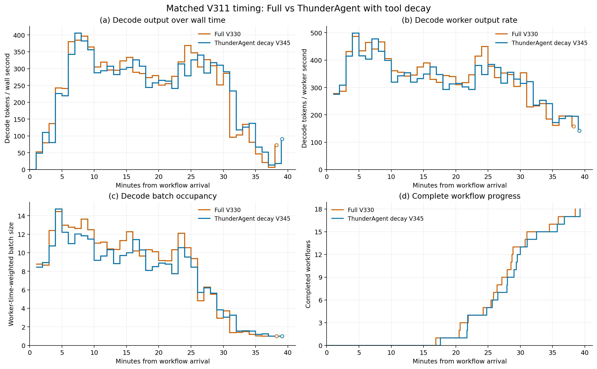

# V330 FULL 与 V345 工具衰减版完整对比

V345 于 2026-10-27 21:15:25 Asia/Shanghai 完成并释放全部 owned
进程。两个新鲜 idle 遥测快照、实际进程退出、完整回执、原生停止、
最终服务配置和相同工作量均已独立核验。
证据为 `experiments/reports/v361_v330_v345_complete_comparison_20261027.json`。

两轮使用相同 V230 工作：18 个不同项目、3674 个请求、
145565966 输入 token、549671 输出 token、72 次 JOIN，
相同 V311 工具时间表、原生树、Device/Host 容量与 seed21。
不使用此前中断的 ThunderAgent 部分回执，不排除任何正常长尾。

| 完整指标 | V330 FULL | V345 ThunderAgent 工具衰减版 | FULL 变化 |
| --- | ---: | ---: | ---: |
| 平均 workflow JCT/s | 1646.613 | 1697.584 | 降低 3.003% |
| Makespan/s | 2311.112 | 2355.345 | 降低 1.878% |
| 端到端输出吞吐/token/s | 237.838 | 233.372 | 提高 1.914% |
| Decode worker 输出率/token/s | 354.557 | 340.158 | 提高 4.233% |
| 普通平均 decode batch | 6.251 | 5.746 | 描述性统计 |
| Worker 时间加权 decode batch | 9.023 | 8.108 | 描述性统计 |

固定输出 token/makespan 仍称为端到端输出吞吐，不与 makespan
作为两项独立性能证据。Decode worker 区间包含运行时与等待，
不代表纯 CUDA kernel 吞吐。
18 个 workflow 中 FULL 的 16 个更快、2 个更慢，逐项保存在报告中；
同一共享服务轮次中的 workflow 不是 18 次独立重复实验。

这是一个完整匹配对比，方向为正，但改善幅度与重复证据尚不足以
认定达到“明显、可重复优于强对照”的目标。其他 baseline 暂不推进。

## 时序与分布

正式图位于 `experiments/figures/decode_diagnostics_20261027_v347/`。
橙色为 V330 FULL，蓝色为 V345 工具衰减版。

四个面板分别显示墙钟 decode 输出率、decode worker 输出率、
worker 时间加权 batch 与实际累计完成 workflow 数。
FULL 在部分前中段具有更宽的 batch，尾段两者均接近 batch=1；
这种相似尾部压缩了全程输出吞吐的差距。不能据图将尾部全部归因
于固定工具时间，也不能把同一时刻的 batch 当作等价工作。

- [时序 PDF](../../experiments/figures/decode_diagnostics_20261027_v347/decode_timeline.pdf)。
- [吞吐分布 PNG](../../experiments/figures/decode_diagnostics_20261027_v347/decode_distributions.png)
  / [PDF](../../experiments/figures/decode_diagnostics_20261027_v347/decode_distributions.pdf)。
- [共同 batch/context 分组 PNG](../../experiments/figures/decode_diagnostics_20261027_v347/decode_geometry.png)
  / [PDF](../../experiments/figures/decode_diagnostics_20261027_v347/decode_geometry.pdf)。
- [时间桶 CSV](../../experiments/figures/decode_diagnostics_20261027_v347/time_bins.csv)、
  [分组 CSV](../../experiments/figures/decode_diagnostics_20261027_v347/geometry.csv)、
  [证据 JSON.gz](../../experiments/figures/decode_diagnostics_20261027_v347/evidence.json.gz)。

固定 60 秒分桶，保留启动、空闲与全部正常长尾，最后不足一桶使用
实际时长。不平滑，不补终止后的零，不截共同尾部。
每臂 545997 个 decode 输出 token 全部逐桶对账。
分布按对应墙钟或 worker 时间加权，geometry 仍为粗分组的描述性比较。

## 恢复与排队

`experiments/reports/v360_v330_v345_matched_restore_churn_20261027.json`
按完整原生传输与请求 Host-hit 对账：

| 需求 H2D 归因/GB | FULL | 工具衰减版 |
| --- | ---: | ---: |
| 工具后继 | 2686.823 | 2137.059 |
| JOIN 后继 | 513.412 | 651.264 |
| 其他 | 23.156 | 20.720 |
| 全部 native demand | 3223.391 | 2809.042 |

FULL 另有 145.725GB tagged H2D，总 H2D 为 3369.116GB。
工具衰减版没有这部分受控拷贝。JOIN 的需求恢复减少，不等于 JOIN
总传输等量减少：部分传输移到了受控恢复路径。
工具后继需求 H2D 反而增加约 549.764GB，值得继续减少非必要的资格
切换与缓存重入，而不是仅增加预取量。以上均非唯一页数或可节省 JCT。

FULL 的全部 3474 个工具后继首服务均有证据，提交到首服务
P50 为 26.478ms、P99 为 17.736s，最大 295.057s。
5 秒以上的 127 个诊断等待共 2569.363s，其中采样 inactive
为 2429.185s、active 为 135.672s、未知为 4.506s。
72 个 JOIN 后继 P50 为 107.633ms，5 秒以上的三个等待合计
42.153s，均采样为 inactive。inactive 不能证明唯一原因或可移除 JCT。

40 个 FULL GPU 恢复等待采样的 P50 为 43.421ms、P90 为 253.161ms。
首个观测 FULL 依赖 P50 为 0.773ms，后续依赖合计 P50 为 42.296ms，
因此首个依赖到达不能保证后续等待完全被计算覆盖。
不对这些采样进行全轮扩张，也不把 instrumentation 区间当作纯计算。

对应报告为 V352 恢复等待、V353 JOIN 后继、V354 工具后继、
V355 JOIN 准入等待与 V356 工具准入等待。诊断阈值不改变主要 JCT。
