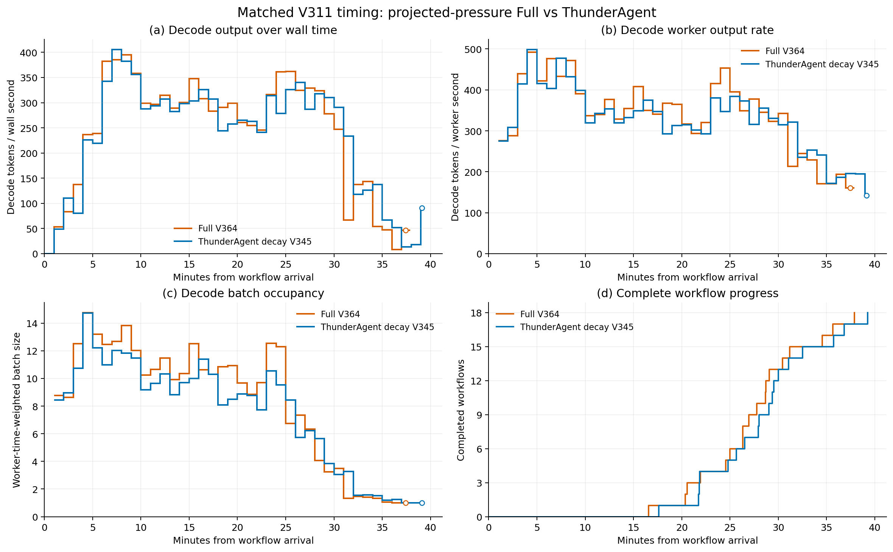
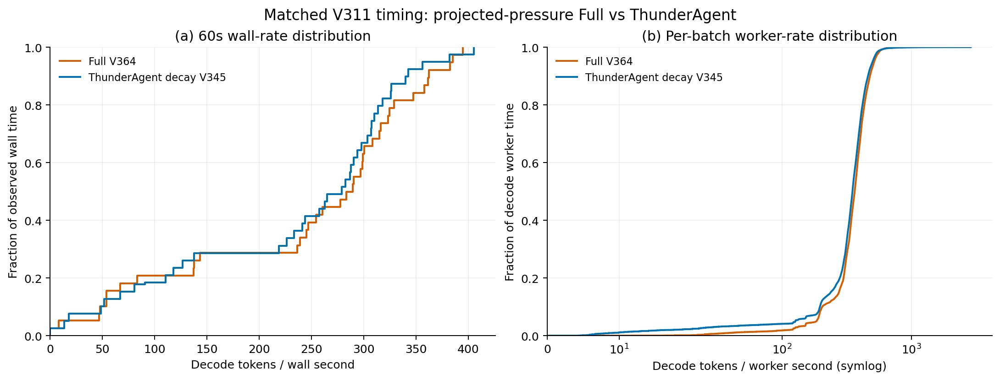

# 最新工具场景的完整 ThunderAgent 对照与 FULL 结果

工具衰减版 ThunderAgent V345 于 2026-10-27 21:15:25 Asia/Shanghai
完整完成。V364 FULL 于同日 22:20:47 完整完成。V373 独立核验完整
回执、原生停止、最终运行配置、两次新鲜 idle 遥测及实际 owned
进程退出；GPU 已释放。V330 中因预约停止的 ThunderAgent 部分结果
继续保留，不与 V345 拼接。

本轮对照已补全；后续只改变 FULL 时直接复用 V345，无需再跑相同
ThunderAgent。所有工作流正常长尾均保留，没有筛选更有利的子集。

## 公共实验条件

- 模型为 Qwen3-Coder-30B-A3B-Instruct，18 个不同项目、18 个 root。
- 完整工作为 3674 次模型请求、145565966 输入 token、
  549671 输出 token、92 个 child、72 次 JOIN。
- 使用 V230 原始请求和依赖、同一 V311 类别可见合成工具时间表；
  931 次 execute 使用留出的 TraceLab WebFetch/WebSearch 时长，
  另外 2543 次工具调用仍保留原始时长。合成工具时间不称为自然时长。
- 在线策略只看到调用时已知的类别和已完成历史，看不到未来采样时长。
- Device FULL 为 805198 token，Host 为 200000077824 bytes；
  running/decode 上限为 24，服务、采样与 Python hash 种子均为 21。
- 使用相同原生树 `11b84f7c31986782be3fbe699bae2574ef092389`、
  page_first/kernel HiCache、position 重放、原生停止及流式计时。
- 对照仅为 `thunderagent_acting_decay`，保留公开实现的一秒半衰期
  ACTING 预算衰减、未衰减压力检查和原生物理容量权限，没有注入 FULL
  的 JOIN、预测、备份或预取策略。

## 完整性能

| 指标 | V345 工具衰减 ThunderAgent | V330 FULL | V364 FULL |
| --- | ---: | ---: | ---: |
| 平均 workflow JCT/s | 1697.584 | 1646.613 | 1641.531 |
| Makespan/s | 2355.345 | 2311.112 | 2272.948 |
| 端到端输出/token/s | 233.372 | 237.838 | 241.832 |
| Decode worker 输出/token/s | 340.158 | 354.557 | 357.858 |
| 普通平均 decode batch | 5.746 | 6.251 | 6.344 |
| Worker 时间加权 decode batch | 8.108 | 9.023 | 9.096 |

V364 相比 V345，完整平均 JCT 下降约 3.30%，makespan 下降约 3.50%，
端到端输出吞吐提高约 3.63%，decode worker 输出率提高约 5.20%。
相比 V330，V364 平均 JCT 只下降约 0.31%，端到端输出吞吐提高约
1.68%。V330 与 V364 是不同配置，不构成同一策略的两次独立重复。
18 个 workflow 中 17 个改善、1 个退化，逐项差异保存在 V373，
不排除退化的 workflow。

这些结果方向为正，但幅度和重复证据仍不足以认定实现了“明显、
可重复优于强对照”。其他 baseline 和总体目标继续保持未完成状态。
固定输出量除以 makespan 是端到端吞吐，与 makespan 不是两项独立
证据；decode worker 区间包含运行时与等待，也不是纯 kernel 吞吐。

## 吞吐趋势与分布

橙色为 V364 FULL，蓝色为 V345 工具衰减 ThunderAgent。

固定 60 秒分桶，保留初始准备、空闲和全部正常尾部；最后不足一桶
按实际时长计算，不补终止后的零，不平滑，不按共同结束时刻截尾。
每臂 545997 个 decode 输出 token 均逐桶对账，另 3674 个 token
来自对应请求的 prefill。worker 分布按实际 worker 区间加权。
中段 FULL 的 batch 较宽，但两者末段都降至接近 1，不能将尾部全部
归因为固定工具等待，也不能用一个峰值代表全程性能。

- [时序 PDF](../../experiments/figures/decode_diagnostics_20261027_v366/decode_timeline.pdf)。
- [分布 PDF](../../experiments/figures/decode_diagnostics_20261027_v366/decode_distributions.pdf)。
- [共同 batch/context 分组](../../experiments/figures/decode_diagnostics_20261027_v366/decode_geometry.png)：
  宽分组仅为描述性比较，不构成严格同计算量的因果证明。
- [时间桶 CSV](../../experiments/figures/decode_diagnostics_20261027_v366/time_bins.csv)、
  [完整图表证据](../../experiments/figures/decode_diagnostics_20261027_v366/evidence.json.gz)。

## 仍需优化的迁移

V372 按原生传输与请求 Host hit 对账，GB 均为十进制。

| H2D/GB | V345 工具衰减 ThunderAgent | V330 FULL | V364 FULL |
| --- | ---: | ---: | ---: |
| 工具后继原生需求恢复 | 2137.059 | 2686.823 | 2747.670 |
| JOIN 后继原生需求恢复 | 651.264 | 513.412 | 558.696 |
| 全部原生需求恢复 | 2809.042 | 3223.391 | 3330.043 |
| 受控恢复 | 0 | 145.725 | 104.218 |
| 总 H2D | 2809.042 | 3369.116 | 3434.262 |

V364 工具后继需求 H2D 比对照多约 28.57%，说明当前小幅加速并非来自
工具迁移总量下降。JOIN 原生需求恢复减少也不代表总传输等量减少，
部分工作移到了受控恢复路径。拷贝字节不是唯一物理页数，也不能
直接换算为可移除的 JCT。

V364 实际记录 505 次逻辑暂停，其中阻塞预算借出 416 次、JOIN 借出
预算归还 70 次、压力 ACTING 暂停 16 次、计划压力暂停 3 次。这些是
控制计数，不是一对一的物理迁移归因。下一步应优先审计借出与召回
期间的工具后继恢复和有效执行机会，而不是只为减少这 3 次标记追加
GPU 轮次，或为了增加预取覆盖而驱逐 ready agent。

## 代码与证据边界

V364 冻结于 `0127655243099ed9ac45631e7321c7462180776a`，
只验证了 `projected_release` 压力标记数量约束。之后实现的
“真实缺口消失或缩小时撤销本模块旧标记”修复没有包含在这轮中；
其 2951 项共享 CPU 检查及 4 个子测试均通过，没有失败或跳过，
尚无新 GPU 性能结论。

- 完整比较：`experiments/reports/v373_v364_v345_complete_comparison_20261027.json`。
- 比较脚本：`ops/compare_v364_complete_20261027.py`，摘要写入 V373。
- 完整迁移：`experiments/reports/v372_v330_v364_v345_matched_restore_churn_20261027.json`。
- 后续修复资格：`experiments/reports/v371_pressure_plan_revalidation_cpu_evidence_20261027.json`。
- [设计与 CPU 边界](../design/projected_pressure_release_20261027_zh.md)、
  [冻结启动记录](v364_projected_pressure_start_20261027_zh.md)。
