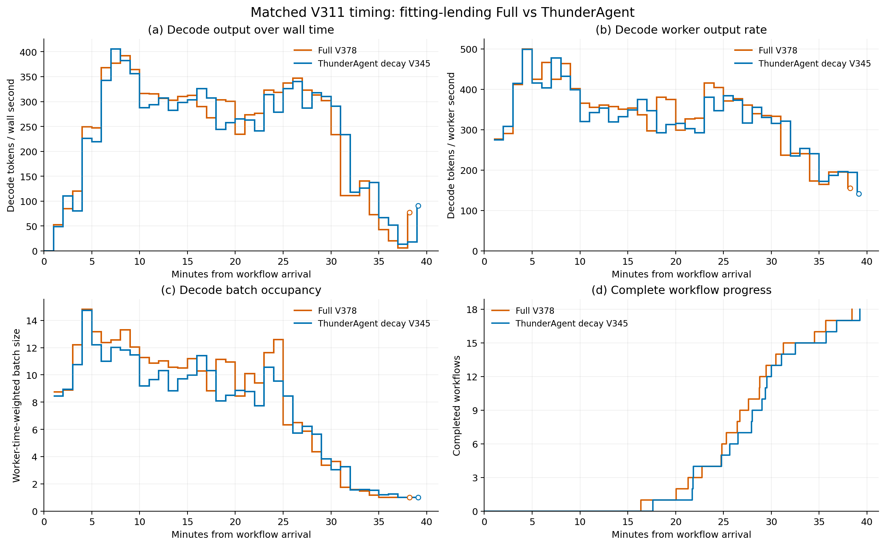
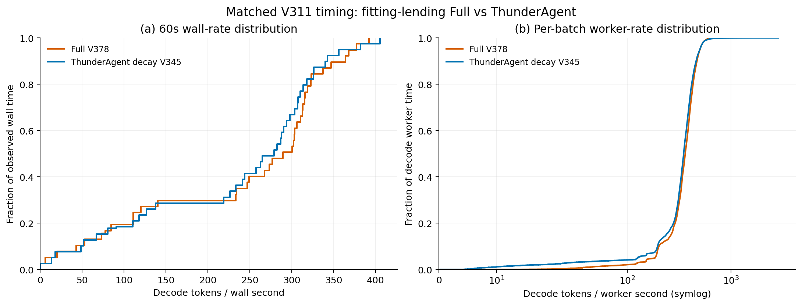

# V378 完整结果与工作集切换的贡献边界

用户指出，借出逻辑本质上仍是工作集切换，并且比 ThunderAgent
增加了复杂度，不能包装为创新点。该判断成立。实际
`lend_backed_blocked()` 在检查候选后调用 `_pause(donor, now)`，
再调用 `_activate_target(...)`。记录借出关系、按 JOIN 召回以及
按缺口选择预算，改变的是工作集切换的选择和记账，没有增加新的
物理迁移原语。这些机制归为工程实现，不作为独立论文贡献。

V378 于 2026-10-27 23:57:16 Asia/Shanghai 完整结束。V388 独立核验
全部工作、最终配置、两次新鲜 idle 遥测及实际 owned 进程退出。
CPU 图表后处理也已完成并退出；没有新的 GPU 实验排队。

## 匹配条件与完整性能

三组均使用 V230 的 18 个不同项目、3674 次请求、145565966 输入
token、549671 输出 token、72 次 JOIN 和原生停止，保留全部正常长尾。
共同使用 V311 类别可见合成工具时间：931 次 execute 替换为留出
TraceLab WebFetch/WebSearch 样本，另外 2543 次工具时长保持原值。
在线策略看不到未来时长。原生树、容量、种子 21、position 重放和
流式计时一致；V345 为工具衰减版 ThunderAgent。

| 完整指标 | V345 ThunderAgent | V364 FULL | V378 fitting FULL |
| --- | ---: | ---: | ---: |
| 平均 workflow JCT/s | 1697.584 | 1641.531 | 1644.824 |
| Makespan/s | 2355.345 | 2272.948 | 2307.271 |
| 端到端输出/token/s | 233.372 | 241.832 | 238.234 |
| Decode worker 输出/token/s | 340.158 | 357.858 | 354.220 |
| Worker 时间加权 decode batch | 8.108 | 9.096 | 8.930 |

V378 相比 V345，平均 JCT 下降 3.10793%，端到端输出吞吐提高
2.08357%；16 个 workflow 改善、2 个退化。相比 V364，平均 JCT
增加 0.20057%，吞吐下降 1.48758%。没有证据表明新增复杂度带来
增量收益，不能以这轮小幅单次改善认定明显、可重复优于强对照。

V378 包含 V364 没有的后续压力标记复核修复，因此两者不是只改变
fitting 的严格消融，也不是同一配置的独立重复。当前结果既不证明
fitting 单独造成退化，也不支持晋级 fitting。

## 传输与逻辑选择

GB 均为十进制；原生需求恢复按请求 Host hit 与传输总量对账，
不是对单次逻辑切换的物理因果归因。

| H2D/GB | V345 ThunderAgent | V364 FULL | V378 fitting FULL |
| --- | ---: | ---: | ---: |
| 工具后继原生需求恢复 | 2137.059 | 2747.670 | 2586.181 |
| JOIN 后继原生需求恢复 | 651.264 | 558.696 | 553.673 |
| 全部原生需求恢复 | 2809.042 | 3330.043 | 3163.682 |
| 受控恢复 | 0 | 104.218 | 106.583 |
| 总 H2D | 2809.042 | 3434.262 | 3270.265 |

V378 总 H2D 比 V364 少约 4.78%，工具后继需求恢复少约 5.88%，
但 JCT 和吞吐没有改善；工具后继需求恢复仍比强对照多约 21.02%。
减少传输字节本身不能代替减少暴露在关键路径上的恢复等待。

V387 验证完整 383 次 fitting 决策。在每次记录的相同合格候选上，
实际选择合计 29939111 token，原顺序足额前缀为 38699581 token；
实际选择 491 个 owner，原顺序为 466 个。预算较少可能涉及更多
owner。这个局部反事实不是旧策略的完整重放或性能证据。

V378 实际逻辑暂停 568 次，V364 为 505 次；阻塞预算切换对应
491/416 次 donor 暂停，JOIN 召回对应 44/70 次暂停。V390 将
实际切换与后续请求关联，但不能证明某次切换造成某次物理驱逐，
也不能把关联的恢复字节直接换算成可移除 JCT。

## 完整吞吐图表

橙色为 V378 FULL，蓝色为 V345 工具衰减版 ThunderAgent。

保持固定 60 秒分桶、实际尾桶时长、全部准备/空闲/正常尾部和实际
worker 区间权重，不裁共同结束时刻、不补终止后零值。
固定输出量除以 makespan 是端到端吞吐；worker 区间含运行时和等待，
不是纯 kernel 吞吐。共同 batch/context 图只提供描述性比较。

- [时序 PDF](../../experiments/figures/decode_diagnostics_20261027_v380/decode_timeline.pdf)。
- [分布 PDF](../../experiments/figures/decode_diagnostics_20261027_v380/decode_distributions.pdf)。
- [Batch/context 图](../../experiments/figures/decode_diagnostics_20261027_v380/decode_geometry.png)。
- [时间桶 CSV](../../experiments/figures/decode_diagnostics_20261027_v380/time_bins.csv)。
- [图表证据](../../experiments/figures/decode_diagnostics_20261027_v380/evidence.json.gz)。

## 后续边界

`largest` 默认保持不变，fitting 保留为显式候选和完整实验记录。
停止沿借出、召回、fitting 继续增加变体或更换名称作为创新点。
已有 JOIN/EOS 预取、工具预测卸载和增量备份也需要各自的机会、
实际恢复重叠及完整 JCT/吞吐证据，不能因使用 workflow 信号就
自动成为新的贡献。

继续研究前，需要明确强 ThunderAgent 对照仍暴露了什么传输等待，
以及在相同容量和工作量下，何种机制可以降低该等待而不增加切换、
重算、计算干扰或就绪请求等待。该问题目前尚未得到充分验证；
本记录不宣称新的设计已成立。总体目标仍未完成，其他 baseline
继续等待明确且可重复的完整工作改善。

## 证据

- V386：`experiments/reports/v386_v378_v364_v345_matched_restore_churn_20261027.json`。
- V387：`experiments/reports/v387_v378_fitting_decisions_complete_20261027.json`。
- V388：`experiments/reports/v388_v378_v364_v345_complete_comparison_20261027.json`，
  绑定实际比较脚本、配置、完整工作、清理证据及图表输入摘要。
- V390：`experiments/reports/v390_v378_lending_handover_cost_complete_20261027.json`。
- [冻结启动记录](v378_fitting_lending_start_20261027_zh.md)。
- [工程候选与 CPU 验证](../design/fitting_blocked_agent_lending_20261027_zh.md)。
