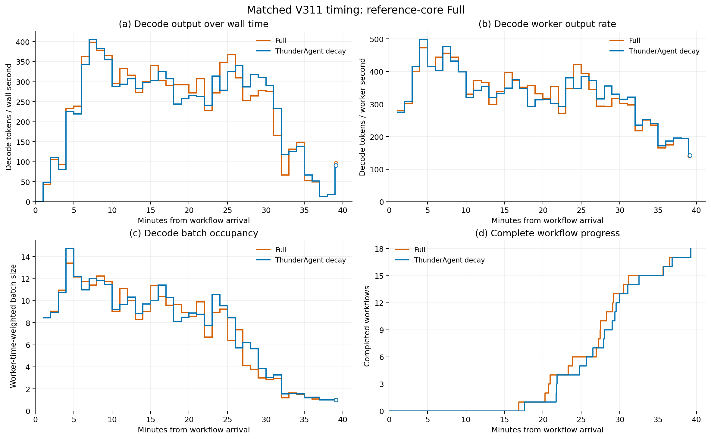
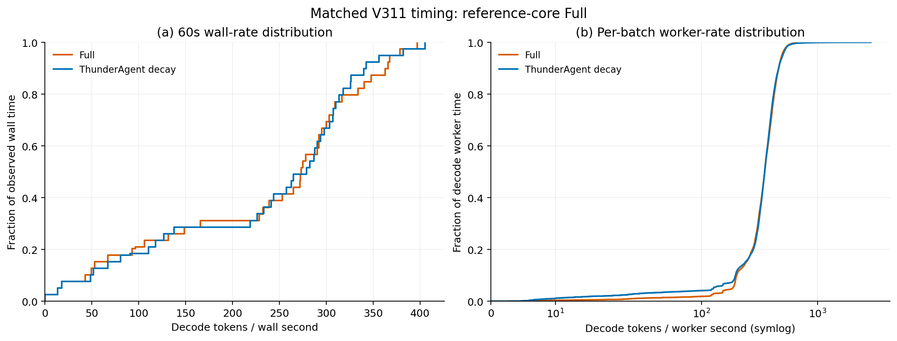

# V400b：参考 ThunderAgent 准入与既有 KV 迁移

V400b 已完整结束并完成独立复核。它直接使用工具衰减版 ThunderAgent 的
参考准入核心，接入已有 JOIN/EOS 预取、条件工具预取、增量备份、
预测长工具卸载和执行连续性；逻辑借出、召回及额外恢复资格均关闭。
该组合用于检验迁移机制的完整收益，不作为新的调度算法贡献。

平均JCT改善2.87157%，全程输出吞吐只提高0.03702%，未达到明确、
可重复的双指标提升目标。没有启动其他baseline或新GPU实验。

## 完整结果

两组均完成全部18个workflow、3674请求、145565966输入token、
549671输出token及原生停止；没有排除正常长尾。两个新鲜idle快照、
实际owned进程退出及完整图表输入摘要均已复核。

| 完整指标 | V345 ThunderAgent工具衰减 | V400b参考核心FULL |
| --- | ---: | ---: |
| 平均workflow JCT/s | 1697.584 | 1648.836 |
| Makespan/s | 2355.345 | 2354.473 |
| 全程输出/token/s | 233.372 | 233.458 |
| Decode worker输出/token/s | 340.158 | 344.282 |
| Worker时间加权decode batch | 8.108 | 7.994 |
| 总H2D/十进制GB | 2809.042 | 2679.208 |
| 总D2H/十进制GB | 2255.863 | 1275.027 |
| Workflow TTFT均值/s | 139.028 | 135.177 |
| 每workflow最大后续就绪输出间隔的均值/s | 73.449 | 81.262 |

17个workflow JCT改善，web_social退化25.491秒，均保留。固定输出下，
makespan只缩短0.872秒，因此全程吞吐几乎持平。完整时序和时间加权
分布没有显示持续明显领先；不能以局部高吞吐区间替代全程结果。

原生需求H2D为2645.000GB，受控恢复为34.208GB，两者严格对账到
2679.208GB。工具后继原生需求恢复为1999.317GB，对照为2137.059GB；
JOIN后继为621.804GB，对照为651.264GB。减少传输字节没有建立明显
吞吐收益。额外预测工具卸载仍未记录实际释放；压力触发的工具释放
计数211与该路径不同，不能混报。下述后续候选修复不在本轮中。

实际最后完成依赖路径的平均提交到首个native forward区间从393.951秒
降到361.743秒，首个forward到请求完成从877.326秒降到861.142秒。
区间包含交错执行、运行时及等待，各臂的阻塞路径可能不同，不能作为
单一迁移机制的因果收益或纯GPU时间。

最后完成的mobile_game在两组的实际关键路径上均有201个请求，其中
195个工具后继、2个JOIN后继及4个其他请求。FULL的该路径提交到首次
执行累计642.827秒，对照573.594秒，增加69.234秒；首次执行到完成
累计803.858秒，对照873.232秒，减少69.374秒，两者几乎抵消。
该路径外部工具边约853秒；FULL两个JOIN后继的首次执行前等待合计
仅0.179秒，首次执行到完成合计6.132秒，后者也不是纯传输。
因此后续应先定位工具后继和普通请求的实际排队差异；目前没有证据
将69秒增加直接归因于resident-first、连续性或某个单独策略。

逐请求对齐确认两组该路径的201个请求及顺序完全相同。最大的单项
差异在epoch38：同一约3.015秒工具之后，FULL提交到首次执行194.641秒，
对照0.088秒；FULL服务时Host命中128239 token，对照完全Device命中。
FULL的该请求只有100个输出token。194秒不是12.606GB恢复的拷贝时间，
也不能由服务时的缓存位置反推其刚入队时的位置。
该区间191个运行时快照中，native_NO_TOKEN仅从189增加到190，
native_admitted从1019增加到1317，且出现持续的逻辑待准入需求。
这支持优先检查资格等待，但旧快照不含逐agent身份，不能断言该
请求全程inactive。完整对齐代码和输入摘要保存在同目录
`tail_request_waits.py/.json`。

后续Full增加每秒状态快照中的真实active、paused-pending和
marked-for-pause身份，以及未衰减逻辑预算；不更改参考策略、事件
或native数据面，不为旧快照补造字段。32-program固定CPU夹具中，
完整status构造中位数10.691微秒、P99为13.734微秒，parent aggregate
分别3.817及4.720微秒；这些只度量快照构造，不是完整控制成本。
记录见`experiments/reports/v400b_followup/snapshot_cpu_cost.py/.json`。
下一次完整运行将同时验证已修复的卸载受益者选择和实际资格轨迹，
仍复用V345，不改变工具时间、工作量、容量或优先级参数。

21个采样恢复批次的层等待累计4301.750ms，对照18个样本为2662.835ms。
样本请求和批次组成不同，既不能按采样间隔扩张，也不能用累计值
直接宣称恢复变慢。全部样本和分组保留在同一实验的附属记录中。

完整复核和实际分析代码：
`experiments/reports/v400b_followup/complete_review.json`及同名`.py`。
传输、关键路径、采样等待分别位于该目录的`complete_restore_churn.json`、
`complete_jct_paths.json`和`complete_sampled_restore_waits.json`。
图表保留固定60秒分桶、实际尾桶及所有正常尾部，不补结束后零值。

## 冻结与对照

- 注册：`ops/v400b_locobench_reference_thunder_offload_20261027.registration.json`。
- 冻结应用：`a5e31ae7464fa9fe06e2e00f3c9c244e619c28ff`；
  运行时修复在 `7fe941c0dfdfad05a01f24add6cb43e3549d87ea`。
- 实际原生树：`11b84f7c31986782be3fbe699bae2574ef092389`。
- 配置：`configs/migration/predictive_reference_thunder_20261027.json`。
- 端口18659，socket `/tmp/bkv-causal-18659.sock`。
- 运行目录：`experiments/raw/locobench_reference_thunder_offload_20261027_v400b/full/`。
- 已核验 watcher163362、server163860、driver165104 的真实身份、
  父子关系和 nice0，保留登记的 start ticks。

只运行 FULL，复用完整 V345 `thunderagent_acting_decay`。V401 逐项
核验26个共同字段，包括完整工作图/token摘要、V311工具时间表、
原生树、实际容量、种子、running上限与流式计时。共同工作为18个
不同项目、3674请求、145565966输入token、549671输出token、
72次JOIN，保留原生停止及全部正常长尾。

## 验证边界

V399 一次通过3035项共享 CPU 检查和4个子测试，保留先前全部3030个
case身份；新增组合检查使用真实 native FULL-only tree/allocator
配合copy/event替身，验证预测卸载释放物理槽而不改变参考工作集。
三个实际构造器与全部源码摘要均已绑定。

启动时V401仅封存198条已完成回执，均与完整 V345 的请求/token/停止
条件一致。回执、运行时和status前缀不是同一原子时刻，当时没有
完整性能结论。现在全部3674条回执及最终配置均已验证，物理控制
健康、关闭逻辑借出/召回、无paper adapter混入；重复性能仍未验证。

V396b 因旧卸载器读取 `.policy.agents` 停止的99条回执及失败现场
保留，不能与本轮拼接。V400 在GPU serving前因旧socket保护停止，
同样保留。启动与修复过程见[前置记录](v396_reference_thunder_preflight_20261027_zh.md)。

## 完成后的吞吐图表

V402 CPU后处理已完成并退出；实际进程167057使用nice19、隐藏CUDA。
它在本轮完整成功、原生遥测收尾和实际owned进程退出后调用冻结
绘图脚本，与完整V345生成固定60秒时序、时间加权分布及batch/context图。
保留准备、空闲和正常尾部，不补终止后零，整个过程未启动新GPU实验。

- 操作器：`scripts/deferred_causal_decode_plots.py`。
- 状态：`ops/v402_reference_thunder_decode_plots_20261027.state.json`。
- 完成后输出目录：`experiments/figures/decode_diagnostics_20261027_v402/`。
- CPU进程与源码绑定：`experiments/reports/v402_reference_thunder_decode_waiter_start_20261027.json`。

目前没有后续GPU实验排队。完整平均JCT及全程输出吞吐须同时得到
明确、可重复改善后，才继续其他baseline；全局目标仍未完成。

## 运行期间发现的后续修复

主工作区发现 reference 模式的工具卸载候选选择缺陷：先选中第一个
需要从Host恢复前缀的请求，随后才检查活跃资格和实际容量缺口。该请求
未获准入，或者当前空间已经足够时，会挡住后续真正需要容量的请求。
修复仅在 reference 模式下提前执行现有资格和需求检查，仍只检查
最多8个候选，每200ms一次。预测门槛、逐节点重新授权、原生锁、
Host 副本、实际释放边界和参考调度核心均保留。

两个反例使用真实 native FULL-only tree/allocator，配合已有
copy/event/Host-index替身；修复前均失败，修复后相关242项CPU检查
全部通过，无跳过。反例确认释放32个Device槽、保留Host副本且不改变
参考program状态。报告归于
`experiments/reports/v400b_followup/`，不新增主实验编号。
后续完整共享回归在一次执行中通过3038项及4个子测试，保留此前
全部3035个case身份；实际Full及两种ThunderAgent构造器保持隔离。
早期测试夹具的请求与图身份不一致，未覆盖该缺陷，其报告保留并明确
排除为复现证据。这里没有证明该缺陷在V400b中的发生次数或性能影响。

该修复不在冻结的V400b中，不能归因于本轮结果。当前运行继续使用
`a5e31ae7464f`，没有热更新、重启或安排新GPU实验。逐层卸载A并复用
空间加载B的分层分配器仍未实现，相关状态见
[容量流水线设计](../design/workflow_service_and_layer_recycling_20261026_zh.md)。

## 证据

- `experiments/reports/v399_reference_thunder_offload_cpu_evidence_20261027.json`。
- `experiments/reports/v401_reference_thunder_offload_live_start_20261027.json`。
- [组合设计与完整历史诊断](../design/reference_thunder_migration_composition_20261027_zh.md)。
