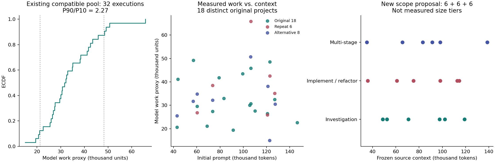

# 工作量混合负载准备

本文落实新的负载选择与到达要求。保留的原 Full 仍关闭 workflow 工作量排序，
工具预取、普通预取、物理逐层 handoff 和 mixed chunk 继续关闭。新候选先采集
自然轨迹，不根据 predictive 是否获胜决定保留哪些任务。

## 已有完整轨迹的审计

入口是 `scripts/prepare_workflow_mix.py`，核心逻辑位于
`beliefkv/experiments/workload_mix.py`。清单重新读取完整原生 token、请求边界和
因果 DAG，不用历史 JCT 代替工作量，不拼接或截断 workflow。不同项目通过原始
`Project:` 身份校验。声明的执行协议按模型、委派协议、软预算、上下文策略、
采样设置等分组，不把运行并发数、端口、到达时间当作任务执行协议。
这不是所有历史系统提示词字节完全相同的证明。

审计了 V174、V181、V187、V195、V230 及两次额外训练采集，共 110 条完整
自然来源执行。当前短工作流协议下只有 V230 的 18 条、补采的 8 条和匹配的
6 条满足至少一次有两个真实服务 child 的完整 root JOIN。

| 当前兼容池 | 实测值 |
| --- | ---: |
| 完整执行 / 不同项目 | 32 / 18 |
| 模型工作量 P90/P10 | 2.2733 |
| 模型工作量最大/最小 | 4.3910 |
| 生成 token P90/P10 | 2.3229 |
| 请求数 P90/P10 | 2.1337 |
| JOIN / 嵌套 JOIN | 136 / 0 |

模型工作量保持原来的 `0.01 * 必要新增输入 + 实际输出` 代理，不能解释为精确
GPU 秒。必要新增输入由同 context 已完成输入及输出的真实公共前缀计算，初始
输入单独列出。源 JCT 只作描述，不参与长短分层。

连允许重复项目的整个池的最大/最小都不到 5，因此不能从中选出 P90/P10 达到
5 的项目互斥子集。历史较短的单 child 或未委派 root 保留在清单中，但不能为
扩大倍率而混入当前执行协议。这是补充自然候选的依据，不是把 5 倍变成硬性
有效性门槛；如果较窄的混合池具有充分真实容量竞争，也应保留并说明。

最初 `inventory_r1` 错把 `JOIN_CREATE.invocation_id` 当作 parent，导致全部
未通过并行结构检查。真实 parent 位于 `JOIN_WAIT`；已修复并增加覆盖嵌套、
并行工具与真实 JOIN 父节点的测试。失败清单保留，使用后续完整清单作证据。

## 新的原始任务候选

已准备 `configs/workloads/locobench_mixed_scope18_20261029.json`：

- 18 个 workflow 来自 18 个原项目，继续使用已修复的工具 runtime 和现有环境。
- 原始 bug investigation、实现/重构、多阶段 development 各 6 条。
- 按项目原始上下文排序，每三个相邻项目构成一个上下文区间，每区间分配三类
  各一个，再用独立种子打乱注册顺序。避免预计短任务全是小上下文。
- 分配种子 21、注册排列种子 22；模型、采样及 Python hash 种子仍为 21。
- 三类使用相同执行协议：child 4/8 提醒与软目标、root 分阶段 8/16，
  至少一次真实的两个 direct child 并行 JOIN，鼓励有效多轮与嵌套，不固定 DAG。
- 只使用原始 title、description、task_prompt；答案、expected approach 和
  evaluation criteria 不传给 agent。项目源码、测试、依赖、工作目录均不修改。

此处三类是**任务范围假设**，不是观测到的短、中、长标签。新自然轨迹完成后，
按实际生成量、必要新增输入和请求数的平均百分位排序，划分各 6 条；工具时间
另列。报告 fanout、真实多轮与嵌套数量；不通过减少输出上限或删除长尾凑倍率。
若自然任务仍不够异构，保留结果后扩展原始候选，不重复复制同一项目。

新源配置为 `configs/migration/workflow_mix_scope18_native_20261029.json`，
只运行 native 采集。仍使用 Qwen3-Coder、BF16 KV、200GB Host、2048 prefill
chunk、24 running/decode；工作量排序没有进入采集策略。新源及其采集时的 native
结果可以复用，不再追加一次相同 native 完整重放。改变到达方式后则必须有相应
匹配的对照，不能沿用旧 V230 数值。

## 到达和容量竞争

快速诊断采用 18 条完整 workflow 同时到达，选定 population 后用固定种子 21
再次打乱重放排列。`burst_arrivals` 已能冻结所有实际 workflow ID 与 0 秒偏移，
到达校验支持这个新声明，旧 Poisson 格式保持原行为。
新重放会按声明的排列投递同时到达的 `WORKFLOW_START`，不是只打乱 JSON 中的
显示顺序；后续请求仍受原依赖、实际工具时间和模型返回约束，不强制每个请求
都按 root 排列执行。Poisson 新增独立排列格式，旧到达表的校验合同保持不变。

主实验暂不填一个任意到达率。计划初始 5 条，然后用另一随机源 seed 22 的
Poisson 间隔到达。先从相同 population 的完整 burst 对照估计
`lambda = 0.9 * N / makespan`。这是有限任务池的承载能力近似，不是已测稳态
90% 利用率；必须继续检查 GPU 空闲、有效 HBM 工作集、真实迁移和队列竞争。
如果提交窗口过长或压力消失，再根据这些数据调整，并记录新的配置身份。
不默认沿用 120 秒，也不同时启动多个到达率以扩大实验周期。

到达标定绑定源执行的 event、token 文件指纹及项目，不只绑定逻辑 workflow ID；
同一个 ID 的两次自然执行不能混用控制结果。排列种子与到达种子分离，
任务大小不决定到达槽位。提交窗口结束后排空全部任务，JCT 从计划到达计到完成。

真正的机制诊断是：恢复空位出现时，同一原恢复类别里存在不同 workflow 的
ready-paused 短长候选，每个候选单独可以容纳，但合计不能容纳。
`capacity_competition` 已提供这个局部逻辑检查，先扣更高类别按原排序消耗的额度，
包括原 buffer，排除未 ready 的工具等待者、超大单个候选和同 workflow 假竞争。
它不是物理 HBM 可行性证明。GPU 实验还要记录原生状态、选中后压力撤销、
最终真实服务、等待变化和控制 CPU，不能把局部排序变化次数当作 JCT 因果收益。

先保持一套 population、排列和种子做开发。正式复验再改变排列/种子，
保留长任务先到、短任务先到和轻载作为后续边界实验。

## 工具时间与预测输入

后续排序的目标应是包含模型服务及工具等待的**剩余关键路径**，串行阶段相加、
并行分支取 max；不能简单将 workflow 内所有工具墙钟时间相加。工作量分层和
排序目标也要区别：分层描述工作量异构，排序还要估计工具等待及其依赖位置。
已发生的排队等待不能再加入剩余工作，否则会重复计费。

未来工具时长和 DAG 只供明确标识的 oracle 读取。可部署模型只能看到当前已知
任务、实际委派、角色、已完成服务和当前工具观测。TraceLab 合成时间继续区分
可观察类别和隐藏时长；不能把私有样本时长或未来工具序列泄漏为输入。
如果新采集使用真实工具时间、后续性能实验再引入 timing overlay，需要单独冻结
overlay，并相应重建 oracle/训练标签，不能把自然工具标签当成合成时长真值。

本次补齐了采集侧的受限语义输入 `workflow_task_and_delegation_metadata_v1`：

| 字段 | 来源与上限 |
| --- | --- |
| `task_instructions` | 原始任务说明，4096 字符 |
| `delegation_instructions` | 实际 task 调用的委派说明，512 字符 |
| `agent_role` | runtime 声明的角色，128 字符 |
| 截断标记 | 三个布尔值，记录边界截断 |

root 开始和 child 创建时各记录一次，直接来自任务/委派参数，不解码完整 prompt，
不包含仓库源码、工具输出、未来 token 数或未来 DAG。解析器拒绝额外字段；
现有线上旧模型仍使用旧输入合同，**本次没有训练或启用新的工具感知工作量模型**。

后续先用新负载的 model+tool oracle 检查排序是否有足够空间，同时修复原 oracle
反复扫描 DAG 的开销再声称其接近低开销理想信息上界。已有旧负载 oracle 平均
JCT 相对原 Full 仅改善约 0.75%、全程吞吐下降约 0.94%，不能作为推广依据。
小模型和稍大 CPU 模型在同一完整执行划分及受限输入上比较，主要看真实竞争
pair 的排序错误、长误判短、控制开销及最终 JCT；不只看总体分类准确率。

## 执行入口

`experiments/reports/workflow_mix_20261029/` 保存声明、CPU 检查、注册和采集后的
只读审计入口。`finish_capture.py` 等待完整 token/因果结果、两份新鲜 idle 遥测
及全部所属进程退出，再生成实际分层、上下文交叉报告及固定 burst 到达表。
该 CPU 收尾程序不注册下一轮 GPU 实验。

当前准备不能证明已经形成足够容量竞争，也不能证明新预测器或调度优于对照。

`bound_cpu_r2` 实际通过 5,204 项测试及 12 个子测试，保留此前全部 5,178 项
测试身份，无失败、错误或跳过；原生 engine 字节未改。18 个项目的 live root/
child 工具配置、镜像、源码提交、上下文和 runtime 环境共 39 项输入也已核对。
此检查没有要求准备阶段修复任务本身的测试断言。
